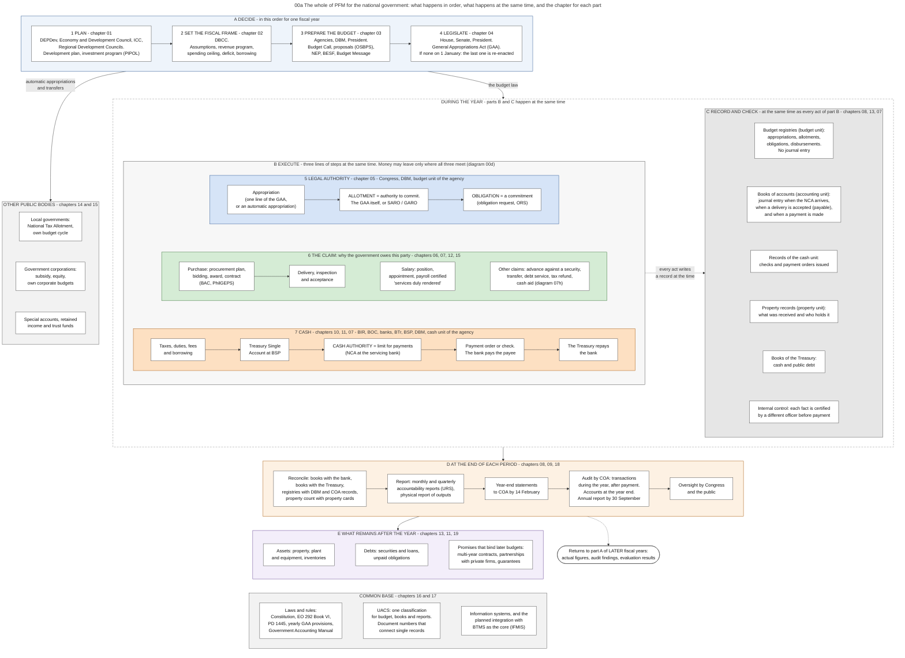
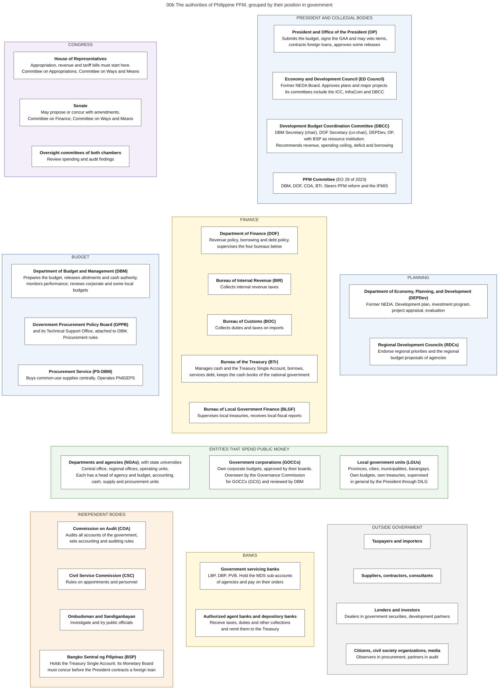
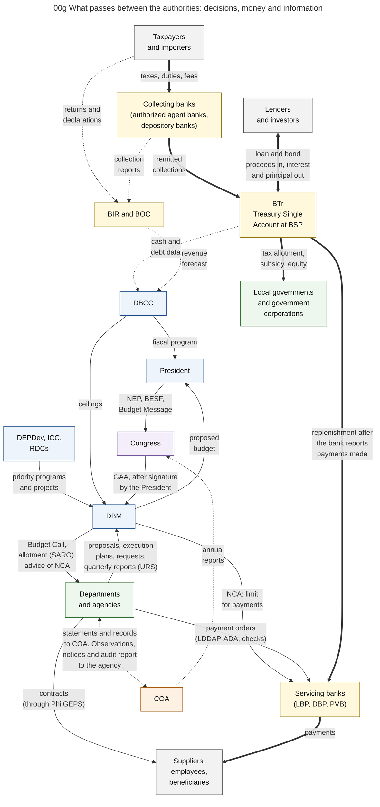
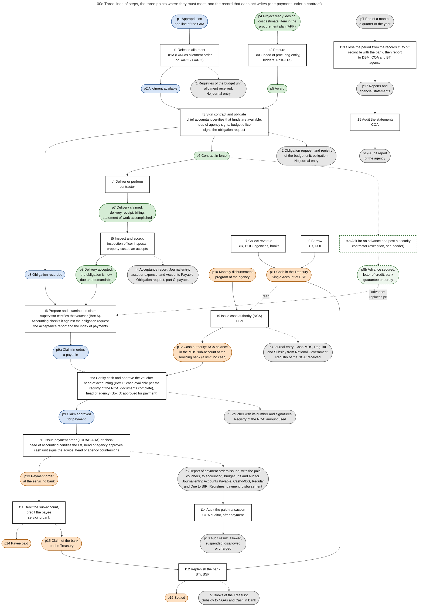
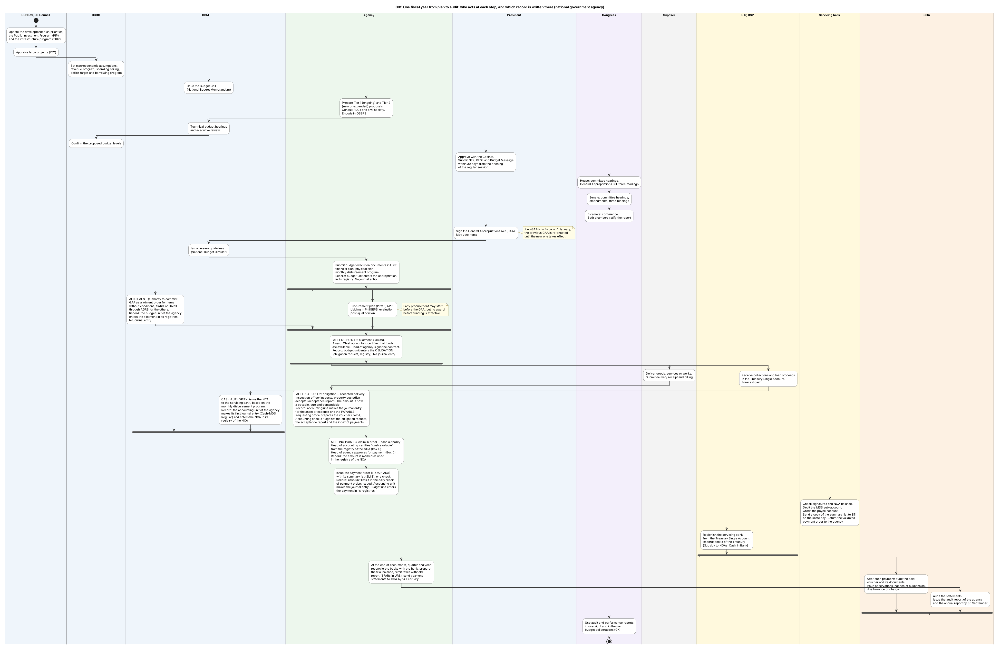
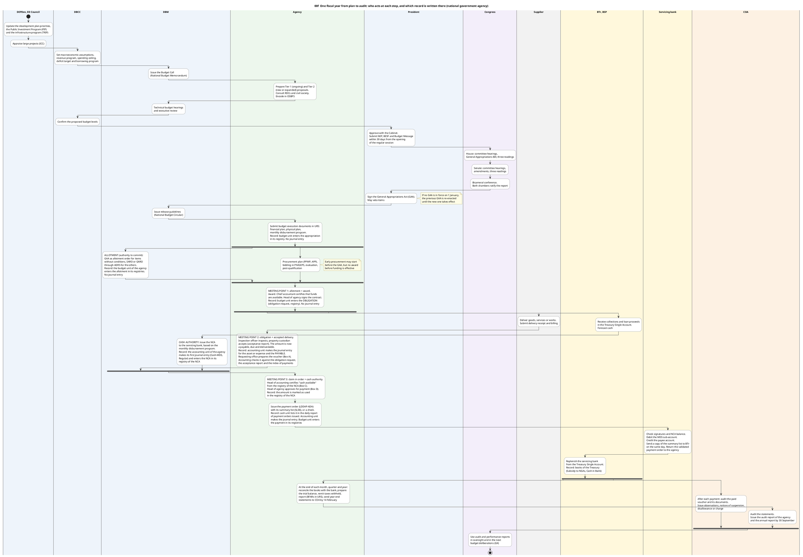
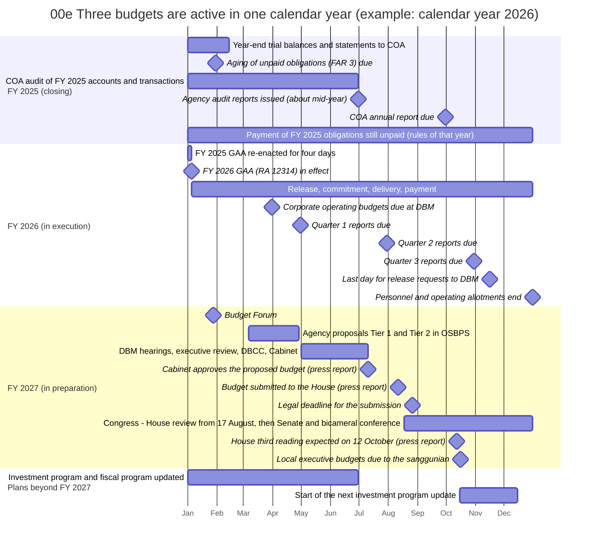
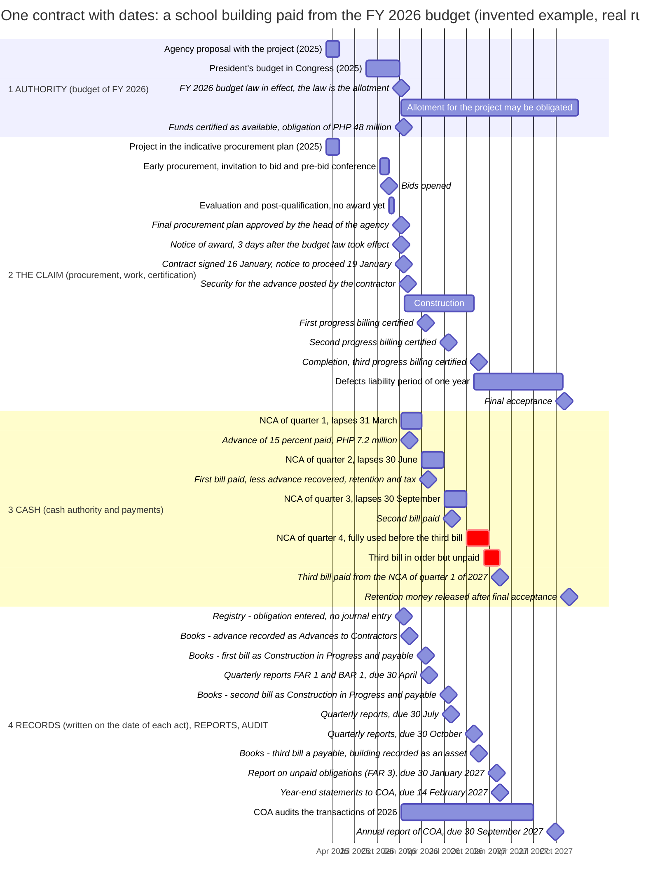

# Philippine PFM Atlas: the big picture

*Facts on current events as of 8 October 2026. A code in square brackets, for example [NBC599], names the source of a statement. The codes are explained in [Reference F](reference/F_sources_and_verification.md). "GK" means general knowledge that I did not open in a source during this work. The list of all files is in the [README](README.md).*

## 1. The question this file answers

How do the parts of Philippine public financial management (PFM) relate to each other: the functions, the authorities that perform them, the information systems that these authorities use, and the records that pass from one to the next?

This file gives the whole on a few pages. Each part has its own chapter with the steps, the documents, the systems and the sources.

## 2. The whole in plain words

Public money does not belong to the person who handles it. For this reason a rule decides, at every step, who may do what. PFM has five parts. Only the first part is a sequence of steps. Diagram 00a shows the five parts.

<!-- site:parts -->

| Part | What happens | Order in time | Chapters |
|---|---|---|---|
| A. Decide | Plan, set the fiscal frame, prepare the budget, pass the budget law | One after the other, for one fiscal year | 01 to 04 |
| B. Execute | Three lines of steps: legal authority, the claim, cash | At the same time. Money may leave the Treasury only where the three meet | 05 to 07, 10 to 12, 15 |
| C. Record and check | Registries, books of accounts, property records, certifications by officers | At the same time as every act of part B | 07, 08, 13 |
| D. Close each period | Reconcile, report, audit, oversee | At the end of each month, quarter and year. The audit of single payments continues during the whole year | 08, 09, 18 |
| E. What remains | Assets, debts, and promises that bind later budgets | After the year | 11, 13, 19 |

<!-- /site:parts -->

The rest of this section explains part B together with part C, because a drawing with one line of steps cannot show them. In part B the rules control three different things. A fourth line of work, part C, records all three.

<!-- site:lines -->

| No. | Line | The question | The main steps | Who is responsible |
|---|---|---|---|---|
| 1 | **Legal authority** | May the government spend for this purpose in this year? | Appropriation, then allotment, then obligation | Congress, DBM, the budget unit of the agency |
| 2 | **The claim** | Why does the government owe this amount to this party? | For a purchase: plan, procurement, contract, delivery, acceptance. For a salary: position, appointment, service rendered. Other payments have other steps (section 12) | The agency, its Bids and Awards Committee, the supplier or the employee |
| 3 | **Cash** | Is there money to pay on the day? | Collection and borrowing, the single account of the Treasury, cash authority, payment, replenishment | BIR, BOC, the banks, BTr, BSP, DBM |
| 4 | **Records and control** | Is each act recorded when it happens, and is each fact stated by an officer who is responsible for it? | Registries, journal entries, certifications on each document, reports, audit | The budget, accounting, cash and property units of the agency, BTr, COA |

<!-- /site:lines -->

Lines 1, 3 and 4 have the same steps for every payment. Line 2 has a different form for each kind of payment. A purchase is one form of claim, and the following paragraphs use it as the example.

<!-- site:meeting-points -->

The lines run at the same time. They do not form one line. A payment can be made only at a point where the lines meet. Two lines meet where one act needs a result from both of them. For one payment under a contract there are three such points (diagram 00d).

1. An **allotment** meets an **award**. Only then may the agency sign the contract and record the obligation. The procurement law says that no contract may be awarded before the funding is approved and effective [RA12009 s.12]. The Auditing Code says that no contract may be entered into before the accounting official has certified that funds are available [PD1445 s.86].
2. An **obligation** meets an **accepted delivery**. Only then is the amount a payable. The Manual defines accounts payable as obligations for which goods, services or projects "have been delivered/rendered/completed and accepted" [GAM-V1 Ch.6 s.2]. The budget reports call such an amount due and demandable [JC2019-1].
3. A **claim in order** meets a **cash authority** that has enough balance. Only then may the head of accounting certify "Cash available" on the voucher, and only then may the head of the agency approve the payment [GAM-V2 App.32][GAM-V1 Ch.6 s.12]. No check and no payment order may be issued without a covering Notice of Cash Allocation [GAM-V1 Ch.6 s.3].

<!-- /site:meeting-points -->

The second point has a lawful exception, the advance payment. The Auditing Code allows no advance payment "Except with the prior approval of the President" [PD1445 s.88]. An order of the President of 2011 gave this approval for goods under the earlier procurement law [MO15-2011]. The procurement rules of 2025 name the cases: for example an advance of not more than 15 percent of a works contract, on the written request of the contractor and against an irrevocable standby letter of credit, a bank guarantee or a surety bond [IRR12009 s.71.2.5]. In such a case the security replaces the accepted delivery. Chapter 07, section 7.2, follows such a contract with amounts.

<!-- site:cases -->

A case where the whole works: an agency starts the bidding before the year begins, which the law allows. The budget law takes effect in January, and for an item without conditions the law itself is the allotment. The agency awards and signs in February, and the budget unit enters the obligation in its registry. The supplier delivers in May, the agency accepts, and the accounting unit records a payable. The Notice of Cash Allocation of the second quarter has enough balance, so the voucher is certified and approved. The agency sends the payment order, the bank credits the supplier, and the Treasury repays the bank [RA12009 s.12][NBC599][CL2013-16A][GAM-V1 Annex H].

A case where it fails: the delivery is accepted on 28 June, and the voucher reaches the head of accounting on 2 July. The unused part of the cash authority of the second quarter lapsed on the last working day of June [NBC599 s.4.2.1.6]. If the cash authority of the third quarter is needed for other payments, the head of accounting cannot certify that cash is available, and the voucher waits [GAM-V1 Ch.6 s.12]. The agency holds a valid obligation and a payable, and it cannot pay. Nothing is wrong in any single line of steps. The lines did not meet in time.

<!-- /site:cases -->

A drawing with one line of steps cannot show this. I think this is the main reason why a map of "the PFM process" as one flow looks incomplete, even when it has many boxes. Five more facts increase the difficulty.

- **Three budgets are active in one calendar year.** In 2026, agencies close the accounts of fiscal year 2025, execute the budget of 2026 and prepare the budget of 2027 (diagram 00e).
- **The records do not wait for the payment.** The allotment and the obligation are entered in registries when they occur, and they have no journal entry. The first journal entry is made when the cash authority arrives. The payable is recorded when the delivery is accepted [GAM-V1 Annex H]. Section 7 and chapter 08 show which unit writes which record, and when.
- **Not all money follows the route of a purchase.** Salaries, the share of local governments, support to government corporations, transfers to other bodies, cash aid to persons, interest on debt and direct payments by lenders each have another form of claim (section 12).
- **One spending has several amounts.** The authority, the commitment, the accepted delivery, the cash paid and the result are recorded on different dates and appear in different reports. For the same program and the same year these amounts differ, and none of them is wrong (section 9, and chapter 08, section 12).
- **Some decisions of today bind the budgets of later years.** A contract for several years, a partnership with a private firm and a guarantee are such decisions. The appropriation of the present year does not show them in full (chapter 19).

Terms used in this file, in the words of the law where I could read them. An **appropriation** is "an authorization made by law or other legislative enactment, directing payment out of government funds under specified conditions or for specified purposes". An **allotment** is "an authorization issued by the Department of the Budget to an agency, which allows it to incur obligations for specified amounts contained in a legislative appropriation". An **obligation** is "an amount committed to be paid by the Government for any lawful act made by an authorized officer for and in behalf of the government" [EO292-B6 s.2]. A **Notice of Cash Allocation (NCA)** "specifies the maximum amount of withdrawal that an entity can make from a government bank for the period indicated" [GAM-V1 Ch.5 s.38]. A **voucher** is the document that approves one claim for payment. A **registry** is a running list with balances that the budget unit keeps. The **books of accounts** are the journals and ledgers that the accounting unit keeps by double entry. The glossary is in [Reference E](reference/E_glossary.md).

## 3. The parts of the cycle and their chapters

Diagram 00a shows the parts. The table adds the lead authority, the main documents and the main systems. Only the four functions of part A follow one another. The functions of parts B and C happen at the same time.

| Part | Function | Lead authorities | Main documents | Main systems | Chapter |
|---|---|---|---|---|---|
| A, step 1 | Plan | DEPDev, Economy and Development Council, Investment Coordination Committee, Regional Development Councils | Development plan, Public Investment Program, Three-Year Rolling Infrastructure Program | PIPOL | [01](processes/01_planning_and_investment_programming.md) |
| A, step 2 | Set the fiscal frame | Development Budget Coordination Committee (DBCC) | Macroeconomic assumptions, revenue program, spending ceiling, deficit target, borrowing program | None named in the sources | [02](processes/02_macro_fiscal_framework.md) |
| A, step 3 | Prepare the budget | DBM, agencies, the President | Budget Call, proposals in two tiers, National Expenditure Program, Budget of Expenditures and Sources of Financing, Budget Message | OSBPS, BPMS, GMIS | [03](processes/03_budget_preparation.md) |
| A, step 4 | Legislate | House of Representatives, Senate, the President | General Appropriations Bill, General Appropriations Act (GAA) | None named in the sources | [04](processes/04_budget_legislation.md) |
| B, line 1 | Legal authority: release and commit | Congress, DBM, the budget unit of the agency | Execution plans, the GAA as allotment order, SARO, GARO, obligation request | URS, ADRS, agency registries, BTMS | [05](processes/05_budget_release_allotment_and_cash_authority.md), [07](processes/07_obligation_delivery_payment.md) |
| B, line 2 | The claim: a purchase | Agency, Bids and Awards Committee, bidders, supplier | Procurement plan, bidding documents, notice of award, contract or purchase order, delivery receipt, acceptance report | PhilGEPS, BTMS | [06](processes/06_procurement.md), [07](processes/07_obligation_delivery_payment.md) |
| B, line 2 | The claim: a salary, and other claims | Agency, DBM, employees, receivers of transfers | List of positions, appointment, payroll, memorandum of agreement, loan agreement | GMIS, agency payroll systems | [12](processes/12_personnel_and_payroll.md), [15](processes/15_gocc_transfers_and_fund_clusters.md), [11](processes/11_treasury_cash_and_debt.md) |
| B, line 3 | Cash: collect, borrow, hold, authorize, pay | BIR, BOC, banks, BTr, BSP, DOF, DBM, the cash unit of the agency | Tax returns, official receipts, government securities, loan agreements, NCA, disbursement voucher, payment order (LDDAP-ADA) | eFPS, Payment Application Secure, NGCDS, eTRAMS, NRoSS, bank facility such as eMDS, BTMS | [10](processes/10_revenue_collection.md), [11](processes/11_treasury_cash_and_debt.md), [07](processes/07_obligation_delivery_payment.md) |
| C | Record and check, at the time of each act | Budget, accounting, cash and property units of the agency. BTr for cash and debt | Registries, journal entry vouchers, journals and ledgers, records of checks and payment orders, property cards, certifications on each document | eNGAS or other software, the eBudget of COA, BTMS | [08](processes/08_accounting_and_reporting.md), [13](processes/13_assets_and_property.md), [07](processes/07_obligation_delivery_payment.md) |
| D | Reconcile and report, at the end of each period | The same units, to DBM, COA and BTr | Bank reconciliation statement, trial balance, accountability reports, financial statements | URS, AFR System, BTMS | [08](processes/08_accounting_and_reporting.md) |
| D | Audit and oversee | COA, Congress, the public | Audit observations, notices of suspension, disallowance and charge, audit reports | None named in the sources | [09](processes/09_audit_and_oversight.md) |
| E | What remains after the year | Agencies, BTr, DOF, DBCC, the PPP Center | Property records, debt records, Fiscal Risks Statement, partnership contracts, Multi-Year Contractual Authority | National Asset Registry System. None named for promises | [13](processes/13_assets_and_property.md), [11](processes/11_treasury_cash_and_debt.md), [19](processes/19_fiscal_risks_ppp_and_contingent_liabilities.md) |
| Outside the main sequence | Other public bodies and other funds | Local governments, government corporations | Appropriation ordinance, Corporate Operating Budget | eSRE, own systems | [14](processes/14_local_governments.md), [15](processes/15_gocc_transfers_and_fund_clusters.md) |
| Parallel to the money | Results | Agencies, DBM, the planning department, COA | Targets in the budget law, physical plan, quarterly physical report, yearly performance review, evaluations | URS, COMPASS portal | [18](processes/18_performance_information_and_evaluation.md) |
| For all parts | Common base | PFM Committee, DBM, COA | UACS, laws and yearly rules, the Government Accounting Manual | The planned IFMIS with BTMS as core | [16](processes/16_information_systems_and_ifmis.md), [17](processes/17_uacs_and_record_identifiers.md) |

The cycle is not a closed loop for one year. The results of year N (actual figures, audit findings, evaluations) return to the plans and budgets of later years, because the budget of year N+1 is already prepared and voted while year N is executed.

A case where the order of part A matters: Congress may not increase the appropriations that the President recommended, so an amount that is missing in the proposal of step 3 cannot be added in step 4 beyond that limit [EO292-B6 s.24]. A case where no order exists: the accounting unit does not wait for the payment to record a delivery. It records the payable when the delivery is accepted, and the budget unit recorded the obligation months before [GAM-V1 Annex H].

### Diagram 00a  The whole of PFM for the national government: what happens in order, what happens at the same time, and the chapter for each part

Code file: `diagrams/mermaid/00a_pfm_cycle_overview.mmd`. Rendered image: [`rendered/00a_pfm_cycle_overview.png`](rendered/00a_pfm_cycle_overview.png).

- **Question:** which parts form public financial management (PFM) in the Philippines, which of them follow one another, which of them happen at the same time, and which chapter of this atlas describes each one?
- **Idea:** only the decisions of part A follow one another for one fiscal year. In part B three lines of steps run at the same time, and money may leave the Treasury only where all three have a result for the same amount (diagram 00d). Part C is not a later step: every act of part B writes a record at the time of the act. Part D happens at the end of each month, quarter and year. Part E is what stays after the year.
- **How to read it:** a solid arrow between two frames = the lower frame needs the result of the upper frame. The dotted arrow from B to C = every act in B writes a record in C at the same time. Inside a frame, an arrow = the order of the steps of that line. The frames at the sides are active during the whole year.
- **The cycle is not a simple loop:** results return to the plans and budgets of LATER fiscal years, so the last node is drawn as an exit and not as an arrow back to part A.
- **Why the records stand at every act:** the Manual records the allotment and the obligation in registries when they occur, makes the first journal entry when the Notice of Cash Allocation arrives, and records the payable when the delivery is accepted, before any payment [GAM-V1 Annex H]. Recording is therefore not a step after payment.
- **Sources:** DBM primer on the budget process [PRIMER], FY 2027 Budget Call [NBM156], FY 2026 release guidelines [NBC599], procurement law [RA12009], reporting circular [JC2019-1], the Government Accounting Manual for the records of each unit and the order of the entries [GAM-V1 Ch.2 s.8, s.12, Ch.3, Annex H], Auditing Code [PD1445 s.41], PFM Reforms Roadmap 2024-2028 [ROADMAP2024]. The arrangement in five parts is my own.
- **Limit:** local governments and government corporations have their own complete cycles (chapters 14 and 15). Here they appear only where national money passes to them.

## 4. The authorities

Diagram 00b groups the authorities by their position in government. The table gives each group in one line. The legal basis of every role is in [Reference A](reference/A_authorities_and_mandates.md).

| Group | Authorities | What the group does in PFM |
|---|---|---|
| Congress | House of Representatives, Senate, their committees | Authorizes all spending and all taxes. Appropriation, revenue and tariff bills start in the House [CONST VI.24] |
| The President and collegial bodies | The President, the Economy and Development Council and its committees, the DBCC, the PFM Committee | Submits the budget, signs the law and may veto items. The DBCC recommends revenue, spending ceiling, deficit and borrowing. The PFM Committee steers reform and the IFMIS [CONST VII.22, VI.27][DBCC-PAGE][EO29] |
| Budget | DBM, the Government Procurement Policy Board, the Procurement Service | Prepares the budget, releases allotments and cash authority, sets procurement rules, operates PhilGEPS [NBC599][RA12009] |
| Finance | DOF, BIR, BOC, BTr, BLGF | Collects revenue, manages cash and debt, receives the fiscal reports of local governments [EO449][eSRE] |
| Planning | DEPDev, Regional Development Councils | Makes the development plan and the investment program, appraises large projects, endorses regional priorities [NBM156][ICC-NEWS] |
| Entities that spend | Departments and agencies, government corporations, local governments | Commit, receive, pay, record and report |
| Independent bodies | COA, Civil Service Commission, Ombudsman and Sandiganbayan, BSP | COA audits all accounts and sets the accounting and auditing rules [CONST IX-D]. BSP holds the Treasury Single Account, and its Monetary Board must concur before a foreign loan [ROADMAP2024][CONST VII.20]. The roles of the Civil Service Commission (personnel rules) and of the Ombudsman and the Sandiganbayan (accountability of officials): GK |
| Banks | Government servicing banks (LBP, DBP, PVB), authorized agent banks, depository banks | Pay on the orders of agencies. Receive collections and remit them [NBC599][CL2013-16A] |
| Outside government | Taxpayers, suppliers, lenders, citizens and civil society | Pay, deliver, lend, observe |

The DBM Secretary chairs the DBCC. The Secretary of Finance is co-chairperson since Administrative Order No. 37 of 13 August 2025 [DBCC-PAGE][AO37].

### Diagram 00b  The authorities of Philippine PFM, grouped by their position in government

Code file: `diagrams/mermaid/00b_authorities_map.mmd`. Rendered image: [`rendered/00b_authorities_map.png`](rendered/00b_authorities_map.png).

- **Question:** which bodies participate in PFM, to which branch or group does each belong, and what is the role of each in one sentence?
- **How to read it:** one frame = one group. One box = one authority and its PFM role. This diagram shows membership only. The exchanges between the authorities are in 00g. The legal basis of each role is in reference file A.
- **Sources:** Congress, President, COA and local governments [CONST]. DBCC members and functions [DBCC-PAGE]. ED Council and its committees [AO37]. PFM Committee [EO29]. BTr functions [EO449]. GPPB and PS-DBM [RA12009]. BLGF and eSRE [eSRE]. Servicing banks LBP, DBP, PVB [NBC599]. GCG and DBM roles for corporations [COB].
- **General knowledge, not opened in a source here:** names of the oversight committees of Congress, the roles of CSC, the Ombudsman, DILG, and the role of BSP as banker of the government.
- **DBCC chair:** the DBM page names the DBM Secretary as chair [DBCC-PAGE]. Administrative Order No. 37 of 13 August 2025 designates the Secretary of Finance as co-chairperson [AO37]. Executive Order No. 108 of 26 January 2026 moved the functions of the former special assistant for economic affairs, who sat in these committees for the Office of the President, to the Office of the Executive Secretary [EO108].

## 5. What passes between the authorities

Three kinds of thing pass from one authority to another: a **decision** (a document that authorizes or requests something), **money**, and **information** (a report, a record, a finding). Diagram 00g shows them with three kinds of arrow. A fourth kind enters from outside the government: the goods, services or works that a supplier delivers. The table lists the main exchanges of the process.

| From | To | What passes | Kind | Chapter |
|---|---|---|---|---|
| DBCC | President, DBM | Fiscal program, ceilings | Decision | 02 |
| DBM | Agencies | Budget Call | Decision | 03 |
| Agencies | DBM | Budget proposals | Information | 03 |
| President | Congress | Proposed budget | Decision | 03, 04 |
| Congress and President | DBM and agencies | The budget law | Decision | 04 |
| DBM | Agencies | Allotment: the law itself, or a SARO or GARO | Decision | 05 |
| DBM | Servicing bank | Notice of Cash Allocation | Decision | 05 |
| Agency | Supplier | Contract | Decision | 06 |
| Supplier | Agency | Delivery and billing | Goods, services or works | 07 |
| Agency | Servicing bank | Payment order | Decision | 07 |
| Servicing bank | Supplier, employees | Payment | Money | 07, 12 |
| BTr and BSP | Servicing bank | Replenishment for payments made | Money | 07, 11 |
| Taxpayers, through banks | Treasury Single Account | Taxes, duties, fees | Money | 10 |
| Lenders and investors | Treasury Single Account, and back | Loan and bond proceeds. Interest and principal | Money | 11 |
| BTr | Local governments and government corporations | Tax allotment, subsidy, equity | Money | 14, 15 |
| Agencies | DBM, COA, BTr | Accountability reports and financial statements | Information | 08 |
| COA | Agencies | Observations, notices, audit report | Information | 09 |
| COA | President and Congress | Annual report | Information | 09 |

### 5.1 Kinds of arrows, and what would show that an arrow is wrong

An arrow in a diagram is a statement about the process. The statements are of different kinds, and each kind is tested in a different way. This atlas uses nine kinds. Where one diagram draws more than one kind, the comment lines at its start explain how each kind is drawn.

| Kind of arrow | What it states | Example | Where the atlas uses it | An observation that would show it to be wrong |
|---|---|---|---|---|
| Order of acts | Act B may happen only after act A, or only when state A exists | The contract may be signed only when an allotment and an award both exist | 00d, the lane diagrams, the state diagrams | A rule or a lawful case in which B happens without A. First example: the bidding does not need an allotment. Only the award needs it, so an arrow from "allotment" to "invitation to bid" would be wrong. Second example: an advance payment is lawful without an accepted delivery, so diagram 00d draws it as a separate path |
| Writing of a record | An act produces an entry in a registry or in a book at the time of the act | The acceptance of a delivery produces the journal entry for the payable | 00d (dotted arrow to a grey node), 08e | The entry is made at another time, by another unit, or not at all. Example: an obligation is entered in a registry and has no journal entry, so an arrow from "obligation" to "journal" would be wrong |
| Authority | A gives B the right or the duty to act | DBM gives an agency an allotment | 00g (thin solid arrow), the sequence diagrams | The legal text gives the right in another way. Example: for an item without conditions the budget law itself is the allotment, so an arrow "DBM issues a SARO" is wrong for that item |
| Document | A document passes from A to B | The agency sends the payment order to the bank | The sequence diagrams | The document goes to another receiver, or it does not exist as a separate document |
| Money | An amount leaves one account and enters another | The Treasury repays the servicing bank | 00g (thick arrow), 07d, 11a, 16g (green arrow) | No account is debited. Example: a Notice of Cash Allocation is a limit, and an arrow "DBM sends cash to the agency" is wrong |
| Information | B receives data about an event. Nothing is authorized and no money moves | Agencies report to DBM, COA and BTr | 00g (dotted arrow), 08b | The report goes to another body, or B does not receive it |
| Link between systems | Data pass from system A to system B | ADRS delivers a release document to an agency | 16b, 16g, and the register in Reference B, section 4 | A person enters the same data a second time, or the data pass as a file or on paper. The register gives the evidence for each flow |
| Reference between records | Record B contains the number of record A | The payment order contains the number of the obligation request | 17b, 17c | The form has no such field, or the field is free text |
| Classification | A record belongs to a class | An obligation has an object code of UACS | 17a, 17d | The record has no code, or two systems use different lists of codes |

A case where the kinds matter: a drawing shows an arrow from DBM to an agency with the label "NCA". Read as money, it says that DBM pays the agency. Read as authority, it says that DBM sets a limit up to which the bank may pay. Only the second reading is correct [NBC599].

A case where the kinds are not enough: an arrow of the kind "order of acts" is correct by the rule, and practice differs. The atlas draws the rules. Where an assessment reports that practice differs, the chapter says so in its section on weaknesses.

An arrow of the kind "order of acts" between two parts of diagram 00a does not say that the lower part starts when the upper part has ended. Parts B and C happen at the same time, and the diagram draws them side by side for this reason.

### Diagram 00g  What passes between the authorities: decisions, money and information

Code file: `diagrams/mermaid/00g_exchanges_between_authorities.mmd`. Rendered image: [`rendered/00g_exchanges_between_authorities.png`](rendered/00g_exchanges_between_authorities.png).

- **Question:** for each pair of authorities, what does one give to the other?
- **How to read it:** three kinds of arrow. Thin solid arrow = a decision or a document that authorizes or requests something. Thick arrow = money. Dotted arrow = information (a report, a record, a finding). An arrow with two heads shows the two things named in its label, one in each direction.
- **Scope:** national government agencies. The exchanges of local governments and government corporations are in chapters 14 and 15.
- **Sources:** budget submission and enactment [CONST]. DBCC outputs [DBCC-PAGE]. Budget Call and proposals [NBM156]. Allotment, NCA, plans and reports [NBC599][JC2019-1]. Payment orders and bank replenishment [CL2013-16A]. Collections remitted to the Treasury Single Account [PEFA2025][BTR-SITE]. Releases by BTr to local governments and corporations [NBC599]. Statements to COA [COA-GAS]. COA annual report [CONST IX-D.4].

## 6. Three lines of steps, three meeting points, and the records

Diagram 00d is the formal version of section 2. It uses the form of a Petri net. A rounded node is a state that is true or not yet true. A rectangle is an act by the persons named in it. An act with two incoming solid arrows needs both states to be true. The colours mark the lines: blue for legal authority, green for the claim, orange for cash, grey for records and audit.

The three meeting points are the acts t3 (sign the contract and obligate), t6 (prepare and examine the claim) and t6c (certify cash and approve the voucher).

The grey nodes r1 to r7 are records. A dotted arrow from an act to a grey node means that the act writes this record at the time of the act. The table lists them. No record waits for the payment.

| Record | Written at the act | By which unit | Content | Basis |
|---|---|---|---|---|
| r1 | Release of the allotment | Budget unit | Allotment in the registries. No journal entry | GAM-V1 Ch.3 ss.8-10, Annex H |
| r2 | Contract signed, obligation request approved | Budget unit | Obligation in the registry. No journal entry | GAM-V1 Ch.3 s.15, Annex H |
| r3 | NCA issued by DBM | Accounting unit | First journal entry: debit Cash-Modified Disbursement System (MDS), Regular, credit Subsidy from National Government. The NCA is entered in the registry of the NCA | GAM-V1 Ch.5 s.38, Ch.6 s.3 |
| r4 | Delivery inspected and accepted | Property unit, accounting unit, budget unit | Acceptance report. Journal entry: debit the asset or expense, credit Accounts Payable. The payable is entered in part C of the obligation request | GAM-V1 Ch.8 s.15, Annex H. GAM-V2 App.11 |
| r5 | Voucher certified and approved | Accounting unit | Voucher with its number. The amount is entered as used in the registry of the NCA | GAM-V1 Ch.6 s.12 |
| r6 | Payment order or check issued | Cash unit, accounting unit, budget unit | Daily report of payment orders or checks issued. Journal entry: debit Accounts Payable, credit Cash-MDS, Regular and Due to BIR. Payment entered in the registries. One copy goes to the COA auditor with the paid vouchers | GAM-V1 Ch.6 s.56, s.57 |
| r7 | Treasury repays the bank | BTr | Books of the Treasury: debit Subsidy to NGAs, credit Cash in Bank | GAM-V1 Annex H |

The diagram has a small separate chain at its side: end of a period, closing, reports, audit of the statements. It is separate because the closing of a period does not follow one payment. It follows the calendar, and it uses all records that exist on that day.

The dashed green path is the lawful exception of section 2: for an advance payment, a security posted by the contractor replaces the accepted delivery.

The form has three limits, and all matter if the diagram is used as a model.

- An allotment and a cash authority are balances, not single items. A model needs an amount on each of them.
- One line of the budget funds many contracts, and one contract has many payments. One case identifier therefore does not fit all places of the net. Chapter 17 explains this with an example.
- The green line is drawn for a purchase. For a salary, a transfer, debt service or a refund, another event creates the claim. Diagram 07h compares the forms.

A difference inside the Manual: its worked example records the payable at delivery, from the delivery receipt and the acceptance report [GAM-V1 Annex H]. Its section on payment orders says that payables are recorded "based on approved DVs" [GAM-V1 Ch.6 s.57]. The diagram follows the worked example. Under the second reading, record r4 would be written at act t6c.

### Diagram 00d  Three lines of steps, the three points where they must meet, and the record that each act writes (one payment under a contract)

Code file: `diagrams/mermaid/00d_four_chains.mmd`. Rendered image: [`rendered/00d_four_chains.png`](rendered/00d_four_chains.png).

- **Question:** which conditions must all be true before one payment to a contractor can be made, who makes each condition true, and which record is written at each act?
- **Idea:** a payment is not the end of one line of steps. Three lines of steps run at the same time: legal authority, the claim, and cash. A payment is possible only when they meet. The fourth line, the records, does not come after the payment: each act writes its record when it happens. A diagram with one line of steps hides both facts.
- **Form (Petri-net style):** rounded node p = a state that can be true or not yet true. Rectangle t = an act by the persons named in it. An act with two incoming solid arrows needs BOTH states. A grey node r = a record. A dotted arrow from an act to a grey node = the act writes this record at the time of the act.
- **Colours:** blue = legal authority to spend. Green = the claim: the contract, the work and its acceptance. Orange = cash. Grey = records, reports and audit.
- **The small separate chain (pT to p19):** the closing of a period does not follow one payment. It follows the calendar, and it uses all records that exist on that day. The audit of one paid transaction (t14) follows the payment, because the paid voucher goes to the auditor with the daily report of payment orders issued [GAM-V1 Ch.6 s.56].
- **The three meeting points:** t3 (allotment meets award), t6 (obligation meets accepted delivery), t6c (the claim meets cash authority). The third point is the certificate "cash available" on the voucher: the head of accounting looks into the registry of the NCA, and when the balance is not sufficient the voucher is kept until cash is available [GAM-V1 Ch.6 s.12]. No check and no payment order may be issued without a covering NCA [GAM-V1 Ch.6 s.3].
- THE EXCEPTION AT t6: the law allows no advance payment without the prior approval of the President, and no payment without a certificate that the delivery was inspected and accepted [PD1445 s.88]. The procurement rules give that approval in defined cases: for works, an advance of not more than 15 percent on the written request of the contractor and against an irrevocable standby letter of credit, a bank guarantee or a surety bond [IRR12009 s.71.2.5]. In that case the security (p8b) replaces the accepted delivery (p8). The dashed green path shows it. Diagram 07i follows such a contract with amounts.
- The dotted arrow into t9 is a read arc: DBM consults the cash position of the Treasury but does not consume it when it issues an NCA.
- **Limits of this form:** (1) allotment and NCA are balances, so each token would need an amount. (2) One appropriation line funds many contracts and one contract has many payments, so one case identifier does not fit all places (see 17d). (3) The claim is drawn for a purchase. For a salary, a transfer, debt service or a refund another event creates the claim (diagram 07h).
- **Sources:** allotment before commitment and NCA before payment [NBC599]. Certificate of availability of funds before a contract [PD1445 s.86][EO292-B6 s.40]. Award only after funding is effective [RA12009 s.12]. Payable = delivered and accepted [GAM-V1 Ch.6 s.2]. The boxes of the voucher [GAM-V2 App.32]. Registry of the NCA, checked before the voucher is certified [GAM-V1 Ch.6 s.12]. Payment order, bank and Treasury steps [CL2013-16A][GAM-V1 Ch.6 s.56]. Which record is written at which act, and that appropriation, allotment and obligation have no journal entry [GAM-V1 Annex H, Ch.3 ss.8-17]. Entry in the books of the Treasury [GAM-V1 Annex H]. Audit after payment [COA2011-002].
- **A difference inside the manual:** its worked example records the payable at delivery, from the delivery receipt and the acceptance report [GAM-V1 Annex H]. Its section on payment orders says that payables are recorded "based on approved DVs" [GAM-V1 Ch.6 s.57]. The diagram follows the worked example.

## 7. One fiscal year from plan to audit, by actor

Diagram 00f shows the same content as a lane diagram: one column for each authority, read from top to bottom. A thick bar that splits the flow means that the branches run at the same time. The bar that closes them means that both branches must be finished before the next step. The diagram is written in PlantUML, because Mermaid has no lane diagram with such bars.

In each step of the execution, a line that starts with "Record:" names the record that is written at that step, and the unit that writes it. The diagram has no separate step "record" after the payment. Its last two branches run at the same time: the audit of each paid voucher by COA, and the closing of each month, quarter and year by the agency.

| Step in the diagram | Record written at this step | Unit | Basis |
|---|---|---|---|
| Budget law in effect | Appropriation in the registry of appropriations and allotments | Budget unit | GAM-V1 Annex H |
| Allotment | Allotment in the registries | Budget unit | GAM-V1 Ch.3 ss.8-10 |
| Contract signed | Obligation request, obligation in the registry | Budget unit | GAM-V1 Ch.3 s.15 |
| NCA issued | First journal entry, registry of the NCA | Accounting unit | GAM-V1 Ch.5 s.38, Ch.6 s.3 |
| Delivery accepted | Acceptance report, journal entry for the payable | Property unit, accounting unit | GAM-V1 Ch.8 s.15 |
| Voucher certified and approved | Voucher, registry of the NCA | Accounting unit | GAM-V1 Ch.6 s.12 |
| Payment order issued | Report of payment orders issued, journal entry, registries | Cash unit, accounting unit, budget unit | GAM-V1 Ch.6 s.56 |
| Bank repaid | Books of the Treasury | BTr | GAM-V1 Annex H |
| End of month, quarter, year | Bank reconciliation, trial balance, reports, statements | Accounting unit, budget unit | GAM-V1 Ch.19 s.60, Ch.21. JC2019-1 |

### Diagram 00f  One fiscal year from plan to audit: who acts at each step, and which record is written there (national government agency) (PlantUML)

Code file: `diagrams/plantuml/00f_end_to_end_swimlane.puml`. Rendered image: [`rendered/00f_end_to_end_swimlane.png`](rendered/00f_end_to_end_swimlane.png).

- **Question:** for one fiscal year, which authority acts at each step from plan to audit, where do two lines of work run at the same time and then have to meet, and at which step is each record written?
- **Idea:** the steps of deciding (plan, fiscal frame, proposal, law) follow one another. In execution, two lines of work run at the same time three times, and each time both must be finished before the next step. The records are not a last step: the text of each step names the record that is written at that step. Only the closing of a period and the audit of the statements follow the calendar.
- **How to read it:** one column (lane) = one authority. Read from top to bottom. A thick horizontal bar that splits the flow = the branches run in parallel. The bar that closes them = BOTH branches must be finished before the next step. A line that starts with "Record:" names what is written at that step, and by which unit.
- **Why PlantUML:** Mermaid has no activity diagram with lanes and parallel bars.
- **Why the records stand at every act:** the Manual shows that the registries are written at the allotment and at the obligation, the first journal entry at the receipt of the NCA, and the payable at the accepted delivery [GAM-V1 Annex H]. The certificate "cash available" on the voucher is a separate step, because it is the point where the claim meets the cash authority [GAM-V1 Ch.6 s.12].
- **Sources:** [PRIMER] [NBM156] [CONST] [NBC599] [RA12009] [PD1445 s.41, s.86] [GAM-V1 Ch.3, Ch.6 s.12, s.56, Ch.19 s.60, Ch.21, Annex H] [GAM-V2 App.32] [CL2013-16A] [JC2019-1] [COA2011-002]. Steps marked (GK) are general knowledge, not opened in a source during this work.

PlantUML code

## 8. The calendar: three budgets in one year

The fiscal year is the calendar year. In one calendar year, work is done for at least three fiscal years. Diagram 00e shows this for 2026.

| Fiscal year | What is done for it in 2026 | Dates | Basis |
|---|---|---|---|
| 2025 | Year-end statements go to COA. COA audits. The annual report of COA is due | 14 February, 30 September | PD1445 s.41 |
| 2026 | The budget law (Republic Act No. 12314) takes effect on 5 January, after four days under the reenacted law of 2025. Release, commitment, delivery and payment follow. Reports are due 30 days after each quarter. The last day for release requests is 16 November | 5 January, 16 November | NBC599, JC2019-1 |
| 2027 | Budget Call in January. Proposals from 6 March to 28 April. Approval by the President and the Cabinet on 10 July. Submission to the House on 11 August, before the legal deadline of 26 August. The House starts its review on 17 August. It approves the bill (House Bill No. 10858) on second reading in early October, and expects the third reading on 12 October | See left | NBM156, CONST VII.22, NEP2027-NEWS and GAB2027-NEWS (press reports) |
| Later years | The investment program and the fiscal program are updated | During the year | PIP-MEMO, DBCC-PAGE. Months: GK |

The third reading in the House was expected on 12 October 2026. I made no check of events after 8 October 2026. The first target date was 9 October [NEP2027-NEWS][GAB2027-NEWS].

### Diagram 00e  Three budgets are active in one calendar year (example: calendar year 2026)

Code file: `diagrams/mermaid/00e_calendar_three_budgets.mmd`. Rendered image: [`rendered/00e_calendar_three_budgets.png`](rendered/00e_calendar_three_budgets.png).

- **Question:** at a given date, which fiscal year does each activity belong to?
- **How to read it:** each section is one fiscal year (the Philippine fiscal year is the calendar year). Bars and diamonds show what is done FOR that fiscal year DURING calendar year 2026.
- **Verified dates:** FY 2026 GAA in effect 5 January 2026, last day for release requests 16 November 2026, quarterly reports within 30 days after each quarter, validity of FY 2026 appropriations [NBC599]. Budget Forum 28-29 January 2026 and proposal period 6 March to 28 April 2026 [NBM156]. President's budget due within 30 days from the opening of the regular session [CONST VII.22]. The session opens on the fourth Monday of July (Constitution, Article VI, section 15, from general knowledge), which is 27 July in 2026, so the last day is 26 August 2026. Year-end trial balances to COA by 14 February and COA annual report by 30 September [PD1445 s.41]. Corporate operating budgets due 31 March [COB]. Local executive budget due 16 October [LGC s.318].
- **From press reports [NEP2027-NEWS]:** approval of the proposed FY 2027 budget by the President and the Cabinet on 10 July 2026, submission to the House of Representatives on 11 August 2026, start of the House review on 17 August 2026, and 9 October 2026 as the date by which the House planned to pass the bill. FROM PRESS REPORTS OF 6 AND 7 OCTOBER 2026 [GAB2027-NEWS]: the House approved the bill (House Bill No. 10858, PHP 7.2 trillion) on second reading and expects the third reading on 12 October 2026. The press report explains the date with a rule of three days between the two readings. The Constitution requires three readings on separate days and printed copies of the final text three days before passage [CONST VI.26(2)].
- **General knowledge, not checked for 2026:** the months of the technical hearings, the stages in the Senate and the bicameral conference, and the issue of agency audit reports.

## 9. One contract with dates

The diagrams of sections 6 and 7 show the order of the steps. They do not show how long a step takes, or in which year it occurs. Diagram 00h follows one contract through the lines of steps of section 2. The contract is invented: a school building of PHP 48 million, paid from the FY 2026 budget, with an advance of 15 percent and three progress billings. The rules that fix the earliest and the latest dates are real.

| When | Line of steps | What happens | Rule that fixes or limits the date | Basis |
|---|---|---|---|---|
| March to April 2025 | Authority, and the claim | The project is in the budget proposal of the agency and in its indicative procurement plan | The procurement plan is prepared together with the budget proposal | IRR12009 s.7. Dates of 2025: GK |
| October to December 2025 | The claim | Invitation to bid, opening of the bids on 17 November, evaluation and post-qualification. No award | Early procurement may start when the budget of the President is submitted. No award before the funding is in effect and the final procurement plan is approved | IRR12009 s.12, RA12009 s.12 |
| 5 January 2026 | Authority. Records | The budget law takes effect. For this item the law itself is the allotment. The budget unit enters it in its registries | An item without conditions needs no release order | NBC599 s.3.7, GAM-V1 Annex H |
| 7 to 19 January 2026 | The claim, then authority. Records | Final procurement plan approved, notice of award on 8 January. The chief accountant certifies that funds are available. Contract signed and obligation of PHP 48 million entered in the registry on 16 January, with no journal entry. Notice to proceed on 19 January | Award within 60 days from the opening of the bids. Contract within 10 days from the notice of award. Notice to proceed within 3 days. Certificate of funds before the contract | IRR12009 ss.66, 67, RA12009 s.66, PD1445 s.86, GAM-V1 Ch.3 s.15 |
| 2 to 10 February 2026 | The claim, then cash. Records | The contractor asks for an advance and posts a security. The agency pays PHP 7.2 million. The books show it as Advances to Contractors, not as a cost of the building | Not more than 15 percent, on written request and against a letter of credit, a bank guarantee or a surety bond | IRR12009 s.71.2.5, GAM-V1 Ch.10 s.8 |
| 20 January to 30 October 2026 | The claim. Records | Construction. Three progress billings are certified on 15 April, 20 July and 20 November. On each of these dates the books record Construction in Progress and a payable | Billing not more often than once a month. The engineer of the agency certifies the amount | IRR12009 s.71.2.7, GAM-V1 Ch.10 s.8. Dates: invented |
| 28 April and 31 July 2026 | Cash. Records | The first and the second bill are paid from the cash authority of the quarter. Each payment is reduced by the part of the advance that is recovered, by the retention money and by the tax withheld | A regular NCA lapses at the end of its quarter. The bank credits the payee within two banking days. Retention of 10 percent of progress payments, as the rules provide | NBC599 s.4.2, CL2018-14, IRR12009 ss.71.2.7, 71.2.8 |
| 20 November 2026 | Records | The contractor delivers the completed building, and the agency accepts it. Its cost moves from Construction in Progress to the asset account Buildings | The Manual records the building as an asset at its "turn-over and acceptance". The example places this at completion | GAM-V1 Ch.10 s.8 |
| 20 November 2026 to 15 February 2027 | Cash, and records | The third bill is in order on 10 December, but the cash authority of the fourth quarter is fully used, so the voucher cannot be certified. The bill is paid on 15 February 2027 from the cash authority of the first quarter of 2027 | The regular NCA of a later period also covers unpaid obligations of earlier years | NBC599 s.4.2, GAM-V1 Ch.6 s.12 |
| 30 January and 14 February 2027 | Records | Report on unpaid obligations (FAR 3). Year-end statements to COA | 30 days after the end of the year. 14 February | JC2019-1, PD1445 s.41 |
| Up to 30 September 2027 | Records | Audit of the transactions of 2026. Annual report of COA | 30 September | PD1445 s.41 |
| 30 October 2026 to November 2027 | The claim, then cash | Defects liability period of one year. Final acceptance on 5 November 2027. The retention money is paid on 25 November 2027 | The retention money is due for release upon final acceptance | IRR12009 ss.90.2.2, 71.2.8 |

What the example shows.

1. **One contract extends over three calendar years.** The budget and the bidding are in 2025 and the work is in 2026. The last progress payment, the year-end reports, the audit, the final acceptance and the release of the retention money are in 2027.
2. **The three meeting points of section 2 have dates.** The allotment meets the award on 16 January 2026. The obligation meets certified work three times. The claim meets a cash authority three times, and the third time it waits from 10 December 2026 to 15 February 2027.
3. **The exception has a date too.** On 10 February 2026 the agency pays PHP 7.2 million although no work is accepted. A security of the same amount replaces the accepted work.
4. **At the end of 2026 the contract has different amounts in different records.** The registry of the budget unit shows an obligation of PHP 48 million. The books show a building of PHP 48 million, the third bill as a payable, and the retention money as a liability [GAM-V1 Ch.10 s.8]. The report of disbursements shows the advance and the first two payments. All three records are correct.
5. **Every record of the example is written on the date of its act.** The last section of diagram 00h shows these dates between the dates of the reports.

A case where the example is typical: a capital outlay without conditions, with competitive bidding and early procurement. The FY 2026 rules allow such an item to be obligated until 31 December 2027 [NBC599 s.3.3]. The table of that section was partly unreadable in my copy.

A case where it is not: an item that needs a release order, a contract for more than one year, a purchase in an emergency, or a salary. Each of these omits steps of the example or adds steps to it (section 12, and chapter 06, section 5).

The arithmetic of an advance, of its recovery and of the retention money is in chapter 07, section 7.2, with the example of the Manual.

### Diagram 00h  One contract with dates: a school building paid from the FY 2026 budget (invented example, real rules)

Code file: `diagrams/mermaid/00h_worked_example_one_contract.mmd`. Rendered image: [`rendered/00h_worked_example_one_contract.png`](rendered/00h_worked_example_one_contract.png).

- **Question:** the other diagrams show the order of steps. How long does each step take for one contract, in which fiscal year does each step occur, and on which date is each record written?
- **Idea:** one contract extends over three calendar years. Its budget is prepared in the year before, the work is done in the budget year, and the last progress payment, the release of the retention money and the audit occur in the year after. The four sections are the four lines of steps of diagram 00d: authority, the claim, cash, records. The records are written on the dates of the acts, and not after the last payment.
- THE EXAMPLE IS INVENTED. The agency, the amounts and the dates of the single steps are not real. The rules that fix the earliest and latest dates are real, and they are listed here with their sources.
- **The example:** an agency builds a school building for PHP 48 million. The amount is a capital outlay in the FY 2026 budget law, without a pre-condition for release. The contractor asks for an advance of 15 percent. The work takes nine months and is billed in three parts.
- **Rules used, with sources:** the agency may hold the bidding before the budget law exists, once the President's budget is submitted, but it may not award before the funding is in effect and the head of the agency has approved the final procurement plan [IRR12009 s.12][RA12009 s.12]. The FY 2026 budget law took effect on 5 January 2026, and the law itself is the allotment for items without pre-conditions [NBC599]. Award within 60 days from the opening of bids, contract within 10 days after the notice of award [IRR12009 s.66, s.67], notice to proceed within 3 days [RA12009 s.66]. The chief accountant certifies that funds are available before the contract [PD1445 s.86]. Advance to a works contractor: not more than 15 percent, on written request and against a letter of credit, bank guarantee or surety bond [IRR12009 s.71.2.5]. Progress billing not more often than once a month. Each bill is reduced by the part of the advance that is recovered and by the retention money [IRR12009 s.71.2.7, s.71.2.8]. Defects liability period of one year from completion to final acceptance. The retention money is due for release upon final acceptance [IRR12009 s.90.2.2, s.71.2.8]. A regular NCA lapses at the end of its quarter, and the regular NCA of a later period also covers payables of earlier years [NBC599 s.4.2]. The bank credits the payee within two banking days after it receives the payment order [CL2018-14]. Quarterly reports within 30 days after each quarter, and the report on unpaid obligations within 30 days after the year [JC2019-1]. Year-end statements to COA by 14 February, annual report of COA by 30 September [PD1445 s.41]. Capital outlays of FY 2026 may be obligated until 31 December 2027 (the table in my copy was partly unreadable) [NBC599 s.3.3].
- **Records, with sources:** the obligation is entered in the registry and has no journal entry. An advance is recorded as Advances to Contractors. Each certified progress billing is recorded as Construction in Progress and as Accounts Payable. At the turn-over of the completed building the cost moves to the account Buildings. Retention money is held as Guaranty/Security Deposits Payable until it is released [GAM-V1 Ch.3 s.15, Ch.10 s.8, Annex H].
- **Where the example fails on purpose:** the third bill is certified on 20 November 2026, but the cash authority of the fourth quarter is fully used. The contractor is paid on 15 February 2027. During these weeks the amount is a cost of construction and a payable in the books, an obligation in the registry, and no disbursement. Diagram 08c explains these measures.
- **General knowledge, not opened in a source here:** the dates of the budget preparation in 2025 (the pattern of 2026 is used), and the month in which the audit report of the agency is issued.

## 10. The information systems

Each institution built systems for its own part of the process. Diagram 00c shows them by owner. The table names the main system at each stage. The full inventory, with owner, user and recipient of each system, is in [Reference B](reference/B_information_systems_inventory.md). The flows of data and documents between the systems and the offices are in [chapter 16](processes/16_information_systems_and_ifmis.md). Reference B, section 4, lists every flow with six properties: what passes, the kind of flow, the carrier, the stage of use, the check that compares both sides, and the basis.

| Stage | System and owner | Basis |
|---|---|---|
| Investment program | PIPOL (DEPDev) | PIP-MEMO |
| Budget proposals | OSBPS (DBM) | NBM156 |
| Positions | GMIS (DBM) | GMIS |
| Release documents | ADRS (DBM), with a public record for verification | ADRS, DBM-BLOCKCHAIN |
| Execution plans and reports | URS (DBM) | NBC599, JC2019-1 |
| Procurement | PhilGEPS (PS-DBM), with a Virtual Store and an eMarketplace for common-use items. The earlier version of the portal takes no new posting from 1 March 2026 | RA12009 s.20, PS-FAQ, GPPB2025-09 |
| Obligations and books in most agencies | Registries and accounting software of the agency, or the eBudget and eNGAS of COA | COA-GAS |
| Obligations, payments, receipts, property and books in agencies of the rollout | BTMS (DBM) | CL2025-8 |
| Payment | Facility of the servicing bank, for example the eMDS of LBP | eMDS |
| Financial statements to COA | AFR System (COA) | COA-GAS |
| Tax returns and payments | eFPS, eBIRForms, payment gateways (BIR). The E2M customs system (BOC), and Payment Application Secure for customs collections | BIR-PAY, BOC-MOD, PAS |
| Collections, cash, securities, assets | NGCDS, eTRAMS, NRoSS, National Asset Registry System (BTr) | BTR-SYS |
| Local fiscal reports | eSRE (BLGF) | eSRE |
| Publication for the public | COMPASS portal (DBM), in use since 26 June 2026 | COMPASS-LAUNCH, EO126 |

Four statements summarize the present state and the plan.

1. **Today the systems are separate.** Data passes between them by reports, by files and by typing the same data again. The Roadmap names three gaps: the same report is prepared more than once, processing is manual, and the systems are not integrated [ROADMAP2024]. Many flows between an agency, its bank, the Treasury and the auditor are numbered copies of paper forms. The Manual of 2015 prescribes them copy by copy [GAM-V1 Ch.6 s.56].
2. **The plan is a core with interfaces, not one system for everything.** Executive Order No. 29 of 2023 directs all national government entities to adopt the Integrated Financial Management Information System (IFMIS). The Roadmap makes BTMS its core and connects the other systems to it through interfaces. Agencies keep their systems [EO29][ROADMAP2024][SFA6]. The procurement rules of 2025 also name the IFMIS: the electronic payment system for procurement "shall be defined in the context of the Integrated Financial Management Information System to be developed by the DBM, COA, and Department of Finance" [IRR12009 s.21].
3. **The core is at an early stage, and official statements on its state differ.** A press report of DBM statements and the action plan of the Roadmap say: DBM and BTr use BTMS, five more pilot agencies prepare in 2026, and the plan is about 110 to 115 agencies in 2027 and 198 in 2028, 315 in total [INQ-BTMS][SFA6]. A speech of the DBM Secretary of 22 January 2026 says that BTMS was launched in 2024, was piloted with seven agencies in 2025, and reaches 155 agencies in 2026 [DBM-SPEECH26]. The atlas uses the first account, because two sources agree on it and it is the more detailed one. Reference G lists the difference.
4. **A portal for the public exists since June 2026.** DBM launched the COMPASS portal on 26 June 2026. Executive Order No. 126 of 28 September 2026 makes it the platform of the government for budget and expenditure disclosures, and requires national agencies and government corporations to submit and update their information. Each agency is responsible for the accuracy of what it submits. The order permits the use of distributed ledger technology and does not require it [COMPASS-LAUNCH][EO126]. I read the order in press releases, not in its text. Chapter 16, section 11, gives the details.

### Diagram 00c  Information systems of Philippine PFM, grouped by the institution that owns or operates each one

Code file: `diagrams/mermaid/00c_systems_landscape.mmd`. Rendered image: [`rendered/00c_systems_landscape.png`](rendered/00c_systems_landscape.png).

- **Question:** which information systems exist, and which institution owns or operates each one?
- **How to read it:** one frame = one owner. One box = one system and what it holds. White = in use. Orange = BTMS, the planned core, now in phased rollout. Dashed border = planned, not yet in use.
- **The owner is not always the user:** for example COA owns eNGAS but agencies enter the data. DBM owns URS but agencies submit the reports. Reference file B lists owner, users and recipients of data for each system.
- THIS DIAGRAM HAS NO DATA FLOWS. The flows between systems are in two PlantUML component diagrams: 16b (spending side) and 16g (revenue and treasury side). The systems by PFM function are in 16a.
- **Sources:** systems by function in the PFM Reforms Roadmap [ROADMAP2024]. OSBPS [NBM156]. URS and ADRS [NBC599][ADRS]. BTMS [CL2025-8]. PhilGEPS [RA12009 s.20]. COA systems [COA-GAS]. BTr systems [BTR-SYS][BTR-SITE]. BIR channels [BIR-PAY]. PAS [PAS]. eSRE [eSRE]. eMDS [eMDS]. GMIS and PSIPOP [GMIS]. PIPOL [PIP-MEMO]. Planned systems [SFA6].
- **More sources:** COMPASS portal [COMPASS-LAUNCH][EO126]. Name of the customs system and the planned new system [BOC-MOD]. Virtual store and e-marketplace of the modernized PhilGEPS [PS-FAQ]. TradeNet [TRADENET] and PNPKI [PNPKI].
- **General knowledge, not opened in a source here:** the internal tax system of BIR, the debt recording system of BTr, the settlement system of BSP, what BPMS and the DBM e-Budget do in detail, the full name of DIME.

```mermaid
---
title: "00c  Information systems of Philippine PFM, grouped by the institution that owns or operates each one"
config:
  flowchart:
    wrappingWidth: 460
---
flowchart TB

  subgraph S_PLAN["Planned (PFM Reforms Roadmap 2024-2028)"]
    direction TB
    INTEG["<b>Integration layer of the IFMIS</b><br/>Interfaces (APIs), one data model,<br/>metadata registry, with BTMS as core"]:::plan
    IPMRS["<b>IPMRS</b> - Integrated Project Monitoring<br/>and Reporting System"]:::plan
    NGHRPS["<b>NGHRPS</b> - National Government<br/>HR and Payroll System"]:::plan
    EGOVPAY["<b>eGovPay platform</b> (DICT)<br/>Common platform for payments<br/>to and from government"]:::plan
    INTEG ~~~ IPMRS
    IPMRS ~~~ NGHRPS
    NGHRPS ~~~ EGOVPAY
  end

  subgraph S_LOC["BLGF and local governments"]
    direction TB
    ESRE["<b>eSRE</b> - electronic Statement of<br/>Receipts and Expenditures<br/>Local treasurers report to BLGF"]
    LSYS["<b>Local systems</b><br/>Each local government has its own<br/>budget, treasury and accounting tools"]
    ESRE ~~~ LSYS
  end

  subgraph S_COA["COA"]
    direction TB
    ENGAS["<b>eNGAS</b> - electronic New Government<br/>Accounting System<br/>Given to agencies for journals,<br/>ledgers and statements"]
    EBUDC["<b>eBudget (COA)</b><br/>Given to agencies for registries of<br/>allotments and obligations.<br/>A different system from the DBM e-Budget"]
    AFRS["<b>AFRS</b> - AFR System<br/>(AFR = Annual Financial Report)<br/>Agencies submit statements to COA online"]
    ENGAS ~~~ EBUDC
    EBUDC ~~~ AFRS
  end

  subgraph S_BTR["BTr"]
    direction TB
    TSA["<b>Treasury Single Account (TSA)</b><br/>Not software. A unified structure of<br/>government bank accounts, held at BSP"]
    TRAMS["<b>eTRAMS</b> - TSA Reporting and<br/>Monitoring System<br/>Collections and disbursements"]
    NGCDS["<b>NGCDS</b> - National Government Collection<br/>and Disbursement System<br/>Depository banks upload collection reports"]
    NROSS["<b>NRoSS</b> - National Registry of<br/>Scripless Securities<br/>Auctions, registry and settlement<br/>of government securities"]
    NARS["<b>NARS</b> - National Asset Registry System<br/>Important non-financial assets"]
    BTRNGAS["<b>BTr accounting and debt systems</b><br/>Books of national government cash,<br/>receipts and debt"]
    TSA ~~~ TRAMS
    TRAMS ~~~ NGCDS
    NGCDS ~~~ NROSS
    NROSS ~~~ NARS
    NARS ~~~ BTRNGAS
  end

  subgraph S_BOC["BOC"]
    direction TB
    E2M["<b>E2M customs system</b><br/>Goods declarations and assessment.<br/>A new Customs Processing System is planned"]
    PAS["<b>PAS</b> - Payment Application Secure<br/>Operated by PCHC for the banks. Banks send<br/>abstracts of customs collections to BOC"]
    E2M ~~~ PAS
  end

  subgraph S_BIR["BIR"]
    direction TB
    EFPS["<b>eFPS and eBIRForms</b><br/>Electronic filing of tax returns"]
    EPAY["<b>ePay gateways</b><br/>Electronic payment through banks<br/>and payment providers"]
    BIRINT["<b>Internal tax system</b><br/>Taxpayer accounts and collections"]
    EFPS ~~~ EPAY
    EPAY ~~~ BIRINT
  end

  subgraph S_BANK["Banks and BSP"]
    direction TB
    EMDS["<b>eMDS</b> (LBP)<br/>Internet facility for MDS transactions:<br/>payments, advice of checks, transfers"]
    RAILS["<b>PESONet and InstaPay</b><br/>Retail transfer systems used<br/>for payments from BTMS"]
    RTGS["<b>BSP settlement system</b><br/>Settles between banks and the<br/>Treasury accounts at BSP"]
    EMDS ~~~ RAILS
    RAILS ~~~ RTGS
  end

  subgraph S_AGY["Each department and agency"]
    direction TB
    AACC["<b>Accounting system</b><br/>eNGAS, another software,<br/>or spreadsheets"]
    APAY["<b>Personnel and payroll system</b><br/>Different in each agency"]
    APROP["<b>Property and inventory records</b><br/>Different in each agency"]
    APROJ["<b>Project and contract systems</b><br/>In large agencies, for example<br/>public works"]
    AACC ~~~ APAY
    APAY ~~~ APROP
    APROP ~~~ APROJ
  end

  subgraph S_PROC["PS-DBM and GPPB"]
    direction TB
    PGEPS["<b>PhilGEPS</b> (modernized version)<br/>Notices, registry of bidders, e-bidding, e-catalogue,<br/>virtual store and e-marketplace for common-use items.<br/>By law the single portal from planning to payment"]
  end

  subgraph S_DBM2["DBM: budget execution"]
    direction TB
    EBUD["<b>e-Budget (DBM)</b><br/>DBM processes appropriations<br/>and releases"]
    ADRS["<b>ADRS</b> - Action Document Releasing System<br/>SARO, GARO, advice of NCA, NCAA and CDC<br/>delivered to agencies in digital form"]
    URS["<b>URS</b> - Unified Reporting System<br/>Agencies submit execution plans (BEDs)<br/>and accountability reports (BFARs)"]
    BTMS["<b>BTMS</b> - Budget and Treasury Management System<br/>Obligations, payments, receipts, property,<br/>accounting. DBM and BTr use it since December 2025"]:::core
    DIME["<b>DIME</b><br/>Monitoring of selected projects<br/>with digital images"]
    BCV["<b>Document verification on a blockchain</b><br/>Public check that a SARO or NCA<br/>document is authentic"]
    COMP["<b>COMPASS portal</b> (since June 2026)<br/>Budget, allotments, obligations and disbursements,<br/>open to the public. Single platform for budget<br/>disclosures by Executive Order No. 126"]
    EBUD ~~~ ADRS
    ADRS ~~~ URS
    URS ~~~ BTMS
    BTMS ~~~ DIME
    DIME ~~~ BCV
    BCV ~~~ COMP
  end

  subgraph S_DBM1["DBM: budget preparation"]
    direction TB
    OSBPS["<b>OSBPS</b> v2.0 - Online Submission of<br/>Budget Proposals System<br/>Agency budget proposal forms"]
    BPMS["<b>BPMS</b> - Budget Preparation<br/>Management System<br/>DBM builds the proposed budget"]
    GMIS["<b>GMIS</b> - Government Manpower Information System<br/>Positions and personnel (PSIPOP),<br/>basis of the personnel budget"]
    OSBPS ~~~ BPMS
    BPMS ~~~ GMIS
  end

  subgraph S_DEP["DEPDev"]
    direction TB
    PIPOL["<b>PIPOL</b><br/>Agencies encode and endorse priority<br/>programs and projects (PIP, TRIP)"]
  end

  S_DEP ~~~ S_DBM1
  S_DBM1 ~~~ S_DBM2
  S_PROC ~~~ S_AGY
  S_AGY ~~~ S_BANK
  S_BIR ~~~ S_BOC
  S_BOC ~~~ S_BTR
  S_COA ~~~ S_LOC
  S_LOC ~~~ S_PLAN

  subgraph S_OTH["DOF and DICT: shared services"]
    direction TB
    TNET["<b>TradeNet</b> (DOF, built by DICT)<br/>Platform of the National Single Window:<br/>permits for imports and exports.<br/>Present state not verified"]
    PNPKI["<b>PNPKI</b> (DICT)<br/>Public key infrastructure: digital certificates<br/>to prove identity and to sign files electronically"]
    TNET ~~~ PNPKI
  end
  S_BANK ~~~ S_OTH

  classDef default fill:#ffffff,stroke:#444444,color:#111
  classDef core fill:#fde0c2,stroke:#a35200,color:#111,stroke-width:2px
  classDef plan fill:#ffffff,stroke:#444444,color:#111,stroke-dasharray: 5 4
  style S_DEP fill:#eef4fb,stroke:#1f4e8c
  style S_DBM1 fill:#eef4fb,stroke:#1f4e8c
  style S_DBM2 fill:#eef4fb,stroke:#1f4e8c
  style S_PROC fill:#eef4fb,stroke:#1f4e8c
  style S_AGY fill:#edf7ed,stroke:#2e6b2e
  style S_BANK fill:#fff8dc,stroke:#8a6d00
  style S_BIR fill:#fff8dc,stroke:#8a6d00
  style S_BOC fill:#fff8dc,stroke:#8a6d00
  style S_BTR fill:#fff8dc,stroke:#8a6d00
  style S_COA fill:#fdf1e3,stroke:#a35200
  style S_LOC fill:#edf7ed,stroke:#2e6b2e
  style S_PLAN fill:#f2f2f2,stroke:#555555
  style S_OTH fill:#eef4fb,stroke:#1f4e8c
```

## 11. Codes and numbers that connect the records

Two kinds of mark connect the records of the process, and each has a different function.

- A **classification code** says to which group an amount belongs. The Unified Accounts Code Structure (UACS) is the common classification of the budget, the books and the reports: 54 digits in five segments, for funding source, organization, location, program and object [JC2017-1]. The Auditing Code requires such a classification: "A common terminology and classification shall be used consistently throughout the budget, the accounts and the financial reports" [PD1445 s.115]. The last segment is the same code in the budget and in the books by its construction: the object code of UACS is the account code of the Revised Chart of Accounts followed by two more digits [GAM-V3 Ch.2].
- A **document number** says which single record this is. The forms of the Manual carry the numbers of the records before them. The purchase order carries the number of the obligation request. The acceptance report carries the number of the purchase order. The voucher carries the number of the obligation request. Each line of the payment order carries the number of the obligation request [GAM-V2 App.61, App.62, App.32, App.42]. In this way one transaction can be followed.

The totals of two systems can be compared only when both use the same classification, or when a documented table translates the codes of one into the codes of the other. UACS is the common classification that COA, DBM and DOF prescribed [JC2017-1]. The sources that I read name no translation table between PFM systems, and the action plan of the Roadmap reports that classification codes are not consistent across systems [SFA6].

UACS is not sufficient to follow one transaction, because two contracts under one budget line have the same code on every record. [Chapter 17](processes/17_uacs_and_record_identifiers.md) shows the chain of numbers for one purchase, form by form, and the places where a form has no field for the number of the record before it.

One link at the start of a purchase has neither a code nor a number. The form of the procurement plan that is mandatory since 21 September 2025 names the source of funds of each line in words, for example "GAA 2026 - Current Appropriation", and has no column for a budget code [APP-FORM2025]. The form of 2015 began with a column "Code (PAP)", and its circular does not say which code belongs there [APP-FORM]. A line of the plan can now be matched with a line of the budget law only by words and amounts. In a purchase, the first record that carries the program code and the object code is the obligation request.

## 12. Other forms of the claim: money outside the route of a purchase

Chapters 05 to 07 follow one purchase by one agency. In other payments the legal authority, the cash and the records are still needed, but another event creates the claim. Diagram 07h in chapter 07 compares the forms.

| Kind of payment | What creates the claim | What is different from a purchase after delivery | Chapter |
|---|---|---|---|
| Purchase, paid after delivery | A contract or purchase order, and a delivery that was inspected and accepted | The route of chapters 05 to 07 | [06](processes/06_procurement.md), [07](processes/07_obligation_delivery_payment.md) |
| Advance payment under a contract | The contract and a security posted by the supplier or contractor | Money leaves before any delivery. Allowed only in the cases that the rules name. It is recovered from later billings | [07](processes/07_obligation_delivery_payment.md) |
| Progress payment for works | Work done in the period, certified by the engineer of the agency | The payment is reduced by the part of the advance that is recovered and by retention money, which is paid after final acceptance | [07](processes/07_obligation_delivery_payment.md) |
| Salaries | A position, an appointment, and service in the pay period. The payroll carries the certificate "Services duly rendered as stated" | No procurement. The amount follows from the list of positions and the pay rules | [12](processes/12_personnel_and_payroll.md) |
| Cash advance to an officer | A purpose that the law allows, for example a payroll in cash, travel or small payments | The officer receives the money first and must account for it afterwards | [07](processes/07_obligation_delivery_payment.md) |
| Tax withheld by the agency | The tax law | No cash moves. One paper, the Tax Remittance Advice, produces entries in the books of the agency, of BIR and of the Treasury | [07](processes/07_obligation_delivery_payment.md), [08](processes/08_accounting_and_reporting.md) |
| Share of local governments in national taxes | The Local Government Code | Automatic appropriation. BTr releases to the local governments, which then follow their own cycle | [14](processes/14_local_governments.md) |
| Subsidy or equity to a government corporation | The budget law and the budget that the board of the corporation approved | BTr releases to the corporation, which spends under its own corporate budget | [15](processes/15_gocc_transfers_and_fund_clusters.md) |
| Transfer to another body that will implement | A memorandum of agreement | The source agency has not disbursed until the receiver has used the money for accepted deliveries and has reported it | [15](processes/15_gocc_transfers_and_fund_clusters.md) |
| Interest and principal of debt | A loan agreement or a government security, and its due date | Automatic appropriation. BTr pays on the due dates | [11](processes/11_treasury_cash_and_debt.md) |
| Foreign-assisted project with direct payment | A contract, an accepted delivery, and a withdrawal application to the lender | The lender pays the supplier. No cash passes through the Treasury. A Non-Cash Availment Authority records the payment | [11](processes/11_treasury_cash_and_debt.md) |
| Income that an agency may keep, and money held in trust | The law that allows the agency to keep the income, or the purpose of the trust | Outside the yearly appropriation, in separate fund clusters with separate registries and reports | [10](processes/10_revenue_collection.md), [15](processes/15_gocc_transfers_and_fund_clusters.md) |
| Cash aid to persons | The law of the program, and a list of persons who qualify | The list replaces the contract and the delivery. One payment order pays many persons through a bank | [15](processes/15_gocc_transfers_and_fund_clusters.md) |
| Money for disasters | The disaster, and for the national fund the approval of the President | Amounts kept ready inside the budgets of twelve agencies may be used immediately | [15](processes/15_gocc_transfers_and_fund_clusters.md) |
| Refund of a tax | A tax that was paid in excess, and an approved claim of the taxpayer | Money leaves the Treasury without a purchase. It needs an appropriation, and it reduces net revenue | [10](processes/10_revenue_collection.md) |
| Payments to the private partner of a partnership | The partnership contract | The contract fixes payments for many years. Each yearly amount must be in the budget law of its year | [19](processes/19_fiscal_risks_ppp_and_contingent_liabilities.md) |
| Contract for more than one year | The contract, and a permission of DBM before the procurement starts | The money of each year comes from the budget law of that year | [06](processes/06_procurement.md) |
| Purchase under a framework agreement | The agreement fixes the supplier and the prices for one to three years. Each order under it, a Call-Off, is a purchase order | The certificate of funds is issued before each order, not before the agreement. The atlas concludes that the obligation is also recorded for each order | [06](processes/06_procurement.md) |

Basis of the second column: for the purchase, the advance and the progress payment [PD1445 s.88][IRR12009 s.71]. For the salary [GAM-V2 App.33]. For the cash advance [PD1445 s.89]. For the tax withheld [GAM-V1 Ch.5 s.38]. For the transfer [GAM-V1 Ch.6 s.63]. For debt [EO292-B6 s.26]. For the direct payment [GAM-V1 Ch.6 ss.66-68]. The other rows are from the chapters named.

## 13. What the assessments report

The table uses the 2025 PEFA assessment, an international assessment of the central government with evidence from 2021 to 2024. A is the best score and D the lowest. The statements are my short summaries of the two pages that I read [PEFA2025].

| Area | Reported as strong | Reported as weak |
|---|---|---|
| Budget credibility | Management of the contingency reserve (2.3, A) | The composition of actual spending differed from the budget by more than 15 percent in each of the three years (2.1, D) |
| Revenue | Revenue administration (19.1, A). Daily transfer of collections to the Treasury (20.2, A) | More than 75 percent of revenue arrears are older than 12 months (19.4, D) |
| Cash | Monthly cash forecast (21.2, A) | Some accounts remain outside the Treasury Single Account (21.1, C) |
| Debt | Recording and approval of debt (13.1 and 13.2, A) | The debt strategy does not meet the requirements for a medium-term strategy (13.3, D) |
| Spending controls | Internal controls (25.1 and 25.3, A). Commitment controls (25.2, B) | Stock of expenditure arrears above 10 percent of spending in 2023 (22.1, D). Not all agencies report arrears (22.2, C) |
| Payroll | Yearly payroll audit (23.4, A). Central personnel system with monthly reconciliation (23.1, B) | Data on payroll changes not provided (23.2, D*). Overall D+ |
| Procurement | | No separate, independent body for complaints (24.4, D) |
| Assets | Rules on disposal (12.3, B) | Monitoring of financial and of non-financial assets (12.1 and 12.2, C) |
| Accounting and reports | Public sector accounting standards adopted (29.3, A). Coverage of reports through URS (28.1, B) | Timing and accuracy of quarterly reports (28.2 and 28.3, C). Partial bank reconciliation (27.1, C). Unliquidated advances (27.3, C) |
| Audit and oversight | Coverage of internal audit (26.1, A) | No formal scrutiny of audit reports by the legislature (31, D). External audit (30.1, C) |
| Transfers to local governments | Clear rules (7.1 and 7.2, A) | |

The PFM Reforms Roadmap adds findings on systems: duplicate preparation of reports, manual processing, no integration, and classification codes that are not consistent across systems [ROADMAP2024][SFA6].

## 14. State of reform in October 2026

| Area | State | Basis |
|---|---|---|
| Planning bodies | The planning authority is now the Department of Economy, Planning, and Development (DEPDev). The former NEDA Board is the Economy and Development Council. Its committees were reorganized on 13 August 2025 | AO37 |
| DBCC | The Secretary of Finance is co-chairperson. An order of 26 January 2026 abolished the office of the special assistant who sat in these committees for the Office of the President, and moved its functions to the Office of the Executive Secretary | AO37, EO108 |
| Procurement | Republic Act No. 12009 of 2024 replaced the earlier law, with a transition period of three years. Its rules are in effect since 25 February 2025. On 31 July 2026 the GPPB withdrew a later text of the rules, called "1st Edition, as of 31 March 2026", and stated that only the rules of Resolution No. 02-2025 may be cited | RA12009, GPPB-ADV, IRR12009 |
| Procurement after the rules | The standard forms are mandatory since 21 September 2025, and the transition period ends on 15 May 2028. Until 14 August 2026 the GPPB added guidelines, among them a new type of negotiated procurement and rules for framework agreements. As far as the titles of its resolutions show, it amended no section of the rules | GPPB2025-05, GPPB-LIST, GPPB2026-01, GPPB2026-12 |
| PhilGEPS | In September 2025 an earlier and a modernized version existed at the same time. The earlier version takes no new posting from 1 March 2026, and its complete decommissioning was planned for the first semester of 2026. I did not verify whether this happened | GPPB2025-09 |
| Election period | Elections of barangay officials and of youth councils on 2 November 2026. From 18 September to 1 November 2026 no notice of award and no release of funds for public works, housing and social welfare projects, with exceptions | GPPB2026-20 |
| Budget execution | The FY 2026 law took effect on 5 January 2026. Appropriations follow the cash budgeting rule of 2019 | NBC599, EO91 |
| FY 2027 budget | A proposed budget of about PHP 7.2 trillion was submitted to the House on 11 August 2026. The House approved House Bill No. 10858 on second reading in early October and expects the third reading on 12 October 2026 | NEP2027-NEWS, GAB2027-NEWS (press reports) |
| BTMS | In use at DBM and BTr. Pilots in 2026. Rollout planned to 2028. A speech of January 2026 gives earlier dates and larger numbers (section 10) | INQ-BTMS, CL2025-8, DBM-SPEECH26 |
| Link between planning and budgeting | The action plan names two gaps in these words: "No standardized project ID system mechanism" and "Lack of interoperability between planning and budgeting platforms". It plans an Integrated Planning and Budgeting Tool for the Public Investment Program, with a pilot in 2026 to 2027 | SFA1 |
| IFMIS standards | Integration architecture, one data model and a metadata registry are planned for 2026 to 2028 | SFA6 |
| UACS | Review and update planned for 2026 and 2027 | SFA6 |
| Roadmap | The midterm update of the PFM Reforms Roadmap was launched on 25 June 2026 and endorsed to the President on 26 June. A press report says that it reduces 41 reform interventions to 18 priority measures | ROADMAP-MID, COMPASS-LAUNCH |
| Public portal | COMPASS portal, in use since 26 June 2026. Executive Order No. 126 of 28 September 2026 makes it the platform for budget and expenditure disclosures and creates a council for it | COMPASS-LAUNCH, EO126 |
| Performance management | The earlier performance management and incentive systems are suspended for a review since 3 June 2024. The rules for the bonus of FY 2024 were issued on 3 July 2026 | EO61, PBB2024 |
| Evaluation | The National Evaluation Policy Framework of 2015 was revised on 14 April 2025 | NEPF, NEPF-NEWS |
| Partnerships with private firms | The Public-Private Partnership Code of 5 December 2023 is the present law | RA11966 |
| Local property tax | A law of 13 June 2024 requires new schedules of market values, certified by the Secretary of Finance | RA12001 |
| Verification of release documents | A blockchain record lets any person check that a copy of a SARO or NCA document is the one that DBM issued. In operation since 30 July 2025 | DBM-BLOCKCHAIN |
| CADENA bill | Passed by the Senate on 15 December 2025. Not passed by the House as of a press report of 5 October 2026 | CADENA-NEWS |
| Proposed general laws | The Roadmap of 2024 names a budget modernization bill and a revised auditing law. I did not check their present state | ROADMAP2024 |

## 15. How far this atlas can be relied on

Every table of steps has a column "Basis", and every diagram file contains comment lines that name its sources. Three marks are used.

| Mark | Meaning |
|---|---|
| A code, for example [NBC599] | I opened this source during this work and found the fact in it |
| GK | General knowledge. I did not open a source for it. Check these lines first |
| Inference | My own conclusion from two or more sources |

The sources were read in two ways. A statement from a source of the first kind is more certain than a statement from a source of the second kind.

- **Read as files, word for word:** the three volumes of the Government Accounting Manual of 2015 [GAM-V1][GAM-V2][GAM-V3], the Government Auditing Code [PD1445], and the Implementing Rules of the procurement law as approved in February 2025 [IRR12009]. A program compares every quotation from these five sources with the text. Of Volume I, I read the chapters on procedure and the worked examples, and not the chapters on single accounting standards.
- **Read through a tool that returns a summary of each page with short quotations:** all other sources, among them the release rules of FY 2026, the Budget Call, the reporting circular, the circulars on BTMS and on payment through the bank, Book VI of the Administrative Code [EO292-B6], and the resolutions of the GPPB of 2025 and 2026 with the forms of the procurement plans (chapter 06, section 3.1).

What is well supported: the constitutional rules, the release rules of FY 2026, the Budget Call of FY 2027, the procurement law and its complete rules, the steps from the obligation to the payment with the forms and the certificates, the records of each unit of an agency and the accounting entries, the rules on cash advances and on transfers between agencies, the property records, the powers of COA and the liability of officers in the Auditing Code, the reporting circular, the structure of UACS and the chain of numbers on the forms, the BTMS circular, the functions of BTr, the sections of the Local Government Code that are cited, the Partnership Code, the national disaster fund of FY 2026, and the assessment scores.

What is mostly from general knowledge: the steps inside each chamber of Congress, the internal work of BIR and BOC and the reports of the collecting banks, the auctions of government securities, the steps of appointment of personnel, the steps of a tax refund and of a cash aid program, the present practice of audit reports, and what the servicing bank checks before it pays.

Four limits concern the sources that I read as files. The Manual is of 2015. I checked one later change, the threshold of PHP 50,000 for property, and I did not search for others. The Manual was written under the earlier procurement law, so its examples of a works contract use the percentages of that time. The file of the Implementing Rules is the text of February 2025. The list of the resolutions of the GPPB to 14 August 2026 contains no amendment of a section, as far as the titles show, and I read the guidelines that the GPPB added only as summaries. And a rule in a manual shows what must be done. It does not show what agencies do. For practice the atlas has only the scores and short statements of the assessment of 2025.

Two more limits are as before. Executive Order No. 126 of 2026 and the state of the FY 2027 budget bill are known to me only from press releases and press reports. Rules that are set each year are given for fiscal year 2026 or 2027.

[Reference F](reference/F_sources_and_verification.md) lists every source with its address and the way it was read, and in section 5 the decisions that shape the atlas. [Reference G](reference/G_open_questions_and_known_gaps.md) lists 86 numbered points: 18 differences between sources, and 68 facts that I could not verify or could verify only in part. 5 of these facts are settled, 15 are settled in part, and 48 are open. A difference between sources is a place where two official texts, or two places of the same text, say different things. The atlas states both sides of each and does not decide.

## 16. Guide to the chapters

| Chapter | The question it answers | Diagrams |
|---|---|---|
| [01 Planning and investment programming](processes/01_planning_and_investment_programming.md) | Which plans exist, and how does a project enter the investment program? | 01a, 01b |
| [02 Macro-fiscal framework](processes/02_macro_fiscal_framework.md) | Who fixes the total that may be spent, and from what? | 02a |
| [03 Budget preparation](processes/03_budget_preparation.md) | How does a proposal of an agency become part of the budget of the President? | 03a to 03d |
| [04 Budget legislation](processes/04_budget_legislation.md) | Which body may change what, and what happens without a law on 1 January? | 04a to 04c |
| [05 Release](processes/05_budget_release_allotment_and_cash_authority.md) | What must an agency hold before it may sign, and before it may pay? | 05a to 05e |
| [06 Procurement](processes/06_procurement.md) | How is a supplier chosen, who decides at each step, and what allows a contract for several years? | 06a to 06f |
| [07 Obligation, verification and payment](processes/07_obligation_delivery_payment.md) | Which officer states which fact, through which accounts does the money move, what replaces the accepted delivery in other kinds of payment, and what happens when a step fails? | 07a to 07i |
| [08 Accounting and reporting](processes/08_accounting_and_reporting.md) | Which unit records each event, in which record and on which date, how do records become reports, and why do correct amounts differ? | 08a to 08e |
| [09 Audit and oversight](processes/09_audit_and_oversight.md) | Who examines the spending afterwards, and with what effect? | 09a to 09c |
| [10 Revenue](processes/10_revenue_collection.md) | How does each kind of receipt reach the Treasury, and how is a tax paid back? | 10a to 10d |
| [11 Treasury, cash and debt](processes/11_treasury_cash_and_debt.md) | Where is the cash, who limits payments, and how is the gap financed? | 11a to 11d |
| [12 Personnel and payroll](processes/12_personnel_and_payroll.md) | What replaces contract and delivery for salaries? | 12a, 12b |
| [13 Assets and property](processes/13_assets_and_property.md) | In which records does a purchased item continue? | 13a |
| [14 Local governments](processes/14_local_governments.md) | How does a local budget work, where does it meet the national system, and how do local taxes, loans and barangay budgets work? | 14a to 14f |
| [15 Corporations, transfers, other paths, fund clusters](processes/15_gocc_transfers_and_fund_clusters.md) | Which other routes does public money take, among them disaster funds and cash aid? | 15a to 15f |
| [16 Information systems and the IFMIS](processes/16_information_systems_and_ifmis.md) | Which system holds which record, and what is planned? | 16a to 16g |
| [17 UACS and record identifiers](processes/17_uacs_and_record_identifiers.md) | Is UACS the key, and which numbers connect the records? | 17a to 17d |
| [18 Performance information and evaluation](processes/18_performance_information_and_evaluation.md) | Who records whether a target was reached, who checks the record, and who uses it? | 18a, 18b |
| [19 Fiscal risks, partnerships and contingent liabilities](processes/19_fiscal_risks_ppp_and_contingent_liabilities.md) | Which payments may become necessary although no budget line of today names them? | 19a, 19b |

Reference files: [A authorities](reference/A_authorities_and_mandates.md), [B information systems, with the register of interfaces](reference/B_information_systems_inventory.md), [C documents and identifiers, with what each record proves](reference/C_documents_and_identifiers.md), [D legal framework](reference/D_legal_framework.md), [E glossary](reference/E_glossary.md), [F sources and verification](reference/F_sources_and_verification.md), [G open questions and coverage](reference/G_open_questions_and_known_gaps.md).
