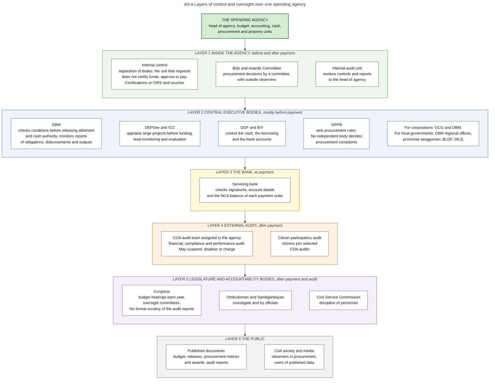
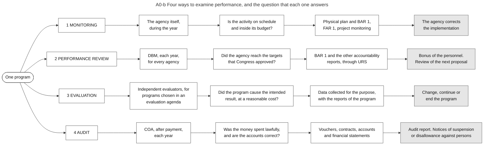
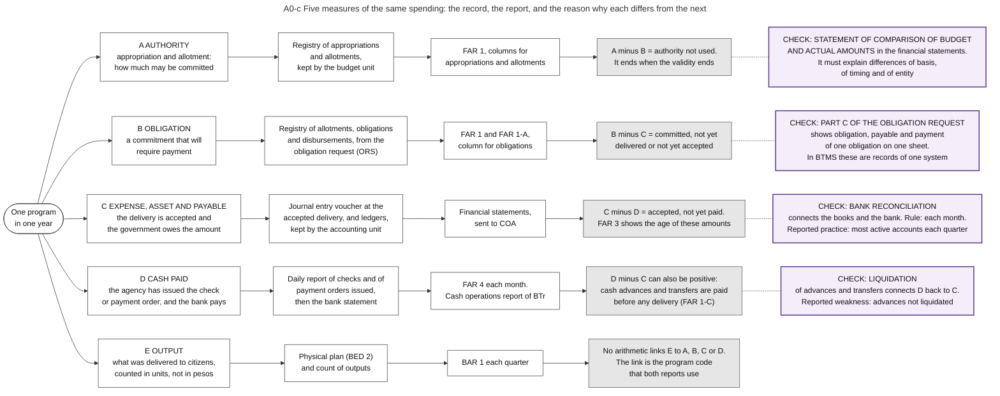

# A0. Accountability

*Part of the Philippine PFM Atlas. Facts as of 8 October 2026. The codes in the column "Basis" are explained in [Reference F](../reference/F_sources_and_verification.md). "GK" means general knowledge that I did not open in a source during this work.*

## 1. The phase in the budget cycle

Accountability is the fourth phase. It starts before the budget year with the performance targets, runs through the year with reports, monitoring and reviews, and ends in the year after it with the DBCC Year-End Report and the audit report [DBM-CYCLE].

| Chapter | Step | When (indicative) |
|---|---|---|
| A1 | Performance targets | October-December of the prior FY |
| A2 | Citizen engagement | Throughout the FY |
| A3 | Monitoring and evaluation | Throughout the FY |
| A4 | Agencies' accountability reports | Monthly and quarterly |
| A5 | Performance review | Throughout the FY |
| A6 | In-year reports | Monthly and quarterly |
| A7 | DBCC Mid-Year Report | September of the FY |
| A8 | DBCC Year-End Report | Within the next FY |
| A9 | Audit report | Within the next FY |

This chapter compares what the steps of the phase examine: the layers of control around one spending agency (section 2), the four examinations of performance and of spending (section 3), and the five measures of the same spending that the reports use (section 4).

## 2. Layers of control around a spending agency

Diagram A0-a shows six layers. The table gives the same content.

| Layer | Who | When | What is checked | Basis |
|---|---|---|---|---|
| 1. Inside the agency | The head of the agency, who must install and monitor a system of internal control. Officers who certify (chapter E4), the Bids and Awards Committee, the internal audit unit | Before and after payment | Authority, delivery, documents, procedure | PD1445 s.124, GAM-V2 App.32, RA12009. Internal audit: ROADMAP2024 (standards named), role GK |
| 2. Central executive bodies | DBM (release conditions, reports), DEPDev and the ICC (appraisal of large projects, evaluation), DOF and BTr (cash, borrowing), GPPB (procurement rules), and for corporations and local governments their own supervisors | Mostly before payment | Conditions of release, readiness, cash, rules | NBC599, ICC-NEWS, SFA11, RA12009, COB, LGC |
| 3. The bank | Servicing bank | At payment | Signatures, account details, NCA balance | CL2013-16A. What the bank checks: GK |
| 4. External audit | COA audit team. In selected audits, citizens participate (citizen participatory audit) | After payment | Accounts and transactions. Financial, compliance and performance audit | CONST IX-D.2, COA2011-002, ROADMAP2024 |
| 5. Legislature and accountability bodies | Congress in its budget hearings and oversight committees. Ombudsman and Sandiganbayan. Civil Service Commission | After payment and audit | Use of funds, conduct of officials | INQ-GUIDE (hearings). The other bodies: GK |
| 6. The public | Civil society, media, any person | At any time, as documents are published | Published documents: budget, releases, procurement notices and awards, audit reports | RA12009 s.43, DBM-BLOCKCHAIN. Publication in general: GK |

### Diagram A0-a  Layers of control and oversight over one spending agency

Code file: `../diagrams/mermaid/A0-a_oversight_map.mmd`. Rendered image: [`../rendered/A0-a_oversight_map.png`](../rendered/A0-a_oversight_map.png).

- **Question:** who checks a spending agency, at which moment (before or after the money is paid), and on what?
- **How to read it:** the agency is at the top. Each frame below is one layer of control, from the closest to the most distant. The text in each box says what that body checks and when.
- **Sources:** internal audit standards named for DBM and COA, kinds of COA audit, citizen participatory audit [ROADMAP2024]. Release conditions and reports checked by DBM [NBC599][JC2019-1]. Project and investment review by DEPDev and the ICC [ICC-NEWS][PIP-MEMO]. National evaluation policy led by DEPDev with DBM [SFA11]. Procurement rules and observers [RA12009]. Bank check on payment orders [CL2013-16A]. Audit after payment [COA2011-002][CONST IX-D]. Budget hearings [INQ-GUIDE]. Weak legislative review of audit reports, no independent procurement complaints body [PEFA2025]. GCG, BLGF roles [COB][eSRE].
- **From the auditing code:** internal control is the direct responsibility of the head of the agency [PD1445 s.124]. The officer who draws checks may not be a member of the accounting unit or of the internal control unit [PD1445 s.92]. COA may also examine bodies outside the government that receive subsidies, and only for the funds that they received [PD1445 s.29].
- **General knowledge, not opened in a source here:** the names of the oversight committees, the roles of the Ombudsman, Sandiganbayan and Civil Service Commission, the transparency seal and freedom of information rules.

## 3. The four examinations compared

Diagram A0-b gives the same content as this table.

| Examination | Who | When | Question | Records used | What may follow | Basis |
|---|---|---|---|---|---|---|
| Monitoring | The agency itself | During the year | Is the activity on schedule and inside its budget? | Physical plan, BAR 1, FAR 1, project monitoring | The agency corrects the implementation | JC2019-1, PEFA2025. Consequence: GK |
| Performance review | DBM | Each year, for every agency | Did the agency reach the targets that Congress approved? | BAR 1 and the other accountability reports | Bonus of the personnel. Review of the next proposal | PBB2024. Use in the next proposal: GK |
| Evaluation | Independent evaluators | For programs chosen in an evaluation agenda | Did the program cause the intended result, at a reasonable cost? | Data collected for the purpose, and the reports of the program | Change, continue or end the program | NEPF, NEPF-NEWS. Consequence: GK |
| Audit | COA | After payment, each year | Was the money spent lawfully, and are the accounts correct? | Vouchers, contracts, accounts, financial statements | Audit report. Notices of suspension or disallowance against persons | COA2011-002, COA2009-006 |

### Diagram A0-b  Four ways to examine performance, and the question that each one answers

Code file: `../diagrams/mermaid/A0-b_four_examinations_of_performance.mmd`. Rendered image: [`../rendered/A0-b_four_examinations_of_performance.png`](../rendered/A0-b_four_examinations_of_performance.png).

- **Question:** monitoring, performance review, evaluation and audit are often named together. What is the difference between them: who does each one, when, on which records, and what may follow from it?
- **Idea:** the four examinations answer four different questions about the same program. A program can pass one and fail another. Example: a training program reports all planned courses as held (monitoring and review: target reached), while an evaluation finds that the trained persons did not find work (the intended effect did not occur), and an audit finds that all payments were lawful.
- **How to read it:** each row is one kind of examination. Column 2 = who does it and when. Column 3 = the question. Column 4 = the records used. Column 5 (grey) = what may follow.
- **Sources:** row 1, quarterly reports BAR 1 and FAR 1 [JC2019-1]; monitoring of physical and financial progress by the implementing agencies (indicator 11.4, score B) [PEFA2025]; monitoring of selected projects with digital images [ROADMAP-MID]. Row 2, Agency Performance Review and the bonus criteria [PBB2024]; review of the earlier systems, which the order calls "duplicative and redundant with the internal and external performance audit and evaluation systems" [EO61]. Row 3, independent evaluation of programs and projects "in terms of their efficiency, outcomes and impacts", national and agency evaluation agendas, steering committee [NEPF][NEPF-NEWS]. Row 4, audit after payment and the notices that may follow [COA2011-002][COA2009-006]; no formal examination of audit reports by the legislature (indicator 31, score D) [PEFA2025].
- **General knowledge, not opened in a source here:** the performance audit of COA as a separate kind of audit, and the consequences in column 5 of rows 1 to 3.

## 4. Five measures of the same spending

For one program in one year, the budget report, the financial statements, the bank and the performance report show different amounts. Diagram A0-c answers the question: which amount measures what, and why do correct records differ?

The idea: one purchase passes five moments on different dates. Authority is given, a commitment is made, a delivery is accepted, cash is paid, and a result is counted. Each moment has its own record and its own report. The totals of a year differ because the moments occur in different periods. The difference is not an error. It is information.

| Measure | Event | First record | Report | What explains the difference to the next measure | Basis |
|---|---|---|---|---|---|
| A. Authority | Appropriation and allotment | Registry of appropriations and allotments | FAR 1 | A minus B is authority not used. It ends when the validity ends | JC2019-1, NBC599, GAM-V1 Ch.3 s.8 |
| B. Obligation | A commitment that will require payment | Obligation request, and the registry of allotments, obligations and disbursements | FAR 1, FAR 1-A | B minus C is committed but not yet delivered or accepted. Part C of the obligation request calls it "Not Yet Due" | JC2019-1, GAM-V1 Ch.3 s.15, GAM-V2 App.11 |
| C. Expense, asset and payable | The delivery is accepted | Journal entry voucher, ledgers | Financial statements to COA | C minus D is accepted but not yet paid. Part C of the obligation request calls it "Due and Demandable". FAR 3 shows the age of these amounts | GAM-V1 Annex H, GAM-V2 App.11, PD1445 s.41, JC2019-1 |
| D. Cash paid | The agency issues the check or payment order, and the bank pays | Daily report of checks and of payment orders issued, then the bank statement | FAR 4, cash operations report of BTr | D can exceed C: cash advances and transfers are paid before any delivery. FAR 1-C shows transfers and their liquidation | JC2019-1, NBC599, GAM-V1 Ch.6 s.52 |
| E. Output | What was delivered to citizens, counted in units | Physical plan and count of outputs | BAR 1 | No arithmetic connects E to the others. The connection is the program (chapter A1) | JC2019-1, NBC599. Connection: Inference |

Measure D itself has three dates for one payment: the day of the daily report of the agency, the day on which the bank pays, and the day of the entry of the Treasury (chapter A4, section 5.4).

When a comparison works: two amounts have the same measure, the same period and the same coverage of funds. Example: the obligations in FAR 1 of two agencies for the same year.

When it fails: an obligation rate of 95 percent is read as "95 percent of the work is done". Row B measures commitments. A contract signed in December counts in full, although nothing is delivered. A second example: the bonus rules measure the financial result of an agency as cash disbursements against the NCA received [PBB2024]. That is measure D compared with a cash limit. It says nothing about B, C or E.

Five checks connect the measures.

| Check | Connects | Rule, and reported state | Basis |
|---|---|---|---|
| Part C of the obligation request | B, C and D of one obligation: obligation, payable and payment on one sheet, kept by the budget unit | Rule of the Manual. I read no report on how completely agencies keep it | GAM-V1 Ch.3 s.12, GAM-V2 App.11 |
| Statement of comparison of budget and actual amounts | A and D of one agency, and the registries with the books | Rule: the difference is reconciled with unreleased appropriations, unobligated allotments and unpaid obligations | GAM-V1 Ch.3 s.26, s.30 |
| Bank reconciliation | The books and the bank | Rule: each month. Reported: "most active government accounts are reconciled quarterly" (indicator 27.1, score C) | GAM-V1 Ch.21 s.4, PEFA2025 |
| Liquidation of advances and transfers | D back to C: cash paid before delivery and the later proof of use | A part of the advances, in particular to government corporations, was not liquidated at the end of 2023 (indicator 27.3, score C) | PEFA2025 |
| One set of records in BTMS | A, B, C and D of one transaction: registries, books and reports come from the same entries | In use at DBM and BTr since December 2025. Other agencies follow in later years (chapter IS gives the dates and a disagreement between the sources) | CL2025-8, INQ-BTMS |

### Diagram A0-c  Five measures of the same spending: the record, the report, and the reason why each differs from the next

Code file: `../diagrams/mermaid/A0-c_five_measures_of_one_spending.mmd`. Rendered image: [`../rendered/A0-c_five_measures_of_one_spending.png`](../rendered/A0-c_five_measures_of_one_spending.png).

- **Question:** for one program in one year, the budget report, the financial statements, the bank and the performance report show different amounts. Which amount measures what, and why do correct records differ?
- **Idea:** one purchase passes five moments on different dates: authority is given, a commitment is made, a delivery is accepted, cash is paid, and a result is counted. Each moment has its own record and its own report. The totals of a year differ because the moments occur in different periods. The difference is not an error. It is information: it shows what is committed but not delivered, delivered but not paid, or paid but not used.
- **How to read it:** each row is one measure, in the order of time. Column 2 = the record in which the event is first written. Column 3 = the report that adds the records. Column 4 (grey) = what explains the difference between this measure and the measure in the next row. Column 5 (violet) = a check that connects two measures.
- **When the comparison works:** two amounts may be compared when they have the same measure, the same period and the same coverage of funds. Example: obligations in FAR 1 of two agencies for the same year.
- **When it fails:** an obligation rate of 95 percent does not show that 95 percent of the goods were delivered or paid. Row B measures commitments, not deliveries or payments.
- **Sources:** registries and the reports FAR 1, FAR 1-A, FAR 1-C, FAR 3, FAR 4 and BAR 1 [JC2019-1]. Which record is written at which event, and the journal entry at the accepted delivery [GAM-V1 Annex H, Ch.3 ss.8-17]. Part C of the obligation request shows obligation, payable and payment of one obligation [GAM-V2 App.11]. The statement of comparison of budget and actual amounts, and the three kinds of difference that it must explain [GAM-V1 Ch.3 ss.25-30]. Bank reconciliation each month [GAM-V1 Ch.21 s.4]. Financial statements and their submission [PD1445 s.41][COA-GAS]. Physical plan (BED 2), cash operations report of BTr, lapse of the NCA, transfers not disbursed until used [NBC599]. The financial result in the bonus rules is cash disbursements measured against the NCA received [PBB2024]. Bank reconciliation: "most active government accounts are reconciled quarterly" (indicator 27.1, score C); unliquidated advances (indicator 27.3, score C) [PEFA2025]. In BTMS the registries, the books and the reports come from one set of records [CL2025-8].
- **A difference between rule and reported practice:** the Manual requires a bank reconciliation statement each month [GAM-V1 Ch.21 s.4]. The assessment of 2025 reports that most active accounts are reconciled each quarter [PEFA2025].

