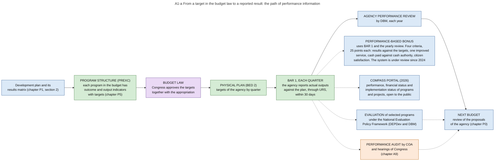

# A1. Performance targets

*Part of the Philippine PFM Atlas. Facts as of 8 October 2026. The codes in the column "Basis" are explained in [Reference F](../reference/F_sources_and_verification.md). "GK" means general knowledge that I did not open in a source during this work.*

## 1. The step in the budget cycle

| Item | This step |
|---|---|
| Phase | Accountability, step 1 of 9 |
| When | October-December of the prior FY. The timing in the illustration of DBM is indicative [DBM-CYCLE] |
| Documents | BED 2 Physical Plan, through URS: the same document as in chapter E2 [NBC599 s.3.9] |
| Receives documents from | Chapters L5 and E2 |
| Passes documents to | Chapters A4 and A5 |
| Read more | The path of a target through one year: section 5 and diagram A1-a |

## 2. The question this process answers

The budget law gives each program an amount in pesos and also a target in units, for example a number of classrooms. Who records whether the target was reached, who checks that record, and who uses it? And what is the difference between monitoring, performance review, evaluation and audit?

## 3. The idea in plain words

Money has a line of records: appropriation, allotment, obligation, payment. Performance has a second line of records, parallel to the first.

- The **target** is written in the budget, with the appropriation.
- The **plan** divides the target among the quarters of the year.
- The **quarterly report** states what the agency delivered.
- The **yearly review** by DBM compares the reports with the targets.

The two lines have no arithmetic connection. A report of money says how much was committed or paid. A report of performance says how many units were delivered. The only connection is that both are organized by program. Diagram A0-c shows this as measure E beside the four measures of money.

Four different examinations use these records. Each one answers a different question. **Monitoring** asks whether the work is on schedule. **Performance review** asks whether the targets were reached. **Evaluation** asks whether the program caused the result that was intended. **Audit** asks whether the money was spent lawfully and whether the accounts are correct. Diagram A0-b shows the four together.

A case where the reported result is reliable: the target is a count of things that the agency itself delivers, for example kilometres of road completed. The count can be checked against contracts and acceptance reports, which are records of the money line.

A case where it is not: the target is a condition that depends on many actors, for example the share of pupils who complete school. The agency can report the figure, but the report does not show whether its spending caused the figure. A program can therefore reach every target and still have no effect, or have an effect that the targets do not show. Only an evaluation can separate the two.

Terms. An **output** is what the agency delivers (a classroom, a training course). An **outcome** is the change that the output is meant to produce (pupils who learn, trained persons who find work). An **indicator** is a measure with a unit, for which a **target** is set for the year. The **program classification** (Program Expenditure Classification, PREXC) is the arrangement of the budget of each agency by programs, each with indicators.

## 4. Authorities and their roles

The law gave this task to the budget department long before the present reports. The Administrative Code of 1987 says: "The President, through the Secretary shall evaluate on a continuing basis the quantitative and qualitative measures of agency performance as reflected in the units of work measurement and other indicators of agency performance, including the standard and actual costs per unit of work" [EO292-B6 s.51]. The same chapter requires standard costs for each unit of work, a continuing review of the programs of each agency, and a report of each head of agency every six months on "both work and financial results" [EO292-B6 s.54, s.55, s.56]. A failure to submit the required reports stops the salary of the officials responsible [EO292-B6 s.57]. The present reports BED 2 and BAR 1 are the form in which these duties are performed today. This last sentence is my reading, and the circulars that I read do not cite these sections.

| Authority | Role in this process | Basis |
|---|---|---|
| Agency | Proposes its programs with indicators and targets. Plans the targets by quarter. Reports actual outputs each quarter. Monitors its own projects | NBM156, NBC599, JC2019-1. Monitoring by the implementing agencies: PEFA2025 |
| DBM | Evaluates the performance of agencies for the President, by law. Receives the physical plan and the quarterly reports through URS. Conducts the yearly Agency Performance Review. Validates the performance results and the financial results for the bonus. Chairs the group that reviews the performance management system. Issues the evaluation framework together with the planning department | EO292-B6 s.51, NBC599, JC2019-1, PBB2024, EO61, NEPF |
| Congress | Approves the targets together with the appropriation. Uses results in budget hearings | PBB2024 for the approval of targets. Hearings: GK |
| DEPDev (before 2025: NEDA) | Issues the National Evaluation Policy Framework with DBM. Its results matrix of the development plan is the origin of many indicators | NEPF, NEPF-NEWS. Results matrix: GK |
| Steering committee of the evaluation framework | Oversees evaluations. It replaced the earlier Evaluation Task Force in 2025 | NEPF-NEWS |
| Technical working group under Executive Order No. 61 | Reviews the performance management and incentive systems. Chair: Secretary of Budget and Management. Co-chair: Executive Secretary. Members: Secretary of Finance, head of the planning department, head of the Anti-Red Tape Authority. Issues the yearly rules for the bonus during the review | EO61, PBB2024 |
| Anti-Red Tape Authority | Validates the criterion "process results" of the bonus | PBB2024 |
| COA | Audits after payment. Its findings are one of the conditions for the bonus | COA2011-002, PBB2024. Performance audits as a separate kind of audit: GK |
| COMPASS Council | Sets the data standards of the public portal that shows program and project performance. Chair DBM, co-chair DICT, members DOF and DILG | EO126 |

## 5. The path of a target through one year

The numbers follow the main row of diagram A1-a.

| No. | Step | Who acts | Record | Basis |
|---|---|---|---|---|
| 1 | The development plan states the results that the government wants | Planning department | Results matrix of the plan | GK |
| 2 | The agency proposes its budget by program. Each program has outcome and output indicators with targets | Agency, in OSBPS | Budget proposal forms, among them the Program Budget Matrix | NBM156 |
| 3 | Congress approves the targets together with the appropriation | Congress | Budget law | PBB2024 |
| 4 | The agency divides the yearly targets among the quarters | Agency, through URS | Physical Plan (BED 2) | NBC599 s.3.9 |
| 5 | The agency reports actual outputs against the plan | Agency, through URS, within 30 days after each quarter | Quarterly Physical Report of Operations (BAR 1) | JC2019-1 |
| 6 | DBM reviews the performance of each agency for the year | DBM | Agency Performance Review | PBB2024 |
| 7 | The results are used when the next proposal of the agency is reviewed | DBM | Budget proposal of the next year | GK |

## 6. Documents and identifiers

| Document | Made by | Identified by | Links to the money line | Basis |
|---|---|---|---|---|
| Program Budget Matrix (BP Form A) | Agency | Agency, fiscal year, 15-digit program code | The same program code is used for the appropriation | NBM156, JC2017-1 |
| Physical Plan (BED 2) | Agency | Agency, fiscal year | Submitted together with the Financial Plan (BED 1) | NBC599 s.3.9 |
| BAR 1 | Agency | Agency, quarter | Compared with BED 2. The link to FAR 1 of the same quarter is the program. The fields of the form were not read | JC2019-1. Link: Inference |
| Agency Performance Review | DBM | Agency, year | Uses BAR 1 and the financial reports | PBB2024 |
| Evaluation report | Evaluator | Program | Not described | NEPF |

The indicator has no identifier of its own in the sources I read. A target is identified by the program to which it belongs and by its wording in the budget law.

## 7. Information systems

| System | Owner | Use in this process | Basis |
|---|---|---|---|
| OSBPS | DBM | Proposal forms with programs, indicators and targets | NBM156 |
| URS | DBM | Physical plan (BED 2) and quarterly physical report (BAR 1) | NBC599, JC2019-1 |
| DIME | DBM | Monitoring of selected projects with digital images | ROADMAP-MID. Description: GK |
| Monitoring systems of agencies | Each agency | Progress of projects. Different in each agency | GK |
| COMPASS portal | DBM | Publication of program and project performance | COMPASS-LAUNCH, EO126 |
| Planned: Integrated Project Monitoring and Reporting System | DBM and the planning department | One system for the monitoring of projects, pilot planned for 2028 | SFA6 |

BTMS has no performance function in the list of its five functions [CL2025-8]. Performance reports stay in URS. The FY 2026 budget law says that reports are submitted through URS or other electronic means until agencies migrate to BTMS [GAA2026-GP]. The circular on BTMS lists BAR 1 among the reports produced from BTMS [CL2025-8]. How the counts of outputs will enter BTMS is not stated in the sources I read.

## 8. Controls: what each one checks, and what it does not check

| Control | What it checks | What it does not check |
|---|---|---|
| BAR 1 against BED 2 | That reported outputs are compared with planned outputs each quarter | That the reported outputs exist. The agency reports on itself |
| Validation by DBM for the bonus | The reported achievement of the targets | Whether the targets were demanding, and whether the outputs had an effect |
| Financial criterion of the bonus | That cash authority was used | That the payments were for accepted deliveries. Advances and transfers also count as payments |
| Evaluation | Whether the program caused the intended result | All programs. Only chosen programs are evaluated |
| Audit | Legality of payments, correctness of accounts | Whether the program was the best use of the money |
| Publication in COMPASS | That the public can see what agencies report | The accuracy of the reports. The order leaves this responsibility with each agency |

Basis of the rows: JC2019-1, PBB2024, NEPF, COA2011-002, EO126. The second column of each row is my reading of what the source describes.

## 9. Timing

| Time | Event | Basis |
|---|---|---|
| With the budget proposal, March to April | Indicators and targets proposed | NBM156 |
| At the start of the year | Physical plan (BED 2) through URS | NBC599 |
| Within 30 days after each quarter | BAR 1 | JC2019-1 |
| After the year | Agency Performance Review | PBB2024 |
| 3 July 2026 | Rules for the bonus of FY 2024 | PBB2024 |

## 10. What the assessments and official texts report

| Finding | Basis |
|---|---|
| "Agencies publish service delivery objectives, outputs, and outcomes annually." Indicators 8.1 to 8.4 are rated A | PEFA2025 |
| Physical and financial progress of investment projects is monitored by the implementing agencies. Indicator 11.4 is rated B | PEFA2025 |
| No formal examination of audit reports by the legislature. Indicator 31 is rated D | PEFA2025 |
| The earlier performance management and incentive systems duplicated the audit and evaluation systems and had no mechanism of review | EO61 |
| DBM stated in 2025 that it will make monitoring and evaluation, and the digital processes of PFM, permanent | INQ-PFMDIGI |

The first finding and the review ordered in 2024 do not contradict each other. The assessment measures whether performance information is published. The order concerns the cost and the usefulness of the system that uses the information.

## 11. Diagrams

### Diagram A1-a  From a target in the budget law to a reported result: the path of performance information

Code file: `../diagrams/mermaid/A1-a_performance_information_flow.mmd`. Rendered image: [`../rendered/A1-a_performance_information_flow.png`](../rendered/A1-a_performance_information_flow.png).

- **Question:** the budget law contains targets in units (for example classrooms built), not only amounts in pesos. Where is a target written, who reports the result, who checks the report, and who uses it?
- **Idea:** performance information has its own line of records, parallel to the line of money. The target is fixed with the appropriation. The result is reported by the agency itself each quarter. DBM reviews the results each year. Three other users take the same reports for other purposes: the bonus system, the public portal, and the evaluators and auditors.
- **How to read it:** the row from left to right is the main path through one year. The column after the quarterly report shows the five uses of the reported results. Three of them lead to the next budget. Blue = executive. Purple = Congress. Green = spending agency. Light orange = audit. Dotted arrows = information.
- **When the path works:** a target that is a count of things delivered by the agency itself (for example kilometres of road completed) can be reported and checked against contracts and acceptance reports.
- **When it fails:** a target that depends on other actors (for example the rate of school completion) can be reported, but the report does not show whether the spending caused the result. That question needs an evaluation (see A0-b).
- **Sources:** program structure with outcome and output indicators in the budget proposal [NBM156]. Physical plan (BED 2) [NBC599]. Quarterly Physical Report of Operations (BAR 1) through URS within 30 days after each quarter [JC2019-1]. Agency Performance Review, and the four criteria of the bonus: performance results against the targets approved by Congress, process results, financial results (cash disbursements against the NCA received), citizen satisfaction, 25 points each [PBB2024]. Suspension of the earlier performance management and incentive systems for review [EO61]. National Evaluation Policy Framework of 2015, revised in 2025, with a steering committee [NEPF][NEPF-NEWS]. COMPASS portal: program and project performance, financial performance and implementation status for the public [EO126]. Monitoring of selected projects with digital images [ROADMAP-MID]. Assessment: "Agencies publish service delivery objectives, outputs, and outcomes annually" (indicators 8.1 to 8.4, score A) [PEFA2025].
- **General knowledge, not opened in a source here:** the results matrix of the development plan as the origin of the indicators, the performance audits of COA, and the use of the review in the next budget.

## 12. Verification status

- **Verified in a source:** the duties of the Administrative Code on the evaluation of agency performance, standard costs and reports on accomplishments [EO292-B6 ss.51-57]. The physical plan and the quarterly physical report [NBC599][JC2019-1]. The four criteria of the bonus, the records that it uses, the offices that validate, and the date of the rules [PBB2024]. The suspension and review of the earlier systems [EO61]. The existence, the dates and the stated purpose of the evaluation framework [NEPF][NEPF-NEWS]. The COMPASS portal and the order of 2026 [COMPASS-LAUNCH][EO126], read in official press releases, not in the text of the order. The scores [PEFA2025].
- **General knowledge, to check:** the results matrix of the development plan, the use of the review in the next budget, the performance audits of COA, the consequences of monitoring and of evaluation, the monitoring systems of agencies.
- **Inference:** that the program is the only link between BAR 1 and the financial reports, the second column of the table of controls, and the statement that the present reports perform the duties of the Administrative Code.
- **Not opened:** the revised evaluation framework of 2025 (joint memorandum circular of the planning authority and DBM), the forms BED 2 and BAR 1, the rules of the yearly Agency Performance Review, the text of Executive Order No. 126.
- **Covered only briefly or not at all:** the performance management of individual employees, the performance scorecards of government corporations, and the performance audit reports of COA.
