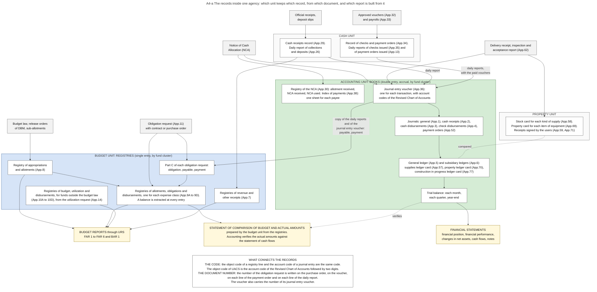
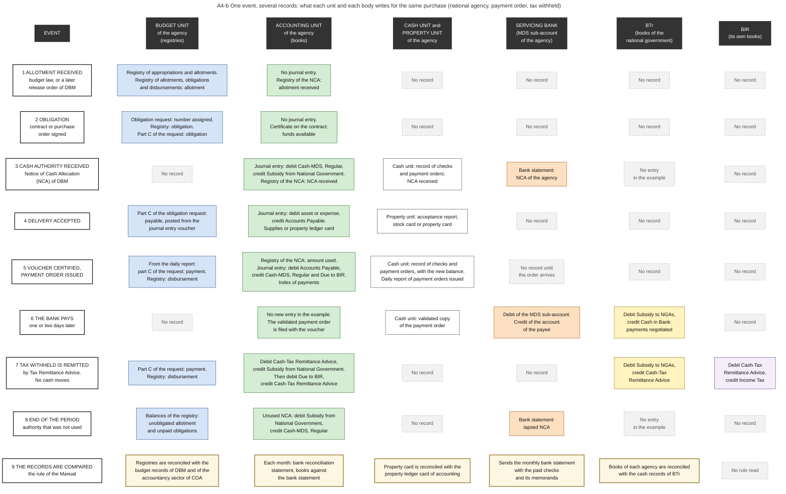
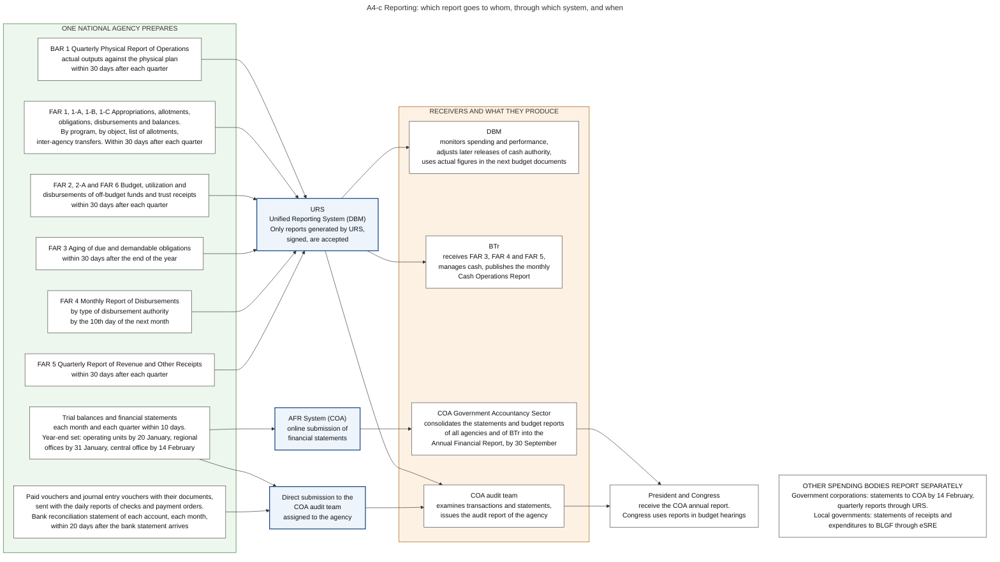
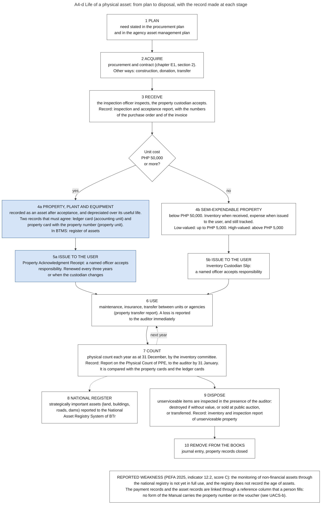

# A4. Agencies' accountability reports

*Part of the Philippine PFM Atlas. Facts as of 8 October 2026. The codes in the column "Basis" are explained in [Reference F](../reference/F_sources_and_verification.md). "GK" means general knowledge that I did not open in a source during this work.*

## 1. The step in the budget cycle

| Item | This step |
|---|---|
| Phase | Accountability, step 4 of 9 |
| When | Monthly and quarterly. The timing in the illustration of DBM is indicative [DBM-CYCLE] |
| Documents | FAR 1, 1-A, 1-B, 1-C and BAR 1: each quarter, within 30 days, through URS [JC2019-1] |
| On the four lines | Records and control |
| Receives documents from | Chapters E4, E6 and A1 |
| Passes documents to | Chapters A5 and A6 |
| Read more | The reports: section 6. The records from which they are built: section 5. The records in which a purchased item continues: section 15 |

## 2. The question this process answers

Where is each event of budget execution recorded, by which unit and by which body, and how do these records become the reports that DBM, COA, BTr, Congress and the public receive?

The main source of this chapter is the Government Accounting Manual for National Government Agencies of 2015: Volume I for the rules and the entries [GAM-V1], Volume II for the forms [GAM-V2], Volume III for the chart of accounts [GAM-V3]. The present list of budget reports is from the joint circular of 2019 [JC2019-1], which is later than the Manual.

## 3. The idea in plain words

No single record contains a whole transaction. Several units and bodies write about the same money, because each must answer a different question.

Inside one agency there are two main sets of records.

The first question is about legal authority: how much of the appropriation was released, committed and paid? The **budget registries** answer it. A registry is a list with a running balance. It is not a double-entry book. The budget unit keeps it.

The second question is about financial position: what does the agency own and owe, and what did its operations cost? The **accounting books** answer it. They use double entry and the accrual basis. The Manual defines the accrual basis as a basis under which "transactions and other events are recognized when they occur (and not only when cash or its equivalent is received or paid)" [GAM-V1 Ch.2 s.2]. The accounting unit keeps the books.

The Manual states this as the design of the whole system: "The financial reporting system of the Philippine government consists of accounting system on accrual basis and budget reporting system on budget basis" [GAM-V1 Ch.2 s.8].

The two sets do not record the same events. An **obligation** is an event for the registries only. The worked example of the Manual shows no journal entry for the budget law, for the allotment and for the obligation [GAM-V1 Annex H]. A **depreciation** charge is an event for the books only. A **payment** is an event for both.

Outside the agency, three more bodies write about the same money. The servicing bank records what it paid from the account of the agency. BTr keeps the books of the national government for cash and debt. BIR records the tax that the agency withheld. Section 5.3 places all these records side by side.

A case where the two sets of the agency agree: the disbursements in the registry of one period equal the credits to the cash accounts in the books for the same period and the same fund. Both are posted from the same daily reports of checks and payment orders issued [GAM-V1 Ch.3 ss.16-17].

A case where they disagree, without any error: the agency has obligated a contract of 100, has received and accepted deliveries worth 60, and has paid 40. The registry shows obligations of 100 and disbursements of 40. The books show an asset or expense of 60, a payable of 20 and a cash payment of 40. A reader who compares "obligations" with "expenses" finds a difference of 40. This difference is the part that is not yet delivered.

Terms. **RAPAL** is the Registry of Appropriations and Allotments. **RAOD** is the Registry of Allotments, Obligations and Disbursements, kept for each expense class. **RBUD** is the Registry of Budget, Utilization and Disbursements, for funds outside the budget law. **RANCA** is the Registry of Allotments and Notice of Cash Allocation, the record in which the accounting unit follows the cash authority. **JEV** is the Journal Entry Voucher, the form on which one accounting entry is written. **BFARs** are the Budget and Financial Accountability Reports. A **fund cluster** is a group of funds with its own books and reports (chapter E6, section 9).

## 4. Authorities and their roles

| Authority | Role in this process | Basis |
|---|---|---|
| COA | Has exclusive authority to issue accounting and auditing rules. Prescribed the Government Accounting Manual for national agencies, in three volumes, in force since 1 January 2016, based on the Philippine Public Sector Accounting Standards. Keeps the general accounts of the government | CONST IX-D.2, COA2015-007, GAM-V1 Ch.1 s.1, Ch.2 s.7 |
| COA, Government Accountancy Sector | Keeps budget records of the approved budget and of its execution. Consolidates the financial statements and the budget reports of all national agencies and of BTr into the Annual Financial Report | GAM-V1 Ch.2 s.8, COA-GAS |
| DBM | Keeps the budget records with which the registries of each agency are reconciled. With COA, prescribes the budget and financial accountability reports. Receives them through URS | GAM-V1 Ch.2 s.8, JC2019-1 |
| BTr | "accounts for the cash, public debt and related transactions" of the national government. The books of each agency are reconciled with its records of cash transactions. Receives FAR 3, FAR 4 and FAR 5. Publishes the Cash Operations Report | GAM-V1 Ch.2 s.8, JC2019-1, NBC599 |
| Budget unit of the agency | Keeps the registries and prepares the budget reports and the statement of comparison of budget and actual amounts | GAM-V1 Ch.3 s.5, s.26, JC2019-1 |
| Accounting unit of the agency | Keeps the books, the registry of the NCA and the index of payments. Prepares trial balances, financial statements and bank reconciliation statements | GAM-V1 Ch.2 s.12, Ch.19 s.59, Ch.21 s.4 |
| Cash unit of the agency | Keeps the records of receipts, checks and payment orders. Reports to the accounting unit each day | GAM-V1 Ch.5 s.39, Ch.6 s.52 |
| Property unit of the agency | Keeps the stock cards and the property cards | GAM-V1 Ch.8 s.9, Ch.10 s.42 |
| Head of agency | Is responsible for the financial statements together with the head of the accounting unit. Approves the budget reports | GAM-V1 Ch.2 s.10, JC2019-1 |
| COA audit team | Receives vouchers, reports and statements for audit | COA2011-002, PD1445 s.41 |

## 5. From event to record

### 5.1 The records of one agency, and who keeps them

Diagram A4-a shows these records and the flows between the units. "App." is the number of the form in Volume II of the Manual.

| Unit | Record | Form | What it shows | Basis |
|---|---|---|---|---|
| Budget unit | Registry of Appropriations and Allotments (RAPAL) | App.8 | The budget of the agency and all allotments received. The Manual says: "The balance is extracted every time an entry is made to prevent incurrence of overdraft in appropriations." | GAM-V1 Ch.3 s.8 |
| Budget unit | Registries of Allotments, Obligations and Disbursements (RAOD), one each for personnel services, for maintenance and other operating expenses, for financial expenses and for capital outlays | App.9A to 9D | Allotments, obligations, unobligated allotments, disbursements, and unpaid obligations in two columns: due and demandable, and not yet due and demandable | GAM-V1 Ch.3 s.10, GAM-V2 App.9A |
| Budget unit | Obligation Request and Status (ORS), part C | App.11 | For one obligation, on one sheet: the obligation, the payable and the payment. The Manual says: "It shall contain the original amount of obligation, payable (goods delivered and services rendered) and the actual amount paid." | GAM-V1 Ch.3 s.12, GAM-V2 App.11 |
| Budget unit | Registries of Budget, Utilization and Disbursements (RBUD), with the Budget Utilization Request and Status | App.10A to 10D, App.14 | The same for money that does not need an allotment of DBM: retained income, revolving funds, trust receipts | GAM-V1 Ch.3 ss.18-24 |
| Budget unit | Registries of Revenue and Other Receipts | App.7 | Revenue estimated, collected, and remitted or deposited | GAM-V1 Ch.3 ss.6-7 |
| Accounting unit | Journal Entry Voucher (JEV) | App.36 | One accounting entry, with the account codes | GAM-V2 App.36 |
| Accounting unit | General Journal, Cash Receipts Journal, Cash Disbursements Journal, Check Disbursements Journal, ADA Disbursements Journal | App.1 to 4, App.52 | The entries in the order of their dates | GAM-V1 Ch.2 s.12, GAM-V2 App.52 |
| Accounting unit | General Ledger and Subsidiary Ledgers | App.5, App.6 | The balance of each account | GAM-V1 Ch.2 s.12 |
| Accounting unit | Registry of Allotments and Notice of Cash Allocation (RANCA) | App.30 | Allotment received, NCA received, NCA used. Two balances: NCA not yet used, and allotment not yet covered by an NCA | GAM-V2 App.30, GAM-V1 Ch.6 s.12 |
| Accounting unit | Index of Payments | App.38 | One sheet for each payee, with every payment to this payee | GAM-V2 App.38, GAM-V1 Ch.6 s.12 |
| Accounting unit | Supplies Ledger Card, Property, Plant and Equipment Ledger Card, Construction in Progress Ledger Card | App.57, App.70, App.77 | The value of each kind of supply, of each asset, and of each project under construction | GAM-V1 Ch.8 s.9, Ch.10 s.42, s.47 |
| Cash unit | Cash Receipts Record, and the daily Report of Collections and Deposits | App.29, App.26 | Each official receipt, and each deposit | GAM-V1 Ch.5 s.39, s.40 |
| Cash unit | Checks and ADA Disbursements Record, and the daily Report of Checks Issued and Report of ADA Issued | App.34, App.35, App.13 | Each check and each payment order, with the remaining balance of the NCA | GAM-V1 Ch.2 s.42, Ch.6 s.52, GAM-V2 App.34 |
| Property unit | Stock Card and Property Card | App.58, App.69 | The quantity of each kind of supply, and each item of equipment with its user | GAM-V1 Ch.8 s.9, Ch.10 s.42 |

Two of these records exist twice on purpose. The accounting unit keeps the ledger card of an asset, and the property unit keeps the property card of the same asset. The Manual requires that the two are reconciled [GAM-V1 Ch.10 s.42]. The reason is separation of duties: the unit that has the goods does not keep the only record of them.

### 5.2 One purchase in the registries and in the books

The table follows one purchase of goods, paid by payment order, with tax withheld. The entries and the account codes are those of the worked example of the Manual.

| Event | Budget unit (registries) | Accounting unit (books) | Basis |
|---|---|---|---|
| The budget law takes effect | RAPAL: appropriation | No journal entry | GAM-V1 Annex H, Ch.3 s.9 |
| Allotment received | RAPAL and RAOD: allotment | No journal entry. RANCA: allotment received | GAM-V1 Annex H, GAM-V2 App.30 |
| Contract or purchase order signed, obligation request approved | Number of the obligation request assigned. RAOD: obligation. Part C of the request: obligation | No journal entry. Certificate on the contract or purchase order that funds are available | GAM-V1 Annex H, Ch.3 s.15, GAM-V2 App.61 |
| NCA received | No record | Debit Cash-Modified Disbursement System (MDS), Regular (10104040). Credit Subsidy from National Government (40301010). RANCA: NCA received | GAM-V1 Ch.5 s.38, Annex H |
| Delivery inspected and accepted | Part C of the request: payable, posted from the journal entry voucher | Debit the asset or expense account. Credit Accounts Payable (20101010). Supplies ledger card or property ledger card | GAM-V1 Ch.8 s.15, Annex H, GAM-V2 App.11 |
| Voucher certified | No record | RANCA: NCA used. Index of payments | GAM-V1 Ch.6 s.12 |
| Payment order issued | Part C of the request: payment. RAOD: disbursement. Both from the copy of the daily report that accounting sends | Debit Accounts Payable. Credit Cash-MDS, Regular and Due to BIR (20201010). Entered in the ADA Disbursements Journal | GAM-V1 Ch.6 s.56, s.57, Ch.3 ss.16-17, Annex H |
| Tax withheld is remitted by Tax Remittance Advice | Part C of the request: payment. RAOD: disbursement | Debit Cash-Tax Remittance Advice (10104070), credit Subsidy from National Government. Then debit Due to BIR, credit Cash-Tax Remittance Advice | GAM-V1 Ch.5 s.38, Annex H |
| Supplies issued to the users | No record | Debit Office Supplies Expenses (50203010). Credit Office Supplies Inventory (10404010) | GAM-V1 Annex H |
| End of the period: cash authority not used | No record | Debit Subsidy from National Government. Credit Cash-MDS, Regular | GAM-V1 Ch.19 s.55 |
| End of the validity of the appropriation | The unobligated allotment can no longer be used | No journal entry read | NBC599 |

Two more events have a record in the books and none in the registries of spending.

| Event | Accounting unit (books) | Basis |
|---|---|---|
| A fee is billed and collected | Billing: debit Accounts Receivable (10301010), credit the income account. Collection: debit Cash-Collecting Officers (10101010). Remittance to the Treasury: debit Cash-Treasury/Agency Deposit, Regular (10104010), credit Cash-Collecting Officers. The budget unit enters the collection in its registry of revenue | GAM-V1 Annex H, Ch.3 ss.6-7 |
| A tax is collected | Recorded when it is collected. The Manual says: "The cash basis of accounting shall be applied by all government agencies in the recognition of revenue from non-exchange transaction until a reliable model of measurement of this revenue is developed." | GAM-V1 Ch.5 s.12 |

A consequence of the second row: a tax that is assessed and not yet paid is in general not an asset in the books. The books show taxes when they are collected (chapter E5, section 4).

### 5.3 The same events in the records of the cash unit, of the bank, of the Treasury and of BIR

Diagram A4-b shows all keepers of records in one grid. The table gives the columns that section 5.2 does not have. "No record" means that this keeper writes nothing at this event.

| Event | Cash unit of the agency | Servicing bank | BTr, books of the national government | BIR, its own books | Basis |
|---|---|---|---|---|---|
| Allotment, obligation | No record | No record | No record | No record | GAM-V1 Annex H |
| NCA received | Record of checks and payment orders: NCA received | The bank statement of the agency lists the NCA | No entry in the worked example | No record | GAM-V2 App.34, GAM-V1 Ch.21 s.8, Annex H |
| Delivery accepted | No record. The property unit writes the acceptance report and its card | No record | No record | No record | GAM-V1 Ch.8 s.15 |
| Payment order issued | Record of checks and payment orders, with the new balance of the NCA. Daily report of payment orders issued | No record until the order arrives | No record | No record | GAM-V1 Ch.6 s.52, s.56 |
| The bank pays | Receives the validated copy of the payment order | Debits the MDS sub-account of the agency. Credits the account of the payee | Debit Subsidy to NGAs (50214010). Credit Cash in Bank. Explanation in the example: "To recognize MDS checks negotiated" | No record | GAM-V1 Ch.6 s.56, Annex H |
| Tax remitted by Tax Remittance Advice | No record | No record. No cash moves | Debit Subsidy to NGAs. Credit Cash-Tax Remittance Advice | Debit Cash-Tax Remittance Advice. Credit Income Tax (40101010) | GAM-V1 Ch.5 s.38, Annex H |
| End of the period: cash authority not used | No record read | The bank statement shows the lapsed NCA | No entry in the worked example | No record | GAM-V1 Ch.21 s.2, s.8, Annex H |

The cells that report no entry of the Treasury in the worked example have a limit. The example of the Manual lists the entries of the Treasury for remittances of collections, for payments and for the Tax Remittance Advice. It has no entry of the Treasury for the issue of an NCA [GAM-V1 Annex H]. I did not read the accounting rules of BTr itself.

### 5.4 What follows from these tables

**One payment has three dates.** The agency credits its cash account on the day of its daily report, which also contains payment orders "not yet delivered" to the bank [GAM-V1 Ch.6 s.52]. The bank credits the payee one or two days after it receives the order. The Treasury records the amount when the bank has paid. A payment order issued on the last day of a month is therefore paid in the books of the agency, and not yet paid in the records of the bank and of the Treasury. None of the three records is wrong.

**The cash account of the agency for its NCA is not money.** The chart of accounts says that the account Cash-MDS, Regular "is used to recognize in the agency books the NCA received for its operating requirements" [GAM-V3 Ch.3]. The Manual says about year-end adjustments of bank accounts that they do not apply to this account, "since there is no actual cash with the GSBs" [GAM-V1 Ch.19 s.56]. GSB means government servicing bank. The account measures a limit that the agency may still use. The money stays in the accounts of the Treasury until the bank has paid (chapter E5, section 3).

**Each body has an account that corresponds to an account of another body.** The agency credits Subsidy from National Government, and the Treasury debits Subsidy to NGAs. The agency debits Cash-Treasury/Agency Deposit when it remits a collection, and the Treasury credits the account of the same name. The Manual calls the entry in the books of the other body the "responding entry" [GAM-V1 Annex H]. This is why the Manual requires that the books of each agency are "reconciled with the records of cash transactions maintained by the BTr" [GAM-V1 Ch.2 s.8].

**The two sides do not record at the same moment.** The agency records the subsidy when it receives the NCA, and it reverses the unused part at the end of the period. The Treasury records the subsidy when the bank has paid. At the end of a year the two amounts therefore differ by the checks and payment orders that the agency has issued and the bank has not yet paid. This sentence is my inference from the entries. The Manual does not state it in these words.

**One paper can produce entries in three sets of books without any movement of money.** The Tax Remittance Advice is the example: the agency, BIR and the Treasury each make an entry from it [GAM-V1 Ch.5 s.38].

## 6. The reports

Diagram A4-c shows the flows. The first table gives the budget reports of the joint circular of 2019.

| Report | Content | Period and deadline | Sent to | Through | Basis |
|---|---|---|---|---|---|
| BAR 1 | Quarterly Physical Report of Operations: actual outputs against the physical plan (BED 2) | Quarterly, within 30 days after the quarter | DBM, COA | URS | JC2019-1 |
| FAR 1 | Statement of Appropriations, Allotments, Obligations, Disbursements and Balances, by fund cluster and by program, activity and project | Quarterly, within 30 days | DBM, COA | URS | JC2019-1 |
| FAR 1-A | The same by object of expenditure | Quarterly, within 30 days | DBM, COA | URS | JC2019-1 |
| FAR 1-B | List of allotments and sub-allotments | Quarterly, within 30 days | DBM, COA | URS | JC2019-1 |
| FAR 1-C | Obligations, disbursements, liquidations and balances of inter-agency fund transfers | Quarterly, within 30 days | DBM, COA | URS | JC2019-1 |
| FAR 2 and 2-A | Approved budget, utilization, disbursements and balances of off-budget funds (fund clusters 05 and 06) | Quarterly, within 30 days | DBM, COA | URS | JC2019-1 |
| FAR 3 | Aging of due and demandable obligations | Yearly, within 30 days after the end of the year | COA, DBM, BTr | URS | JC2019-1 |
| FAR 4 | Monthly Report of Disbursements, by type of disbursement authority | Monthly, by the 10th day of the next month | DBM, COA, BTr | URS | JC2019-1 |
| FAR 5 | Quarterly Report of Revenue and Other Receipts, fund clusters 01 to 07 | Quarterly, within 30 days | DBM, COA, BTr | URS | JC2019-1 |
| FAR 6 | Approved budget, utilization, disbursements and balances of trust receipts (fund cluster 07) | Quarterly, within 30 days | DBM, COA | URS | JC2019-1 |

Rule on form: only reports generated by URS and then signed are accepted [JC2019-1]. The FY 2026 budget law says that reports are submitted through URS or other electronic means until agencies migrate to BTMS [GAA2026-GP].

Sources of the budget reports: the registries RAPAL, RAOD and RBUD [JC2019-1].

A difference between two rules: the Manual of 2015 lists the budget reports of the joint circulars of 2013 and 2014, without FAR 1-C and FAR 6, and with a deadline of 30 days after the month for FAR 4 [GAM-V1 Ch.2 s.14, Ch.3 s.31, s.32]. The table above gives the later rule.

The second table gives the reports that come from the books.

| Report | Content | Period and deadline | Sent to | Basis |
|---|---|---|---|---|
| Trial balance with supporting schedules | All accounts of the general ledger with their balances, in the order of the chart of accounts | Monthly and quarterly, within ten days after the period | COA auditor, DBM | GAM-V1 Ch.19 s.48, s.59, s.60 |
| Financial statements | Statement of Financial Position, Statement of Financial Performance, Statement of Changes in Net Assets/Equity, Statement of Cash Flows, Statement of Comparison of Budget and Actual Amounts, Notes | Quarterly, within ten days. Year-end: operating units by 20 January, regional offices by 31 January, central offices by 14 February | COA auditor, DBM, and at year-end the COA Government Accountancy Sector | GAM-V1 Ch.2 s.11, Ch.19 s.5, s.60, PD1445 s.41. Channel at year-end, the AFR System: COA-GAS |
| Bank reconciliation statement | For each bank account: the balance in the books compared with the balance in the bank statement | Monthly. Prepared within ten days after the bank statement arrives, submitted within twenty days | COA auditor, head of agency | GAM-V1 Ch.21 s.4, s.5, s.7 |
| Daily reports of checks issued and of payment orders issued, with the paid vouchers | The transactions themselves, with their documents | With each report | COA auditor | GAM-V1 Ch.6 s.56 |
| Report on the physical count of property, plant and equipment | The items found at the count, as at 31 December | Yearly, not later than 31 January | COA auditor | GAM-V1 Ch.10 s.38 |
| Report on the physical count of inventories | The supplies found at the count, compared with the ledger cards | Every six months, not later than 31 July and 31 January | COA auditor | GAM-V1 Ch.8 s.13, GAM-V2 App.66 |

**The statement that connects both sets.** The Statement of Comparison of Budget and Actual Amounts is one of the six financial statements, and it is prepared from the registries. The Manual gives the reason for a separate statement: "the budget and the financial statements are not prepared on a comparable basis" [GAM-V1 Ch.3 s.25]. The budget unit prepares it. The accounting unit verifies its actual amounts against the Statement of Cash Flows [GAM-V1 Ch.3 s.26, s.30]. Three rules of this statement show how the two sets relate.

- The actual payments in it are the disbursements posted in the registry from the reports of checks and payment orders issued, from the Tax Remittance Advice and from journal entry vouchers [GAM-V1 Ch.3 s.30]. They are cash paid. They are not obligations and not expenses.
- "The NCA received for funding requirements of the agency shall not be considered as receipts for the purpose of this statement" [GAM-V1 Ch.3 s.30]. In the books the NCA is credited to a revenue account, Subsidy from National Government. In this statement it is not a receipt.
- The difference between the final budget and the actual amounts must be reconciled with three balances of the budget report FAR 1: unreleased appropriations, unobligated allotments and unpaid obligations [GAM-V1 Ch.3 s.30]. In symbols of chapter A0, section 4: A minus D equals appropriation not released, plus allotment not obligated, plus obligation not paid.

The notes to the statements must also reconcile the actual amounts of this statement with the amounts of the other statements, and must name three kinds of difference: of basis (the budget is on another basis than the books), of timing (the budget period is not the reporting period) and of entity (the budget omits programs or bodies that the statements include) [GAM-V1 Ch.3 s.28].

## 7. What the receivers produce

| Receiver | Product | Deadline | Basis |
|---|---|---|---|
| COA Government Accountancy Sector | Annual Financial Report on the national government, from the statements and budget reports of all agencies and of BTr | The annual report of COA is due not later than the last day of September | GAM-V1 Ch.2 s.8, PD1445 s.41, COA-GAS |
| COA audit team | Audit report of each agency (chapter A9) | | GK |
| BTr | Monthly Cash Operations Report. Press reports of BTr data give the deficit and the debt of the national government for each month | Monthly | NBC599, BTR-DATA |
| DBM | Monitoring of spending and performance. Actual figures in the next budget documents. Since June 2026: the COMPASS portal, which shows the budget with allotments, obligations and disbursements to the public | | Portal: COMPASS-LAUNCH, EO126. The rest: GK |
| DOF | Consolidated Public Sector Financial Position, a table in the budget documents that adds the national government, monitored corporations, social security institutions, the central bank, government financial institutions and local governments | Yearly | BESF2026-A3 |
| DBCC | Fiscal Risks Statement (chapter P1, section 4) | Six statements between 2015 and 2023 | FRS2023 |
| COA | Annual report to the President and Congress | Yearly | CONST IX-D.4 |

Government corporations send year-end statements to the COA Government Accountancy Sector and to their auditor on or before 14 February. No revision is allowed after 31 March [COA2015-004]. Local governments report receipts and expenditures to BLGF through eSRE, quarterly and yearly [eSRE].

## 8. Information systems

| System | Owner | Holds | Basis |
|---|---|---|---|
| Registries on paper or spreadsheet, or eBudget (COA) | Agency, COA | Allotments, obligations, disbursements | COA-GAS, ROADMAP2024 |
| eNGAS or other accounting software | COA, agency | Journal entries, ledgers, statements | COA-GAS |
| URS | DBM | Execution plans and accountability reports | NBC599, JC2019-1 |
| AFR System | COA | Financial statements for the Annual Financial Report | COA-GAS |
| BTMS | DBM | In agencies that use it: registries, books and reports from one set of records. Journal entries are created by the system from vouchers, revenue vouchers and asset transactions. Reports listed in the circular: FAR 1 to 6, BAR 1, registry of allotments, NCA listings | CL2025-8, BTMS-SITE |

The Manual prescribes the forms of section 5.1 as forms. It does not prescribe a system. Where the collection system of an agency is not connected with its accounting system, the Manual tells the accounting unit to record the collections from the reports that the collection system produces [GAM-V1 Ch.5 s.39].

The Roadmap names three gaps of the present arrangement: the same report is prepared more than once, processing is manual, and the systems are not integrated [ROADMAP2024].

## 9. The link between the sets of records

Two things connect a record of one unit with a record of another unit.

The **code** connects records of the same kind of spending. The object code in a line of a registry and the account code in a journal entry are the same code by construction. In the chart of accounts each account has a code of eight digits, and the object code of UACS is this code followed by two digits for the sub-object. Example of the chart: Cash-Collecting Officers has the account code 10101010 and the object code 1010101000 [GAM-V3 Ch.2].

The **document number** connects records of the same transaction. The forms of the Manual carry these numbers.

| Form | Number of another record that it carries | Basis |
|---|---|---|
| Purchase order | Number, date and amount of the obligation request, beside the certificate "Funds Available" | GAM-V2 App.61 |
| Inspection and acceptance report | Number of the purchase order, number of the invoice | GAM-V2 App.62 |
| Disbursement voucher | Number of the obligation request. After payment: number of the check or payment order, number of the official receipt of the payee, number of the journal entry voucher | GAM-V2 App.32 |
| Payment order (LDDAP-ADA), each line | Number of the obligation request, and the bank account of the payee | GAM-V2 App.42 |
| Daily report of checks or of payment orders issued, each line | Number of the check or payment order, of the voucher and of the obligation request, with the payee and the object code | GAM-V2 App.13, App.35 |
| Part C of the obligation request | Reference column for the number of the journal entry voucher, check, payment order or Tax Remittance Advice | GAM-V2 App.11 |

The line of the daily report is the one place where the numbers of the payment, of the voucher and of the obligation, the payee and the object code stand together. Chapter UACS follows this chain of numbers from the plan to the asset, and it shows which numbers no form carries.

## 10. Controls: what each one checks, and what it does not check

| Control | What it checks | What it does not check | Basis |
|---|---|---|---|
| Balance of the registry, extracted at every entry | That obligations do not exceed allotments, and that disbursements do not exceed obligations | That the obligation was valid | GAM-V1 Ch.3 s.8, s.10 |
| Registry of the NCA, read before the voucher is certified | That the payment does not exceed the cash authority | That the claim is true | GAM-V1 Ch.6 s.12 |
| Double entry and trial balance | That debits equal credits | That the right account was used | GAM-V1 Ch.19 s.48 |
| Monthly bank reconciliation, by the chief accountant | That the books agree with the bank statement, for each bank account and for the MDS account. The Manual names three purposes: to check both records, to deter fraud, and to make known the items that only one side has recorded | That the payment went to the right person for a real delivery | GAM-V1 Ch.21 s.3, s.4 |
| Property card against property ledger card | That the unit that holds the goods and the unit that keeps the books agree | That the goods exist. Only the physical count shows this | GAM-V1 Ch.10 s.38, s.42 |
| Statement of comparison of budget and actual amounts, verified by accounting | That the disbursements of the registries agree with the cash flows of the books | The obligations | GAM-V1 Ch.3 s.26, s.30 |
| Reports generated only by URS | That DBM, COA and BTr receive the same figures in the same form | That the figures entered by the agency agree with its registries and books | JC2019-1 |
| Certification of FAR 1 by budget officer and chief accountant | That the two units agree on the figures | | JC2019-1 |
| Deadline with penalty | That reports arrive in time. The Auditing Code allows the suspension of the salary of an official who does not submit year-end statements | The quality of the reports | PD1445 s.41 |

In BTMS the bank reconciliation is made each day from electronic bank statements [BTMS-SITE].

## 11. Closing a period, and the calendar of one year

At the end of a period the accounting unit makes adjusting entries before it prepares the statements. The Manual lists among them: the unused NCA, the petty cash fund, commercial checks that were written and not released, impairment, the write-down of inventories, corrections, depreciation, and differences of exchange rates [GAM-V1 Ch.19 s.51]. An expense that belongs to the period and is not yet paid is accrued. Example of the Manual: salaries earned and not yet paid are debited to the salary expense and credited to Due to Officers and Employees [GAM-V1 Ch.19 s.52].

At the end of the year the revenue and expense accounts are closed to the account Revenue and Expense Summary, and this account is closed to Accumulated Surplus/(Deficit). The balance of Cash-Treasury/Agency Deposit, Regular is also closed to Accumulated Surplus/(Deficit) [GAM-V1 Ch.19 s.57]. The collections that an agency remitted to the Treasury in the year are therefore not an asset of the agency in the next year.

| Date | Report or event | Basis |
|---|---|---|
| Each day | Reports of collections and deposits, of checks issued and of payment orders issued, from the cash unit to the accounting unit | GAM-V1 Ch.5 s.39, Ch.6 s.52 |
| 10th day of each month | FAR 4 of the month before. Trial balance of the month before | JC2019-1, GAM-V1 Ch.19 s.60 |
| Each month, within twenty days after the bank statement arrives | Bank reconciliation statement to the auditor | GAM-V1 Ch.21 s.7 |
| 30 days after each quarter (about 30 April, 30 July, 30 October, 30 January) | BAR 1, FAR 1 and its parts, FAR 2, FAR 5, FAR 6 | JC2019-1 |
| 20 January, 31 January | Year-end statements of operating units, then of regional offices | GAM-V1 Ch.19 s.60 |
| 30 days after the end of the year | FAR 3 | JC2019-1 |
| 31 January | Report on the physical count of property, plant and equipment | GAM-V1 Ch.10 s.38 |
| 14 February | Year-end trial balances and statements of the whole agency to COA | PD1445 s.41, GAM-V1 Ch.19 s.60 |
| 30 September | Annual report of COA | PD1445 s.41 |

## 12. Where the process fails in practice

| Reported weakness | Basis |
|---|---|
| Quarterly budget reports are issued within 8 weeks after the quarter (PEFA indicator 28.2, score C). Their accuracy is rated C because manual processes remain (indicator 28.3). Coverage through URS is rated B (indicator 28.1) | PEFA2025 |
| Not all agencies comply with the rules on reporting expenditure arrears (PEFA indicator 22.2, score C) | PEFA2025 |
| Bank reconciliation is partial (PEFA indicator 27.1, score C). The Manual requires it each month. The assessment reports that most active accounts are reconciled each quarter | PEFA2025, GAM-V1 Ch.21 s.4 |
| A strength: the Philippine Public Sector Accounting Standards are adopted (PEFA indicator 29.3, score A) | PEFA2025 |
| Duplicate preparation of reports, manual processing, no integration | ROADMAP2024 |
| Classification codes are not consistent across PFM systems | SFA6 |

## 13. Diagrams

### Diagram A4-a  The records inside one agency: which unit keeps which record, from which document, and which report is built from it

Code file: `../diagrams/mermaid/A4-a_accounting_records_flow.mmd`. Rendered image: [`../rendered/A4-a_accounting_records_flow.png`](../rendered/A4-a_accounting_records_flow.png).

- **Question:** inside one national agency, which unit keeps which record, from which document it is written, which unit passes its record to which other unit, and from which records are the reports built?
- **Idea:** four units of one agency write about the same money. The BUDGET UNIT keeps registries: lists with running balances that follow legal authority (appropriation, allotment, obligation, disbursement). The ACCOUNTING UNIT keeps the books: double entry on the accrual basis (assets, liabilities, revenue, expenses). The CASH UNIT keeps the records of receipts, checks and payment orders, and it reports to accounting every day. The PROPERTY UNIT keeps the cards of the items in stock and in use. The budget reports come from the registries. The financial statements come from the books. One statement, the comparison of budget and actual amounts, needs both.
- **How to read it:** top row (grey) = source documents. Blue frame = budget unit. Green frame = accounting unit. White frames = cash unit and property unit. Yellow = reports. A solid arrow = this document or record is the source of the next record. A dotted arrow = the two records are compared with each other.
- **Numbers in brackets:** "App." is the number of the form in Volume II of the Manual [GAM-V2].
- **Sources:** the list of journals, ledgers and registries [GAM-V1 Ch.2 s.12]. Registries of the budget unit and the rule that a balance is extracted at every entry [GAM-V1 Ch.3 ss.5-12]. Part C of the obligation request as the subsidiary record of one obligation [GAM-V1 Ch.3 s.12][GAM-V2 App.11]. The budget unit posts payments from the reports that accounting sends [GAM-V1 Ch.3 ss.16-17]. Registry of the NCA and index of payments [GAM-V1 Ch.6 s.12][GAM-V2 App.30, App.38]. Daily reports of the cash unit [GAM-V1 Ch.5 s.39, Ch.6 s.52, s.56]. Documents that are posted to the journals [GAM-V1 Ch.19 s.59]. Ledger cards of accounting and cards of the property unit, and their reconciliation [GAM-V1 Ch.8 s.9, Ch.10 s.42]. The six statements [GAM-V1 Ch.2 s.11]. The statement of comparison is prepared by the budget unit and verified by accounting [GAM-V1 Ch.3 ss.25-30]. The present set of budget reports and their route through URS [JC2019-1].
- **Limit:** the diagram shows the records that the Manual of 2015 prescribes. It does not show how many agencies keep them on paper, in a spreadsheet or in a system (chapter IS).

### Diagram A4-b  One event, several records: what each unit and each body writes for the same purchase (national agency, payment order, tax withheld)

Code file: `../diagrams/mermaid/A4-b_one_event_several_records.mmd`. Rendered image: [`../rendered/A4-b_one_event_several_records.png`](../rendered/A4-b_one_event_several_records.png).

- **Question:** for each event of one purchase, which unit of the agency and which other body writes a record, what does each record say, and where does one body record nothing although another body has recorded the event?
- **Idea:** no single record contains the whole transaction. Five units or bodies write about the same money, each in its own record and on its own date. An obligation exists only in the registries of the budget unit. The first journal entry of the purchase itself is made when the delivery is accepted. The Treasury records the spending of the agency only when the bank has paid. A cell with the words "No record" is therefore information: it shows which body cannot see the event from its own records.
- **How to read it:** each row is one event, in the order of time. Each column is one keeper of records. Column 1 = the event. Column 2 (blue) = budget unit of the agency: registries, no double entry. Column 3 (green) = accounting unit of the agency: books with double entry. Column 4 (white) = cash unit and property unit of the agency. Column 5 (orange) = the servicing bank. Column 6 (yellow) = books of the national government kept by BTr. Column 7 (violet) = books of BIR. Grey with a dashed border = this keeper writes nothing at this event. The diagram has no arrows: the cells of one row are records of the same event, and they are not steps that follow one another.
- **When the records agree:** at the end of a month the cash account of the agency for its NCA equals the balance of the NCA in the bank statement, after the items in transit are listed. The monthly bank reconciliation statement shows this [GAM-V1 Ch.21].
- **When they disagree without an error:** a payment order is issued on the last day of the month. The agency has credited its cash account (row 5). The bank and the Treasury have recorded nothing yet (row 6). The three records differ by this amount until the bank pays.
- **Sources:** which record is written at which event, and that appropriation, allotment and obligation have no journal entry [GAM-V1 Annex H, Ch.3 ss.8-17]. Part C of the obligation request with the columns obligation, payable and payment [GAM-V2 App.11]. Registry of the NCA with the columns allotment received, NCA received and NCA utilized [GAM-V2 App.30][GAM-V1 Ch.6 s.12]. Record of checks and payment orders of the cash unit [GAM-V2 App.34]. Daily report of payment orders issued [GAM-V2 App.13][GAM-V1 Ch.6 s.52, s.56]. Stock card and property card [GAM-V2 App.58, App.69]. NCAs and lapsed NCAs in the bank statement [GAM-V1 Ch.21 s.2, s.8]. Entries of the Treasury: "To recognize MDS checks negotiated" [GAM-V1 Annex H]. Tax Remittance Advice in three sets of books [GAM-V1 Ch.5 s.38, Annex H]. Reversion of the unused NCA [GAM-V1 Ch.19 s.55]. The reconciliations of row 9 [GAM-V1 Ch.2 s.8, Ch.21 s.4].
- **The cells that say no entry in the example:** the worked example of the Manual lists the entries of the Treasury. It contains no entry of the Treasury for the issue of an NCA and none for a lapsed NCA [GAM-V1 Annex H]. I did not read the accounting rules of BTr itself.
- **Limit:** the diagram shows the records that the Manual of 2015 prescribes. In an agency that uses BTMS the records of columns 2, 3 and 4 are entries in one system (chapter IS).

### Diagram A4-c  Reporting: which report goes to whom, through which system, and when

Code file: `../diagrams/mermaid/A4-c_reporting_flows.mmd`. Rendered image: [`../rendered/A4-c_reporting_flows.png`](../rendered/A4-c_reporting_flows.png).

- **Question:** after a transaction is recorded, in which reports does it appear, who receives each report, and what are the deadlines?
- **How to read it:** left = reports of one national agency. Middle = the system or channel. Right = the receiver and what the receiver produces from it.
- **Sources:** the list of BFARs, their contents, deadlines, receivers and the rule that only URS-generated copies are accepted [JC2019-1]. Deadlines restated for FY 2026 [NBC599]. Reports through URS until agencies migrate to BTMS [GAA2026-GP]. Year-end trial balances and statements by 14 February, COA annual report by 30 September [PD1445 s.41]. Trial balances each month and each quarter within ten days, year-end statements of operating units by 20 January, of regional offices by 31 January and of the central office by 14 February [GAM-V1 Ch.19 s.59, s.60]. Bank reconciliation statement to the auditor within twenty days after the bank statement arrives [GAM-V1 Ch.21 s.7]. Paid vouchers to the auditor with the daily reports [GAM-V1 Ch.6 s.56]. COA consolidates the statements and the budget reports of all agencies and of BTr [GAM-V1 Ch.2 s.8]. AFR System for submission of statements to COA [COA-GAS]. COA annual report to the President and Congress [CONST IX-D.4]. Cash Operations Report of BTr [NBC599]. Corporations: statements by 14 February [COA2015-004]. Local governments: eSRE [eSRE].
- **A difference between two rules:** the Manual of 2015 lists the budget reports of the joint circulars of 2013 and 2014 [GAM-V1 Ch.3 s.31]. The diagram shows the present set of the joint circular of 2019 [JC2019-1].
- **General knowledge, not opened in a source here:** the agency audit report as a separate document for each agency, the fiscal reports that DBM and DOF publish, publication on agency websites.

## 14. Verification status

- **Verified in a source:** the design of the reporting system and the duties of the agencies, BTr, DBM and COA in it [GAM-V1 Ch.2 s.8]. The books, registries and forms, and the unit that keeps each [GAM-V1 Ch.2 s.12, Ch.3][GAM-V2]. The entries and account codes of sections 5.2 and 5.3, including the entries of the Treasury and of BIR [GAM-V1 Ch.5 s.38, Annex H]. The cash basis for taxes [GAM-V1 Ch.5 s.12]. The six statements, the trial balances, the closing entries and their deadlines [GAM-V1 Ch.2 s.11, Ch.19]. The statement of comparison of budget and actual amounts [GAM-V1 Ch.3 ss.25-30]. Bank reconciliation [GAM-V1 Ch.21]. The object code as account code plus two digits [GAM-V3 Ch.2]. The numbers that each form carries [GAM-V2]. The rule on elimination in consolidated statements [GAM-V1 Ch.20 s.8]. The list, content, deadlines and receivers of the budget and financial accountability reports, the registries as their sources, the rule on URS [JC2019-1]. The deadlines of 14 February and 30 September [PD1445 s.41]. The AFR System [COA-GAS]. The rows and the 2024 figures of the consolidated public sector position [BESF2026-A3]. The issuer and chapters of the Fiscal Risks Statement [FRS2023]. The COMPASS portal [COMPASS-LAUNCH][EO126].
- **Limit of the main source:** the Manual is of 2015. I checked one later change, the capitalization threshold (section 15). I did not check whether later circulars of COA changed other rules or account codes that this chapter uses.
- **General knowledge, to check:** the audit report as a product, the use of actual figures in the budget documents, local governments in the Annual Financial Report.
- **Inference:** that the subsidy accounts of the agencies and of the Treasury differ at year-end by the payments issued and not yet paid by the bank (section 5.4). That the program is the only connection between the performance report and the financial reports. The readings in section 12 of what each difference means.
- **Not opened:** the Annual Financial Report itself, the cash operations report itself, the accounting rules of BTr for its own books, and the notes of DOF on the consolidated public sector position.

## 15. Assets and property

### 15.1 The question this process answers

After a supplier is paid, the budget records of that purchase end. In which records does the purchased item continue, who is responsible for it, and how does the government know what it owns?

### 15.2 The idea in plain words

The budget follows money for one year. A building, a vehicle or a computer exists for many years. Two other kinds of record follow the item after the payment.

- The **property record** says where the item is and which officer is responsible for it.
- The **accounting record** says what the item cost and how much of that cost is not yet charged as an expense.

The accounting manual prescribes both records for the same asset, in two different units: the ledger card in the accounting unit and the property card in the property unit. It requires that the two are reconciled [GAM-V1 Ch.10 s.42]. The reason is that the unit which holds the goods must not keep the only record of them.

A **physical count** compares both records with the items that really exist. Without the count, the two records can agree with each other and still be wrong.

Not every item is recorded in this full way. An item with a unit cost of PHP 50,000 or more is recorded as **property, plant and equipment**: an asset whose cost is distributed over the years of its use. An item below that amount is **semi-expendable property**: it is recorded as inventory when it is received and as an expense when it is issued to its user, and the item is still issued to a named officer and tracked [GAM-V1 Ch.8 s.10][COA2022-004]. The amount of PHP 50,000 is from a circular of COA of 2022. The Manual of 2015 still prints the earlier amount of PHP 15,000 [GAM-V1 Ch.10 s.3].

The Manual gives five conditions for recording an item as property, plant and equipment: future benefit or service is probable, the cost can be measured, "beneficial ownership and control clearly rest with the government", the asset is used for the objectives of the government, and the threshold is met [GAM-V1 Ch.10 s.3]. The threshold applies to each item, and items that work together as one network count as one asset [GAM-V1 Ch.10 s.4].

A case where the process works: a vehicle is accepted, recorded as an asset in the books and in the property records, issued to a named officer, found at each yearly count, and removed from both records when it is sold.

A case where it fails: the vehicle is paid and recorded in the accounting books, but the property record is not updated when the vehicle moves to another office. At the next count the books show an asset that the counting team cannot find in the place stated. The 2025 PEFA assessment rates the monitoring of non-financial assets C: the national registry is not yet in full use and does not record the age of assets [PEFA2025].

Terms. The **capitalization threshold** is the amount from which an item is recorded as an asset. **Depreciation** is the yearly charge that distributes the cost of an asset over its useful life. An **Inventory Custodian Slip** is the document by which semi-expendable property is issued to a user. An **accountable officer** is an officer who holds government money or property and is responsible for it.

### 15.3 Authorities and their roles

| Authority | Role in this process | Basis |
|---|---|---|
| COA | Sets the accounting rules for property, including the capitalization threshold of PHP 50,000 from 2022. Audits property | COA2022-004, CONST IX-D.2 |
| Head of agency | Is immediately and primarily responsible for the property of the agency. Approves the report on the physical count | PD1445 s.102, GAM-V2 App.73 |
| Property (supply) unit of the agency | Receives, keeps, issues and records items. Its custodian signs the acceptance of a delivery. Keeps the stock cards and the property cards, and assigns the property number | GAM-V1 Ch.8 s.15, Ch.10 s.42, GAM-V2 App.58, App.69 |
| Accounting unit of the agency | Records the asset, the depreciation and the removal in the books. Keeps the ledger cards | GAM-V1 Ch.10 s.8, s.27, s.42, GAM-V2 App.57, App.70 |
| Inspection officer or inspection committee | Inspects a delivery and signs that it is in order as to quantity and specifications. The property custodian signs the acceptance. These are two different signers | GAM-V2 App.62, GAM-V1 Ch.8 s.15 |
| Officer who receives an item | Accepts responsibility for it by signing the issue document: the Property Acknowledgment Receipt for an asset, the Inventory Custodian Slip for semi-expendable property | GAM-V2 App.71, App.59, COA2022-004 |
| Inventory committee of the agency | Counts the property each year and prepares the Report on the Physical Count of Property, Plant and Equipment as at 31 December. Counts the inventories every six months | GAM-V1 Ch.10 s.38, Ch.8 s.13, GAM-V2 App.73, App.66, COA2022-004 |
| COA auditor | Verifies the count report. Is present when unserviceable property is inspected. Is told immediately of a loss | GAM-V2 App.73, PD1445 s.79, GAM-V1 Ch.10 s.41 |
| Disposal committee | Inspects, values and disposes of items that can no longer be used | GK |
| BTr | Keeps the National Asset Registry System, a list of strategically important non-financial assets. Bonds accountable officers. Leads the financial instruments of the government against disaster risk (parametric insurance and a catastrophe bond) | BTR-SYS, EO449, ROADMAP2024 |
| DOF, DBM and NEDA (now DEPDev) | Issued a joint circular in 2023 that requires agency asset management plans | ROADMAP2024 |
| DBM | Provides the property, plant and equipment function of BTMS | CL2025-8 |

### 15.4 Stages in the life of an asset

The numbers are those of diagram A4-d. "App." is the number of the form in Volume II of the accounting manual.

| No. | Stage | What happens | Record made | Basis |
|---|---|---|---|---|
| 1 | Plan | The need is stated in the procurement plan and in the asset management plan of the agency | Annual Procurement Plan, asset management plan | RA12009 s.7, ROADMAP2024 |
| 2 | Acquire | The requesting office prepares a purchase request after the property unit finds that the item is not in stock. Procurement and contract follow. Other ways are construction, donation and transfer from another agency | Purchase request, then purchase order or contract | GAM-V1 Ch.8 s.13, GAM-V2 App.60, App.61, RA12009. Donation: GK |
| 3 | Receive | The property custodian signs the delivery receipt. The inspection officer inspects against the delivery receipt and the purchase order. The custodian signs the acceptance, complete or partial | Inspection and acceptance report in four copies, with the numbers of the purchase order and of the invoice. In BTMS: goods received note | GAM-V1 Ch.8 s.15, GAM-V2 App.62. BTMS: CL2025-8 |
| 4a | Record as property, plant and equipment | Unit cost of PHP 50,000 or more. Recorded as an asset "after inspection and acceptance of delivery", and depreciated | Journal entry. Ledger card in the accounting unit. Property card in the property unit, with the property number. Register in BTMS | Threshold: COA2022-004. Recording and cards: GAM-V1 Ch.10 s.8, s.42, GAM-V2 App.69, App.70. Register: CL2025-8, BTMS-SITE |
| 4b | Record as semi-expendable property | Unit cost below PHP 50,000. Low-valued up to PHP 5,000, high-valued above PHP 5,000 | Inventory when received, expense when issued to the user, and tracked | GAM-V1 Ch.8 s.10, COA2022-004 |
| 5a | Issue an asset to its user | A named officer accepts responsibility. The receipt is renewed every three years, or when the custodian changes | Property Acknowledgment Receipt, with the property number | GAM-V2 App.71 |
| 5b | Issue semi-expendable property to its user | A named officer accepts responsibility | Inventory Custodian Slip | GAM-V1 Ch.8 s.11, GAM-V2 App.59, COA2022-004 |
| 6 | Use | Depreciation in equal amounts over the useful life, for every asset except land. Maintenance, insurance, transfer between units or agencies. A loss is reported to the auditor immediately, and the officer applies for relief within thirty days | Property transfer report. Report of lost, stolen, damaged or destroyed property | GAM-V1 Ch.10 s.27, s.41, GAM-V2 App.75, App.76, PD1445 s.76, s.77. Insurance: GK |
| 7 | Count | Physical count each year. The report is as at 31 December and reaches the auditor not later than 31 January. It is compared with the property cards and the ledger cards | Report on the Physical Count of Property, Plant and Equipment, certified by the inventory committee, approved by the head of agency and verified by the representative of COA | GAM-V1 Ch.10 s.38, GAM-V2 App.73, COA2022-004 |
| 8 | Report to the national register | Strategically important assets such as land, buildings, roads, bridges, irrigation systems and dams | Entry in the National Asset Registry System | BTR-SYS. How the data reach the system: not described |
| 9 | Dispose | Items that can no longer be used are inspected in the presence of the auditor. An item without value is destroyed. Other items are sold at public auction, or by private sale at a price that COA approves when the auction fails | Inventory and inspection report of unserviceable property, with the number of the official receipt of the sale | PD1445 s.79, GAM-V2 App.74. Disposal committee: GK |
| 10 | Remove from the books | The asset leaves the accounting and property records | Journal entry | GAM-V1 Ch.10 s.41. Entry for a sale: GK |

#### A building or a road that is built under a contract

The cost of a work under construction is collected in the account Construction in Progress, on a ledger card that the accounting unit keeps for each project. The card names the project, the contract period, the contractor with its tax number, and the project cost, and it lists each voucher and journal entry [GAM-V2 App.77]. When the completed work is delivered and accepted, the cost moves to the asset account, for example Buildings [GAM-V1 Ch.10 s.8]. Chapter E6, section 3.2, follows the payments of such a contract.

Two rules on cost. Interest on a loan of the national government is an expense in the books of BTr and is not added to the cost of the asset in the books of the agency [GAM-V1 Ch.10 s.8]. An asset that a private operator builds under a concession is recorded by the government body that granted the concession, together with a liability of the same amount, when that body controls the services and the remaining interest in the asset [GAM-V1 Ch.14 s.3, s.5]. Chapter P1, section 4 describes such contracts.

#### Supplies

Supplies have two records in the same way: a supplies ledger card in the accounting unit, with quantities and cost, and a stock card in the property unit, with quantities only. They are counted every six months. An issue to a user is made on a requisition and issue slip, and the accounting unit charges the expense from a monthly report of the supplies issued [GAM-V1 Ch.8 s.9, s.13, s.16, Annex H][GAM-V2 App.57, App.58, App.63].

### 15.5 Documents and identifiers

| Document | Identified by | It quotes | Basis |
|---|---|---|---|
| Purchase request | Request number | Responsibility center code, stock or property number of the item requested | GAM-V2 App.60 |
| Inspection and acceptance report | Report number | Number and date of the purchase order, number of the invoice, responsibility center code | GAM-V2 App.62 |
| Property card | Property number, assigned by the property unit | Description, a reference to the acceptance report or the receipt of the user, receipts, issues, transfers, balance | GAM-V2 App.69 |
| Property, plant and equipment ledger card | Class of asset, with the object account code | The journal entry voucher as reference, cost, depreciation, repair history | GAM-V2 App.70 |
| Property Acknowledgment Receipt | Receipt number: year, month and a serial number | Property number, date acquired, amount, the user and the custodian | GAM-V2 App.71 |
| Inventory Custodian Slip | Slip number | Inventory item number, officer | GAM-V2 App.59, COA2022-004 |
| Construction in progress ledger card | Project | Contractor with tax number, contract period, project cost, vouchers and journal entry vouchers | GAM-V2 App.77 |
| Report on the Physical Count | Agency and date of the count | Property number, quantity by the card and by the count, shortage or overage | GAM-V2 App.73, COA2022-004 |
| Property transfer report | Report number | Property number, kind of transfer | GAM-V2 App.76 |
| Inventory and inspection report of unserviceable property | Report | Property number, manner of disposal, number of the official receipt of a sale | GAM-V2 App.74 |
| Journal entry voucher | Its number | Asset account code | GAM-V2 App.36. In BTMS, asset transactions create the journal entry: BTMS-SITE |
| Entry in the National Asset Registry System | Not described | Asset, agency | BTR-SYS |

The property number is assigned by the property unit, and no form of the Manual carries it on the voucher or on the journal entry voucher. The way from an asset back to its payment therefore passes through a reference column: the property card refers to the acceptance report, the acceptance report carries the number of the purchase order, and the purchase order carries the number of the obligation request (see diagram UACS-b). A person fills each of these references.

### 15.6 Information systems

| System | Owner | Use | Basis |
|---|---|---|---|
| Property records of the agency | Each agency | Property cards, issue documents, count reports. The Manual prescribes the forms and no system | GAM-V2. Medium in each agency: GK |
| eNGAS or other accounting software | COA, agency | Asset accounts and depreciation in the books | COA-GAS. Detail: GK |
| BTMS, property, plant and equipment function | DBM | Register of assets. Asset transactions create journal entries | CL2025-8, BTMS-SITE |
| National Asset Registry System | BTr | List of strategically important assets, for asset management and insurance. In March 2023 it held 359,689 assets of 40 agencies, with a value above PHP 2.0 trillion | BTR-SYS, ROADMAP2024 |
| PhilGEPS | PS-DBM | The acquisition | RA12009 s.20 |

### 15.7 Controls: what each one checks, and what it does not check

| Control | What it checks | What it does not check |
|---|---|---|
| Capitalization threshold | Which items become assets in the books | That the item exists |
| Two records in two units, reconciled | That the unit that holds the items and the unit that keeps the books agree | That the items exist |
| Two signers on the acceptance report | That the person who inspects is not the person who takes the goods into custody | The quality of the inspection |
| Issue document signed by a named officer | That one person is responsible for each item | That the item is used for official purposes |
| Bonding of accountable officers | That a loss can be recovered | |
| Yearly physical count, verified by the representative of COA | That the records agree with the items that exist | The time between two counts |
| Presence of the auditor at the inspection of unserviceable property | That an item is not removed from the records without a second witness | |
| National register | That the important assets are known at national level | Assets and agencies that are not yet in the register |
| Audit | The property accounts | The 2009 rules on the settlement of accounts say that they do not cover property accounts. I did not open the rules that apply to property accounts |

Basis of the rows: COA2022-004, GAM-V1 Ch.10 s.38, s.42, GAM-V2 App.62, App.73, PD1445 s.79, s.101, BTR-SYS, COA2009-006.

### 15.8 What the 2025 assessment reports

| Finding | Basis |
|---|---|
| Financial assets are recorded and reported by BTr, but COA has reported persistent accounting issues (PEFA indicator 12.1, score C) | PEFA2025 |
| The monitoring of non-financial assets through the National Asset Registry System is not yet in full use, and the registry does not record the age of assets (indicator 12.2, score C) | PEFA2025 |
| The rules on the disposal of assets are rated B (indicator 12.3) | PEFA2025 |
| Agency asset management plans are required by a joint circular of 2023 | ROADMAP2024 |

### 15.9 Timing

| Time | Event | Basis |
|---|---|---|
| At acceptance | The asset enters the books and the property records | GAM-V1 Ch.10 s.8 |
| First month of use | Depreciation starts in the same month when the asset is ready for use on or before the 15th day, and in the next month otherwise | GAM-V1 Ch.10 s.27 |
| Every six months | Count of inventories. The report reaches the auditor by 31 July and 31 January | GAM-V1 Ch.8 s.13, GAM-V2 App.66 |
| 31 December | Date of the yearly physical count of property, plant and equipment | GAM-V1 Ch.10 s.38, COA2022-004 |
| 31 January | The count report reaches the auditor | GAM-V1 Ch.10 s.38 |
| 14 February | Year-end statements to COA, which include the asset accounts | PD1445 s.41 |

### 15.10 Diagram

#### Diagram A4-d  Life of a physical asset: from plan to disposal, with the record made at each stage

Code file: `../diagrams/mermaid/A4-d_asset_lifecycle.mmd`. Rendered image: [`../rendered/A4-d_asset_lifecycle.png`](../rendered/A4-d_asset_lifecycle.png).

- **Question:** after the supplier is paid, the budget records stop. In which records does the purchased item continue, and who is responsible for it?
- **How to read it:** read from top to bottom. A solid arrow leads to the next stage. The dotted arrow with the label "next year" shows that use and count are repeated each year. The other dotted arrow shows a report that is made in addition to the main sequence. Blue = property, plant and equipment.
- **Idea:** the budget follows money for one year. An asset lives for many years. It is followed in property records (who holds the item) and in accounting records (what it is worth). The two must agree with a physical count each year.
- **Sources:** capitalization threshold of PHP 50,000, semi-expendable property (low-valued up to PHP 5,000, high-valued above that), Inventory Custodian Slip, annual Report on the Physical Count of Property, Plant and Equipment as of 31 December [COA2022-004]. Property, plant and equipment register in BTMS, asset transactions create journal entries [CL2025-8][BTMS-SITE]. National Asset Registry System of BTr, agency asset management plans [BTR-SYS][ROADMAP2024]. Monitoring of non-financial assets through the national registry is not yet in full use and does not record the age of assets (indicator 12.2, score C), rules on disposal rated B (indicator 12.3) [PEFA2025]. Procurement plan [RA12009 s.7]. Bonding of accountable officers by BTr [EO449].
- **From the accounting manual of 2015 and its forms:** an item is recorded as an asset after inspection and acceptance [GAM-V1 Ch.10 s.8]. Two records for the same asset: the ledger card in the accounting unit and the property card in the property unit, which must be reconciled [GAM-V1 Ch.10 s.42][GAM-V2 App.69, App.70]. Receipt signed by the user, renewed every three years or when the custodian changes [GAM-V2 App.71]. Depreciation by equal yearly amounts, for all assets except land [GAM-V1 Ch.10 s.27]. Count each year, with a report as at 31 December that reaches the auditor by 31 January [GAM-V1 Ch.10 s.38][GAM-V2 App.73]. Loss: the auditor is told immediately [GAM-V1 Ch.10 s.41]. Transfer and disposal reports [GAM-V2 App.74, App.76]. Unserviceable property: inspected in the presence of the auditor, destroyed if it has no value, or sold at public auction [PD1445 s.79]. Items below the threshold: inventory when received, expense when issued to the user [GAM-V1 Ch.8 s.10].
- **A later rule changed one number:** the Manual gives a threshold of PHP 15,000. A circular of COA of 2022 raised it to PHP 50,000 [COA2022-004]. The diagram uses the later number.
- **General knowledge, not opened in a source here:** insurance with GSIS, and the disposal committee.

### 15.11 Verification status

- **Verified in a source:** the conditions for recording an asset, the two records and their reconciliation, the receipt and acceptance of a delivery, depreciation, the yearly count and its report, loss, construction in progress, supplies, and the fields of the forms [GAM-V1 Ch.8, Ch.10][GAM-V2]. Responsibility, transfer and disposal of property in the Auditing Code [PD1445 s.76, s.77, s.79, s.101, s.102]. The threshold of PHP 50,000, the two classes of semi-expendable property and the Inventory Custodian Slip, through two documents that apply the COA circular [COA2022-004]. The asset function of BTMS [CL2025-8][BTMS-SITE]. The national register and its content [BTR-SYS][ROADMAP2024]. The scores [PEFA2025].
- **A later rule changed the Manual:** the threshold of PHP 15,000 in the Manual of 2015 is now PHP 50,000. I did not check whether other rules of the Manual on property were changed later, and I did not open the new forms that the circular of 2022 names.
- **General knowledge, to check:** insurance, the disposal committee, the entry for a sale.
- **Not opened:** the text of COA Circular No. 2022-004 itself, and the rules on the audit of property.
- **Covered only briefly or not at all:** land titles, infrastructure assets such as roads, intangible assets, heritage assets, biological assets. Chapter P1, section 4 covers the approval and the payments of a partnership with a private firm.
