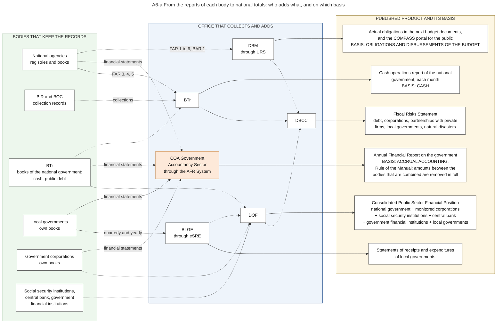

# A6. In-year reports

*Part of the Philippine PFM Atlas. Facts as of 8 October 2026. The codes in the column "Basis" are explained in [Reference F](../reference/F_sources_and_verification.md). "GK" means general knowledge that I did not open in a source during this work.*

## 1. The step in the budget cycle

| Item | This step |
|---|---|
| Phase | Accountability, step 6 of 9 |
| When | Monthly and quarterly. The timing in the illustration of DBM is indicative [DBM-CYCLE] |
| Receives documents from | Chapters E6 and A4 |
| Read more | From the reports of each body to national totals: section 2. The monthly Cash Operations Report of BTr: chapter P1, section 3.5 |

## 2. From the reports of each body to national totals

No single office holds all the records. Diagram A6-a answers the question: which office adds the figures of which bodies, on which basis, and into which published product?

The idea: there are several national totals, not one. Each comes from a different office and uses a different basis of measurement. A total of one product cannot be checked against a total of another product without a statement of what differs.

| Product | Produced by | From the records of | Basis of measurement | Basis |
|---|---|---|---|---|
| Actual obligations in the next budget documents | DBM | National agencies, through URS | Obligations and disbursements of the budget | JC2019-1. Use in the budget documents: GK |
| COMPASS portal | DBM | National agencies and government corporations must submit and update information. The order of 2026 says that the portal must be able to interface with the IFMIS, BTMS, PhilGEPS and DIME. Which system supplies the figures today is not stated | Budget, allotments, obligations, disbursements | COMPASS-LAUNCH, EO126 |
| Annual Financial Report | COA Government Accountancy Sector | National agencies and BTr. Government corporations, through the AFR System and by direct submission | Accrual accounting | GAM-V1 Ch.2 s.8, PD1445 s.41, COA-GAS, COA2015-004. Local governments in the report: GK |
| Cash operations report of the national government | BTr | Treasury accounts, collections of BIR and BOC, FAR 3, 4 and 5 of agencies | Cash | NBC599, JC2019-1, BTR-DATA |
| Statements of receipts and expenditures of local governments | BLGF | Local treasurers, through eSRE | Receipts and expenditures of each local government | eSRE |
| Consolidated Public Sector Financial Position | DOF | National government, monitored non-financial government corporations, social security institutions, central bank, government financial institutions, local governments | Surplus or deficit of each part | BESF2026-A3 |
| Fiscal Risks Statement | DBCC | DOF, BTr, DBM and the other members | Risks, not totals | FRS2023 |

The structure of the table of DOF shows how a total for the whole public sector is built [BESF2026-A3].

| Row | 2024, in PHP billion |
|---|---|
| National government | -1,506.4 |
| Monitored non-financial government corporations | +0.8 |
| Adjustment in net lending and equity to government corporations | +9.1 |
| = Public sector borrowing requirement | -1,496.4 |
| Social security institutions | +175.8 |
| Central bank | +97.1 |
| Government financial institutions | +44.5 |
| Local governments | +358.4 |
| = Consolidated public sector balance | -820.6, or 3.1 percent of gross domestic product |

The first three rows add to -1,496.5. The table of the source shows -1,496.4, because each row is rounded.

The third row is an example of the main difficulty of any consolidation. Money that the national government lends or gives to its corporations is spending of the giver and income of the receiver. If both are added, the amount is counted twice, so the table removes it. The same applies to the National Tax Allotment, which is spending of the national government and income of the local governments.

For one of the products I read the rule. The Manual says about consolidated financial statements: "Balances, transactions, revenues, and expenses between entities within the economic entity shall be eliminated in full" [GAM-V1 Ch.20 s.8]. The corresponding accounts of chapter A4, section 5.4 are such balances: the subsidy that the agencies record as revenue is the subsidy that the Treasury records as expense. I did not open the Annual Financial Report itself, so I do not know how far it follows this rule. For the cash report of BTr and for the table of DOF I read no rule on such transfers, and the table does not say which corporations are "monitored".

### Diagram A6-a  From the reports of each body to national totals: who adds what, and on which basis

Code file: `../diagrams/mermaid/A6-a_from_agency_reports_to_national_totals.mmd`. Rendered image: [`../rendered/A6-a_from_agency_reports_to_national_totals.png`](../rendered/A6-a_from_agency_reports_to_national_totals.png).

- **Question:** no single office holds all the records. Which office adds the figures of which bodies, on which basis of measurement, and into which published product?
- **Idea:** there are several national totals, not one. Each is produced by a different office from a different set of reports, and each uses a different basis: obligations, accrual accounting, or cash. A total of one product cannot be checked against a total of another product without a statement of what differs.
- **How to read it:** left = the bodies that keep records. Middle = the office that collects and adds. Right = the published product, with its basis in capital letters. Dotted arrows are flows of information.
- **The risk of counting twice:** a transfer is spending of the giver and income of the receiver. Example: the National Tax Allotment is spending of the national government and income of the local governments. A total for the whole public sector must remove such transfers. The table of the Department of Finance contains a line for this purpose: "Adjustment in Net Lending and Equity to GOCCs" [BESF2026-A3].
- **The rule for one of the products:** for consolidated financial statements the Manual says "Balances, transactions, revenues, and expenses between entities within the economic entity shall be eliminated in full" [GAM-V1 Ch.20 s.8]. I did not open the Annual Financial Report itself, so I do not know how far it follows this rule. For the cash report of BTr and for the table of DOF I read no rule.
- **Sources:** the duties of each agency, of BTr, of DBM and of COA in the financial reporting system [GAM-V1 Ch.2 s.8]. Budget and financial accountability reports through URS to DBM, COA and BTr [JC2019-1]. Financial statements through the AFR System, and the dates of 14 February and 30 September [PD1445 s.41][COA-GAS]. Statements of government corporations [COA2015-004]. Statements of receipts and expenditures of local governments through eSRE [eSRE]. Cash operations report of BTr [NBC599]. Rows of the Consolidated Public Sector Financial Position, source DOF [BESF2026-A3]. Fiscal Risks Statement of the DBCC and its chapters [FRS2023]. COMPASS portal: budget information from the NEP and the GAA with allotments, obligations and disbursements [COMPASS-LAUNCH][EO126].
- **General knowledge, not opened in a source here:** that local governments send their financial statements to the same sector of COA; that the Annual Financial Report of COA is issued in separate volumes for national agencies, local governments and government corporations; how DOF obtains the data of the social security institutions, the central bank and the government financial institutions.
- **Not stated in the sources I read:** which corporations are "monitored", and how the cash report and the table of DOF treat the transfers between levels of government.

