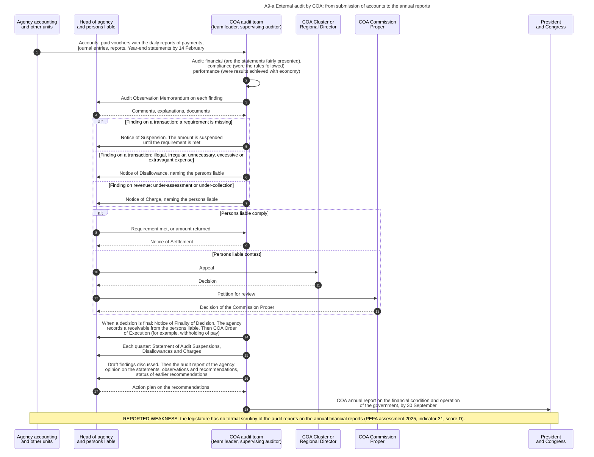
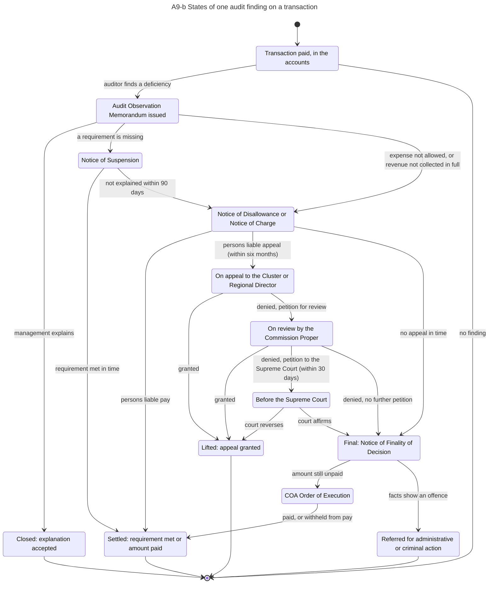

# A9. Audit report

*Part of the Philippine PFM Atlas. Facts as of 8 October 2026. The codes in the column "Basis" are explained in [Reference F](../reference/F_sources_and_verification.md). "GK" means general knowledge that I did not open in a source during this work.*

## 1. The step in the budget cycle

| Item | This step |
|---|---|
| Phase | Accountability, step 9 of 9 |
| When | Within the next FY. The timing in the illustration of DBM is indicative [DBM-CYCLE] |
| Documents | The audit report of the agency, and the notices of suspension, disallowance and charge. The annual report of COA is due on 30 September [PD1445 s.41][COA2009-006] |
| On the four lines | Records and control |
| Read more | The steps of external audit: section 5 and diagram A9-a. The states of one finding: section 6 |

## 2. The question this process answers

After public money is spent, who examines whether it was spent lawfully and well, and what happens when the answer is no?

## 3. The idea in plain words

Every earlier step of the process is performed by the body that spends. Audit is the first examination by a body that does not spend and does not answer to the spender. In the Philippines this body is the **Commission on Audit (COA)**, which the Constitution makes independent and to which it gives the power to examine, audit and settle all accounts of the government [CONST IX-D.2].

Two features define the Philippine arrangement.

First, the audit comes **after payment**. COA lifted its examination before payment (pre-audit) in 2011. It may restore pre-audit where the internal control of an agency is inadequate [COA2011-002]. The responsibility before payment therefore belongs to the management of the agency.

Second, a finding on one transaction can become a **personal liability**. The Auditing Code says: "Expenditures of government funds or uses of government property in violation of law or regulations shall be a personal liability of the official or employee found to be directly responsible therefor" [PD1445 s.103]. The auditor can issue a notice that names the officers responsible and requires them to return the money. This is stronger than a recommendation in a report.

The Code also fixes who answers first. "The head of any agency of the government is immediately and primarily responsible for all government funds and property pertaining to his agency" [PD1445 s.102]. An officer who holds funds or property is accountable for them and must be bonded [PD1445 s.101]. An order of a superior does not free this officer, unless the officer gave written notice beforehand that the order was illegal. In that case the superior is liable first [PD1445 s.106].

A case where the arrangement works: the auditor finds that a payment lacks a required document, suspends the amount, and the agency supplies the document. The suspension is lifted.

A case where it fails: the auditor finds a pattern of weak spending in the yearly report and recommends changes, and no body with power over the agency acts on the report. The 2025 PEFA assessment found no formal scrutiny by the legislature of the audit reports on the annual financial reports (indicator 31, score D) [PEFA2025].

Terms. An **Audit Observation Memorandum** is the first written statement of a finding. A **Notice of Suspension** holds an amount until a requirement is met. A **Notice of Disallowance** rejects an expenditure. A **Notice of Charge** concerns revenue that was not assessed or collected. **Settlement** means that the requirement is met or the amount is paid.

## 4. Authorities and their roles in external audit

| Authority | Role | Basis |
|---|---|---|
| COA | Examines, audits and settles all accounts. Its jurisdiction covers government corporations and their subsidiaries. For bodies outside the government that receive a subsidy, it covers only the funds that came from the government. It makes the accounting and auditing rules that prevent irregular, unnecessary, excessive or extravagant spending | CONST IX-D.2, PD1445 s.26, s.29, s.33 |
| COA audit team assigned to an agency (team leader and supervising auditor) | Audits the accounts. Has custody of the paid vouchers and of the reports of collections and disbursements. Issues observations and notices. Prepares the audit report. Its check of property includes a visit to see that the property exists | COA2009-006, PD1445 s.43, s.44. Team structure: COA2015-004 names the supervising auditor and audit team leader |
| COA Cluster Director or Regional Director | Decides appeals from notices of the auditor | COA2009-006 |
| COA Commission Proper | Decides petitions for review | COA2009-006 |
| Head of agency | Is immediately and primarily responsible for the funds and property of the agency. Must supervise the accountable officers, and is liable with them when this supervision fails. Answers observations and acts on recommendations | PD1445 s.102, s.104. Answers and action: GK |
| Accountable officers | Officers who hold funds or property. They are bonded, and they are liable for a loss | PD1445 s.101, s.105 |
| Persons liable | Officers named in a notice. They must settle or may appeal | COA2009-006, PD1445 s.103 |
| President and Congress | Receive the annual report of COA | CONST IX-D.4 |

## 5. Steps

The steps are those of diagram A9-a.

| No. | Who acts | Towards whom | What is done or passed | Basis |
|---|---|---|---|---|
| 1 | Agency accounting and other units | COA audit team (team leader, supervising auditor) | Accounts: paid vouchers with the daily reports of payments, journal entries, reports. Year-end statements by 14 February | PD1445 s.41, s.43. Vouchers with the daily reports: GAM-V1 Ch.6 s.56 |
| 2 | COA audit team (team leader, supervising auditor) | (own action) | Audit: financial (are the statements fairly presented), compliance (were the rules followed), performance (were results achieved with economy) | ROADMAP2024 |
| 3 | COA audit team (team leader, supervising auditor) | Head of agency and persons liable | Audit Observation Memorandum on each finding | GK |
| 4 | Head of agency and persons liable | COA audit team (team leader, supervising auditor) | Comments, explanations, documents | GK |
| 5 | COA audit team (team leader, supervising auditor) | Head of agency and persons liable | Notice of Suspension. The amount is suspended until the requirement is met | COA2009-006. Short definitions: GK |
| 6 | COA audit team (team leader, supervising auditor) | Head of agency and persons liable | Notice of Disallowance, naming the persons liable | COA2009-006. Short definitions: GK |
| 7 | COA audit team (team leader, supervising auditor) | Head of agency and persons liable | Notice of Charge, naming the persons liable | COA2009-006. Short definitions: GK |
| 8 | Head of agency and persons liable | COA audit team (team leader, supervising auditor) | Requirement met, or amount returned | COA2009-006 |
| 9 | COA audit team (team leader, supervising auditor) | Head of agency and persons liable | Notice of Settlement | COA2009-006 |
| 10 | Head of agency and persons liable | COA Cluster or Regional Director | Appeal | COA2009-006, PD1445 ss.48-50 |
| 11 | COA Cluster or Regional Director | Head of agency and persons liable | Decision | COA2009-006, PD1445 ss.48-50 |
| 12 | Head of agency and persons liable | COA Commission Proper | Petition for review | COA2009-006, PD1445 ss.48-50 |
| 13 | COA Commission Proper | Head of agency and persons liable | Decision of the Commission Proper | COA2009-006, PD1445 ss.48-50 |
| 14 | COA audit team (team leader, supervising auditor) | Head of agency and persons liable | When a decision is final: Notice of Finality of Decision. The agency records a receivable from the persons liable. Then COA Order of Execution (for example, withholding of pay) | COA2009-006. Entry in the books: GAM-V1 Ch.6 s.46 |
| 15 | COA audit team (team leader, supervising auditor) | Head of agency and persons liable | Each quarter: Statement of Audit Suspensions, Disallowances and Charges | COA2009-006 |
| 16 | COA audit team (team leader, supervising auditor) | Head of agency and persons liable | Draft findings discussed. Then the audit report of the agency: opinion on the statements, observations and recommendations, status of earlier recommendations | GK |
| 17 | Head of agency and persons liable | COA audit team (team leader, supervising auditor) | Action plan on the recommendations | GK |
| 18 | COA audit team (team leader, supervising auditor) | President and Congress | COA annual report on the financial condition and operation of the government, by 30 September | CONST IX-D.4, PD1445 s.41 |

## 6. States of one finding

Diagram A9-b shows the states. The table gives the main paths.

| From | Event | To | Basis |
|---|---|---|---|
| Transaction paid | Auditor finds a deficiency | Audit Observation Memorandum | GK |
| Audit Observation Memorandum | Management explains | Closed | GK |
| Audit Observation Memorandum | A requirement is missing | Notice of Suspension | COA2009-006 |
| Audit Observation Memorandum | Expenditure not allowed, or revenue not collected in full | Notice of Disallowance or Notice of Charge | COA2009-006 |
| Notice of Suspension | Requirement met | Settled | COA2009-006 |
| Notice of Suspension | Not explained in a satisfactory way within ninety days | Notice of Disallowance | PD1445 s.82 |
| Notice of Disallowance or Charge | Persons liable pay | Settled, with a Notice of Settlement | COA2009-006 |
| Notice of Disallowance or Charge | Persons liable appeal. The Auditing Code gives six months for the appeal and thirty days for a petition to the Supreme Court after the decision of the Commission | Appeal to the Director, then petition to the Commission Proper | COA2009-006, PD1445 s.48, s.50 |
| Decision | No further appeal | Notice of Finality of Decision. Only now does the agency record the amount in its books: debit Receivables-Disallowances/Charges, credit the expense account of the year or the accumulated surplus for an earlier year | COA2009-006, PD1445 s.51, GAM-V1 Ch.6 s.46 |
| Final decision | Amount still unpaid | COA Order of Execution | COA2009-006 |

A settled account is not closed for all time: the Commission may open it again within three years [PD1445 s.52].

A consequence of the accounting rule in the table: a disallowance that is under appeal is in no account of the agency. The books show the full expense until the decision is final. The quarterly statement of the auditor is the record of the amounts that are still open.

The rules of 2009 cover accounts of revenues, receipts, expenditures and uses of funds. They do not cover property accounts [COA2009-006]. The same rules name an Adjudication and Settlement Board between the Director and the Commission Proper for some cases. I did not check whether that board still operates.

## 7. Documents and identifiers

| Document | Identified by | It quotes | Basis |
|---|---|---|---|
| Audit Observation Memorandum | Memorandum number | The transaction examined | GK |
| Notice of Suspension, Notice of Disallowance, Notice of Charge | Notice number | The voucher, check or payment order numbers, the amount, the persons liable, the rule violated | COA2009-006. Fields: GK |
| Statement of Audit Suspensions, Disallowances and Charges | Agency and quarter | All open notices | COA2009-006 |
| Notice of Settlement | Notice number | The notice settled | COA2009-006 |
| Notice of Finality of Decision, COA Order of Execution | Document number | The decision | COA2009-006 |
| Audit report of the agency | Agency and year | The financial statements and the findings | GK |
| Annual report of COA | Year | | CONST IX-D.4 |

## 8. Information systems

The sources I read do not name a system in which audit findings are recorded and followed. Auditors receive budget reports through URS [JC2019-1] and financial statements through the AFR System [COA-GAS]. The original vouchers and their documents reach the auditor on paper, with the daily reports of checks and of payment orders issued and with the journal entry vouchers [GAM-V1 Ch.6 s.56]. The Code requires that vouchers are kept for ten years [PD1445 s.26]. The audit record and the transaction record are linked only by the voucher number written in the notice (see diagram UACS-b).

## 9. Controls: what each one checks, and what it does not check

| Control | What it checks | What it does not check |
|---|---|---|
| Internal control, as a duty of the head of the agency | That assets are safe and that the accounting data are reliable, before any auditor arrives | The Code defines the duty. It does not say how its fulfilment is measured |
| Audit after payment | Legality and regularity of paid transactions, fairness of the statements, in some audits also performance | It cannot stop a payment before it is made |
| Notice of Suspension | That a missing requirement is supplied | |
| Notice of Disallowance | That money spent against the rules is returned by the persons liable | It does not recover money from a person who cannot pay |
| Appeal | That a notice can be reviewed at two higher levels inside COA | |
| Quarterly statement of open notices | That open findings stay visible to management | That anyone outside acts on them |
| Annual report to the President and Congress | That the result of the audit is made known | That the legislature examines it. See section 10 |

Audit is one of four examinations that use the records of an agency. Chapter A0, section 3, compares it with monitoring, with the yearly performance review by DBM and with evaluation. Chapter E6, section 6, lists what happens to the records when a single step fails before any audit.

## 10. Where the process fails in practice

| Reported weakness | Basis |
|---|---|
| The legislature has no formal scrutiny of the audit reports on the annual financial reports. Hearings are held case by case (PEFA indicator 31, score D) | PEFA2025 |
| Monitoring of assets is rated C. For financial assets COA has reported persistent accounting issues (PEFA indicator 12.1). For non-financial assets the national registry is not yet in full use (indicator 12.2) | PEFA2025 |
| A part of the advances, in particular advances to government corporations, was not liquidated at the end of 2023 (PEFA indicator 27.3, score C) | PEFA2025 |
| No separate, independent body for procurement complaints (PEFA indicator 24.4, score D) | PEFA2025 |
| External audit: indicator 30.1 is rated C and indicator 30.3 is rated B. The page I read describes them only as "recurring external audit and follow-up" | PEFA2025 |
| A strength: internal audit coverage is rated A (PEFA indicator 26.1) | PEFA2025 |

## 11. Timing

| Date | Event | Basis |
|---|---|---|
| 14 February | Agencies submit year-end trial balances and statements | PD1445 s.41 |
| During the year | Audit of transactions, notices, quarterly statements | COA2009-006 |
| Last working day of February, in the Auditing Code of 1978 | Report of audit of each auditing unit for the year before, to the head of the agency. I did not read the present rule. From general knowledge, the audit reports of agencies appear about the middle of the year | PD1445 s.43. Present practice: GK |
| 30 September | Annual report of COA | PD1445 s.41 |

## 12. Audit and Congress

COA audits each agency after payment (sections 5 and 6). The 2025 assessment rates the examination of audit reports by the legislature D: no formal examination is made, only hearings when a need arises [PEFA2025].

## 13. Diagrams

### Diagram A9-a  External audit by COA: from submission of accounts to the annual reports

Code file: `../diagrams/mermaid/A9-a_audit_sequence.mmd`. Rendered image: [`../rendered/A9-a_audit_sequence.png`](../rendered/A9-a_audit_sequence.png).

- **Question:** what happens between the agency and the Commission on Audit (COA) after money is spent, and how does a finding become a personal liability?
- **Idea:** COA audits after payment. A finding on the accounts as a whole is written in the audit report with a recommendation. A finding on one transaction may become a notice that makes named persons liable to explain, to complete a requirement, or to return money.
- **Sources:** COA examines, audits and settles all accounts and sets accounting and auditing rules [CONST IX-D.2]. Annual report to the President and Congress [CONST IX-D.4]. Deadlines of 14 February and 30 September [PD1445 s.41]. Audit after payment since 2011 [COA2011-002]. Notice of Suspension, Notice of Disallowance, Notice of Charge, quarterly statement, notice of settlement, appeal levels, Notice of Finality of Decision, COA Order of Execution [COA2009-006]. Kinds of audit and citizen participatory audit [ROADMAP2024]. No formal scrutiny by the legislature of the audit reports on the annual financial reports (indicator 31, score D) [PEFA2025].
- **From the auditing code of 1978, read in full in october 2026:** an expenditure against law or regulations is a personal liability of the official directly responsible [PD1445 s.103]. The head of the agency is immediately and primarily responsible for its funds and property [PD1445 s.102]. A suspension that is not explained within ninety days becomes a disallowance [PD1445 s.82]. Appeal to the Commission within six months, and to the Supreme Court within thirty days after its decision [PD1445 s.48, s.50]. The paid vouchers reach the auditor with the daily reports of checks and payment orders issued [GAM-V1 Ch.6 s.56]. A disallowance enters the books of the agency only when it is final [GAM-V1 Ch.6 s.46].
- **Limit:** the Code is of 1978. The rules of procedure of COA set the present steps and periods, and I did not open them.
- **General knowledge, not opened in a source here:** the Audit Observation Memorandum and the reply (steps 3 and 4), the short definitions of the three notices in steps 5 to 7, the structure of the agency audit report, the action plan.
- **Note:** the 2009 rules also name an Adjudication and Settlement Board between the Director and the Commission Proper for some cases. I did not check whether that board still operates, so it is not drawn.

### Diagram A9-b  States of one audit finding on a transaction

Code file: `../diagrams/mermaid/A9-b_audit_finding_states.mmd`. Rendered image: [`../rendered/A9-b_audit_finding_states.png`](../rendered/A9-b_audit_finding_states.png).

- **Question:** a transaction was questioned by the auditor. In which state is the finding now, and what are the possible next states?
- **Sources:** the notices, the settlement, the appeal levels, the Notice of Finality of Decision and the COA Order of Execution [COA2009-006] (Rules and Regulations on the Settlement of Accounts, COA Circular No. 2009-006).
- **From the auditing code of 1978:** a suspension that is not explained within ninety days becomes a disallowance [PD1445 s.82]. Appeal from the decision of an auditor within six months [PD1445 s.48]. The Commission decides within sixty days [PD1445 s.49]. Petition to the Supreme Court within thirty days [PD1445 s.50]. A decision that is not appealed is final and executory [PD1445 s.51]. A settled account may be opened again within three years [PD1445 s.52]. A disallowance is recorded in the books of the agency only when it is final and executory, as a receivable from the persons liable [GAM-V1 Ch.6 s.46].
- **Limit:** the Code names the Commission as the body of appeal. The rules of 2009 place a Director before the Commission Proper [COA2009-006]. The rules of procedure of COA set the present periods, and I did not open them.
- **General knowledge, not opened in a source here:** the Audit Observation Memorandum as the first step, and the referral to the Ombudsman.

## 14. Verification status

- **Verified in a source:** the constitutional mandate and the annual report [CONST]. Audit after payment [COA2011-002]. The notices, the settlement, the appeal levels, the finality and the order of execution [COA2009-006]. From the Auditing Code, read in full except its sections 5 to 24 on the organization of COA: jurisdiction, custody of vouchers, the deadlines, the ninety days for a suspension, the periods of appeal, responsibility and personal liability, internal control [PD1445]. The entry for a final disallowance, and the route of the vouchers to the auditor [GAM-V1 Ch.6 s.46, s.56]. The kinds of audit and the citizen participatory audit [ROADMAP2024]. The weaknesses [PEFA2025].
- **Limit:** the Auditing Code is of 1978. Later rules of COA set the present procedure and periods. Where the chapter gives a period from the Code, it says so.
- **General knowledge, to check:** the Audit Observation Memorandum, the short definitions of the three notices, the structure and present timing of the audit report of an agency, the action plan of the agency, the roles of the Ombudsman, the Sandiganbayan and the Civil Service Commission, the names of the oversight committees of Congress.
- **Not opened:** the COA rules of procedure, and sections 5 to 24 of the Auditing Code.
