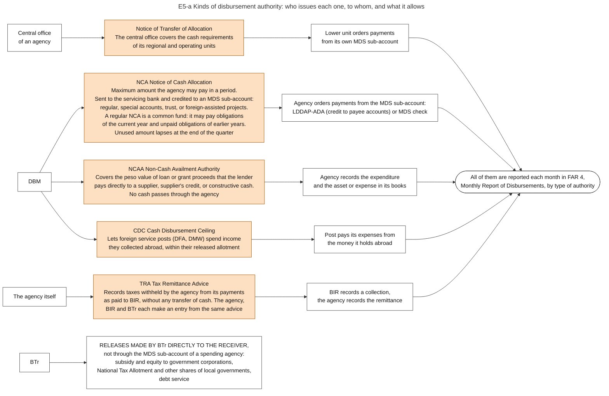
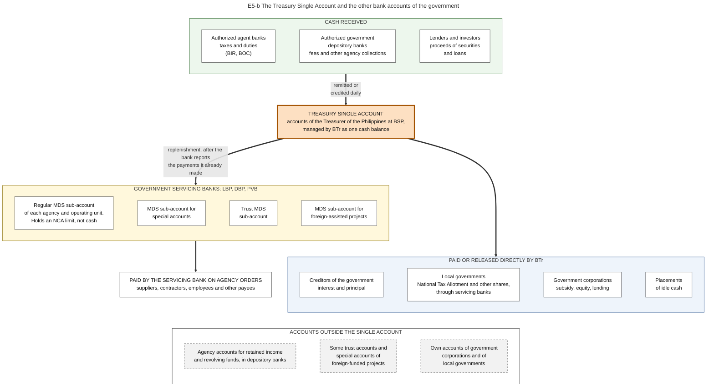
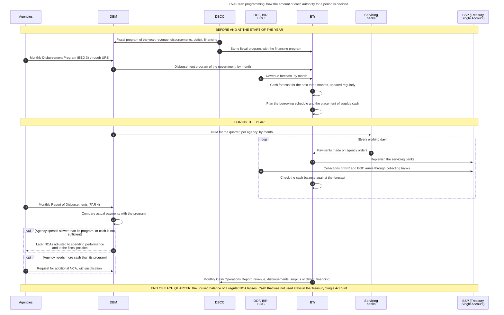
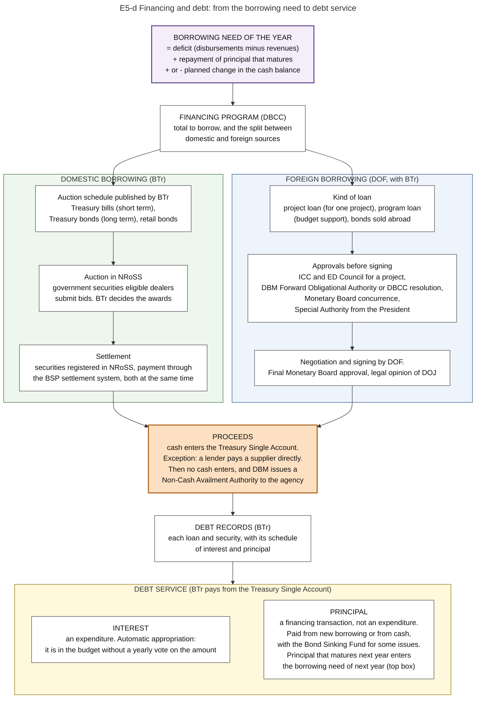
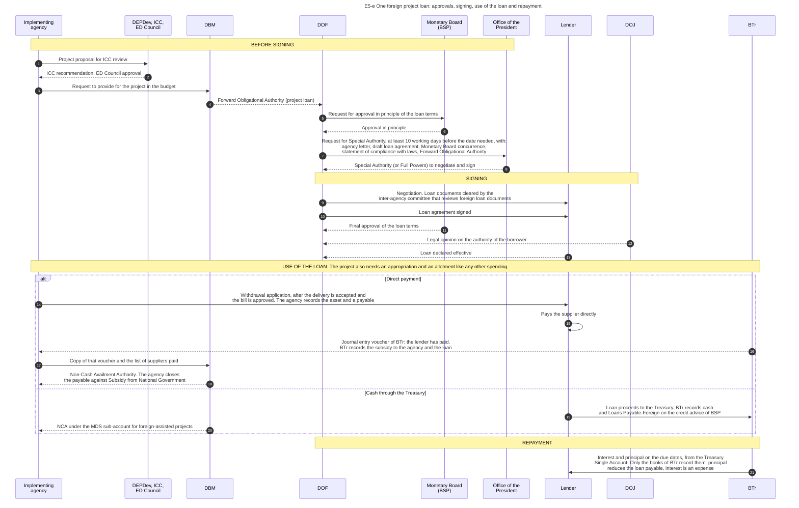
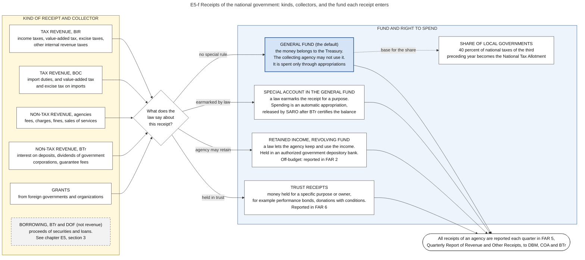
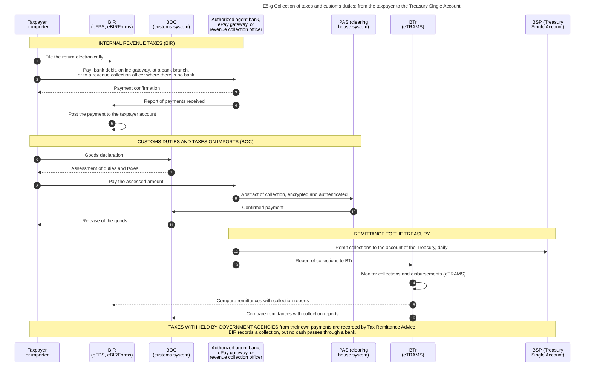
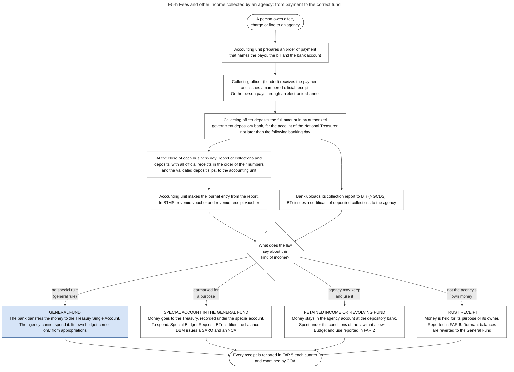
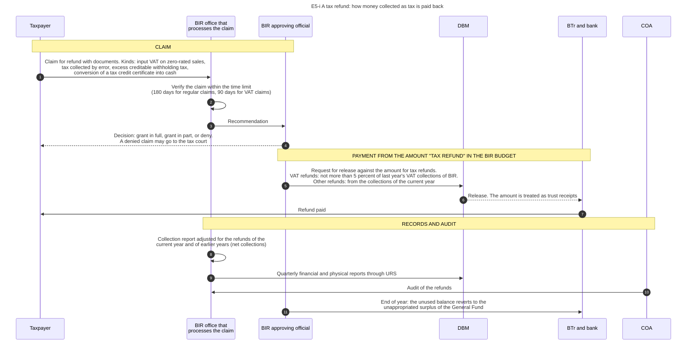

# E5. Cash allocation

*Part of the Philippine PFM Atlas. Facts as of 8 October 2026. The codes in the column "Basis" are explained in [Reference F](../reference/F_sources_and_verification.md). "GK" means general knowledge that I did not open in a source during this work.*

## 1. The step in the budget cycle

| Item | This step |
|---|---|
| Phase | Execution, step 5 of 6 |
| When | January (comprehensive) and throughout the FY. The timing in the illustration of DBM is indicative [DBM-CYCLE] |
| Documents | Notice of Cash Allocation (NCA), advised through ADRS, and the registry of the NCA (Appendix 30) [NBC599 s.4.2.1][ADRS][GAM-V2 App.30] |
| On the four lines | Cash |
| Not drawn in the loop | A regular NCA lapses at the end of its quarter [NBC599 s.4.2.1.6] |
| Receives documents from | Chapter E2 |
| Passes documents to | Chapter E6 |
| Read more | Steps 12 to 19 of diagram E0-a. The kinds of cash authority: section 2. How the amount of cash authority is decided, and the bank accounts of the Treasury: section 3. Where the cash comes from: section 4 |

## 2. Kinds of cash authority

Diagram E5-a shows the kinds. The table gives the same content.

| Authority | Issued by | What it allows | Basis |
|---|---|---|---|
| Notice of Cash Allocation (NCA) | DBM, to the servicing bank | Payments from an MDS sub-account up to the amount stated. The first NCA of the year covers the first quarter, including retirement and life insurance premiums. Later NCAs follow the Monthly Disbursement Program of the full year, subject to the spending performance of the agency and the fiscal position. A regular NCA is a common fund: it may pay obligations of the current year and unpaid obligations of earlier years. Its unused balance lapses on the last working day of the quarter | NBC599 s.4.2.1, s.4.2.1.6 |
| Additional NCA | DBM | Payments above the program, on a justified request | NBC599 s.4.2.1 |
| Non-Cash Availment Authority (NCAA) | DBM, through ADRS | Covers the peso value of loan or grant proceeds used by direct payment, supplier's credit or constructive cash | NBC599 s.4.2.2.1 |
| Cash Disbursement Ceiling (CDC) | DBM, through ADRS | Lets the foreign service posts of two departments use income collected abroad, up to their released allotment | NBC599 s.4.2.2.2 |
| Tax Remittance Advice (TRA) | The agency, in the electronic filing system of BIR | Records taxes withheld by the agency as remitted to BIR without a transfer of cash. The agency, BIR and BTr each make an entry from the same advice | NBC599 (listed). Working: GAM-V1 Ch.5 s.38, Ch.6 ss.60-62 |
| Notice of Transfer of Allocation | The central office of an agency | Covers the cash requirements of its regional and operating units | GAM-V1 Ch.3 s.3. Not mentioned in the FY 2026 circular |

There are four kinds of MDS sub-account, kept at LBP, DBP and PVB: regular, special accounts in the General Fund, trust, and foreign-assisted projects [NBC599 s.4.2.1.6].

The accounting manual names the same authorities as the only bases for a payment: an agency may pay "based on the Notice of Cash Allocation (NCA), Notice of Transfer of Allocation (NTA), Cash Disbursement Ceiling (CDC) or other authority that may be provided by law" [GAM-V1 Ch.2 s.40]. Each authority has its own entry in the books of the agency (chapter E6, section 4). The Manual also says what the cash account for the NCA is not: it holds "no actual cash with the GSBs", the government servicing banks [GAM-V1 Ch.19 s.56].

### Diagram E5-a  Kinds of disbursement authority: who issues each one, to whom, and what it allows

Code file: `../diagrams/mermaid/E5-a_cash_authorities.mmd`. Rendered image: [`../rendered/E5-a_cash_authorities.png`](../rendered/E5-a_cash_authorities.png).

- **Question:** an allotment contains no cash. Which document gives an agency the right to make payments, and which one applies in each situation?
- **How to read it:** left = issuer. Middle = the authority. Right = what the agency does with it. The last block shows payments that BTr makes directly to the receiver. They do not pass through the MDS sub-account of a spending agency. DBM still issues release documents for them: for the FY 2026 tax allotment it issued one SARO and the corresponding NCAs [NTA-PR].
- **Sources:** NCA rules, the four MDS sub-accounts, the three servicing banks, the Common Fund, NCAA, CDC, the listing of the Tax Remittance Advice, releases by BTr to corporations and local governments [NBC599]. Payment instruments LDDAP-ADA and check [CL2013-16A]. Monthly report of disbursements by type of authority, FAR 4 [JC2019-1]. The four disbursement authorities of the Manual: NCA, Non-Cash Availment Authority, Cash Disbursement Ceiling and Notice of Transfer of Allocation [GAM-V1 Ch.3 s.3, Ch.2 s.40]. The entries for each authority and for the Tax Remittance Advice [GAM-V1 Ch.5 s.38]. The NCA as a maximum amount of withdrawal [GAM-V1 Ch.5 s.38].
- **A difference between two sources:** the Notice of Transfer of Allocation is in the Manual of 2015 and is not mentioned in the FY 2026 circular [NBC599].
- **Warning on one abbreviation:** "NTA" has two meanings in Philippine PFM. In this diagram it is not used. In chapter E3, section 4 it means National Tax Allotment.

## 3. Treasury: cash, the Treasury Single Account, borrowing and debt

### 3.1 The question this process answers

Where is the cash of the national government held, who decides how much may be paid in a period, and how is the gap between receipts and payments financed?

### 3.2 The idea in plain words

The budget fixes how much may be spent in a year. It does not fix when the cash arrives. Tax collections are uneven during the year, and payments become due on their own dates. One office must therefore hold all the cash as one balance, forecast its movement, and borrow or invest so that money is there on the day a payment is due. This office is the **Bureau of the Treasury (BTr)**.

Three arrangements make this possible.

1. **One balance.** The **Treasury Single Account (TSA)** is, in the words of BTr, "a unified structure of government bank accounts" [BTR-SITE]. It is not one account and it is not software. It is a rule about bank accounts: the cash of the government is consolidated at the central bank so that BTr can see and use it as one amount.
2. **Limits, not cash, for agencies.** An agency does not hold cash for its regular budget. It holds a limit (the NCA) at a servicing bank. The bank pays, and BTr repays the bank. Cash therefore stays in the single balance until the moment of payment. The accounting manual states the same fact for the books of an agency: for its account of the NCA "there is no actual cash with the GSBs", the government servicing banks [GAM-V1 Ch.19 s.56].
3. **A cash program.** BTr forecasts cash for the next three months [BTR-SITE]. DBM issues NCAs within that forecast. When cash is not sufficient, BTr borrows. When there is more than needed, BTr places it. The Administrative Code requires this: an operational cash budget, "to ensure the availability of cash resources for priority development projects and to establish a sound basis for determining the level, type and timing of public borrowings" [EO292-B6 s.36].

One rule of law stands behind all three. National funds "shall not be withdrawn from the National Treasury except upon warrant or other instruments of withdrawal approved by the Minister (Secretary) of Finance as recommended by the Treasurer of the Philippines" [PD1445 s.84]. The temporary investment of cash that is not needed immediately is not a disbursement [PD1445 s.84].

A case where this works: collections arrive daily, the forecast is close to the actual amounts, and cash is available for all NCAs that were issued. The 2025 PEFA assessment rates cash forecasting with the highest score, A (indicator 21.2) [PEFA2025].

A case where it fails: money is held in accounts outside the single balance, for example agency accounts for retained income or accounts of foreign-funded projects. The government then borrows and pays interest while it holds idle cash elsewhere. The same assessment states that accounts of foreign-funded projects and trust accounts with a legal basis remain outside the single account (indicator 21.1, score C) [PEFA2025].

Terms. **Modified Disbursement System (MDS)**: the arrangement of sub-accounts at servicing banks through which agencies pay. **Government securities**: Treasury bills and bonds, which are promises of the government to pay. **Debt service**: payment of interest and repayment of principal. **Financing**: borrowing and repayment, which are not revenue and not expenditure.

### 3.3 Authorities and their roles

| Authority | Role in this process | Basis |
|---|---|---|
| BTr | Manages the cash resources of the national government. Keeps the books of its cash transactions: in the words of the accounting manual, it "accounts for the cash, public debt and related transactions" of the national government, and the books of every agency are reconciled with its cash records. Issues, services and redeems government securities. Controls and services public debt. Administers the Bond Sinking Fund. Is principal custodian of the financial assets of the national government. Forecasts cash. Releases to local governments and subsidized corporations | EO449, BTR-SITE, NBC599, GAM-V1 Ch.2 s.8 |
| DOF | Policy on borrowing and debt. Negotiates and signs foreign loans | MC51. Policy role: GK |
| DBCC | Recommends the level of borrowing in the fiscal program | DBCC-PAGE |
| DBM | Issues NCAs from the monthly disbursement programs of agencies, subject to spending performance and the fiscal position. Issues the Forward Obligational Authority for a project loan | NBC599, MC51 |
| BSP | Holds the Treasury Single Account. Operates the settlement system. Its Monetary Board gives prior concurrence to foreign loans | ROADMAP2024, NRoSS, CONST VII.20 |
| Government servicing banks | Pay on agency orders and are replenished. Send to BTr, on the day of receipt, a copy of each summary list and payment order, so that BTr knows which payments and which replenishment to expect. Report to each agency at the end of each month the state of its account | CL2013-16A, NBC599, GAM-V1 Ch.6 s.56, PD1445 s.74 |
| Dealers in government securities | Bid in the auctions | NRoSS |
| President and Office of the President | The President may contract or guarantee foreign loans. The Office issues the Special Authority to negotiate and sign | CONST VII.20, MC51 |
| DEPDev, ICC, ED Council | Review every project to be funded by a foreign loan | ICC-NEWS |
| DOJ | Legal opinion on the loan | ODA |

Structure of BTr under its reorganization order: an Asset Management Service for cash receipts and disbursements, the investment of idle balances and the Bond Sinking Fund; a Liability Management Service for borrowing and the tracking of public debt; an Accounting Service; and regional, provincial and district offices that examine the books of national collecting officers and local treasurers [EO449]. The present structure may differ.

### 3.4 The bank accounts

Diagram E5-b shows the accounts. The table gives the same content.

| Account | Held at | Holds | Basis |
|---|---|---|---|
| Treasury Single Account | BSP | The cash of the national government as one balance | BTR-SITE, ROADMAP2024 |
| Collection accounts | Authorized agent banks and authorized government depository banks | Collections on their way to the Treasury. Remitted or credited daily | PEFA2025, EO449 |
| MDS sub-accounts: regular, special accounts in the General Fund, trust, foreign-assisted projects | LBP, DBP, PVB | A limit (NCA) for each agency and operating unit, not cash | NBC599 s.4.2.1.6 |
| Accounts for retained income and revolving funds | Authorized government depository banks | Cash that an agency may keep under a law. Outside the single account | GAA2026-GP |
| Some trust accounts and special accounts of foreign-funded projects | Banks | Outside the single account | PEFA2025 |
| Accounts of government corporations and of local governments | Banks | Their own money. Outside the national single account | GK |

Legal basis of the single account named by BTr: Executive Order No. 55 of 2011, Executive Order No. 338 of 1996 and Executive Order No. 431 of 2005 [BTR-SITE].

### 3.5 Steps of cash programming

The steps are those of diagram E5-c.

| No. | Who acts | Towards whom | What is done or passed | Basis |
|---|---|---|---|---|
| 1 | DBCC | DBM | Fiscal program of the year: revenue, disbursements, deficit, financing | DBCC-PAGE |
| 2 | DBCC | BTr | Same fiscal program, with the financing program | DBCC-PAGE |
| 3 | Agencies | DBM | Monthly Disbursement Program (BED 3) through URS | NBC599 s.3.9 |
| 4 | DBM | BTr | Disbursement program of the government, by month | GK |
| 5 | DOF, BIR, BOC | BTr | Revenue forecast, by month | GK |
| 6 | BTr | (own action) | Cash forecast for the next three months, updated regularly | BTR-SITE |
| 7 | BTr | (own action) | Plan the borrowing schedule and the placement of surplus cash | EO449. Link to the forecast: GK |
| 8 | DBM | Servicing banks | NCA for the quarter, per agency, by month | NBC599 s.4.2.1 |
| 9 | Servicing banks | BTr | Payments made on agency orders | CL2013-16A |
| 10 | BTr | BSP (Treasury Single Account) | Replenish the servicing banks | PRIMER, CL2013-16A |
| 11 | DOF, BIR, BOC | BSP (Treasury Single Account) | Collections of BIR and BOC arrive through collecting banks | PEFA2025 |
| 12 | BTr | (own action) | Check the cash balance against the forecast | GK |
| 13 | Agencies | DBM | Monthly Report of Disbursements (FAR 4) | JC2019-1 |
| 14 | DBM | (own action) | Compare actual payments with the program | Inference from NBC599 s.4.2.1 |
| 15 | DBM | Agencies | Later NCAs adjusted to spending performance and to the fiscal position | NBC599 s.4.2.1 |
| 16 | Agencies | DBM | Request for additional NCA, with justification | NBC599 s.4.2.1 |
| 17 | BTr | DBCC | Monthly Cash Operations Report: revenue, disbursements, surplus or deficit, financing | NBC599 |

### 3.6 Financing and debt

Diagram E5-d shows the flow from the borrowing need to debt service.

| Stage | Content | Basis |
|---|---|---|
| Borrowing need of the year | Deficit, plus repayment of principal that matures in the year, adjusted for the planned change in the cash balance | GK |
| Financing program | Total to borrow and the split between domestic and foreign sources, recommended by the DBCC | DBCC-PAGE |
| Domestic borrowing | BTr sells government securities in auctions. Bids are submitted, awards are confirmed and results are settled in NRoSS, the National Registry of Scripless Securities, which replaced two older systems. The system is linked to the BSP settlement system, so that the securities and the payment are exchanged at the same time | NRoSS, BTR-SYS. Kinds of securities and auction calendar: GK |
| Foreign borrowing | Loans for projects, loans for budget support, and bonds sold abroad. Approvals: see section 3.7 | MC51, ODA. Kinds: GK |
| Rule on the use of loan proceeds | Spending that is financed by borrowing is part of the expenditure program of the agency. Loan proceeds, in cash or in kind, may not be used without a release of funds | EO292-B6 s.29 |
| Proceeds in cash | Cash enters the Treasury. On the credit advice of BSP, BTr records the cash and the liability Loans Payable-Foreign. The agency then receives an NCA like for any other spending | GAM-V1 Annex I, NBC599 s.4.2.1.6 |
| Proceeds without cash: a lender pays a supplier directly | The agency records the accepted delivery and a payable, and sends a withdrawal application to the lender. The lender pays. BTr records the loan and sends a journal entry voucher to the agency. The agency sends a copy to DBM. DBM issues a Non-Cash Availment Authority, and the agency closes the payable against Subsidy from National Government | GAM-V1 Ch.6 ss.66-68, Annex I, NBC599 s.4.2.2.1 |
| Debt records | BTr accounts for the public debt of the national government. The loan is a liability in the books of BTr, not in the books of the agency that uses it | GAM-V1 Ch.2 s.8, Annex I, EO449. System: GK |
| Interest | An expense in the books of BTr. Interest on a loan of the national government is not added to the cost of the asset in the books of the agency. It is an automatic appropriation: it is in the budget without a yearly vote on the amount | GAM-V1 Annex I, Ch.10 s.8, EO292-B6 s.26, NBC599 |
| Principal | Also an automatic appropriation. In the books of BTr the repayment reduces the liability and is not an expense. In the presentation of the budget it is a financing transaction, not an expenditure | EO292-B6 s.26, GAM-V1 Annex I. Presentation in the budget: GK |
| Limit on automatic appropriations | No obligation and no payment from an automatic appropriation except through a regular allotment | EO292-B6 s.26 |

The accounting manual lists the funding source codes of the automatic appropriations. Among them are 104109 for debt principal amortization, 104110 for debt interest payments and 104280 for net lending to government corporations [GAM-V1 Annex P].

This section covers debt that exists. Payments that may become due later, because of a guarantee or a partnership contract, are in chapter P1, section 4. A guarantee of the national government that is called is also paid from an automatic appropriation [EO292-B6 s.26]. BTr publishes the deficit and the outstanding debt of the national government. Press reports of its data give a deficit of PHP 264.3 billion for June 2026 and a debt of PHP 19.07 trillion at the end of June 2026 [BTR-DATA].

### 3.7 Steps of one foreign project loan

The steps are those of diagram E5-e. The order of approvals follows one loan described by DOF and a circular of the Office of the President. It is an example, not a general rule.

| No. | Who acts | Towards whom | What is done or passed | Basis |
|---|---|---|---|---|
| 1 | Implementing agency | DEPDev, ICC, ED Council | Project proposal for ICC review | ICC-NEWS, ODA |
| 2 | DEPDev, ICC, ED Council | Implementing agency | ICC recommendation, ED Council approval | ICC-NEWS, ODA |
| 3 | Implementing agency | DBM | Request to provide for the project in the budget | GK |
| 4 | DBM | DOF | Forward Obligational Authority (project loan) | ODA, MC51 |
| 5 | DOF | Monetary Board (BSP) | Request for approval in principle of the loan terms | ODA |
| 6 | Monetary Board (BSP) | DOF | Approval in principle | ODA |
| 7 | DOF | Office of the President | Request for Special Authority, at least 10 working days before the date needed, with: agency letter, draft loan agreement, Monetary Board concurrence, statement of compliance with laws, Forward Obligational Authority | MC51 |
| 8 | Office of the President | DOF | Special Authority (or Full Powers) to negotiate and sign | MC51, ODA |
| 9 | DOF | Lender | Negotiation. Loan documents cleared by the inter-agency committee that reviews foreign loan documents | ODA |
| 10 | DOF | Lender | Loan agreement signed | MC51 |
| 11 | Monetary Board (BSP) | DOF | Final approval of the loan terms | ODA |
| 12 | DOJ | DOF | Legal opinion on the authority of the borrower | ODA |
| 13 | Lender | DOF | Loan declared effective | GK |
| 14 | Implementing agency | Lender | Withdrawal application, after the delivery is accepted and the bill is approved. The agency records the asset and a payable | GAM-V1 Ch.6 ss.66-68, Annex I |
| 15 | Lender | (own action) | Pays the supplier directly | GAM-V1 Ch.6 ss.66-68, Annex I |
| 16 | BTr | Implementing agency | Journal entry voucher of BTr: the lender has paid. BTr records the subsidy to the agency and the loan | GAM-V1 Ch.6 ss.66-68, Annex I |
| 17 | Implementing agency | DBM | Copy of that voucher and the list of suppliers paid | GAM-V1 Ch.6 ss.66-68, Annex I |
| 18 | DBM | Implementing agency | Non-Cash Availment Authority. The agency closes the payable against Subsidy from National Government | NBC599 s.4.2.2.1, GAM-V1 Ch.6 ss.66-68 |
| 19 | Lender | BTr | Loan proceeds to the Treasury. BTr records cash and Loans Payable-Foreign on the credit advice of BSP | GAM-V1 Annex I |
| 20 | DBM | Implementing agency | NCA under the MDS sub-account for foreign-assisted projects | NBC599 s.4.2.1.6, GAM-V1 Annex I |
| 21 | BTr | Lender | Interest and principal on the due dates, from the Treasury Single Account. Only the books of BTr record them: principal reduces the loan payable, interest is an expense | EO449, GAM-V1 Annex I |

Documents that DOF sends to the Office of the President with a request for Special Authority for a loan: the letter of the proponent agency, the draft loan agreement, the concurrence of the Monetary Board, a statement of compliance with laws, and the Forward Obligational Authority of DBM for a project loan or a resolution of the DBCC for a program loan. The request must arrive at least ten working days before the date needed. The authority is given in writing as a Special Authority, and may also be given as Full Powers [MC51].

### 3.8 Documents and identifiers

| Document | Issued by | Identified by | Basis |
|---|---|---|---|
| NCA | DBM | NCA number | NBC599 |
| Summary list of payment orders (copy for BTr) | Agency, through the bank | Number of the list | CL2013-16A, GAM-V1 Ch.6 s.56, GAM-V2 App.53 |
| Journal entry voucher of BTr for a direct payment by a lender | BTr | Number of the voucher | GAM-V1 Ch.6 ss.66-68 |
| Cash Operations Report | BTr | Month | NBC599 |
| Government security | BTr | Registry entry in NRoSS (GK: each issue has an identifying number) | NRoSS |
| Loan agreement | DOF and lender | Loan number | MC51 |
| Forward Obligational Authority | DBM | Document number | MC51, ODA |
| Special Authority | Office of the President | Date | MC51 |
| Non-Cash Availment Authority | DBM | Document number | NBC599 |

### 3.9 Information systems

| System | Owner | Use | Basis |
|---|---|---|---|
| eTRAMS | BTr, with LBP | Monitoring of collections and disbursements | BTR-SYS |
| NGCDS | BTr | Collection reports of banks | BTR-SYS |
| NRoSS | BTr | Auctions, registry and settlement of securities | NRoSS, BTR-SYS |
| BSP settlement system | BSP | Settlement between banks and the Treasury accounts | NRoSS. Details: GK |
| Electronic facility of the servicing bank (eMDS of LBP) | Bank | Payment orders of agencies | eMDS |
| URS | DBM | Monthly disbursement programs and FAR 4 | NBC599, JC2019-1 |
| BTr accounting and debt systems | BTr | Books of cash and debt. Named by the Roadmap, not described | ROADMAP2024 |
| BTMS, later stage | DBM | Treasury modules are planned after the Budget Execution Module | CL2025-8 |

### 3.10 Controls: what each one checks, and what it does not check

| Control | What it checks | What it does not check |
|---|---|---|
| Approval of the instruments of withdrawal by the Secretary of Finance, on the recommendation of the Treasurer | That no money leaves the Treasury without the two officials who are responsible for the cash | The merit of the payment |
| NCA | That payments of an agency in a period stay inside the cash plan | That the payment is due (chapter E4) |
| Reconciliation of the books of each agency with the cash records of BTr, and monthly bank reconciliation | That the agency, the bank and BTr record the same payments | It finds a difference after the payment, not before |
| Quarterly lapse of unused NCA | That unused limits do not accumulate | It can delay a valid payment |
| Single balance at BSP | That all cash is visible and usable | Accounts outside the structure |
| Prior concurrence of the Monetary Board | The effect of a foreign loan on the external position | The merit of the project |
| ICC review | The merit of a project funded by a foreign loan | |
| Special Authority | That the President has authorized the negotiation and the signing | |
| Settlement of securities against payment | That BTr receives the money when it delivers the security | |

### 3.11 Where the process fails in practice

| Reported finding | Basis |
|---|---|
| BIR and BOC transfer collections daily to the single account (PEFA indicator 20.2, score A). A cash flow committee makes a monthly cash forecast and updates it with the actual flows (indicator 21.2, score A) | PEFA2025 |
| Accounts of foreign-funded projects and trust accounts with a legal basis remain outside the single account, so the consolidation of cash balances is partial (PEFA indicator 21.1, score C) | PEFA2025 |
| The current debt strategy of BTr does not meet the PEFA requirements for a medium-term debt strategy (PEFA indicator 13.3, score D). The recording and the approval of debt are rated A (indicators 13.1 and 13.2) | PEFA2025 |
| Systems named for cash management are separate: NGCDS, eTRAMS, the MDS, payment orders, a payment platform and a cash planning report | ROADMAP2024 |

### 3.12 Diagrams

#### Diagram E5-b  The Treasury Single Account and the other bank accounts of the government

Code file: `../diagrams/mermaid/E5-b_tsa_account_structure.mmd`. Rendered image: [`../rendered/E5-b_tsa_account_structure.png`](../rendered/E5-b_tsa_account_structure.png).

- **Question:** in which bank accounts is the cash of the national government held, and which accounts are outside the single account?
- **Idea:** the Treasury Single Account (TSA) is not one account and not software. BTr defines it as a unified structure of government bank accounts. The balances are consolidated at the central bank so that BTr can see and use the cash as one amount. Agencies hold spending limits (NCA) at servicing banks, not cash.
- **How to read it:** thick arrows = cash. Grey boxes with a dashed border = accounts that are not part of the single account.
- **Sources:** definition and legal basis of the TSA (EO 55 of 2011, EO 338 of 1996, EO 431 of 2005), eTRAMS for collections reported by BIR, BOC and agencies [BTR-SITE]. TSA at BSP [ROADMAP2024]. MDS sub-accounts (regular, special accounts, trust, foreign-assisted projects) at LBP, DBP and PVB [NBC599]. Daily replenishment of servicing banks, the MDS seed fund [PRIMER][CL2013-16A]. Same-day deposit of collections with authorized government depository banks, investment of idle balances, Bond Sinking Fund [EO449]. Daily transfer of collections, some foreign-funded and trust accounts outside the TSA [PEFA2025]. Shares of local governments released directly by BTr through servicing banks [GAA2026-GP]. Releases to corporations through BTr [BSGC2026]. Revolving funds in authorized depository banks [GAA2026-GP].
- **General knowledge, not opened in a source here:** the names of the Treasury accounts at BSP, the settlement system of BSP, the arrangement by which depository banks transfer balances to BSP.

#### Diagram E5-c  Cash programming: how the amount of cash authority for a period is decided

Code file: `../diagrams/mermaid/E5-c_cash_programming_sequence.mmd`. Rendered image: [`../rendered/E5-c_cash_programming_sequence.png`](../rendered/E5-c_cash_programming_sequence.png).

- **Question:** an agency has an allotment and an approved claim, but DBM gives it less cash authority than it asked for. Who decided the amount, and from which information?
- **Idea:** allotments are fixed by the budget. Cash arrives daily from taxes and borrowing. The cash program matches the planned payments of all agencies to the expected cash. The NCA is the instrument that keeps payments inside that plan.
- **Sources:** fiscal program of the DBCC [DBCC-PAGE]. Monthly Disbursement Program (BED 3) as the basis of the NCA, first NCA for the first quarter, later NCAs subject to spending performance and the fiscal position, quarterly lapse, Cash Operations Report [NBC599]. Three-month cash forecast under DOF Department Order No. 032.2015 [BTR-SITE]. DBM issues the disbursement program and NCAs, BTr coordinates daily cash needs with large spending agencies, systems used [ROADMAP2024]. Daily collections to the Treasury Single Account, cash forecasting rated A [PEFA2025]. Bank collection reports through NGCDS [BTR-SYS]. Replenishment of servicing banks [CL2013-16A][PRIMER]. BTr invests idle balances and manages borrowing [EO449].
- **General knowledge, not opened in a source here:** steps 4 and 5 (how the forecasts of revenue and of disbursements reach BTr), step 7 (how the borrowing schedule follows the forecast).

#### Diagram E5-d  Financing and debt: from the borrowing need to debt service

Code file: `../diagrams/mermaid/E5-d_financing_and_debt.mmd`. Rendered image: [`../rendered/E5-d_financing_and_debt.png`](../rendered/E5-d_financing_and_debt.png).

- **Question:** how is the amount to borrow decided, through which channels does the government borrow, which approvals are needed, and how is the debt paid?
- **How to read it:** top = the need. Middle = the two channels (domestic, foreign) with their approvals. Bottom = where the proceeds go, how the debt is recorded and how it is serviced.
- **Sources:** DBCC recommends the level of borrowing [DBCC-PAGE]. BTr issues, services and redeems government securities, tracks public debt, coordinates borrowing with BSP and DBM, administers the Bond Sinking Fund [EO449]. Auctions, registry and settlement in NRoSS, dealers (GSEDs), settlement through the BSP payment system with delivery versus payment [NRoSS][BTR-SYS]. The President may contract foreign loans with the prior concurrence of the Monetary Board [CONST VII.20]. Special Authority from the President, documents required, DBM Forward Obligational Authority for project loans, DBCC resolution for program loans [MC51]. ICC review of every project funded by a foreign loan [ICC-NEWS]. Sequence of approvals in one loan [ODA]. Non-Cash Availment Authority for direct payments, MDS sub-account for foreign-assisted projects [NBC599]. Interest payments and net lending as automatic appropriations [NBC599]. The current debt strategy of BTr does not meet the PEFA requirements for a medium-term debt strategy (indicator 13.3, score D), while recording and approval of debt are rated A [PEFA2025].
- **General knowledge, not opened in a source here:** the formula for the gross borrowing need, the names of the instruments (Treasury bills, Treasury bonds, retail bonds, global bonds), the Auction Committee, the rule that repayment of principal is a financing transaction and not an expenditure in the presentation of the budget (in the accounts of BTr, principal reduces the liability Loans Payable and interest is an expense [GAM-V1 Annex I]), the legal basis of the automatic appropriation for debt service, the debt recording system.

#### Diagram E5-e  One foreign project loan: approvals, signing, use of the loan and repayment

Code file: `../diagrams/mermaid/E5-e_foreign_loan_sequence.mmd`. Rendered image: [`../rendered/E5-e_foreign_loan_sequence.png`](../rendered/E5-e_foreign_loan_sequence.png).

- **Question:** a project is to be financed by a foreign loan. Which bodies must approve before the loan is signed, and how does the loan money reach the project?
- **Sources:** ICC review of every project funded by a foreign loan [ICC-NEWS]. Order of approvals seen in one concessional loan (approval by the NEDA Board, DBM Forward Obligational Authority, Monetary Board approval in principle, Special Presidential Authority, clearance of the Inter-Agency Committee for the Review of Foreign Loan Documents, final Monetary Board approval, legal opinion of DOJ) [ODA]. Documents that DOF sends to the Office of the President and the lead time of 10 working days [MC51]. Prior concurrence of the Monetary Board [CONST VII.20]. Non-Cash Availment Authority for direct payment, MDS sub-account for foreign-assisted projects [NBC599]. The steps and the entries of a direct payment by the lender, of a cash availment and of the debt service [GAM-V1 Ch.6 ss.66-68, Annex I]. Loan proceeds may be used only after a release of funds [EO292-B6 s.29]. Tier 2 profile of foreign-assisted projects, BP Form 203 [NBM156]. BTr services the debt [EO449].
- **Note:** the ED Council replaced the NEDA Board in 2025 [AO37]. The loan in the source was approved before that change.
- **General knowledge, not opened in a source here:** step 3 (request to provide for the project in the budget) and step 13 (declaration of effectiveness).

### 3.13 Verification status

- **Verified in a source:** the rule on withdrawals from the Treasury and the monthly report of depositories [PD1445 s.84, s.74]. The cash budget, the automatic appropriation of debt service and the rule on loan proceeds, read through summaries with quotations [EO292-B6 s.26, s.29, s.36]. The entries of BTr and of the agency for loan proceeds, for a direct payment by a lender and for debt service [GAM-V1 Ch.6 ss.66-68, Annex I]. The functions and structure of BTr [EO449]. The definition and legal basis of the single account, the three-month forecast [BTR-SITE]. The MDS sub-accounts, the banks and the rules on NCA [NBC599]. The copy of the summary list to BTr [CL2013-16A]. NRoSS and its link to the BSP settlement system [NRoSS][BTR-SYS]. The constitutional rule on foreign loans [CONST VII.20]. The documents for the Special Authority [MC51]. The approvals of one loan [ODA].
- **General knowledge, to check:** how forecasts reach BTr, the formula of the borrowing need, the kinds of securities, the auction calendar and the body that decides awards, the treatment of principal in the presentation of the budget, the debt recording system, the conditions of effectiveness of a loan.
- **Inference:** that DBM compares actual payments with the program before it adjusts later NCAs.
- **Not opened:** BTr and DOF circulars, laws on borrowing.

## 4. Revenue and other receipts

### 4.1 The question this process answers

Which kinds of money does the national government receive, how does each kind reach the Treasury, and may the office that collects the money also spend it?

### 4.2 The idea in plain words

The office that collects money is normally not the office that may spend it. A tax office collects taxes but its own budget comes from an appropriation like that of any other agency. All collections go to one place, the Treasury, and from there they are spent only through appropriations. This rule is what makes the budget complete: if agencies could spend what they collect, part of public money would never be examined by Congress.

The law states the rule in three parts. Income of agencies is deposited in the National Treasury and credited to the General Fund unless a law provides otherwise [PD1445 s.65]. Every payment is acknowledged immediately: "No payment of any nature shall be received by a collecting officer without immediately issuing an official receipt in acknowledgment thereof" [PD1445 s.68]. Collecting officers "shall remit or deposit intact the full amounts" that they collect, and the treasury of the agency deposits them with the government depository "not later than the following banking day" [PD1445 s.69]. The accounting manual adds that no temporary receipt may be used for public funds, and that official receipts are numbered in advance and issued in the strict order of their numbers [GAM-V1 Ch.2 s.4].

The exceptions are all made by law, and each has its own kind of fund.

- A law earmarks a receipt for a purpose. The money is in the Treasury but in a **special account in the General Fund**, and may be spent only for that purpose.
- A law lets an agency keep and use its income. This is **retained income** or a **revolving fund**. It stays in a bank account of the agency, outside the yearly appropriation.
- The money is not the government's own: it is held for a purpose or for another party. These are **trust receipts**.

A case where the rule works: a taxpayer pays through a bank, the bank remits to the Treasury on the same or the next day, and the cash is available for all payments of the government. The 2025 PEFA assessment found that BIR and BOC transfer their collections daily into the Treasury Single Account (indicator 20.2, score A) [PEFA2025].

A case where it fails: an agency keeps income in its own account under a special law, and this money is reported only in periodic reports. The Roadmap plans to include such off-budget accounts in BTMS or URS [SFA6].

Terms. An **authorized agent bank** is a bank that may receive tax payments. An **authorized government depository bank** is a bank that may receive the collections of agencies. The **General Fund** is the fund for all money that no law places elsewhere.

### 4.3 Kinds of receipt

Diagram E5-f shows the kinds and the funds. The table gives the same content.

| Kind | Collector | Enters which fund | Basis |
|---|---|---|---|
| Internal revenue taxes | BIR, through authorized agent banks, electronic gateways and revenue collection officers | General Fund, except taxes earmarked by law | BIR-PAY, CONST VI.29(3) |
| Duties and taxes on imports | BOC, through authorized agent banks | General Fund | PAS |
| Fees, charges and fines | The agency that renders the service, through its collecting officers and depository banks | General Fund by default. Special account, retained income or trust receipt where a law says so | PD1445 s.65, GAA2026-GP |
| Income of the Treasury: interest, dividends of government corporations (at least 50 percent of annual net earnings), guarantee fees | BTr | General Fund | BSGC2026, EO449 |
| Grants | Receiving agency or the Treasury | As the grant agreement and the law provide. In the example of the Manual a foreign grant in cash is received by BTr, which records it as a deferred credit. The agency that implements receives an NCA. The grant becomes income in the books of BTr when the agency reports that the project is complete | GAM-V1 Ch.5 s.27 |
| Taxes that agencies withhold from their own payments | The paying agency, by Tax Remittance Advice | General Fund. No cash moves: the advice produces entries in the books of the agency, of BIR and of BTr | GAM-V1 Ch.5 s.38 |
| Proceeds of borrowing | BTr and DOF | Treasury. Borrowing is financing, not revenue (section 3) | EO449 |

Forty percent of the national taxes collected in the third fiscal year before the budget year is the share of local governments [LGC s.284][MANDANAS]. See chapter E3, section 4.

### 4.4 Authorities and their roles

| Authority | Role in this process | Basis |
|---|---|---|
| Congress | Passes tax laws. Revenue and tariff bills start in the House | CONST VI.24 |
| DOF | Revenue policy and forecasts. Supervises BIR and BOC | DBCC-PAGE (revenue estimates in the DBCC). Supervision: GK |
| BIR | Receives returns, posts payments to taxpayer accounts | BIR-PAY. Posting: GK |
| BOC | Receives goods declarations, assesses duties and taxes, releases goods after payment | PAS. Declaration and release: GK |
| Authorized agent banks | Receive payments, report them, remit to the Treasury | BIR-PAY, PAS, PEFA2025 |
| Philippine Clearing House Corporation | Operates the system by which banks send abstracts of customs collections to BOC | PAS |
| Accounting unit of an agency | Prepares the order of payment on which the collecting officer collects. Makes the journal entry from the daily report of the collecting officer or from the report of the bank. Sends the quarterly report of revenue to COA, DBM and BTr | GAM-V1 Ch.5 s.40, s.41, s.42 |
| Collecting officers of agencies | Issue official receipts, deposit the full amount not later than the following banking day, and report each day. They must be bonded | PD1445 s.68, s.69, s.101, GAM-V1 Ch.5 s.39 |
| Permanent Committee: the Secretary of Finance as chair, the Secretary of Budget and Management and the Chairman of COA | Makes the rules under which receipts are recorded as income of special, fiduciary and trust funds. Monitors all funds other than the General Fund, and may recommend to the President that amounts return to the General Fund | PD1445 s.65, s.66, EO292-B6 s.45, GAM-V1 Ch.5 s.4 |
| Authorized government depository banks | Receive agency collections and upload collection reports to BTr | EO449, BTR-SYS |
| BTr | Receives the money in the Treasury Single Account, monitors collections, certifies balances of special accounts, examines the books of collecting officers through its regional offices | EO449, BTR-SITE, BTR-SYS, NBC599 |
| COA | Audits revenue. May examine the papers of revenue collection to see that all amounts found due were collected. Its auditor examines the reports of collecting officers within thirty days. May issue a Notice of Charge for revenue not assessed or collected | PD1445 s.28, s.64, COA2009-006 |

### 4.5 Steps for taxes and customs duties

The steps are those of diagram E5-g.

| No. | Who acts | Towards whom | What is done or passed | Basis |
|---|---|---|---|---|
| 1 | Taxpayer or importer | BIR (eFPS, eBIRForms) | File the return electronically | BIR-PAY |
| 2 | Taxpayer or importer | Authorized agent bank, ePay gateway, or revenue collection officer | Pay: bank debit, online gateway, at a bank branch, or to a revenue collection officer where there is no bank | BIR-PAY |
| 3 | Authorized agent bank, ePay gateway, or revenue collection officer | Taxpayer or importer | Payment confirmation | GK |
| 4 | Authorized agent bank, ePay gateway, or revenue collection officer | BIR (eFPS, eBIRForms) | Report of payments received | GK |
| 5 | BIR (eFPS, eBIRForms) | (own action) | Post the payment to the taxpayer account | GK |
| 6 | Taxpayer or importer | BOC (customs system) | Goods declaration | GK |
| 7 | BOC (customs system) | Taxpayer or importer | Assessment of duties and taxes | GK |
| 8 | Taxpayer or importer | Authorized agent bank, ePay gateway, or revenue collection officer | Pay the assessed amount | PAS |
| 9 | Authorized agent bank, ePay gateway, or revenue collection officer | PAS (clearing house system) | Abstract of collection, encrypted and authenticated | PAS |
| 10 | PAS (clearing house system) | BOC (customs system) | Confirmed payment | PAS |
| 11 | BOC (customs system) | Taxpayer or importer | Release of the goods | GK |
| 12 | Authorized agent bank, ePay gateway, or revenue collection officer | BSP (Treasury Single Account) | Remit collections to the account of the Treasury, daily | PEFA2025 |
| 13 | Authorized agent bank, ePay gateway, or revenue collection officer | BTr (eTRAMS) | Report of collections to BTr | GK. The source describes NGCDS only for authorized government depository banks: BTR-SYS |
| 14 | BTr (eTRAMS) | (own action) | Monitor collections and disbursements (eTRAMS) | BTR-SYS |
| 15 | BTr (eTRAMS) | BIR (eFPS, eBIRForms) | Compare remittances with collection reports | GK |
| 16 | BTr (eTRAMS) | BOC (customs system) | Compare remittances with collection reports | GK |

#### Channels of BIR

| Purpose | Channel | Basis |
|---|---|---|
| Filing of returns | eFPS for taxpayers enrolled in it. eBIRForms for others. Software of accredited tax software providers. Manual filing only when the systems are not available | BIR-PAY |
| Attachments to returns | Electronic submission facilities of BIR | BIR-PAY |
| Payment | Authorized agent banks. Revenue collection officers, who accept cash only up to PHP 20,000 and checks without limit. Electronic gateways: the portals of LBP and DBP, the online facility of a private bank, and two payment providers that accept cards and electronic wallets | BIR-PAY |

#### Channel of BOC

The banks collect customs duties and taxes and send abstracts of collection to BOC through Payment Application Secure, a system that the Philippine Clearing House Corporation has operated for the banks since October 1996 under an agreement between the bankers' association and BOC. The abstracts are encrypted and authenticated [PAS].

### 4.6 Steps for fees collected by an agency

Diagram E5-h shows the steps and the four possible funds. The steps and the forms are those of the accounting manual. "App." is the number of the form in its Volume II.

| No. | Step | Who | Basis |
|---|---|---|---|
| 1 | Order of payment: it names the payor, the bill and the bank account for the deposit | Accounting unit | GAM-V1 Ch.5 s.40, GAM-V2 App.28 |
| 2 | Payment received. Official receipt issued immediately, in three copies: for the payor, for the report, for the file | Collecting officer | PD1445 s.68, GAM-V1 Ch.5 s.40 |
| 3 | Collection entered in the cash receipts record | Collecting officer | GAM-V2 App.29 |
| 4 | Deposit of the full amount in an authorized government depository bank "for the account of the National Treasurer", with deposit slips in three copies and a list of the deposited collections | Collecting officer | GAM-V1 Ch.5 s.40, PD1445 s.69 |
| 5 | At the close of the business day: report of collections and deposits in four copies, with all official receipts in the order of their numbers, the cancelled ones included, and with the validated deposit slips. The head of the cash unit signs it | Collecting officer, head of the cash unit | GAM-V1 Ch.5 s.39, s.40, GAM-V2 App.26 |
| 6 | Journal entry from the report, certified by the chief accountant and entered in the cash receipts journal. In BTMS: revenue voucher and revenue receipt voucher | Accounting unit | GAM-V1 Ch.5 s.40, CL2025-8 |
| 7 | For collections that payors make directly at a bank: the bank sends a consolidated report of daily collections, and the accounting unit makes the journal entry from it | Bank, accounting unit | GAM-V1 Ch.5 s.41 |
| 8 | Bank uploads its collection report to BTr. BTr issues a certificate of deposited national collections to the agency | Bank, BTr | BTR-SYS |
| 9 | The money goes to the fund that the law provides: General Fund, special account, retained income, or trust | BTr, agency | PD1445 s.65, GAA2026-GP |
| 10 | Receipts reported each quarter, within 30 days, to COA, DBM and BTr (report FAR 5) | Chief accountant | GAM-V1 Ch.5 s.42, JC2019-1 |

Three rules for cases that go wrong. A check that the bank does not honour: the official receipt is cancelled, the amount becomes a receivable, and the payor may settle only in cash or by certified check [GAM-V1 Ch.5 s.32, s.34]. More cash than the receipts show: the difference is taken as income of the government [GAM-V1 Ch.5 s.35]. Less cash than the receipts show: the difference is a receivable from the collecting officer [GAM-V1 Ch.5 s.35].

#### What the books show for revenue

| Kind of revenue | When it is recorded | Entry | Basis |
|---|---|---|---|
| A fee for a service | When the service is rendered or billed, "or if not practicable, when fees are collected" | Billing: debit Accounts Receivable, credit the income account. Collection: debit Cash-Collecting Officers. Remittance to the Treasury: debit Cash-Treasury/Agency Deposit, Regular | GAM-V1 Ch.5 s.7, Annex H |
| A tax | When it is collected. "The cash basis of accounting shall be applied by all government agencies in the recognition of revenue from non-exchange transaction until a reliable model of measurement of this revenue is developed." | In the books of BIR, for a payment through a bank: debit Cash-Treasury/Agency Deposit, Regular, credit the account of the tax, for example Income Tax | GAM-V1 Ch.5 s.12, Annex H |
| The same remittance in the books of the Treasury | When the money arrives | Debit Cash in Bank, credit Cash-Treasury/Agency Deposit, Regular | GAM-V1 Annex H |

Three consequences follow.

- A tax that is assessed and not yet paid is in general not an asset in the books. The stock of revenue arrears that an assessment reports (section 4.11) therefore comes from the records of the tax offices and not from the accounts.
- Tax revenue is recorded at the gross amount. An expense that the government pays through the tax system is recorded as an expense and is not deducted from the revenue [GAM-V1 Ch.5 s.19].
- A tax expenditure is a concession of the tax law to certain taxpayers. It is revenue that is not collected. The Manual says that it creates no asset, liability, revenue or expense, so the books do not show it [GAM-V1 Ch.5 s.20].

### 4.7 The four funds and the right to spend

| Fund | Where the cash is | How the agency may spend it | Report | Basis |
|---|---|---|---|---|
| General Fund | Treasury Single Account. In the books of the agency the remitted amount is recorded in the account Cash-Treasury/Agency Deposit, Regular, which is closed at the end of the year | Not at all from the receipt. Only through its appropriation | FAR 5 for the receipt, FAR 1 for the spending | PD1445 s.65, GAA2026-GP, GAM-V1 Ch.19 s.57 |
| Special account in the General Fund | Treasury Single Account, recorded under the special account | Special Budget Request. BTr certifies the balance. DBM issues a SARO and an NCA under the sub-account for special accounts | FAR 5, FAR 1 | NBC599 |
| Retained income, revolving fund | Agency account in an authorized government depository bank | Under the law that allows it. Revolving funds must be self-liquidating | FAR 5, FAR 2 | GAA2026-GP, JC2019-1 |
| Trust receipts | Trust account | Only for the purpose of the trust. Dormant balances are reverted to the General Fund | FAR 5, FAR 6 | GAA2026-GP, JC2019-1, PD1445 s.84 |

The accounting manual keeps separate books for each group of funds. It calls the groups fund clusters: 01 for the regular agency fund, 03 and 04 for special accounts, 05 for internally generated funds (retained income), 06 for business related funds (revolving funds), 07 for trust receipts [GAM-V1 Ch.2 s.13]. Chapter E6, section 9 describes the clusters.

### 4.8 Information systems

| System | Owner | Use | Basis |
|---|---|---|---|
| eFPS, eBIRForms | BIR | Returns | BIR-PAY |
| Electronic payment gateways | Banks and payment providers | Tax payments | BIR-PAY |
| E2M customs system | BOC | Declarations and assessment. The page of BOC on its modernization calls it the "currently implemented E2M customs module" and plans a new Customs Processing System as "one single and unified system". The page gives 2024 as the target year. The present state is not verified | BOC-MOD. What the system holds: GK |
| TradeNet | DOF, built by DICT | The platform of the National Single Window for permits of imports and exports, adopted in 2017 for 66 agencies and 10 economic zones. The present state is not verified | TRADENET |
| Payment Application Secure | Philippine Clearing House Corporation | Abstracts of customs collections from banks to BOC | PAS |
| NGCDS | BTr | Authorized government depository banks upload daily and monthly collection reports. BTr issues certificates of deposited national collections to the agencies | BTR-SYS |
| eTRAMS | BTr, developed with LBP | Monitoring of revenue collections and disbursements of the national government. Who sends the data on tax and customs collections is not described in the sources I read | BTR-SYS, BTR-SITE |
| URS | DBM | FAR 5 | JC2019-1 |
| BTMS | DBM | Receipt management in agencies that use it | CL2025-8 |
| Planned: eGovPay platform | DICT with the working group on digital payments | A common platform for payments to government | SFA6 |

### 4.9 Controls: what each one checks, and what it does not check

| Control | What it checks | What it does not check |
|---|---|---|
| Payment through banks, not to the tax office | That the officer who assesses does not handle the money | The correctness of the assessment |
| Numbered official receipts | That every payment received is recorded | Payments for which no receipt was issued |
| Order of payment prepared by the accounting unit | That the officer who receives the money does not decide alone what is due | The correctness of the bill |
| Deposit of the full amount by the following banking day | That collections are not used before deposit | |
| Daily report with every official receipt in the order of its number, the cancelled ones included | That no receipt is missing between two numbers | A payment for which no receipt was issued |
| Bonding of collecting officers | That a loss can be recovered | |
| Examination of the reports of collecting officers by the auditor within thirty days | That the reports agree with the receipts and the deposits | |
| Three records of one payment (revenue agency, bank, Treasury) | That what was paid equals what was remitted | Taxes that were never assessed |
| Certification of the balance of a special account by BTr | That an earmarked fund is not overspent | |
| Audit of revenue, Notice of Charge | Under-assessment and under-collection | |

### 4.10 Refunds: money collected as tax that is paid back

A tax that was collected must sometimes be returned: the taxpayer paid too much, paid by error, or has a right to recover the value-added tax on its purchases. Diagram E5-i answers the question: from which authority is a refund paid, and how does it change the reported collections?

The idea: a refund is not spending for a program, but it is money that leaves the Treasury. The Constitution allows no payment from the Treasury without an appropriation [CONST VI.29(1)]. The budget law therefore contains an amount for refunds in the budget of BIR. A refund also reduces net revenue, so a figure of collections must say whether it is before or after refunds.

The steps are those of diagram E5-i.

| No. | Who acts | Towards whom | What is done or passed | Basis |
|---|---|---|---|---|
| 1 | Taxpayer | BIR office that processes the claim | Claim for refund with documents. Kinds: input VAT on zero-rated sales, tax collected by error, excess creditable withholding tax, conversion of a tax credit certificate into cash | GAA2025-BIR, TRIB-REFUND |
| 2 | BIR office that processes the claim | (own action) | Verify the claim within the time limit (180 days for regular claims, 90 days for VAT claims) | TRIB-REFUND. Period for VAT claims: GK |
| 3 | BIR office that processes the claim | BIR approving official | Recommendation | GK |
| 4 | BIR approving official | Taxpayer | Decision: grant in full, grant in part, or deny. A denied claim may go to the tax court | GK |
| 5 | BIR approving official | DBM | Request for release against the amount for tax refunds. VAT refunds: not more than 5 percent of last year's VAT collections of BIR. Other refunds: from the collections of the current year | GAA2025-BIR. The request to DBM: GK |
| 6 | DBM | BTr and bank | Release. The amount is treated as trust receipts | GAA2025-BIR. Form of the release: GK |
| 7 | BTr and bank | Taxpayer | Refund paid | GK |
| 8 | BIR office that processes the claim | (own action) | Collection report adjusted for the refunds of the current year and of earlier years (net collections) | GAA2025-BIR |
| 9 | BIR office that processes the claim | DBM | Quarterly financial and physical reports through URS | GAA2025-BIR |
| 10 | COA | BIR office that processes the claim | Audit of the refunds | GAA2025-BIR |
| 11 | BIR approving official | BTr and bank | End of year: the unused balance reverts to the unappropriated surplus of the General Fund | GAA2025-BIR |

| Rule | Content | Basis |
|---|---|---|
| Amount | PHP 13,913,626,214 in the FY 2025 budget of BIR under the heading "Tax Refund". I did not find the FY 2026 text | GAA2025-BIR |
| Limit for VAT refunds | 5 percent of the total VAT collections of BIR in the preceding year | GAA2025-BIR |
| Other refunds | Paid from the tax collections of the current year | GAA2025-BIR |
| Kind of fund | The amount is "treated as trust receipts". The unused balance at the end of the year reverts to the unappropriated surplus of the General Fund | GAA2025-BIR |
| Conditions | The collection report of BIR is adjusted for the refunds of the current and of earlier years. The refunds are audited by COA | GAA2025-BIR |
| Periods for BIR to act | 180 days from the submission of the claim with complete documents for regular claims. Two years for claims on the dissolution of a business | TRIB-REFUND (press report on BIR issuances of 29 September 2026) |

A case where the figures can be compared: collections of BIR in two years, both after refunds.

A case where the comparison fails: the collections of one year are reported before refunds and those of the next year after refunds. The difference then appears as a decrease of revenue that did not occur.

Two related facts from the accounting manual. Its list of funding sources has a code for tax refunds among the automatic appropriations, 104108, and a code 104105 for "Customs duties and taxes, including tax expenditures" [GAM-V1 Annex P]. The Manual describes the tax expenditure fund as "a subsidy released by the DBM to government-owned or controlled corporations and government financial institutions to settle customs duties and other taxes arising from the importation of goods" [GAM-V1 Ch.5 s.20]. The Administrative Code has the rule behind it: government bodies pay taxes and duties, and a body that a law exempts may ask for a subsidy of the same amount, which is recorded as revenue and as expenditure of the General Fund [EO292-B6 s.20]. The budget law of FY 2025 treats the refund amount as trust receipts, as the table says. I did not read how the two descriptions relate.

Not read: the refund rules of the Tax Code and of the Bureau of Customs.

### 4.11 Where the process fails in practice

| Reported weakness | Basis |
|---|---|
| The stock of revenue arrears is below 40 percent of yearly collections, but more than 75 percent of the arrears are older than 12 months (PEFA indicator 19.4, score D). Under the cash basis for taxes, these arrears are not receivables in the accounts (section 4.6) | PEFA2025, GAM-V1 Ch.5 s.12 |
| Accounts of foreign-funded projects and trust accounts with a legal basis remain outside the Treasury Single Account (PEFA indicator 21.1, score C) | PEFA2025 |
| Off-budget accounts are not in the main systems | SFA6 |

### 4.12 Diagrams

#### Diagram E5-f  Receipts of the national government: kinds, collectors, and the fund each receipt enters

Code file: `../diagrams/mermaid/E5-f_revenue_classification.mmd`. Rendered image: [`../rendered/E5-f_revenue_classification.png`](../rendered/E5-f_revenue_classification.png).

- **Question:** which kinds of money does the national government receive, who collects each kind, and may the collecting agency use the money?
- **How to read it:** left = kind of receipt and collector. Middle = the rule that decides the fund. Right = the fund and who may spend from it.
- **Sources:** revenue and tariff bills start in the House [CONST VI.24]. A tax levied for a special purpose is a special fund [CONST VI.29(3)]. Income of agencies goes to the National Treasury and to the General Fund unless a law provides otherwise, numbered receipts, deposit of the full amount [PD1445 s.65, s.68, s.69]. Taxes are recorded when they are collected [GAM-V1 Ch.5 s.12]. Collections as General Fund income, special accounts, trust receipts, revolving funds [GAA2026-GP]. Special accounts released as automatic appropriations, BTr certifies balances [NBC599]. Off-budget funds in fund clusters 05 and 06, trust receipts in cluster 07, report FAR 5 [JC2019-1]. Dividends of corporations, at least 50 percent of net earnings [BSGC2026]. Share of local governments from national taxes [LGC s.284][MANDANAS]. BTr functions [EO449].
- **General knowledge, not opened in a source here:** the list of taxes under each collector, privatization proceeds, examples of retained income.

#### Diagram E5-g  Collection of taxes and customs duties: from the taxpayer to the Treasury Single Account

Code file: `../diagrams/mermaid/E5-g_tax_and_customs_collection_sequence.mmd`. Rendered image: [`../rendered/E5-g_tax_and_customs_collection_sequence.png`](../rendered/E5-g_tax_and_customs_collection_sequence.png).

- **Question:** BIR and BOC assess taxes, but they do not hold the money. Through which channels does the money reach the Treasury, and which records must agree afterwards?
- **Idea:** three parties each keep a record of the same payment: the revenue agency (what was assessed and paid), the collecting bank (what was received), and the Treasury (what was remitted). Reconciliation means comparing these three records.
- **Sources:** filing channels eFPS, eBIRForms and tax software providers, payment through authorized agent banks, revenue collection officers and ePay gateways [BIR-PAY]. Payment Application Secure, operated by the Philippine Clearing House Corporation, by which banks send abstracts of customs collections to BOC [PAS]. Daily transfer of collections to the Treasury Single Account [PEFA2025]. eTRAMS monitors revenue collections and disbursements of the national government [BTR-SYS]. NGCDS is described only for authorized government depository banks, which receive agency collections (see E5-h) [BTR-SYS]. Treasury Single Account at BSP [BTR-SITE][ROADMAP2024]. Tax Remittance Advice [NBC599].
- **General knowledge, not opened in a source here:** steps 3, 4 and 5 (bank confirmation, bank report to BIR, posting), steps 6, 7 and 11 (customs declaration, assessment, release of goods), step 13 (how the banks that collect taxes report to BTr), steps 15 and 16 (comparison of remittances with collection reports).

#### Diagram E5-h  Fees and other income collected by an agency: from payment to the correct fund

Code file: `../diagrams/mermaid/E5-h_agency_collections.mmd`. Rendered image: [`../rendered/E5-h_agency_collections.png`](../rendered/E5-h_agency_collections.png).

- **Question:** an agency collects a fee. What must the collecting officer do with the money, and under which condition may the agency itself spend it?
- **How to read it:** the upper part is the same for every collection. The lower part depends on what the law says about that kind of income.
- **Sources:** numbered official receipt immediately for every payment, deposit of the full amount not later than the following banking day, income to the National Treasury and the General Fund unless a law provides otherwise [PD1445 s.65, s.68, s.69]. The steps, the forms and the copies: order of payment prepared by the accounting unit, official receipt, cash receipts record, deposit through a depository bank for the account of the National Treasurer, daily report of collections and deposits, journal entry [GAM-V1 Ch.5 s.39, s.40][GAM-V2 App.26, App.28, App.29]. Bonding of accountable officers [PD1445 s.101]. Banks upload collection reports, BTr issues deposit certificates [BTR-SYS]. General Fund, special accounts, trust receipts, revolving funds in the general provisions [GAA2026-GP]. Release of special accounts after BTr certifies the balance [NBC599]. FAR 5, FAR 2, FAR 6 [JC2019-1]. Receipt records in BTMS (revenue voucher, revenue receipt voucher) [CL2025-8].
- **The entries:** collection: debit Cash-Collecting Officers, credit the income account or Accounts Receivable. Remittance: debit Cash-Treasury/Agency Deposit, Regular, credit Cash-Collecting Officers. The books of the Treasury: debit Cash in Bank, credit Cash-Treasury/Agency Deposit, Regular [GAM-V1 Annex H].
- **General knowledge, not opened in a source here:** electronic collection channels of each agency.

#### Diagram E5-i  A tax refund: how money collected as tax is paid back

Code file: `../diagrams/mermaid/E5-i_tax_refund_sequence.mmd`. Rendered image: [`../rendered/E5-i_tax_refund_sequence.png`](../rendered/E5-i_tax_refund_sequence.png).

- **Question:** a tax that was collected must sometimes be returned. From which authority is it paid, and how does it change the reported collections?
- **Idea:** a refund is not spending for a program, but it is still money that leaves the Treasury. The Constitution allows no payment from the Treasury without an appropriation, so the budget law contains an amount for refunds in the budget of the Bureau of Internal Revenue. A refund reduces net revenue. A report of collections must therefore say whether it is before or after refunds.
- **Sources:** the rule that money leaves the Treasury only under an appropriation [CONST VI.29(1)]. The amount for "Tax Refund" in the BIR budget, its treatment as trust receipts, the limit of VAT refunds to 5 percent of the VAT collections of BIR in the preceding year, payment of other refunds from the collections of the current year, the adjustment of the collection report, the audit by COA, and the reversion of the unused balance [GAA2025-BIR]. This is the text of the FY 2025 budget law. I did not find the FY 2026 text.
- **From a press report [TRIB-REFUND]:** BIR issuances of 29 September 2026 on refund claims, and the period of 180 days for regular claims.
- **General knowledge, not opened in a source here:** the period of 90 days for VAT refund claims (section 112 of the Tax Code), the appeal to the Court of Tax Appeals, and the way in which the cash reaches the taxpayer (steps 6 and 7). Refunds of customs duties by the Bureau of Customs follow separate rules that I did not read.

### 4.13 Verification status

- **Verified in a source:** the rules on collections in the Auditing Code, now read in the full text [PD1445 ss.63-71]. The steps, forms and entries for the collections of an agency, the cash basis for taxes, and the treatment of tax expenditures [GAM-V1 Ch.5, Annex H][GAM-V2]. The channels of BIR, through a professional summary of the BIR circular [BIR-PAY]. The customs channel [PAS]. The treasury systems [BTR-SYS]. The kinds of fund in the general provisions [GAA2026-GP]. The reports [JC2019-1]. Daily transfer to the Treasury [PEFA2025]. The amount and the rules for tax refunds in the FY 2025 budget law [GAA2025-BIR]. The name of the customs system and the planned new system [BOC-MOD]. TradeNet as adopted in 2017 [TRADENET].
- **General knowledge, to check:** bank confirmation and bank reports to BIR, how the banks that collect taxes report to BTr, posting to taxpayer accounts, the customs declaration, assessment and release, the comparison between BIR, BOC and BTr, the decision on a refund claim and the way in which the cash of a refund reaches the taxpayer.
- **A precise wording of the deposit rule:** the Auditing Code does not say that collections are deposited "intact and daily". It says: in full, and with the government depository not later than the following banking day.
- **From a press report only:** the periods for BIR to act on refund claims [TRIB-REFUND].
- **Not covered:** tax policy, assessment, taxpayer audit and enforcement, the refund rules of the Tax Code and of customs, tax expenditures.
