# E6. Disbursement

*Part of the Philippine PFM Atlas. Facts as of 8 October 2026. The codes in the column "Basis" are explained in [Reference F](../reference/F_sources_and_verification.md). "GK" means general knowledge that I did not open in a source during this work.*

## 1. The step in the budget cycle

| Item | This step |
|---|---|
| Phase | Execution, step 6 of 6 |
| When | Throughout the FY. The timing in the illustration of DBM is indicative [DBM-CYCLE] |
| Documents | The DV (Appendix 32) with Box C "cash available", the LDDAP-ADA (Appendix 42) and the daily report of payment orders issued [GAM-V2 App.32, App.42][GAM-V1 Ch.6 s.52] |
| On the four lines | Meeting point 3: the claim in order meets the cash authority |
| Not drawn in the loop | Inside this step: diagram E4-a, steps 9 to 27. The bank credits the payee within two banking days [CL2018-14] |
| Receives documents from | Chapters E4 and E5 |
| Passes documents to | Chapters A4 and A6 |
| Read more | How the money moves: section 2. The kinds of payment: section 3. When a step fails: section 6. Other routes of public money (government corporations, transfers to another body, money for disasters, cash aid to persons) and the fund clusters: section 9 |

## 2. How the money moves

The steps are those of diagram E6-a.

| No. | Who acts | Towards whom | What is done or passed | Basis |
|---|---|---|---|---|
| 1 | DBM | Servicing bank (LBP, DBP or PVB) | NCA: limit for the MDS sub-account of the agency | NBC599 |
| 2 | Agency (accounting and cash units) | (own action) | Books: debit Cash-MDS, Regular, credit Subsidy from National Government. Registry of the NCA. No official receipt is issued for an NCA | GAM-V1 Ch.5 s.38, Ch.6 s.3 |
| 3 | Agency (accounting and cash units) | Servicing bank (LBP, DBP or PVB) | Payment order (LDDAP-ADA) in three copies and summary list (SLIIE) in two, on paper or through the electronic facility of the bank | GAM-V1 Ch.6 s.56, s.58. eMDS |
| 4 | Agency (accounting and cash units) | (own action) | Books, on the day of the daily report: credit Cash-MDS, Regular | GAM-V1 Ch.6 s.52, s.54 |
| 5 | Servicing bank (LBP, DBP or PVB) | (own action) | Check the payment order and the NCA balance. Debit the MDS sub-account (the NCA balance decreases) | CL2013-16A. What the bank checks: GK |
| 6 | Servicing bank (LBP, DBP or PVB) | Payee's bank account | Direct credit, not earlier than 24 hours and not later than 48 hours after receipt | GAM-V1 Ch.6 s.2 |
| 7 | Servicing bank (LBP, DBP or PVB) | Payee's bank account | Bank transfer. The payee bears the bank charge | GAM-V1 Ch.6 s.2 |
| 8 | Servicing bank (LBP, DBP or PVB) | BTr | One copy of the summary list and of the payment order on the same day: notice of the amount to be replenished | GAM-V1 Ch.6 s.56, CL2013-16A |
| 9 | BTr | BSP (Treasury Single Account) | Instruction to replenish the servicing bank | PRIMER, CL2013-16A. Entries at BSP: GK |
| 10 | BSP (Treasury Single Account) | Servicing bank (LBP, DBP or PVB) | Debit the Treasury account, credit the account of the bank at BSP | PRIMER, CL2013-16A. Entries at BSP: GK |
| 11 | BTr | (own action) | Books of the Treasury: debit Subsidy to NGAs, credit Cash in Bank | GAM-V1 Annex H |
| 12 | Servicing bank (LBP, DBP or PVB) | Agency (accounting and cash units) | Validated copy of the payment order. Items that could not be credited are marked | GAM-V1 Ch.6 s.53, s.56. CL2018-14 |
| 13 | Agency (accounting and cash units) | (own action) | For an item not credited: journal entry to cancel it, and a new payment order. Each month: reconcile the books with the bank statement of the sub-account | GAM-V1 Ch.6 s.54, Ch.21. PD1445 s.74 |

Four points follow from these steps.

- The agency holds no cash for its regular budget. It holds a limit at the bank. The books of the agency call this limit "Cash-Modified Disbursement System (MDS), Regular". The Manual says of this account that "there is no actual cash with the GSBs" [GAM-V1 Ch.19 s.56]. GSB means government servicing bank.
- The bank pays first. A copy of the summary list and of the payment order goes to BTr on the same day, so that BTr knows in advance how much will be paid and can replenish the fund from which the bank pays. The sources call this fund the MDS Seed Fund [CL2013-16A][GAM-V1 Ch.6 s.56].
- Cash leaves the Treasury Single Account at the replenishment, not at the issue of the NCA.
- One payment has three dates in three sets of records. The agency credits its account on the day of the daily report. The bank credits the payee one or two days after it receives the payment order. The Treasury records the amount when the bank has paid [GAM-V1 Ch.6 s.2, s.54, Annex H]. The monthly bank reconciliation explains the differences between the first two [GAM-V1 Ch.21]. Chapter A4, section 5.2, shows the three sets of records side by side.

A check is the exception. An MDS check is "chargeable against the account of the Treasurer of the Philippines", and the agency sends the bank an Advice of Checks Issued and Cancelled at least daily, so that the payees can cash the checks [GAM-V1 Ch.6 s.2][GAM-V2 App.39]. The electronic facility of LBP was adopted as a mode of disbursement by a joint order of DBM and DOF of 12 March 2015, to make it easier to reconcile the payments of agencies with the accounts of BTr at that bank [GAM-V1 Ch.6 s.58].

## 3. Kinds of payment, and ways to settle them

### 3.1 What replaces the contract and the accepted delivery

Chapter E4, sections 5 and 6, and section 2 of this chapter follow a purchase that is paid after delivery. This is the general rule of the law: no payment under a contract "except upon a certification by the head of the agency concerned" that the services or supplies "have been duly inspected and accepted" [PD1445 s.88]. In other kinds of payment another event creates the claim, and another document proves it. The legal authority, the cash and the records are needed in the same way. Diagram E6-e compares ten kinds. The table gives the same content.

| No. | Kind of payment | What creates the claim | Document that proves it before payment | What the books record at that time | Basis |
|---|---|---|---|---|---|
| 1 | Purchase, paid after delivery | A contract or purchase order, and a delivery that was inspected and accepted | Inspection and acceptance report, signed by the inspection officer and by the property custodian | Asset or expense, and Accounts Payable | PD1445 s.88, GAM-V1 Ch.8 s.15, GAM-V2 App.62 |
| 2 | Advance under a contract | The contract, and a case that the rules name (section 3.2) | A security: irrevocable letter of credit or bank guarantee, for works also a surety bond. No acceptance report exists yet | Advances to Contractors, which is an asset. It is recovered from later billings | IRR12009 s.71.1.5, s.71.2.5. GAM-V1 Ch.6 s.57, Ch.10 s.8 |
| 3 | Progress payment for works | Work done, billed not more often than once a month | Statement of work accomplished, checked and certified by the engineer of the agency | Construction in Progress and Accounts Payable. The retention money is held as Guaranty/Security Deposits Payable | IRR12009 s.71.2.7, s.71.2.8. GAM-V1 Ch.10 s.8 |
| 4 | Salary | A position, an appointment, and service in the pay period | Payroll. An authorized official certifies "Services duly rendered as stated" | On approval of the payroll: salaries expense, Due to Officers and Employees, Due to BIR and to the insurance bodies | GAM-V2 App.33. GAM-V1 Ch.6 s.19, Annex H |
| 5 | Cash advance to an officer | A purpose that the law allows. The officer is bonded and has no earlier advance that is unsettled | Voucher for the advance. The proof of spending comes afterwards: a liquidation report with receipts | An advance, which is a receivable from the officer. The expense is recorded at liquidation | PD1445 s.89. GAM-V1 Ch.6 ss.14-39 |
| 6 | Tax withheld from payments | The tax law. The agency withheld the tax when it paid | Tax Remittance Advice, certified by the chief accountant and approved by the head, filed in the electronic system of BIR | Due to BIR is closed against Subsidy from National Government. No cash moves | GAM-V1 Ch.5 s.38, Ch.6 ss.60-62 |
| 7 | Transfer to an agency that will implement | A memorandum of agreement between the two agencies | Official receipt of the receiver. Each month, its reports of checks issued and of cash disbursements | A receivable from the receiver when unused money must be returned. An expense when the agreement has no such condition | GAM-V1 Ch.6 s.63. NBC599 s.3.4 |
| 8 | Direct payment by a lender | A contract, an accepted delivery, and a withdrawal application to the lender | Acceptance report and approved billing. Then the journal voucher of BTr and the Non-Cash Availment Authority of DBM | Asset and Accounts Payable. The payable is closed against Subsidy from National Government. BTr records the loan | GAM-V1 Ch.6 ss.66-68. NBC599 s.4.2.2.1 |
| 9 | Interest and principal of debt | A loan agreement or a government security, and its due date | Debt records of BTr. An automatic appropriation is the authority | Books of the Treasury. No voucher of a spending agency | EO292-B6 s.26, EO449 |
| 10 | Share of local governments in national taxes | The Local Government Code. The share is released automatically | The release, without a request of the local government | An expense for the transfer, in the books of DBM | LGC s.286, ALGU2026, GAM-V1 Ch.5 s.18 |

Two more kinds are in other chapters: the refund of a tax (chapter E5, section 4.10) and cash aid to persons (section 9.5.2). I did not read the rules on their documents.

In rows 2 and 5 the money leaves before anything is delivered. The rules answer this in two ways. They require a security or a bond, so that the money can be recovered. And the books record a receivable, not an expense, so that the amount stays visible until it is settled.

A point on row 4. The Manual states that "Payrolls are prepared in advance and some agencies pay their employees through the banking system. All these are done before reports of attendance are submitted, making it impossible to know the exact amount to be paid in case there are absences without pay". An overpayment is then demanded back and recorded as a receivable from the employee [GAM-V1 Ch.6 s.48]. So the certificate on the payroll, and not the attendance record, is the proof that exists before the payment.

### 3.2 Advance payment, progress payment and retention money

The rule and its exception. The Auditing Code says: "Except with the prior approval of the President (Prime Minister) the government shall not be obliged to make an advance payment for services not yet rendered or for supplies and materials not yet delivered under any contract therefor" [PD1445 s.88]. An order of the President of 2011 gave this approval for goods under the earlier procurement law [MO15-2011]. The Implementing Rules of the procurement law of 2024 name the following cases [IRR12009 s.71].

| Subject | Goods | Works (infrastructure projects) | Basis |
|---|---|---|---|
| Advance payment | Not more than 15 percent of the contract amount, against an irrevocable letter of credit or bank guarantee of the same amount, paid within 60 days from the signing of the contract. Also 15 percent for goods needed in an area under a declared state of calamity. A single advance of not more than 50 percent for hotel and restaurant services, the use of conference areas and the lease of office space, where a down payment is standard practice | Not more than 15 percent of the total contract price, in one amount or at most two instalments. Only on the written request of the contractor, and against an irrevocable standby letter of credit, a bank guarantee, or a surety bond callable upon demand | IRR12009 s.71.1.5, s.71.2.5 |
| Recovery of the advance | "All progress payments shall first be charged against the advance payment until the latter has been fully exhausted" | A part of the advance is deducted from each progress payment | IRR12009 s.71.1.5, s.71.2.7 |
| Progress payment | | Once a month the contractor may submit a statement of work accomplished. The representative or engineer of the agency checks it and certifies the amount. Materials and equipment that were delivered to the site and are not yet part of the works are not paid, unless the instructions to bidders say otherwise | IRR12009 s.71.2.7 |
| Retention money | For the warranty: 1 to 5 percent of every progress payment, or a special bank guarantee of 1 to 5 percent of the contract price. Released after the warranty period: at least three months for expendable supplies and one year for other supplies | 10 percent of the amount due before any deduction, from every progress payment until 50 percent of the works are completed. No further retention after that when the work is satisfactory and on schedule. Due for release upon final acceptance | IRR12009 s.90.1, s.71.2.8 |
| Damages for delay | One tenth of one percent of the cost of the delayed goods for every day. When the total reaches 10 percent of the contract price, the agency may rescind | At least one tenth of one percent of the cost of the unperformed portion for every day. The same limit of 10 percent | IRR12009 s.71.1.4, s.71.2.4, s.97 |
| Change of the contract | Amendment to order: an increase of not more than 10 percent of the original price, or 20 percent with approval of the head of the procuring entity | Variation orders: not more than 10 percent in total, in exceptional cases up to 20 percent | IRR12009 s.71.1.1, s.71.2.1 |
| Late payment by the agency | | The contractor may suspend the work when a certified progress billing is unpaid for more than 45 days | IRR12009 s.71.2.2 |
| Performance security, before the contract is signed | 5 percent of the contract price in cash or bank instruments, or 30 percent as surety bond | 10 percent in cash or bank instruments, or 30 percent as surety bond | IRR12009 s.68 |

A case where the exception works: a contractor needs money to bring equipment to the site. The contractor asks in writing, posts a bank guarantee of 15 percent, and receives 15 percent. If the contractor does nothing, the agency calls the guarantee. The government has lost no money.

A case where it fails: an advance is paid without a security, or the security ends before the advance is recovered. The money has then left without a delivery and without a means to recover it. The bidder states in its sworn statement that a failure to perform after an advance payment "shall be sufficient grounds to constitute criminal liability" [IRR12009 s.54.3].

Diagram E6-f follows one works contract with the amounts of the worked example of the Manual. The steps are those of the diagram.

| No. | Who acts | Towards whom | What is done or passed | Basis |
|---|---|---|---|---|
| 1 | Contractor | Cash unit and servicing bank | Performance security before the contract is signed. In the example: cash of 75,000. Books: Guaranty/Security Deposits Payable 75,000 | IRR12009 s.68. Amount and entry: GAM-V1 Ch.10 s.8 |
| 2 | Budget unit | (own action) | Obligation for the whole contract price: 800,000 in the registry. No journal entry | GAM-V1 Ch.10 s.47. Amount: GAM-V1 Ch.10 s.8 |
| 3 | Contractor | Project unit and engineer of the agency | Written request for an advance, with a letter of credit, a bank guarantee or a surety bond | IRR12009 s.71.2.5 |
| 4 | Accounting unit | Contractor | Advance of 15 percent: 120,000. Books: debit Advances to Contractors 120,000, credit Cash-MDS, Regular 120,000 | GAM-V1 Ch.10 s.8 |
| 5 | Contractor | Project unit and engineer of the agency | Statement of work accomplished: 400,000 | IRR12009 s.71.2.7. Amount: GAM-V1 Ch.10 s.8 |
| 6 | Project unit and engineer of the agency | Accounting unit | The engineer checks the statement and certifies the amount to be paid | IRR12009 s.71.2.7. Amount: GAM-V1 Ch.10 s.8 |
| 7 | Accounting unit | (own action) | Books: debit Construction in Progress 400,000. Credit Advances to Contractors 60,000 (half of the advance is recovered) and Accounts Payable 340,000 | GAM-V1 Ch.10 s.8 |
| 8 | Accounting unit | Contractor | Payment of 282,200. Books: debit Accounts Payable 340,000. Credit Cash-MDS, Regular 282,200, Guaranty/Security Deposits Payable 34,000 (retention), Due to BIR 23,800 (tax withheld) | GAM-V1 Ch.10 s.8 |
| 9 | Contractor | Project unit and engineer of the agency | Statement of work accomplished: 400,000. Certificate of completion | IRR12009 s.71.2.7. Certificate of completion: GAM-V1 Ch.10 s.47. Amount: GAM-V1 Ch.10 s.8 |
| 10 | Accounting unit | (own action) | Books: debit Construction in Progress 400,000. Credit Advances to Contractors 60,000 and Accounts Payable 340,000 | GAM-V1 Ch.10 s.8 |
| 11 | Contractor | Cash unit and servicing bank | Damages for the delay: 8,000, collected in cash. Books: Miscellaneous Income 8,000 | GAM-V1 Ch.10 s.8 |
| 12 | Accounting unit | Contractor | Payment of 282,200. Retention 34,000. Tax withheld 23,800 | GAM-V1 Ch.10 s.8 |
| 13 | Accounting unit | (own action) | Turn-over of the building. Books: debit Buildings 800,000, credit Construction in Progress 800,000 | GAM-V1 Ch.10 s.8 |
| 14 | Accounting unit | Contractor | Release of the retention money: 68,000. Books: debit Guaranty/Security Deposits Payable 68,000, credit Cash-MDS, Regular 68,000 | GAM-V1 Ch.10 s.8, IRR12009 s.71.2.8 |
| 15 | Cash unit and servicing bank | Contractor | Return of the performance security: 75,000 | GAM-V1 Ch.10 s.8, IRR12009 s.68 |

The arithmetic of the example, for a contract price of PHP 800,000.

| Occasion | Cash to the contractor | Kept as retention money | Tax withheld | Books of the agency |
|---|---|---|---|---|
| Advance of 15 percent | 120,000 | | | Advances to Contractors 120,000 |
| First billing, 400,000, less 60,000 of the advance: payable 340,000 | 282,200 | 34,000 | 23,800 | Construction in Progress 400,000 |
| Final billing, 400,000, less 60,000 of the advance: payable 340,000 | 282,200 | 34,000 | 23,800 | Construction in Progress 400,000, then Buildings 800,000 |
| Release of the retention money | 68,000 | -68,000 | | Guaranty/Security Deposits Payable closed |
| Total | 752,400 | 0 | 47,600 | Buildings 800,000 |

The cash and the tax add to 800,000, the contract price. The damages of 8,000 for the delay are collected separately in the example and are income of the government.

Three differences between the example of 2015 and the rules of 2025. The example retains 10 percent of the payable after the advance is recovered, which is 34,000. The rules of 2025 base the retention on the amount due before any deduction, and they stop the retention after 50 percent of the works when the work is satisfactory and on schedule. The performance security of the example is 75,000, and 10 percent of the contract price would be 80,000. The example computes the damages on the contract price, and the rules of 2025 use the cost of the unperformed portion.

### 3.3 Instruments of payment

The Manual names six modes of disbursement: checks (MDS checks or commercial checks), cash out of a cash advance, advice to debit the account, tax remittance advice, working fund or cash disbursement ceiling, and direct payment [GAM-V1 Ch.6 s.7]. Diagram E6-b shows which instrument applies in which situation. The table gives the same content.

| Situation | Instrument | Cash authority that it uses | Basis |
|---|---|---|---|
| Supplier or contractor with a bank account | LDDAP-ADA. The bank credits the payee not earlier than 24 hours and not later than 48 hours after it receives the payment order. A later circular says within the next two banking days. When the account of the payee is in another bank, the payee bears the bank charge | NCA | GAM-V1 Ch.6 s.2, s.50. CL2013-16A, CL2018-14, eMDS |
| Employees | Payroll. Net pay is credited to the accounts of the employees, or paid in cash from an advance for payroll | NCA | GAM-V1 Ch.6 s.15, s.57 |
| Payments that the Manual of 2015 excludes from the payment order: terminal leave and retirement benefits, premiums to GSIS, PhilHealth and Pag-IBIG, bills of utility companies, and other payables that cannot conveniently be paid by bank credit | MDS check. Checks are listed in the Advice of Checks Issued and Cancelled. A later circular limits checks to payees that cannot conveniently be paid by bank credit, and the agency needs a clearance of BTr to buy MDS checks | NCA | GAM-V1 Ch.6 s.50, s.12. CL2018-14, eMDS |
| Many small payments, travel, or payments outside the office | Cash advance to a bonded officer, who must liquidate it (section 3.4, diagram E6-c) | NCA | PD1445 s.89, GAM-V1 Ch.6 ss.14-39 |
| Tax withheld from payments | Tax Remittance Advice, filed with the returns in the electronic system of BIR by the 10th day of the following month. No cash moves | Tax Remittance Advice | GAM-V1 Ch.6 ss.60-62, NBC599 |
| Supplier of a foreign-assisted project, paid by the lender | Direct payment by the lender on a withdrawal application | Non-Cash Availment Authority | GAM-V1 Ch.6 ss.66-68, NBC599 s.4.2.2.1 |
| Another agency, corporation or local government that will implement | Fund transfer by check to the trust account of the receiver. Not a disbursement of the source agency in the budget reports until the receiver uses it for accepted deliveries | NCA | GAM-V1 Ch.6 s.63, NBC599 s.3.4 |
| Payment from income that the agency may keep | Commercial check, drawn on the account of the agency in a depository bank | None. The balance of the account is the limit | GAM-V1 Ch.6 s.2, s.8 |
| Common-use supplies bought from the Procurement Service | The voucher is prepared on the approved request for the supplies, and the payment goes directly to the Procurement Service. The books show an advance to the Procurement Service as a receivable until delivery | NCA | GAM-V1 Ch.8 s.15, Ch.6 s.13 |
| Common-use supplies ordered in the Electronic Marketplace of PhilGEPS | An eWallet that PhilGEPS issues, a Government Purchase Card, or another authorized electronic mode. With the eWallet the entity must hold a sufficient balance before the order. The Procurement Service pays the merchant after the entity accepts the goods. How money is deposited in the eWallet, and how the books of the entity show the balance, is not stated in what I read | Not stated | GPPB2025-10 |
| Online subscription without a local provider | Government purchase card, or direct electronic payment by credit card | Not stated | IRR12009 s.35.13 |
| Agency that uses BTMS | Electronic funds transfer (PESONet, InstaPay) or check | NCA | CL2025-8 |

### 3.4 Cash advances

A cash advance is money given to a named officer before the expense exists. Diagram E6-c shows its states. The law states three rules: "No cash advance shall be given unless for a legally authorized specific purpose. A cash advance shall be reported on and liquidated as soon as the purpose for which it was given has been served. No additional cash advance shall be allowed to any official or employee unless the previous cash advance given to him is first settled or a proper accounting thereof is made" [PD1445 s.89].

| Kind of advance | For what | Limit on amount or time | Account in the books | Basis |
|---|---|---|---|---|
| Advance for payroll | Salaries, wages, allowances and honoraria paid in cash by a regular disbursing officer | Equal to the net amount of the payroll of the pay period. Liquidated within 5 days after the end of the pay period | Advances for Payroll | GAM-V1 Ch.6 s.15, s.19 |
| Advance for travel | Official travel | Local travel: liquidated within 30 days after return. Foreign travel: within 60 days | Advances to Officers and Employees | GAM-V1 Ch.6 ss.25-29 |
| Advance for operating expenses | Field offices that keep no complete set of books | Requirements of two months | Advances for Operating Expenses | GAM-V1 Ch.6 ss.20-24 |
| Advance to a special disbursing officer | A special purpose or an undertaking with a time limit, on the explicit authority of the head of the agency | As the authority states | Advances to Special Disbursing Officer | GAM-V1 Ch.6 s.2, ss.30-34 |
| Petty cash fund | Small expenses that cannot conveniently be paid by check or payment order | Requirements of one month. Replenished when at least 75 percent is used. In the Manual of 2015: not more than PHP 15,000 for one transaction, and no splitting of a transaction. Whether this amount is still in force: not verified | Petty Cash | GAM-V1 Ch.6 ss.35-39 |

Further rules of the Manual: except for travel, the officer must be bonded, and the advance may not exceed the bond. Only permanently appointed officials may be designated as disbursing officers. A cash advance may not be transferred from one officer to another, and may not be used to cash checks or to liquidate another advance [GAM-V1 Ch.6 s.14]. The detailed rules are in COA Circular No. 97-002, which I did not open.

## 4. Accounting entries

The entries are those of the Manual, with the account titles of the Revised Chart of Accounts. The eight-digit number is the account code.

| Event | Record | Basis |
|---|---|---|
| Budget law received | Entry in the registry of appropriations and allotments. No journal entry | GAM-V1 Annex H |
| Allotment received | Entry in the registries of the budget unit. No journal entry | GAM-V1 Annex H |
| Obligation | The obligation request is entered in the registry of allotments, obligations and disbursements. No journal entry | GAM-V1 Ch.3 s.15, Annex H |
| Receipt of the NCA | Debit Cash-Modified Disbursement System (MDS), Regular (10104040). Credit Subsidy from National Government (40301010) | GAM-V1 Ch.5 s.38 |
| Delivery accepted | Debit the asset, inventory or expense account. Credit Accounts Payable (20101010). The payable is then entered in part C of the obligation request | GAM-V1 Annex H, Ch.8 s.15 |
| Payroll approved | Debit Salaries and Wages-Regular (50101010) and the allowance accounts. Credit Due to BIR (20201010), Due to GSIS (20201020), Due to Pag-IBIG (20201030), Due to PhilHealth (20201040) and Due to Officers and Employees (20101020) | GAM-V1 Ch.6 s.19, Annex H |
| Payment of a payable | Debit Accounts Payable. Credit Cash-MDS, Regular for the net amount, and Due to BIR for tax withheld | GAM-V1 Ch.6 s.57 |
| Advance to a contractor | Debit Advances to Contractors (19902010). Credit Cash-MDS, Regular | GAM-V1 Ch.6 s.57, Ch.10 s.8 |
| Cash advance for payroll | Debit Advances for Payroll (19901020). Credit Cash-MDS, Regular. At liquidation: debit Due to Officers and Employees, credit Advances for Payroll | GAM-V1 Ch.6 s.19 |
| Remittance of tax withheld by Tax Remittance Advice | Debit Cash-Tax Remittance Advice (10104070), credit Subsidy from National Government. Then debit Due to BIR, credit Cash-Tax Remittance Advice | GAM-V1 Ch.5 s.38 |
| Non-Cash Availment Authority for a direct payment by a lender | Debit Accounts Payable. Credit Subsidy from National Government | GAM-V1 Ch.5 s.38, Ch.6 s.68 |
| Stale or spoiled check cancelled | Debit Cash-MDS, Regular. Credit Accounts Payable | GAM-V1 Ch.6 s.45 |
| Disallowance that is final and executory | Debit Receivables-Disallowances/Charges (10305010). Credit the expense account of the year, or Accumulated Surplus/(Deficit) for an earlier year | GAM-V1 Ch.6 ss.46-47 |
| Unused NCA at the end of the period | Debit Subsidy from National Government. Credit Cash-MDS, Regular | GAM-V1 Ch.19 s.55 |

Chapter A4, section 5, places these entries beside the entries of the registries, of the Treasury and of BIR for the same events.

## 5. Timing

A claim becomes payable when the delivery is accepted. It can be paid only while the NCA of the quarter has balance. The first NCA of FY 2026 covers the first quarter. Unused regular NCA lapses on the last working day of the quarter [NBC599]. The bank must credit the payees within the next two banking days after it receives the payment order with its summary list [CL2018-14]. In the electronic facility of LBP, payees are credited within 24 to 48 hours after the agency approves the payment order [eMDS]. Tax withheld is remitted by the 10th day of the following month [GAM-V1 Ch.6 s.62]. Each month the agency reports its payments by type of authority in FAR 4, by the 10th day of the next month [JC2019-1]. The bank reconciliation is prepared within ten days from the receipt of the monthly bank statement and submitted within twenty days [GAM-V1 Ch.21].

## 6. When a step fails

Chapter E4, sections 5 and 6, and sections 2 and 3 of this chapter describe the path when every check succeeds. Diagram E6-d shows what happens when a check fails. The question it answers: who acts, where does the transaction continue, and in which record can a reader see the failure?

The idea: each failure leads to a different next step. Some failures stop it before any record is made (rows 1 and 3). Some leave an obligation or a transfer that remains unsettled for months (rows 2, 4 and 8). Some end an authority (row 7). Two concern a payment that is already ordered or made (rows 5, 6 and 9). A model of the process that contains only the main path cannot represent unpaid obligations, lapsed authority or recovered payments.

| No. | What fails | Who acts, and how | Where the transaction continues | Record that shows it | Basis |
|---|---|---|---|---|---|
| 1 | No allotment balance for the obligation request | The budget unit refuses the request. In BTMS the system blocks an obligation above the allotment | The agency asks for a change of allotment or for a new release (diagram E3-b) | Registry of allotments and obligations | GAM-V1 Ch.3 s.10, NBC599 s.3.13, CL2025-8 |
| 2 | The delivery is not accepted, or is late | No acceptance report is issued. Items that do not conform are returned to the supplier. For delay the supplier owes damages of one tenth of one percent of the cost of the delayed goods for every day | When the damages reach 10 percent of the contract price, the agency may rescind. Another supplier may then complete the contract, chosen by negotiated procurement | The obligation stays open, or is changed by a notice of adjustment | GAM-V1 Ch.8 s.15, IRR12009 s.71.1.4, s.35.3, GAM-V1 Ch.3 ss.13-14 |
| 3 | The claim is incomplete, or was paid before | The accounting unit returns the voucher. It finds an earlier payment in the index of payments | The claimant completes the claim and submits it again | Index of payments. No entry in the registry of the NCA | GAM-V1 Ch.6 s.12 |
| 4 | No cash authority: the NCA is fully used, or the NCA of the quarter has lapsed | The head of accounting cannot certify "Cash available". The voucher is kept. The agency requests an additional NCA from DBM | If the claim is unpaid at the end of the year, it is a due and demandable obligation. A regular NCA of a later period also covers payables of earlier years | Part C of the obligation request. FAR 3 (age of unpaid obligations), FAR 4 (monthly disbursements) | GAM-V1 Ch.6 s.12, GAM-V2 App.11, NBC599 s.4.2, JC2019-1 |
| 5 | The bank cannot credit the payee, because the branch, the account name or the account number does not agree with its records | The bank marks the item as not paid on the validated payment order | The accounting unit makes a journal entry to cancel the item. A new payment order replaces it, with a certified copy of the paid voucher | Summary list, part for invalidated entries. Bank reconciliation | GAM-V1 Ch.6 s.54, GAM-V2 App.53, CL2018-14 |
| 6 | A check is not cashed | The bank treats a check as stale after six months. The law says that a check that is outstanding for two years is not paid | The check is cancelled, and the books restore the cash authority and the payable. A new check may replace it | Advice of checks issued and cancelled. Bank reconciliation: outstanding checks | GAM-V1 Ch.6 ss.44-45, PD1445 s.97 |
| 7 | The validity of the appropriation ends and a balance is not obligated | The authority to obligate the balance ends | The balance reverts to the unappropriated surplus of the General Fund | FAR 1, unobligated balances | NBC599 s.3.6, EO292-B6 s.28 |
| 8 | Money was transferred to another agency or local government and is not used | The source agency may not report it as disbursed | The receiver reports within ten days after each month and returns the unused balance | FAR 1-C | NBC599 s.3.4, GAM-V1 Ch.6 s.63, JC2019-1 |
| 9 | The auditor finds an irregular payment after payment | Notice of suspension (documents required) or notice of disallowance (payment rejected) | Appeal. When the decision is final and executory: a receivable in the books, and an order of execution against the persons liable (diagram A9-b) | Audit notices and statements | COA2009-006, GAM-V1 Ch.6 s.46 |

Row 4 is the most frequent case in the reports: the stock of expenditure arrears in 2023 was above 10 percent of expenditure [PEFA2025]. Diagram A0-c explains why such an amount is an expense and a payable in the books, an obligation in the registry, and not yet a disbursement.

A further case concerns accounts payable that stay unpaid for a long time. The Auditing Code lets COA revert to the General Fund any balance of accounts payable "which has been outstanding for two years or more and against which no actual claim, administrative or judicial, has been filed" [PD1445 s.98].

## 7. Where the process fails in practice

| Reported weakness | Basis |
|---|---|
| The stock of expenditure arrears in 2023 was more than 10 percent of total expenditure (PEFA indicator 22.1, score D). Not all agencies comply with the rules on reporting arrears (indicator 22.2, score C) | PEFA2025 |
| A part of the advances, in particular advances to government corporations, was not liquidated at the end of 2023 (PEFA indicator 27.3, score C). Bank reconciliation is partial (indicator 27.1, score C) | PEFA2025 |
| Internal controls on expenditure other than salaries are rated A in two dimensions (PEFA indicators 25.1 and 25.3, which in the PEFA method are the segregation of duties and the compliance with payment rules). Commitment controls are rated B (indicator 25.2) | PEFA2025. Names of the dimensions: GK |
| Duplicate preparation of reports, manual processing, no integration of systems | ROADMAP2024 |

## 8. Diagrams

### Diagram E6-a  Payment and settlement: how money moves from the Treasury Single Account to the payee (Modified Disbursement System)

Code file: `../diagrams/mermaid/E6-a_payment_settlement_sequence.mmd`. Rendered image: [`../rendered/E6-a_payment_settlement_sequence.png`](../rendered/E6-a_payment_settlement_sequence.png).

- **Question:** the agency holds no cash for its regular budget. Through which accounts does the money pass when the agency pays, at which moment does cash leave the Treasury, and on which date does each party record the payment?
- **Idea:** under the Modified Disbursement System (MDS) the servicing bank pays first, from a fund that the Treasury keeps filled. The NCA is only a limit recorded at the bank. The Manual says of the account Cash-MDS in the books of the agency that "there is no actual cash with the GSBs" [GAM-V1 Ch.19 s.56]. Cash leaves the Treasury Single Account when BTr replenishes the bank for payments already made.
- **Three dates for one payment:** the agency credits its account Cash-MDS on the day of the daily report of payment orders issued. That report also contains payment orders that are not yet delivered to the bank [GAM-V1 Ch.6 s.52, s.54]. The bank credits the payee 24 to 48 hours after it receives the payment order [GAM-V1 Ch.6 s.2]. The Treasury records the subsidy to the agency when the bank has paid [GAM-V1 Annex H]. The monthly bank reconciliation explains the differences [GAM-V1 Ch.21].
- **Sources:** NCA credited to MDS sub-accounts at LBP, DBP and PVB, lapsing at the end of the quarter [NBC599]. Receipt of the NCA in the books, no official receipt [GAM-V1 Ch.5 s.38]. Payment order, summary list, copies, same-day copy to BTr for the replenishment of the MDS Seed Fund, validated copy, invalidated items [GAM-V1 Ch.6 ss.50-56][CL2013-16A]. Daily replenishment of servicing banks [PRIMER]. Electronic facility of LBP, adopted by a joint order of DBM and DOF of 12 March 2015 [GAM-V1 Ch.6 s.58][eMDS]. Checks, the daily advice of checks issued and cancelled, stale checks [GAM-V1 Ch.6 s.2, s.12, s.44]. Bank reconciliation [GAM-V1 Ch.21][PD1445 s.74]. Entry for the unused NCA [GAM-V1 Ch.19 s.55]. Treasury Single Account as a unified structure of government bank accounts [BTR-SITE]. Daily bank reconciliation in BTMS, payments by PESONet and InstaPay [BTMS-SITE][CL2025-8].
- **General knowledge, not opened in a source here:** steps 9 and 10 (the instruction to BSP and the entries at BSP).

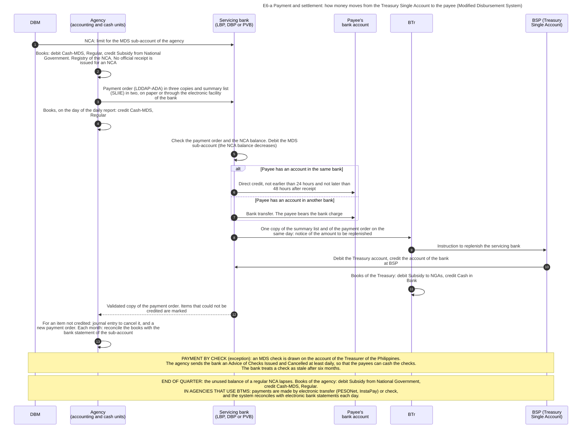

### Diagram E6-b  Ways in which a national agency settles a payment

Code file: `../diagrams/mermaid/E6-b_payment_modes.mmd`. Rendered image: [`../rendered/E6-b_payment_modes.png`](../rendered/E6-b_payment_modes.png).

- **Question:** which instrument does an agency use to pay, depending on who is paid and from which source?
- **How to read it:** left = the situation. Middle = the instrument. Right = the cash authority or the account that it uses (see E5-a).
- **Sources:** the Manual names six modes of disbursement: checks (MDS or commercial), cash from a cash advance, advice to debit the account, tax remittance advice, working fund or cash disbursement ceiling, and direct payment [GAM-V1 Ch.6 s.7]. Payment order (LDDAP-ADA) as the mode for accounts payable, and the four kinds of payment that are excluded from it [GAM-V1 Ch.6 s.50][CL2013-16A]. MDS checks and commercial checks [GAM-V1 Ch.6 s.2, s.8]. Advice of Checks Issued and Cancelled [GAM-V1 Ch.6 s.12][eMDS]. Checks only for payees that cannot be paid by bank credit [CL2018-14]. Salaries through bank accounts, and advances for payroll [GAM-V1 Ch.6 s.15, s.57]. Petty cash: not more than PHP 15,000 for one transaction in the Manual of 2015 [GAM-V1 Ch.6 ss.35-39]. Tax Remittance Advice [GAM-V1 Ch.6 ss.60-62]. Direct payment by a lender and the Non-Cash Availment Authority [GAM-V1 Ch.6 ss.66-68][NBC599 s.4.2.2.1]. Transfers to another agency [GAM-V1 Ch.6 s.63][NBC599 s.3.4]. Purchases from the Procurement Service are paid directly to it [GAM-V1 Ch.8 s.15]. Online subscriptions by purchase card or credit card [IRR12009 s.35.13]. Electronic transfer from BTMS [CL2025-8].
- **Not verified:** whether the limit of PHP 15,000 for one petty cash payment is still in force.

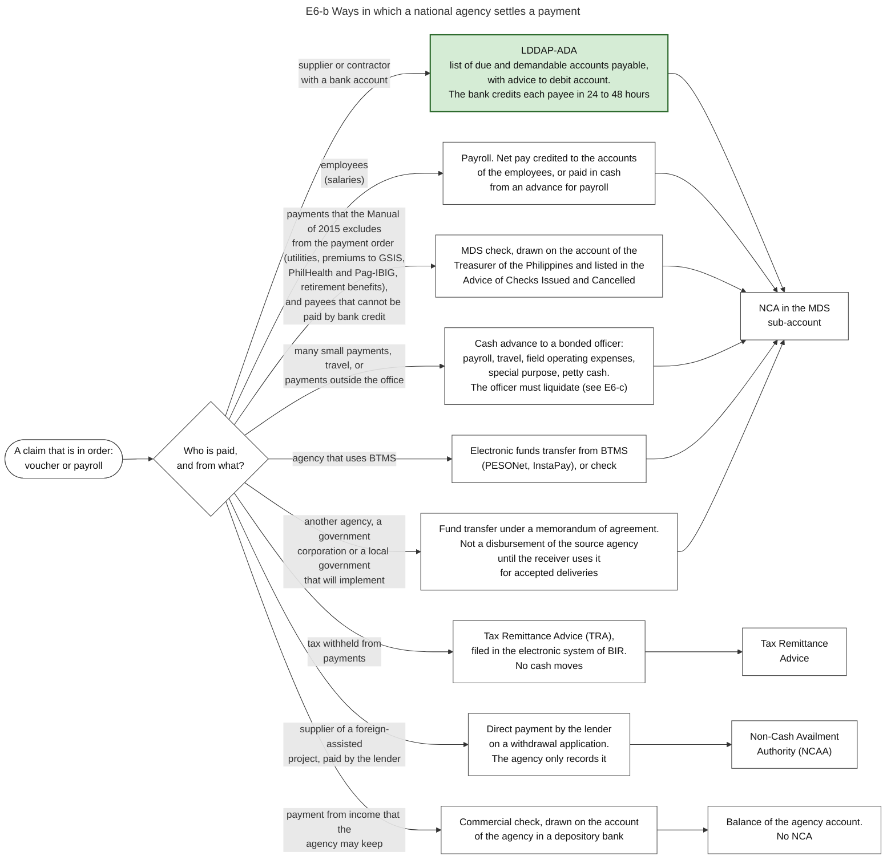

### Diagram E6-c  States of one cash advance, from grant to liquidation

Code file: `../diagrams/mermaid/E6-c_cash_advance_states.mmd`. Rendered image: [`../rendered/E6-c_cash_advance_states.png`](../rendered/E6-c_cash_advance_states.png).

- **Question:** a cash advance leaves the Treasury before any delivery is accepted. How does the government ensure that the money is later accounted for?
- **Idea:** a cash advance is money given to a named officer, who is personally accountable for it until he or she presents proof of how it was spent (liquidation) and returns the rest. In the books the money is a receivable from the officer until then, and not an expense.
- **Sources:** the three rules of the law: only for a legally authorized specific purpose, to be liquidated as soon as the purpose is served, and no new advance before the earlier one is settled [PD1445 s.89]. Bond, permanent appointment of disbursing officers, no transfer between officers [GAM-V1 Ch.6 s.14]. Time limits: an advance for payroll within 5 days after the end of the pay period, local travel within 30 days after return, foreign travel within 60 days [GAM-V1 Ch.6 s.15, ss.25-29]. Petty cash: replenished when 75 percent is used, never closed at the end of the year [GAM-V1 Ch.6 ss.35-39]. The accounts: Advances for Payroll, Advances to Officers and Employees, Advances for Operating Expenses, Advances to Special Disbursing Officer [GAM-V1 Ch.5 s.38, Ch.6 s.19]. A disallowance enters the books only when it is final and executory, as a receivable [GAM-V1 Ch.6 s.46]. Bonding is administered by BTr [EO449]. Weakness reported: a part of the advances, in particular advances to government corporations, was not liquidated at the end of 2023 (indicator 27.3, score C) [PEFA2025].
- **General knowledge, not opened in a source here:** the demand letter and the withholding of salary. They are in COA Circular No. 97-002, which the Manual names and which I did not open.

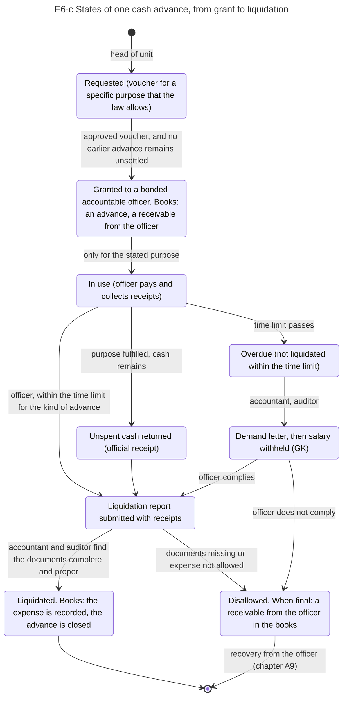

### Diagram E6-d  When a step fails: who acts, where the transaction continues, and which record shows it

Code file: `../diagrams/mermaid/E6-d_when_a_step_fails.mmd`. Rendered image: [`../rendered/E6-d_when_a_step_fails.png`](../rendered/E6-d_when_a_step_fails.png).

- **Question:** diagrams E4-a and E4-b show the path when every check succeeds. What happens when one check fails, and where can a reader of the records see that it failed?
- **How to read it:** each row is one kind of failure, in the order of the process. The rows are separate cases, not a sequence. Column 1 = what fails. Column 2 = who acts and how. Column 3 = where the transaction continues. Column 4 (grey) = the record or report in which the failure is visible.
- **Why it matters for a process model:** each row is a path that leaves the main sequence. A model that contains only the main sequence cannot represent unpaid obligations, lapsed authority or recovered payments.
- **Sources:** row 1, the registry balance is taken at every entry to prevent obligations above the allotment [GAM-V1 Ch.3 s.10]; changes of allotment and their approval [NBC599 s.3.13]; BTMS refuses an obligation above the allotment [CL2025-8]. Row 2, items that do not conform are returned to the supplier [GAM-V1 Ch.8 s.15]; damages of one tenth of one percent of the cost of the delayed goods for every day of delay, and the right to rescind when they reach 10 percent of the contract price [IRR12009 s.71.1.4]; take-over of an ended contract by negotiated procurement [IRR12009 s.35.3]; notice of adjustment of an obligation [GAM-V1 Ch.3 ss.13-14]. Row 3, check of completeness and of the index of payments [GAM-V1 Ch.6 s.12]. Row 4, the voucher is kept when the registry of the NCA shows no balance [GAM-V1 Ch.6 s.12]; a regular NCA lapses at the end of the quarter, additional NCAs, and the regular NCA covers payables of the current and of earlier years [NBC599 s.4.2]; aging of unpaid obligations in FAR 3 and monthly disbursements in FAR 4 [JC2019-1]. Row 5, a payment order may be invalidated when the bank branch, the account name or the account number does not agree with the bank records; journal entry and new payment order [GAM-V1 Ch.6 s.54]; remarks of the bank [CL2018-14]. Row 6, stale checks and the entry that restores the payable [GAM-V1 Ch.6 ss.44-45]; the law gives two years [PD1445 s.97]. Row 7, unused balances revert to the unappropriated surplus of the General Fund [NBC599 s.3.6][EO292-B6 s.28]. Row 8, transfers are not disbursements until the receiver has used them for accepted deliveries [NBC599 s.3.4]; reports of the receiver within ten days after each month and return of the unused balance [GAM-V1 Ch.6 s.63]; report FAR 1-C [JC2019-1]. Row 9, notices of suspension and of disallowance, appeal, finality, order of execution [COA2009-006]; a disallowance enters the books only when it is final and executory [GAM-V1 Ch.6 s.46].
- **Weakness reported:** the stock of expenditure arrears in 2023 was above 10 percent of expenditure (indicator 22.1, score D) [PEFA2025].

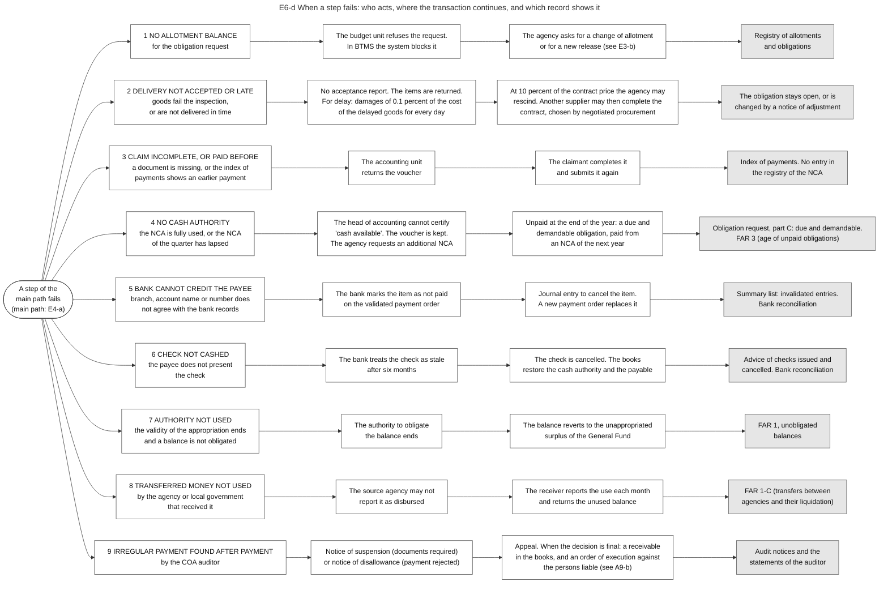

### Diagram E6-e  Kinds of payment: what creates the claim, what proves it before payment, and what the books record at that time

Code file: `../diagrams/mermaid/E6-e_kinds_of_claim.mmd`. Rendered image: [`../rendered/E6-e_kinds_of_claim.png`](../rendered/E6-e_kinds_of_claim.png).

- **Question:** a purchase is paid after a contract and an accepted delivery. What replaces these two things in the other kinds of payment, which document proves the claim before the money leaves, and what do the books show at that moment?
- **Idea:** every payment needs legal authority, cash and records in the same way (diagram BP-d). The kinds of payment differ only in the event that makes the government owe the money, and in the document that proves this event. In rows 2 and 5 the money leaves before anything is delivered. The rules then require a security or a bond, and the books record a receivable and not an expense.
- **How to read it:** each row is one kind of payment. The rows are separate cases, not a sequence. Column 1 = the kind of payment. Column 2 = the event that creates the claim. Column 3 = the document that proves the event, and the officer who states it. Column 4 (grey) = what the books of the agency record at that time.
- **Sources:** row 1 [PD1445 s.88][GAM-V1 Ch.8 s.15][GAM-V2 App.62]. Row 2 [IRR12009 s.71.1.5, s.71.2.5][GAM-V1 Ch.6 s.57, Ch.10 s.8]. Row 3 [IRR12009 s.71.2.7, s.71.2.8][GAM-V1 Ch.10 s.8]. Row 4 [GAM-V2 App.33][GAM-V1 Ch.6 s.19, s.48, Annex H]. Row 5 [PD1445 s.89][GAM-V1 Ch.6 ss.14-39]. Row 6 [GAM-V1 Ch.5 s.38, Ch.6 ss.60-62]. Row 7 [GAM-V1 Ch.6 s.63][NBC599 s.3.4]. Row 8 [GAM-V1 Ch.6 ss.66-68][NBC599 s.4.2.2.1]. Row 9 [EO292-B6 s.26][EO449]. Row 10 [LGC s.286][ALGU2026][GAM-V1 Ch.5 s.18].
- **Not in the diagram:** the refund of a tax and cash aid to persons. Their steps are in chapters E5 and E6, and I did not read the rules on their documents.
- **Limit:** the Manual is of 2015. The accounts and the forms are those of the Manual. The limits on advances, retention and damages are those of the procurement rules of 2025.

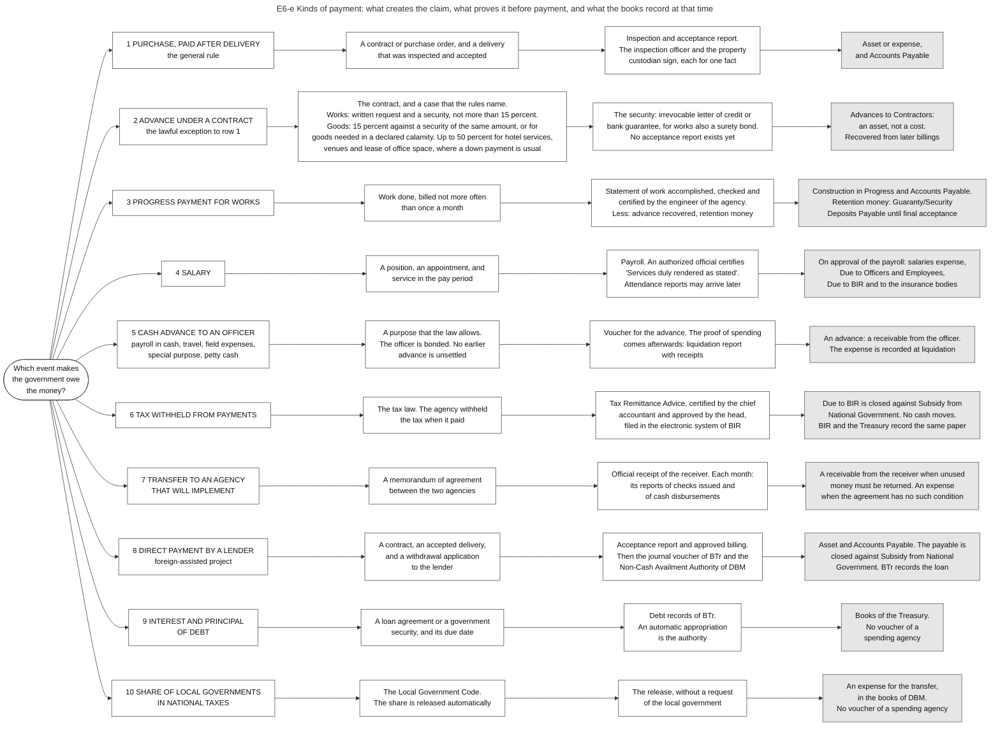

### Diagram E6-f  A works contract with an advance, progress billings and retention money (example of the Manual)

Code file: `../diagrams/mermaid/E6-f_advance_progress_retention.mmd`. Rendered image: [`../rendered/E6-f_advance_progress_retention.png`](../rendered/E6-f_advance_progress_retention.png).

- **Question:** when a contractor receives an advance and is then paid by progress billings, which amounts leave the Treasury on which occasion, what is retained, and what do the books show at each step?
- **Idea:** the advance is not a cost. It is money of the government in the hands of the contractor, covered by a security, and it is recovered from the later billings. A part of each payment is kept as retention money until final acceptance. Over the whole contract the payments, the retention and the tax together equal the contract price.
- **The example:** the amounts and the accounts are those of the worked example of the Manual for a building of PHP 800,000 [GAM-V1 Ch.10 s.8]. The Manual is of 2015 and its example follows the rules of that time.
- **The rules of 2025:** advance of not more than 15 percent, on the written request of the contractor and against an irrevocable standby letter of credit, a bank guarantee or a surety bond [IRR12009 s.71.2.5]. Progress billing not more often than once a month, checked and certified by the engineer of the agency. Deductions: work already paid, the part of the advance that is recovered, retention money, third-party liabilities, uncorrected defects [IRR12009 s.71.2.7]. Retention of 10 percent of the amount due before any deduction, from every progress payment until 50 percent of the works are completed, and released upon final acceptance [IRR12009 s.71.2.8]. Performance security before the contract is signed: 10 percent for works in cash or bank instruments, 30 percent as surety bond [IRR12009 s.68]. Damages for delay: at least one tenth of one percent of the cost of the unperformed portion for every day [IRR12009 s.71.2.4]. Defects liability period of one year from completion [IRR12009 s.90.2.2].
- **Differences between the example and the rules of 2025:** (1) the example retains 10 percent of the payable after the advance is recovered (34,000). The rules of 2025 base the retention on the amount due before any deduction, and stop it after 50 percent of the works when the work is satisfactory and on schedule. (2) The performance security of the example is 75,000. Ten percent of the contract price would be 80,000. (3) The example computes the damages as one tenth of one percent of the contract. The rules of 2025 use the cost of the unperformed portion.
- **Check of the arithmetic:** cash to the contractor 120,000 + 282,200 + 282,200 + 68,000 = 752,400. Tax withheld 23,800 + 23,800 = 47,600. Together 800,000, the contract price.

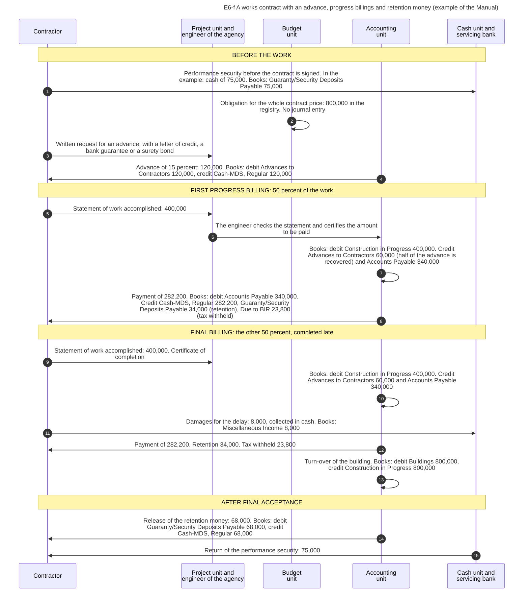

## 9. Government corporations, fund transfers, other spending paths, and fund clusters

### 9.1 The question this process answers

Chapters E0 to E6 follow one purchase by one national agency. Which other routes does public money take, who approves the budget of a government corporation, when does a transfer to another body count as spent, and how does one agency separate different kinds of money?

### 9.2 The idea in plain words

The main route is: an agency receives an allotment, procures, accepts a delivery and pays. Four things do not fit this route, and each has its own rule.

1. **A government corporation is not an agency in the budget law.** It is a separate legal person with its own income. Its yearly budget is the **Corporate Operating Budget**, which its governing board approves and DBM reviews [COB]. The Administrative Code has the rule: the internal operating budgets of these corporations "shall be approved by their respective governing boards", and they pass through the budget process of the national government "in cases where national government budgetary support is needed" [EO292-B6 s.19]. Only the money that the national government gives to it (a subsidy, or equity, which is a capital investment) passes through the budget law and the Treasury [BSGC2026].
2. **A fund transfer moves cash, but it does not move the responsibility.** When an agency gives money to another agency, a corporation or a local government to implement a project, the source agency may not treat the money as disbursed until the receiver has used it for works, goods or services that were completed, inspected and accepted [NBC599 s.3.4].
3. **Several kinds of spending omit steps of the main route.** Salaries have no procurement. The share of local governments has no voucher of an agency. Interest on debt has no yearly vote on the amount. Diagram E6-i shows eight such paths.
4. **One agency holds several kinds of money.** Money from the budget law, money from loans, income that the agency may keep, and money held for others must be recorded and reported separately. Each group is a **fund cluster** with its own books [JC2017-1][JC2019-1]. The accounting manual requires "fund cluster accounting" as one of its basic principles, and each agency keeps a complete set of books for each cluster [GAM-V1 Ch.2 s.6, s.8].

A case where the transfer rule works: in March an agency transfers 100 to a second agency for a project. The second agency procures, accepts the work in October, pays 90, reports this and returns 10. The first agency then reports a disbursement of 90.

A case where it fails: the second agency does not report. The books of the first agency show a receivable for years. The cash left the Treasury in March, and no record of the first agency shows what was bought. The 2025 PEFA assessment found that a part of the advances, in particular those given to government corporations, was not liquidated at the end of 2023 [PEFA2025].

Terms. A **GOCC** is a government-owned or controlled corporation. A **subsidy** is money for the operations or programs of the corporation (GK for this short definition). **Equity** is a capital investment of the national government in the corporation, and may not be used for salaries [BSGC2026]. **Liquidation** means that the receiver of an advance or transfer reports, with documents, how the money was used. **Off-budget** means not appropriated each year in the budget law.

### 9.3 Government corporations

#### 9.3.1 Authorities and their roles

| Authority | Role | Basis |
|---|---|---|
| Governing board of the corporation | Approves the Corporate Operating Budget | BSGC2026, COB |
| Management of the corporation | Prepares the budget and submits it to DBM on or before 31 March of the fiscal year. Requests budgetary support. Reports | COB, BSGC2026 |
| DBM, Budget and Management Bureau C | Evaluates the budget within 20 working days. An Undersecretary approves and DBM issues an approval letter | COB |
| DBM | Administers the item "Budgetary Support to Government Corporations". Acts on the Special Budget Request | BSGC2026 |
| BTr | Releases the support directly to the corporation. May offset the release against dividends due, guarantee fees, advances and other receivables of the national government. Receives the dividends | BSGC2026 |
| Congress | Appropriates the budgetary support. Receives notice of the reports | BSGC2026 |
| Governance Commission for GOCCs | Has a defined group of corporations under its coverage. What it does in the budget of a corporation is not stated in the source I read | COB. Its work on performance: GK |
| COA | Receives the year-end statements by 14 February. Audits the corporation and its subsidiaries | COA2015-004, CONST IX-D.2, PD1445 s.26 |

#### 9.3.2 Steps

The steps are those of diagram E6-g.

| No. | Who acts | Towards whom | What is done or passed | Basis |
|---|---|---|---|---|
| 1 | GOCC management | GOCC governing board | Proposed COB | COB |
| 2 | GOCC governing board | GOCC management | Board approval | COB |
| 3 | GOCC management | DBM (Budget and Management Bureau C) | COB on or before 31 March, with DBM Forms 700, 703-A to 703-C, 705, 706 | COB |
| 4 | DBM (Budget and Management Bureau C) | (own action) | Evaluate: uses agree with the board approval, sources cover uses, national priorities, physical performance, use of last year's budget, financial ratios | COB |
| 5 | DBM (Budget and Management Bureau C) | GOCC management | COB approval letter (within 20 working days) | COB |
| 6 | GOCC management | DBM (Budget and Management Bureau C) | Request for subsidy or equity in the national budget proposal | GK |
| 7 | Congress | DBM (Budget and Management Bureau C) | GAA item "Budgetary Support to Government Corporations" | BSGC2026 |
| 8 | GOCC management | DBM (Budget and Management Bureau C) | Special Budget Request. The amount must be in the board-approved COB | BSGC2026 |
| 9 | DBM (Budget and Management Bureau C) | BTr | Release document | BSGC2026 |
| 10 | BTr | GOCC management | Cash released directly to the corporation | BSGC2026 |
| 11 | BTr | (own action) | Offset the release against dividends due, guarantee fees, advances and other receivables | BSGC2026 |
| 12 | GOCC management | BTr | Dividends: at least 50 percent of annual net earnings | BSGC2026 |
| 13 | GOCC management | DBM (Budget and Management Bureau C) | Quarterly financial and physical reports through URS, within 30 days after each quarter. Also published on its website | BSGC2026 |
| 14 | GOCC management | Congress | Written notice that the reports were submitted and published | BSGC2026 |
| 15 | GOCC management | COA | Year-end financial statements by 14 February | COA2015-004 |
| 16 | COA | GOCC governing board | Audit report | GK |
| 17 | Governance Commission for GOCCs | GOCC governing board | Performance targets and evaluation of the corporation | GK |

#### 9.3.3 The Corporate Operating Budget

| Subject | Content | Basis |
|---|---|---|
| Who must submit | Corporations and government financial institutions under the coverage of the Governance Commission or under the jurisdiction of DBM, with or without budgetary support | COB |
| Legal bases named by DBM | Executive Order No. 518 of 1979, Republic Act No. 10149, Corporate Budget Circular No. 24 | COB |
| Forms | DBM Form 700 on corporate strategic measures. Forms 703-A, 703-B and 703-C on personnel services, operating expenses and capital outlays. Form 705 on sources of funds. Form 706 on uses of funds by expense class | COB |
| What DBM checks | That the uses agree with the board approval, that sources cover uses, agreement with national priorities, physical performance, the use of the budget of the previous year, the ratio of revenue to expense, and capital adequacy for banks | COB |
| Late submission | The budget is limited to the lower of two amounts: the level approved for the previous year, or the level approved by the board | COB |

#### 9.3.4 Budgetary support and what the corporation returns

| Subject | Rule in the FY 2026 budget law | Basis |
|---|---|---|
| Kinds of support | Subsidy, and equity. Equity is a capital investment and is not for salaries | BSGC2026 |
| Condition | The corporation files a Special Budget Request. The amount must be in the budget approved by its board | BSGC2026 |
| Route of the money | DBM issues the release. BTr releases directly to the corporation | BSGC2026, NBC599 |
| Offsetting | BTr may deduct what the corporation owes: cash dividends, guarantee fees, advances, other receivables | BSGC2026 |
| Dividends | At least 50 percent of yearly net earnings go to the National Treasury | BSGC2026 |
| Reports | Quarterly financial and physical reports within 30 days after each quarter, through URS or other electronic means until migration to BTMS. Written notice to DBM, to both chambers and to their committees on appropriations and finance | BSGC2026 |
| Year-end statements | To the COA Government Accountancy Sector and to the auditor of the corporation on or before 14 February. No revision after 31 March | COA2015-004 |
| Codes | Corporations with budgetary support are users of UACS. The list of funding sources has codes for budgetary support to government corporations (equity, subsidies, loans, advances) and for net lending | UACS-FAQ, GAM-V1 Annex P |

### 9.4 Transfers of funds to another body that will implement

#### 9.4.1 Steps

The steps are those of diagram E6-h. They follow the accounting manual, which describes a transfer between two national agencies: a source agency and an implementing agency.

| No. | Who acts | Towards whom | What is done or passed | Basis |
|---|---|---|---|---|
| 1 | Source agency (holds the appropriation) | Implementing body (agency, corporation or local government) | Memorandum of agreement: purpose, amount (enough for three months, or the total project cost), period, reports | GAM-V1 Ch.6 s.63 |
| 2 | Source agency (holds the appropriation) | (own action) | Obligation recorded against its own allotment | GAM-V1 Annex M |
| 3 | Source agency (holds the appropriation) | Implementing body (agency, corporation or local government) | Check in the name of the implementing body. The receiver issues an official receipt | GAM-V1 Ch.6 s.63 |
| 4 | Source agency (holds the appropriation) | (own action) | Books: Due from National Government Agencies (a receivable). Not yet an expense, not yet a disbursement in the budget reports | GAM-V1 Annex M. Budget reports: NBC599 s.3.4 |
| 5 | Implementing body (agency, corporation or local government) | (own action) | Trust fund books: Due to NGAs (a liability). The money goes to a trust account, or to the Treasury, from which DBM gives an NCA for trust | GAM-V1 Ch.6 s.63, Annex M |
| 6 | Implementing body (agency, corporation or local government) | Suppliers and contractors | Procurement, contract | GAM-V1 Annex M |
| 7 | Suppliers and contractors | Implementing body (agency, corporation or local government) | Delivery, inspected and accepted | GAM-V1 Annex M |
| 8 | Implementing body (agency, corporation or local government) | Suppliers and contractors | Payment from the trust account or under the NCA for trust | GAM-V1 Annex M |
| 9 | Implementing body (agency, corporation or local government) | Source agency (holds the appropriation) | Within ten days after each month: reports of checks issued and of cash disbursements, approved by the head of the implementing body | GAM-V1 Ch.6 s.63 |
| 10 | Source agency (holds the appropriation) | (own action) | Books: expense recorded, receivable reduced. Now reported as disbursed. The implementing body reduces its liability by the same expenses | GAM-V1 Ch.6 s.63, Annex M, NBC599 s.3.4 |
| 11 | Implementing body (agency, corporation or local government) | Source agency (holds the appropriation) | Unused balance returned, if the agreement says so | GAM-V1 Ch.6 s.63 |
| 12 | Source agency (holds the appropriation) | DBM and COA | FAR 1-C each quarter: obligations, disbursements, liquidations and balances of fund transfers | JC2019-1 |
| 13 | DBM and COA | Source agency (holds the appropriation) | The auditor of the implementing body audits its payments. The auditor of the source agency audits the transfer | GAM-V1 Ch.6 s.63 |

#### 9.4.2 The rules of the Manual

| Subject | Rule | Basis |
|---|---|---|
| Document | A memorandum of agreement between the source agency and the implementing agency | GAM-V1 Ch.6 s.63 |
| Amount | Enough "for three months operation subject to replenishment", or the total project cost | GAM-V1 Ch.6 s.63 |
| Where the money goes | A check in the name of the implementing agency "for deposit to its trust account in its authorized government depository bank". The implementing agency issues its official receipt. The worked example shows a second way: the implementing agency remits the money to the Treasury as a trust deposit and receives from DBM an NCA for trust, under which it pays | GAM-V1 Ch.6 s.63, Annex M |
| Reports | Within ten days after the end of each month, or of the agreed period, the implementing agency submits its report of checks issued and its report of cash disbursements. "Only actual project expenses shall be reported." The head of the implementing agency approves the reports | GAM-V1 Ch.6 s.63 |
| Unused money | Returned to the source agency after the project, when the agreement says so | GAM-V1 Ch.6 s.63 |
| Audit | The auditor of the implementing agency audits the payments from the trust account | GAM-V1 Ch.6 s.63 |

#### 9.4.3 What the two sets of books show

The worked example of the Manual places the books of the two agencies side by side [GAM-V1 Annex M].

| Moment | Books of the source agency (regular agency fund) | Books of the implementing agency (trust fund) | Budget reports of the source agency | Basis |
|---|---|---|---|---|
| Transfer of cash | Debit Due from National Government Agencies. Credit Cash-MDS, Regular | Debit Cash-Collecting Officers. Credit Due to NGAs | Obligation recorded. No disbursement yet | GAM-V1 Annex M. Budget reports: NBC599 s.3.4 |
| The implementing agency deposits the money and receives its cash authority | No entry | Debit Cash-Treasury/Agency Deposit, Trust. Then, on the NCA for trust: debit Cash-MDS, Trust, credit Cash-Treasury/Agency Deposit, Trust | | GAM-V1 Annex M |
| The implementing agency accepts a delivery and pays | No entry | Debit the asset or inventory, credit Accounts Payable. Then debit Accounts Payable, credit Cash-MDS, Trust and Due to BIR | | GAM-V1 Annex M |
| The implementing agency reports | Debit the expense accounts. Credit Due from National Government Agencies | Debit Due to NGAs. Credit the expense accounts | Disbursement reported | GAM-V1 Annex M, Ch.6 s.63. Budget reports: NBC599 s.3.4 |
| End of the year, a part is not yet reported | Due from National Government Agencies stays as a receivable | Due to NGAs stays as a liability | The balance is shown in report FAR 1-C | GAM-V1 Annex M, JC2019-1 |

Three things follow from the example.

- The cash that the source agency transfers can return to the Treasury, and the implementing agency then spends under a new cash authority of DBM. One appropriation is in that case the basis of two cash authorities in sequence, one for each agency.
- In the books of the implementing agency the spending does not stay as its own expense. It reduces the liability to the source agency. The expense appears in the books of the source agency, and only when the implementing agency has reported.
- The receivable in the books of the source agency is the measure of what has not been reported. The assessment of 2025 found that a part of such advances was not liquidated at the end of 2023 [PEFA2025].

The Manual makes one condition. The receivable and the liability are recorded when the agreement requires that unused money is returned. When the agreement has no such condition, the source agency records an expense and the implementing agency records revenue at the moment of the transfer [GAM-V1 Ch.6 s.63].

A difference between two sources, to state and not to resolve: the Manual of 2015 credits the cash account of the source agency when the check is issued, like any other payment. The release guidelines of FY 2026 say that the source agency does not treat the transfer as disbursed until the receiver has used it for deliveries that were inspected and accepted [NBC599 s.3.4]. I did not read how the registry of the source agency shows the transfer between these two moments. Report FAR 1-C lists, for each quarter, the obligations, disbursements, liquidations and balances of inter-agency fund transfers [JC2019-1].

For a transfer to a government corporation or to a local government I read only the rule of the circular.

### 9.5 Paths after the allotment

Diagram E6-i shows eight paths. The table gives the same content, and names the steps of the main route that each path omits.

| Path | Kind of spending | What is different from a purchase | Where the records of the national agency end | Basis |
|---|---|---|---|---|
| A | Personnel services | No procurement. The amount follows from positions and pay rules | At the remittances | GMIS, NBC599. See chapter E4, section 11 |
| B | Goods, services and works bought by the agency | The main route | At the payment and the audit | RA12009, CL2013-16A. See chapters E1, E4 and E6 |
| C | Share of local governments | Automatic appropriation. No voucher of an agency. BTr releases to the local government | At the release. The local cycle continues in local records | LGC s.286, MANDANAS, ALGU2026. See chapter E3, section 4 |
| D | Subsidy or equity to a government corporation | Special Budget Request. BTr releases to the corporation | At the release. Spending continues under the corporate budget | BSGC2026 |
| E | Cash aid to persons | A list of beneficiaries replaces the contract. Payout by a bank, a remittance institution or an accountable officer | At the payment order for all persons. The proof of payment to each person is in the records of the payer | RA11310 s.9 for one program (section 9.5.2). Other programs: GK |
| F | Transfer to another body that will implement | The receiver procures and pays. The source agency has not disbursed until then | At the reports of the implementing body | NBC599 s.3.4, GAM-V1 Ch.6 s.63 |
| G | Interest on debt | Automatic appropriation. BTr pays creditors on the due dates | At the payment, in the books of BTr only. Repayment of principal reduces the liability and is not an expense | NBC599, EO292-B6 s.26, GAM-V1 Annex I. See chapter E5, section 3 |
| H | Foreign-assisted project with direct payment | The lender pays the supplier. No cash passes through the Treasury. BTr records the loan, and a Non-Cash Availment Authority lets the agency close its payable | At the recording | NBC599 s.4.2.2.1, GAM-V1 Ch.6 ss.66-68. See chapter E5, section 3 |

Why this matters for a model of the process: directly after the allotment there is a choice among these paths, and only path B contains procurement by the spending agency.

#### 9.5.1 Money for disasters

After a disaster, money is needed within days, and the main route takes months. Diagram E6-k answers the question: which money is already available, who must approve the rest, and which records show the use?

The idea: speed is obtained in three ways, and none of them removes the normal controls of appropriation, obligation, voucher and audit.

| Way | Content | Who decides | Basis |
|---|---|---|---|
| Quick Response Fund of an agency | An amount kept ready inside the budget of twelve agencies and corporations (the rules call it a standby fund), among them the social welfare, education, public works, agriculture and health departments and the Office of Civil Defense. PHP 10.69 billion in FY 2026. The agency uses it immediately | The agency. When the balance decreases to 50 percent, it asks DBM to replenish the fund | GAA2026-NDRRMF, DBM-QRF |
| National Disaster Risk Reduction and Management Fund | PHP 39.82 billion in the FY 2026 budget law, with no project named in advance. Four purposes: relief and rehabilitation services (11.03 billion), repair and reconstruction (12.47 billion), the People's Survival Fund (1.00 billion), and assistance to local governments for rehabilitation and reconstruction (15.33 billion). It covers events of the current year and of the two years before | The President approves each use, with the recommendation of the national disaster council. DBM then issues a SARO | GAA2026-NDRRMF |
| Fund of each local government | Not less than 5 percent of estimated revenue from regular sources, in every yearly budget. 30 percent of it is a Quick Response Fund. Amounts not spent go to a special trust fund for five years and then return to the general fund | The local government. The condition for the use of the 30 percent, and who approves, are not verified | RA10121 (read in two documents that quote the law and its rules) |

What the records show. DBM publishes the status of the national fund each month, with the number, date and amount of each SARO. By 31 May 2026 it had released PHP 5.92 billion, all in three SAROs to the social welfare department to replenish its Quick Response Fund. One of them is SARO-BMB-B-26-0000189 of 12 February 2026 for PHP 1,979,556,861 [NDRRMF-STATUS]. Implementing agencies report each quarter through URS and publish the reports on their websites [GAA2026-NDRRMF].

Procurement in an emergency: the Implementing Rules allow negotiated procurement when there is imminent danger to life or property during a calamity, or when vital services must be restored. Some documents of the supplier may then be submitted after the award, before payment [IRR12009 s.35.2].

On 14 August 2026 the GPPB approved guidelines for procurement in four stages: preparedness, action before an expected disaster, response and recovery. Emergency negotiated procurement applies "When time is of the essence arising from natural or man-made calamities", and also for action before a disaster once a state of imminent disaster is declared. The guidelines encourage framework agreements for goods that will be needed (chapter E1, section 2.5), and they allow the steps of a procurement before the award to be done early. The entity must confirm that "there is a budget for the purpose", and the contract form has a line "Certified Funds Available" for the chief accountant. Payment stays "subject to existing budgeting, accounting and auditing rules and regulations". A performance security is at the option of the entity. The guidelines do not speak of the Quick Response Fund or of advance payment [GPPB2026-17]. I read them as a summary. They shorten the choice of the supplier. They do not change the controls of funds: the certificate of the accountant, the obligation and the voucher remain.

A case where the design works: a typhoon damages schools. The education department repairs classrooms immediately from its Quick Response Fund, and asks for replenishment when half of it is used.

A case where it fails: the damage is larger than these ready amounts, and the release from the national fund needs a recommendation and an approval. The time between the disaster and the SARO is then the time of these two steps. The sources that I read do not state how long they take.

#### 9.5.2 Cash aid to persons

In a purchase, one supplier delivers and one voucher is paid. In a cash aid program, one payment order pays many thousands of persons, and nothing is delivered to the government. Diagram E6-l answers the question: what replaces the contract, the delivery and the acceptance?

The idea: the law of the program replaces the contract, because it says who has a right to the money. The list of persons who qualify replaces the delivery. The control is that each person on the list exists, qualifies and has met the conditions. The proof of payment is the record of the bank for each person.

The steps are those of diagram E6-l. The example is the conditional cash transfer program.

| No. | Who acts | Towards whom | What is done or passed | Basis |
|---|---|---|---|---|
| 1 | Congress | Program agency (DSWD) | Program law: who qualifies, conditions, kinds of grant. Budget law: the amount for the year | RA11310 s.22 |
| 2 | Program agency (DSWD) | (own action) | Select households with a standardized targeting system. Check the list again every three years | RA11310 s.5 |
| 3 | Program agency (DSWD) | (own action) | Amount of each grant, as fixed by the advisory council of the program and reviewed every six years | RA11310 s.7, s.10 |
| 4 | Program agency (DSWD) | (own action) | Check that each household met the conditions (for example school attendance, health visits) | GK |
| 5 | Program agency (DSWD) | (own action) | Payroll of beneficiaries for the period, certified and approved. Obligation recorded against the allotment | GK |
| 6 | DBM | Program agency (DSWD) | Cash authority (NCA) for the period (chapter E5) | GK |
| 7 | Program agency (DSWD) | Government bank or remittance institution | Payment order with the list of accounts, within the cash authority | GK |
| 8 | Government bank or remittance institution | Household | Grant credited to the account of the household, or paid out by a remittance institution | RA11310 s.9 |
| 9 | Government bank or remittance institution | Program agency (DSWD) | Report of amounts credited and of amounts not credited | GK |
| 10 | Program agency (DSWD) | (own action) | Accounting entries. Amounts not credited are returned or paid again | GK |
| 11 | Program agency (DSWD) | Congress | Yearly report on the program, before the President's budget message | RA11310 s.18 |
| 12 | Monitoring bodies and COA | Program agency (DSWD) | Independent monitoring committee, and audit by COA | RA11310 s.16. Audit: CONST IX-D.2 |

The law of that program requires "direct and secured access to cash grants" through authorized government depository banks. Where no such bank serves an area, the department may use institutions for money remittance that the central bank has accredited [RA11310 s.9].

A consequence for the records: the books of the agency show one payment for many persons. The evidence that each person was paid is in the records of the bank or of the remittance institution, outside the systems of the government (Inference). Other aid programs follow their own rules, and some pay in cash through accountable officers (diagram E6-c).

### 9.6 Fund clusters

Diagram E6-j shows the seven fund clusters, the report that covers each one, and the form in which its cash is held. The names are those of the accounting manual [GAM-V1 Ch.2 s.13], and the content of each cluster is from its list of funding sources [GAM-V1 Annex P].

| Code | Name | What belongs to it | Budget report | Cash is held as | Basis |
|---|---|---|---|---|---|
| 01 | Regular Agency Fund | The General Fund: new general appropriations, continuing and supplemental appropriations, automatic appropriations, unprogrammed funds | FAR 1, 1-A, 1-B, 1-C | A limit (NCA) in an MDS sub-account, or a Non-Cash Availment Authority | GAM-V1 Ch.2 s.13, Annex P. Reports: JC2019-1. Cash: NBC599 |
| 02 | Foreign Assisted Projects Fund | The counterpart funds of the government, and one funding source code for each lender or donor | FAR 1 and its parts | As above | Same |
| 03 | Special Account-Locally Funded/Domestic Grants Fund | Special accounts in the General Fund that a law created, and domestic grants | FAR 1 and its parts | As above | Same |
| 04 | Special Account-Foreign Assisted/Foreign Grants Fund | Special accounts for foreign-assisted projects and foreign grants | FAR 1 and its parts | As above | Same |
| 05 | Internally Generated Funds | Retained income, for example the income of state universities and colleges. The Manual calls the group "Off-Budgetary Funds - Retained Income Funds" | FAR 2, 2-A | An account of the agency in an authorized government depository bank | GAM-V1 Ch.2 s.13, Annex P, JC2019-1, GAA2026-GP |
| 06 | Business Related Funds | Revolving funds, for example the revolving fund of the Procurement Service. The Manual calls the group "Off-Budgetary Funds-Revolving Funds" | FAR 2, 2-A | As for 05 | Same |
| 07 | Trust Receipts | Money held for others or for a purpose. It includes money that an agency receives from another agency to implement a project (section 9.4) | FAR 6 | A trust MDS sub-account, or a trust account in a depository bank | GAM-V1 Ch.2 s.13, Annex M, Annex N, JC2019-1, NBC599, GAA2026-GP |

Notes on this table.

- The clusters 01 to 04 are spent through an appropriation, in the yearly budget law or as an automatic appropriation under another law, and are reported in FAR 1. The Manual and the reporting circular call the clusters 05 and 06 off-budgetary funds [GAM-V1 Annex P][JC2019-1]. For these, the budget unit keeps other registries and the form is the budget utilization request, not the obligation request [GAM-V1 Ch.3 ss.18-24].
- The fund cluster is the first two digits of the funding source segment of UACS [JC2017-1]. Chapter UACS explains the segments.
- Report FAR 5 covers the revenue and other receipts of all seven clusters [JC2019-1].
- There are four kinds of MDS sub-account: regular, special accounts in the General Fund, trust, and foreign-assisted projects [NBC599]. The books have three cash accounts for the NCA: Cash-MDS, Regular, Cash-MDS, Special Account and Cash-MDS, Trust [GAM-V1 Ch.5 s.38]. The table does not pair each cluster with one sub-account.
- The law gives one committee the watch over all funds other than the General Fund: the Secretary of Finance as chair, the Secretary of Budget and Management and the Chairman of COA. It may recommend to the President that amounts return to the General Fund when they are no longer needed for their purpose, when the General Fund needs them in an emergency, or when rules were violated [GAM-V1 Ch.5 s.4][EO292-B6 s.45].
- The Roadmap plans to include off-budget accounts in BTMS, or in URS if that is not feasible. A feasibility report is due in the fourth quarter of 2026 and a pilot in 2028 [SFA6].

### 9.7 Documents and identifiers

| Document | Issued by | Identified by | Basis |
|---|---|---|---|
| Corporate Operating Budget and its forms | Corporation | Corporation and year | COB |
| Approval letter | DBM | Date | COB |
| Special Budget Request for support | Corporation | Request | BSGC2026 |
| Release document for support | DBM | Document number | BSGC2026 |
| Memorandum of agreement for a transfer | Source agency and receiver | Agreement | GAM-V1 Ch.6 s.63 |
| Official receipt for the transferred money | Implementing agency | Receipt number | GAM-V1 Ch.6 s.63 |
| Report of checks issued and report of cash disbursements, as the proof of use | Implementing agency | Month | GAM-V1 Ch.6 s.63 |
| FAR 1-C | Source agency | Agency and quarter | JC2019-1 |
| FAR 2, FAR 5, FAR 6 | Agency | Agency, fund cluster and quarter | JC2019-1 |

### 9.8 Information systems

| System | Use in this chapter | Basis |
|---|---|---|
| URS | Quarterly reports of corporations that receive support. Report FAR 1-C on transfers. Reports FAR 2, 5 and 6 on off-budget funds and receipts | BSGC2026, JC2019-1 |
| ADRS | Release documents | ADRS, NBC599 |
| AFR System of COA | Year-end statements | COA-GAS |
| BTMS | National agencies in the rollout. Off-budget accounts are planned for a later step | CL2025-8, SFA6 |
| Own systems of each corporation | Its budget, accounting and payments | GK |

### 9.9 Controls: what each one checks, and what it does not check

| Control | What it checks | What it does not check |
|---|---|---|
| Board approval and DBM review of the corporate budget | That planned uses are covered by sources and agree with the board decision and with national priorities | Each payment of the corporation |
| Special Budget Request for support, linked to the board-approved budget | That national money goes only to what the board has budgeted | How the corporation spends it afterwards |
| Offsetting by BTr | That a corporation that owes the Treasury does not receive the full support | |
| Rule on dividends | That at least half of the net earnings return to the Treasury | |
| Rule that a transfer is not a disbursement | That a source agency cannot show spending by moving cash to another body | That the receiver reports in time |
| Receivable in the books of the source agency, and liability in the trust fund books of the receiver | That the amount not yet reported stays visible in two sets of books | That the two balances are compared with each other. I read no rule that requires this comparison |
| FAR 1-C | That balances of transfers stay visible each quarter | That anyone acts on old balances |
| Separate books and reports for each fund cluster | That money of one kind is not used for another | Accounts that are outside the main systems |
| Audit of the source and of the receiver | Both parties of a transfer | |

### 9.10 Timing

| Date | Event | Basis |
|---|---|---|
| 14 February | Year-end statements of corporations to COA | COA2015-004 |
| 31 March | Corporate Operating Budget due at DBM. Last day for revisions of the year-end statements | COB, COA2015-004 |
| 20 working days | Processing time that DBM states for its action on the corporate budget | COB |
| 30 days after each quarter | Quarterly reports of supported corporations. FAR 1-C, FAR 2, FAR 5, FAR 6 | BSGC2026, JC2019-1 |

### 9.11 What the 2025 assessment and the Roadmap report

| Finding | Basis |
|---|---|
| A part of the advances, in particular advances to government corporations, was not liquidated at the end of 2023 (PEFA indicator 27.3, score C) | PEFA2025 |
| Accounts of foreign-funded projects and trust accounts with a legal basis are outside the Treasury Single Account (PEFA indicator 21.1, score C) | PEFA2025 |
| Off-budget accounts are not in the main systems. A plan exists to include them in BTMS or URS | SFA6 |
| The page that I read gives no finding on the monitoring of public corporations (PEFA indicator 10.1) | PEFA2025 |

### 9.12 Diagrams

#### Diagram E6-g  Government corporations (GOCCs): corporate operating budget, budgetary support and reports

Code file: `../diagrams/mermaid/E6-g_gocc_budget_sequence.mmd`. Rendered image: [`../rendered/E6-g_gocc_budget_sequence.png`](../rendered/E6-g_gocc_budget_sequence.png).

- **Question:** a government corporation is not an agency in the GAA. Who approves its budget, how does national money reach it, and what does it return?
- **Idea:** a corporation spends its own income under a Corporate Operating Budget (COB) approved by its board and reviewed by DBM. Only the part that comes from the national budget (subsidy, equity) passes through the GAA and the Treasury.
- **Sources:** review and approval of the COB by DBM, legal bases (EO 518 of 1979, RA 10149, Corporate Budget Circular No. 24), forms, deadline of 31 March, 20 working days, rule for late submission [COB]. Special provisions of the FY 2026 GAA on budgetary support: release through BTr, Special Budget Request, request must be in the board-approved COB, offsetting, dividends of at least 50 percent of net earnings (RA 7656), quarterly reports through URS within 30 days, notice to DBM and Congress [BSGC2026]. Year-end statements to COA by 14 February [COA2015-004]. Releases by BTr to subsidized corporations [NBC599].
- **General knowledge, not opened in a source here:** step 6 (the corporation's request during national budget preparation), what the Governance Commission for GOCCs does in step 17 (the source only states which corporations it covers), step 16 (audit report to the board), guarantees and lending by DOF.

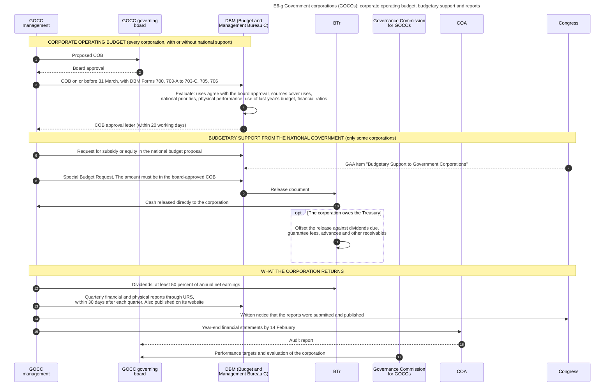

#### Diagram E6-h  Transfer of funds from one agency to another body that will implement

Code file: `../diagrams/mermaid/E6-h_inter_agency_transfers.mmd`. Rendered image: [`../rendered/E6-h_inter_agency_transfers.png`](../rendered/E6-h_inter_agency_transfers.png).

- **Question:** an agency gives its money to another agency, a corporation or a local government to implement a project. When is the money "spent", and who is responsible for it?
- **Idea:** a transfer moves cash but not accountability. Under the FY 2026 rules the source agency may not treat the transfer as a disbursement until the receiver has used it for works, goods or services that were delivered, inspected and accepted. Until then the source agency holds a receivable and the receiver holds a liability.
- **Sources:** transfers to other agencies, corporations and local governments are not treated as disbursed by the source until used by the receiver for accepted deliveries within the validity period [NBC599 s.3.4]. Report FAR 1-C on obligations, disbursements, liquidations and balances of inter-agency fund transfers [JC2019-1]. A part of the advances, in particular advances to government corporations, was not liquidated at the end of 2023 (indicator 27.3, score C) [PEFA2025]. Schedule of fund transfers required from corporations [COA2015-004].
- **From the accounting manual of 2015:** the memorandum of agreement, the amount (enough for three months, or the total project cost), the check in the name of the implementing agency for its trust account, its official receipt, the monthly reports within ten days, the return of an unused balance when the agreement says so, the audit by the auditor of the implementing agency [GAM-V1 Ch.6 s.63]. The entries of both agencies side by side: Due from National Government Agencies in the books of the source, Due to NGAs in the trust fund books of the implementer [GAM-V1 Annex M].
- **A condition in the manual:** the receivable and the liability are recorded when the agreement requires that unused money is returned. When the agreement has no such condition, the source agency records an expense and the receiver records revenue at the transfer [GAM-V1 Ch.6 s.63]. The diagram shows the first case.
- **Limit:** the Manual describes a transfer between two national agencies. For a transfer to a corporation or to a local government I read only the rule of the FY 2026 circular [NBC599 s.3.4].

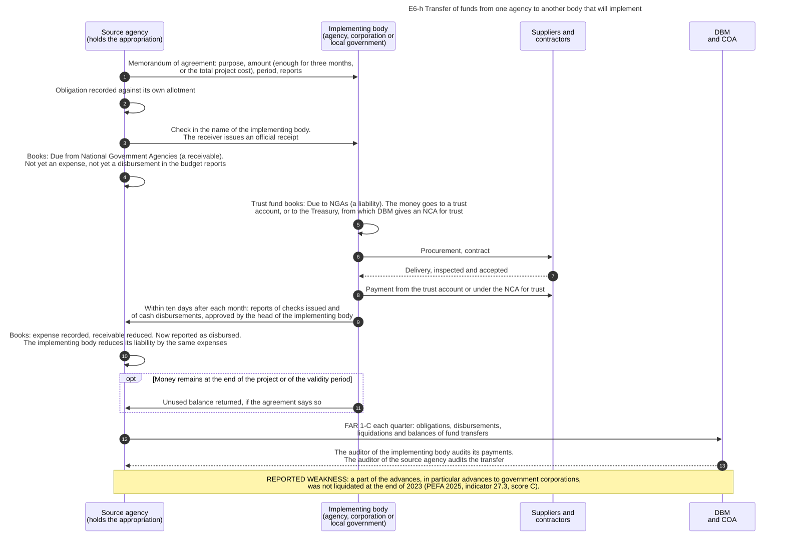

#### Diagram E6-i  The path after allotment depends on the kind of spending

Code file: `../diagrams/mermaid/E6-i_spending_paths.mmd`. Rendered image: [`../rendered/E6-i_spending_paths.png`](../rendered/E6-i_spending_paths.png).

- **Question:** chapters E1, E4 and E6 follow one purchase by one agency. Which other paths does public money take, and which steps does each path omit?
- **How to read it:** each row is one kind of spending. A grey box marks the point where the records of the national agency stop showing what happens next. The last column names the chapter that continues the path.
- **Why it matters for a process model:** this is a choice among eight branches directly after the allotment. Only branch B contains procurement by the spending agency itself.
- **Sources:** A personnel [GMIS][NBC599]. B procurement and payment [RA12009][CL2013-16A]. C share of local governments, automatic appropriation and direct release by BTr [LGC s.286][MANDANAS][GAA2026-GP]. D budgetary support to corporations through BTr [BSGC2026]. F transfers not disbursed until used by the receiver [NBC599 s.3.4]. G interest as automatic appropriation [NBC599]. H direct payment by a lender and Non-Cash Availment Authority [NBC599].
- **Row e:** payment of cash grants through authorized government depository banks or accredited remittance institutions is verified for one program [RA11310 s.9]. Diagram E6-l shows that program.
- **More sources:** the reports by which an implementing agency proves the use of transferred money (row F) [GAM-V1 Ch.6 s.63]. Debt service is recorded only in the books of BTr (row G) [GAM-V1 Annex I].
- **General knowledge, not opened in a source here:** the other steps of row E. Each program has its own guidelines.

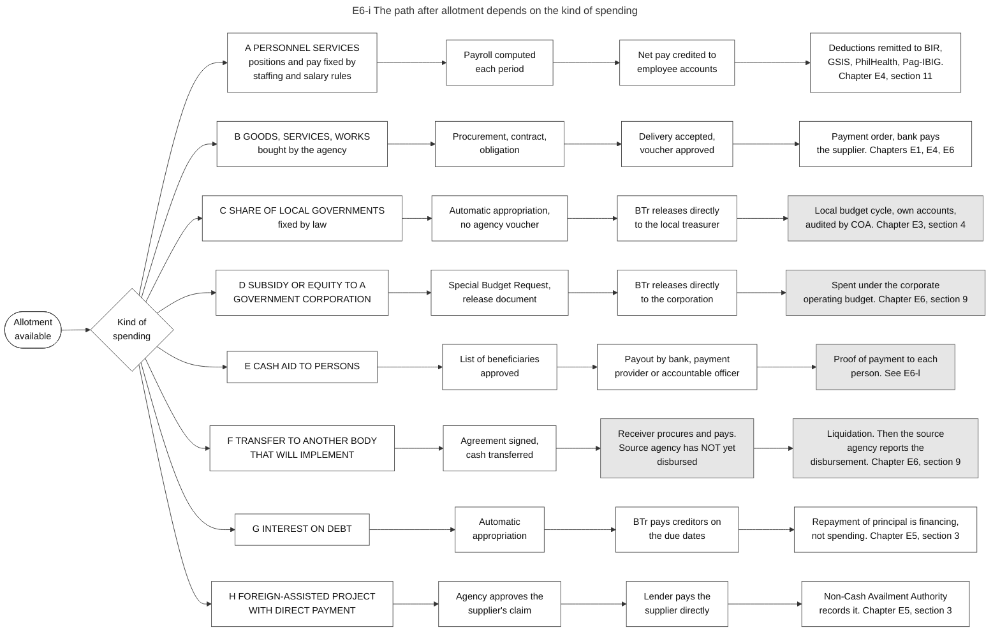

#### Diagram E6-j  Fund clusters: seven groups of money inside one agency, each with its own books and reports

Code file: `../diagrams/mermaid/E6-j_fund_clusters.mmd`. Rendered image: [`../rendered/E6-j_fund_clusters.png`](../rendered/E6-j_fund_clusters.png).

- **Question:** an agency handles money from the GAA, from loans, from its own income and from other parties. How are these separated, and which report covers each group?
- **Idea:** a fund cluster is a group of funds that must be recorded and reported separately. The fund cluster is the first two digits of the funding source segment of UACS. Each cluster has its own set of books.
- **How to read it:** left = fund cluster. Solid arrow = the budget report that covers it. Dotted arrow = the form in which its cash is held.
- **Sources:** fund cluster as the first element of the funding source code [JC2017-1]. FAR 2 and 2-A for off-budgetary funds in clusters 05 and 06, FAR 6 for trust receipts in cluster 07, FAR 5 for revenue of clusters 01 to 07, FAR 1 for appropriations [JC2019-1]. Four MDS sub-accounts: regular, special accounts, trust, foreign-assisted projects [NBC599]. Revolving funds in authorized government depository banks, trust receipts, special accounts [GAA2026-GP]. Plan to include off-budget accounts in BTMS or URS [SFA6].
- **Names and content of the seven clusters:** from the Government Accounting Manual. The names [GAM-V1 Ch.2 s.13]. The funding sources that belong to each cluster [GAM-V1 Annex P]. The Manual calls cluster 05 "Off-Budgetary Funds - Retained Income Funds" and cluster 06 "Off-Budgetary Funds-Revolving Funds".
- **The cash accounts:** the books have three accounts for the NCA: Cash-MDS, Regular, Cash-MDS, Special Account and Cash-MDS, Trust [GAM-V1 Ch.5 s.38]. The FY 2026 circular lists four kinds of sub-account [NBC599]. The diagram does not pair each cluster with one sub-account.
- **A fact from the manual:** money that one agency receives from another agency to implement a project is recorded in the trust fund books of the receiver, in cluster 07 [GAM-V1 Ch.2 s.13, Annex M].

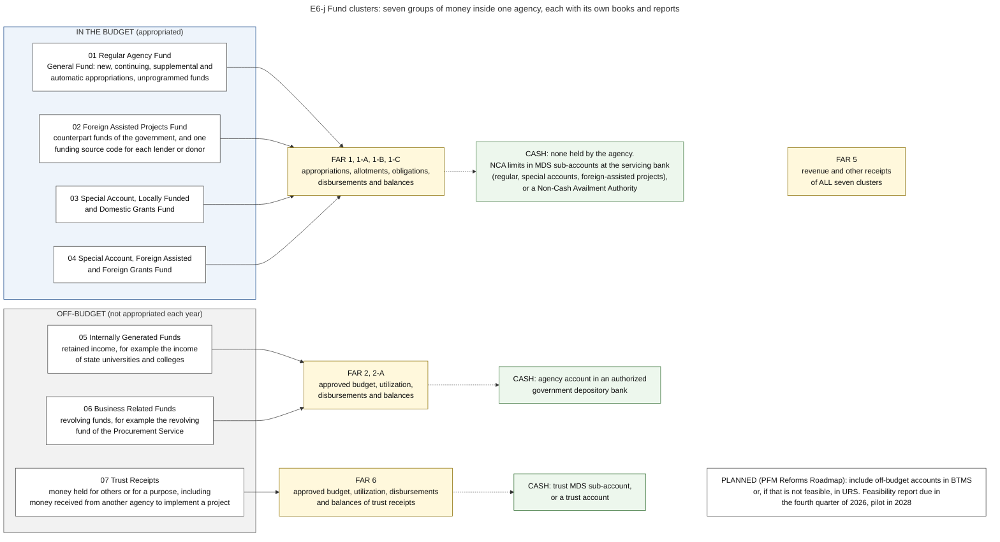

#### Diagram E6-k  Money for disasters: standby funds of agencies, the national fund, and the fund of each local government

Code file: `../diagrams/mermaid/E6-k_disaster_funds.mmd`. Rendered image: [`../rendered/E6-k_disaster_funds.png`](../rendered/E6-k_disaster_funds.png).

- **Question:** after a disaster, money is needed within days, and the normal path (release request, procurement, payment) takes months. Which money is already available, who must approve the rest, and which records show the use?
- **Idea:** speed is obtained in three ways. First, an amount is placed in advance in the budgets of the agencies that respond first (Quick Response Fund), so that no release is needed at the moment of the disaster. Second, a national fund without a named project is kept in the budget law and released case by case. Third, every local government must set aside its own fund each year. The normal controls remain: appropriation, obligation, voucher, audit.
- **How to read it:** upper frame = national level. Lower frame = local level. Blue = decision of an authority. Thick arrows = money. The grey boxes show where the use becomes visible.
- **Sources, national:** amount of PHP 39.82 billion in FY 2026 and its four purposes, approval by the President with the recommendation of the national disaster council, the agencies with a Quick Response Fund, replenishment when the balance reaches 50 percent subject to approval by DBM, the People's Survival Fund, the assistance program for local governments, and the reporting rule [GAA2026-NDRRMF]. The Quick Response Fund as a standby fund that is built into the budgets of the agencies and that they use immediately, and the request for replenishment [DBM-QRF]. The table of the amounts by agency (PHP 10.69 billion in total) is printed in the chapter of the national fund [GAA2026-NDRRMF]. Releases by SARO with their numbers, published by DBM each month; by 31 May 2026 three releases to DSWD of PHP 5.92 billion in total, all to replenish its Quick Response Fund [NDRRMF-STATUS]. Emergency cases as a ground for negotiated procurement [IRR12009 s.35.2].
- **Sources, local:** not less than 5 percent of estimated revenue from regular sources, 30 percent of it as a Quick Response Fund, and the special trust fund for unexpended amounts for five years, after which they revert to the general fund [RA10121]. I read these rules only in two documents that quote the law and its implementing rules, not in the law itself.
- **Not verified:** the condition (a declared state of calamity) for the use of the local Quick Response Fund, and who approves the use of the local fund. The uses of the remaining 70 percent are from a page that summarizes the joint circular of 2013: preparedness and training, rescue equipment, supplies and medicines, activities after a disaster, and insurance premiums [RA10121].

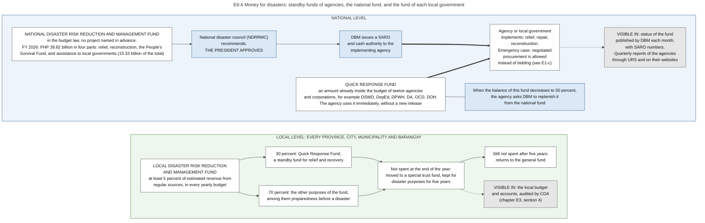

#### Diagram E6-l  Cash aid to persons: from the list of beneficiaries to the credit in each account

Code file: `../diagrams/mermaid/E6-l_cash_aid_to_persons_sequence.mmd`. Rendered image: [`../rendered/E6-l_cash_aid_to_persons_sequence.png`](../rendered/E6-l_cash_aid_to_persons_sequence.png).

- **Question:** in a purchase, one supplier delivers and one voucher is paid. In a cash aid program, one payment order pays many thousands of persons and nothing is delivered to the government. What replaces the contract, the delivery and the acceptance?
- **Idea:** the law of the program replaces the contract: it says who has a right to the money and under which conditions. The list of persons who qualify replaces the delivery: the control is that each person on the list exists, qualifies and has met the conditions. The proof of payment is the record of the bank for each person.
- **Sources:** the example is the Pantawid Pamilyang Pilipino Program. Selection of households with a standardized targeting system and revalidation every three years (section 5); amounts fixed by an advisory council and reviewed every six years (sections 7 and 10); "direct and secured access to cash grants" through authorized government depository banks, and through remittance institutions accredited by the central bank where no such bank serves the area (section 9); cost charged to the yearly budget law (section 22); independent monitoring committee and yearly report to Congress before the President's budget message (sections 16 and 18) [RA11310].
- **General knowledge, not opened in a source here:** steps 4, 5, 6, 7, 9 and 10 (checking of conditions, the payroll of beneficiaries, the obligation, the cash authority, the payment order, the report of the bank, the accounting). Other aid programs have their own rules, and some pay in cash through accountable officers (see E6-c).
- **Inference:** the note at the end.

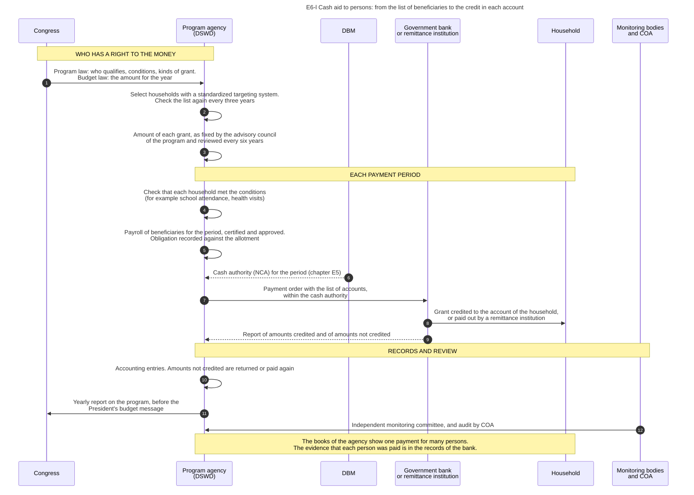

### 9.13 Verification status

- **Verified in a source:** the rules and the entries for a transfer between two national agencies [GAM-V1 Ch.6 s.63, Annex M]. The names and the content of the fund clusters [GAM-V1 Ch.2 s.13, Annex P]. The rule of the Administrative Code on the budgets of government corporations, read through a summary with quotations [EO292-B6 s.19]. The review of the Corporate Operating Budget, its forms, deadline and criteria [COB]. The special provisions on budgetary support in FY 2026 [BSGC2026]. Year-end statements of corporations [COA2015-004]. The rule that a transfer is not disbursed until the receiver uses it [NBC599 s.3.4]. Report FAR 1-C and the reports by fund cluster [JC2019-1]. The fund cluster as part of the funding source code [JC2017-1]. The PEFA scores [PEFA2025]. The national disaster fund, its purposes, the approval of its use and the standby funds of agencies in FY 2026 [GAA2026-NDRRMF][DBM-QRF]. The releases from the fund with their SARO numbers [NDRRMF-STATUS]. The guidelines of the GPPB of August 2026 on procurement for disasters, read as a summary [GPPB2026-17]. The payment of cash grants through banks, the selection of households and the reports of one program [RA11310].
- **Secondary source:** the rules of the local disaster fund, from two documents that quote the disaster law and its implementing rules [RA10121].
- **A difference between two sources:** when the source agency treats a transfer as disbursed (section 9.4.3).
- **General knowledge, to check:** the request of a corporation during national budget preparation, the work of the Governance Commission for GOCCs, the accounts used for a transfer to a corporation or to a local government, in the path of cash aid to persons: the checking of conditions, the payroll of beneficiaries, the payment order, the report of the bank and the accounting. Guarantees and lending by the national government to corporations (chapter P1, section 4).
- **Not opened:** Corporate Budget Circular No. 24, Republic Act No. 10149, Republic Act No. 7656 on dividends, later COA rules on fund transfers.
- **Not verified:** the condition for the use of the local Quick Response Fund, and the validity period of the national disaster fund.
- **Not covered:** government financial institutions as banks, social security institutions, water districts, the internal budget process of a corporation, aid programs other than the one in diagram E6-l.
