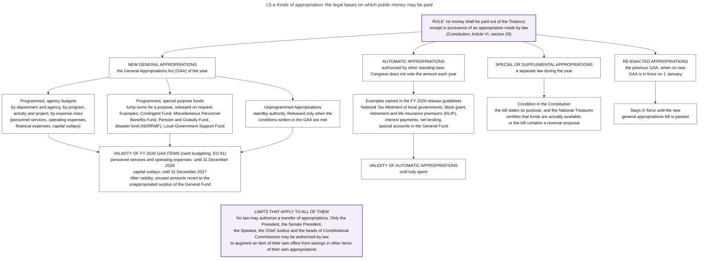

# L5. Enactment of the General Appropriations Act

*Part of the Philippine PFM Atlas. Facts as of 8 October 2026. The codes in the column "Basis" are explained in [Reference F](../reference/F_sources_and_verification.md). "GK" means general knowledge that I did not open in a source during this work.*

## 1. The step in the budget cycle

| Item | This step |
|---|---|
| Phase | Legislation, step 5 of 5 |
| When | December of the prior FY. The timing in the illustration of DBM is indicative [DBM-CYCLE] |
| Documents | General Appropriations Act. FY 2026: Republic Act No. 12314, in effect on 5 January 2026. Each line is identified by its UACS codes [NBC599][GAA2026-GP] |
| On the four lines | Starts the legal-authority line |
| Not drawn in the loop | For items without pre-conditions, the GAA of a year is itself the allotment order of that year (chapter E3) [NBC599]. Congress approves the performance targets together with the appropriation (chapter A1) [PBB2024] |
| Receives documents from | Chapter L4 |
| Passes documents to | Chapters E3 and A1 |
| Read more | Steps 19 to 21 of diagram L0-a: the item veto, the signed law and the override. The kinds of appropriation: section 2. What happens when no law is in force on 1 January: chapter L0, sections 3 and 6 |

## 2. Kinds of appropriation

Diagram L5-a shows the kinds. The table gives the same content.

| Kind | What it is | Examples | Basis |
|---|---|---|---|
| New general appropriations, agency budgets | The amounts for each department and agency in the GAA, by program, activity and project and by expense class | Any agency budget | NBC599 |
| New general appropriations, special purpose funds | Lump sums for a purpose, released on request | Contingent Fund, Miscellaneous Personnel Benefits Fund, Pension and Gratuity Fund, disaster fund (chapter E6, section 9.5.1), Local Government Support Fund | NBC599 |
| Unprogrammed appropriations | Standby authority in the GAA, released only when conditions written in the law are met. For FY 2026 they are part of the total release program, net of vetoed purposes | | NBC599 s.3.2.1. Conditions: GK |
| Automatic appropriations | Authorized by standing laws. Congress does not vote the amount each year. The Administrative Code names three kinds: retirement premiums and government service insurance of personnel, principal and interest of the public debt, and guarantees of the national government that are called. It adds that no obligation and no payment is made from them except through a regular allotment | National Tax Allotment, block grant, retirement and life insurance premiums, interest payments, net lending, special accounts in the General Fund. Funding source codes of the accounting manual: 104102 retirement and life insurance premiums, 104108 tax refunds, 104109 debt principal, 104110 debt interest, 104251 Internal Revenue Allotment | NBC599, MANDANAS, EO292-B6 s.26, GAM-V1 Annex P |
| Special or supplemental appropriations | A separate law during the year | | CONST VI.25(4) |
| Re-enacted appropriations | The preceding GAA when no new one is in force | 1 to 4 January 2026 | CONST VI.25(7), NBC599 |
| Continuing appropriations | An appropriation that stays available for a purpose or project when the obligations are incurred after the budget year | Capital outlays within their period of validity | EO292-B6 s.2, s.28, GAM-V1 Ch.3 s.2 |

### Diagram L5-a  Kinds of appropriation: the legal bases on which public money may be paid

Code file: `../diagrams/mermaid/L5-a_appropriation_types.mmd`. Rendered image: [`../rendered/L5-a_appropriation_types.png`](../rendered/L5-a_appropriation_types.png).

- **Question:** the Constitution says that no money may be paid from the Treasury except under an appropriation made by law. Which kinds of such laws exist, and how long does each one stay valid?
- **How to read it:** top = the constitutional rule. Second row = the kinds of appropriation. Third row = examples and validity for FY 2026.
- **Sources:** the rule [CONST VI.29(1)]. Special appropriation bills and reenactment [CONST VI.25(4), VI.25(7)]. Limits on transfer and augmentation [CONST VI.25(5)]. Automatic appropriations named in the FY 2026 release guidelines, validity of FY 2026 appropriations, Unprogrammed Appropriations as part of the release program, special purpose funds [NBC599]. Automatic appropriation of the local government share [MANDANAS]. Cash budgeting [EO91].
- **Warning:** the validity table in my copy of the release guidelines was partly unreadable. Check section 3.3 of National Budget Circular No. 599 before relying on the dates.
- **Legal basis of three automatic appropriations:** retirement premiums and government service insurance of personnel, principal and interest of the public debt, and guarantees of the national government that are called [EO292-B6 s.26]. The accounting manual lists the funding source codes of the automatic appropriations [GAM-V1 Annex P].
- **General knowledge, not opened in a source here:** the conditions for releasing Unprogrammed Appropriations, and the legal bases of the other automatic appropriations.

