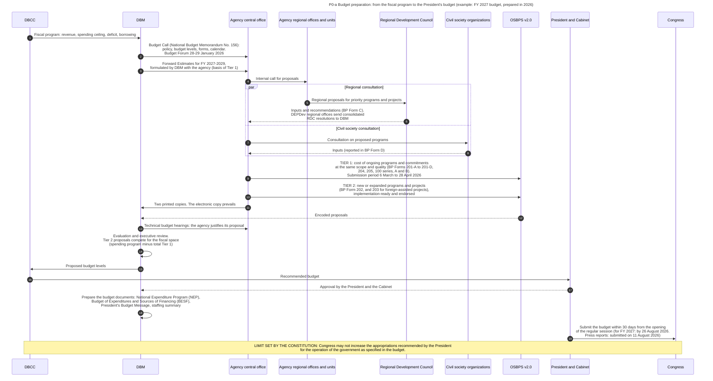
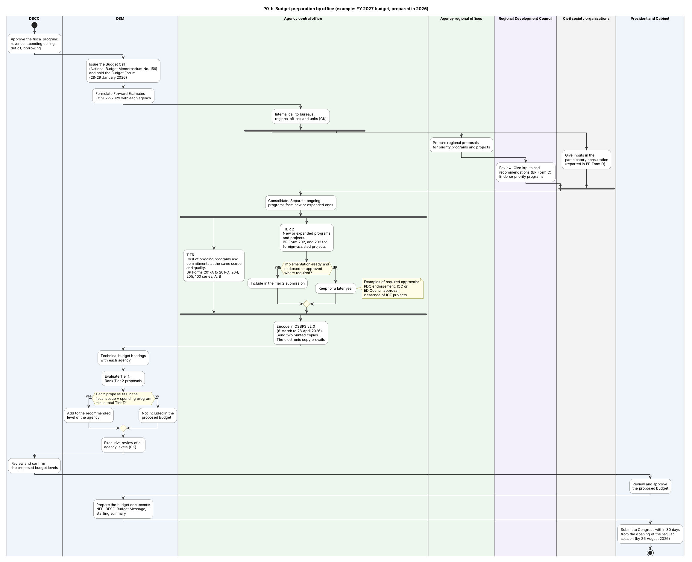
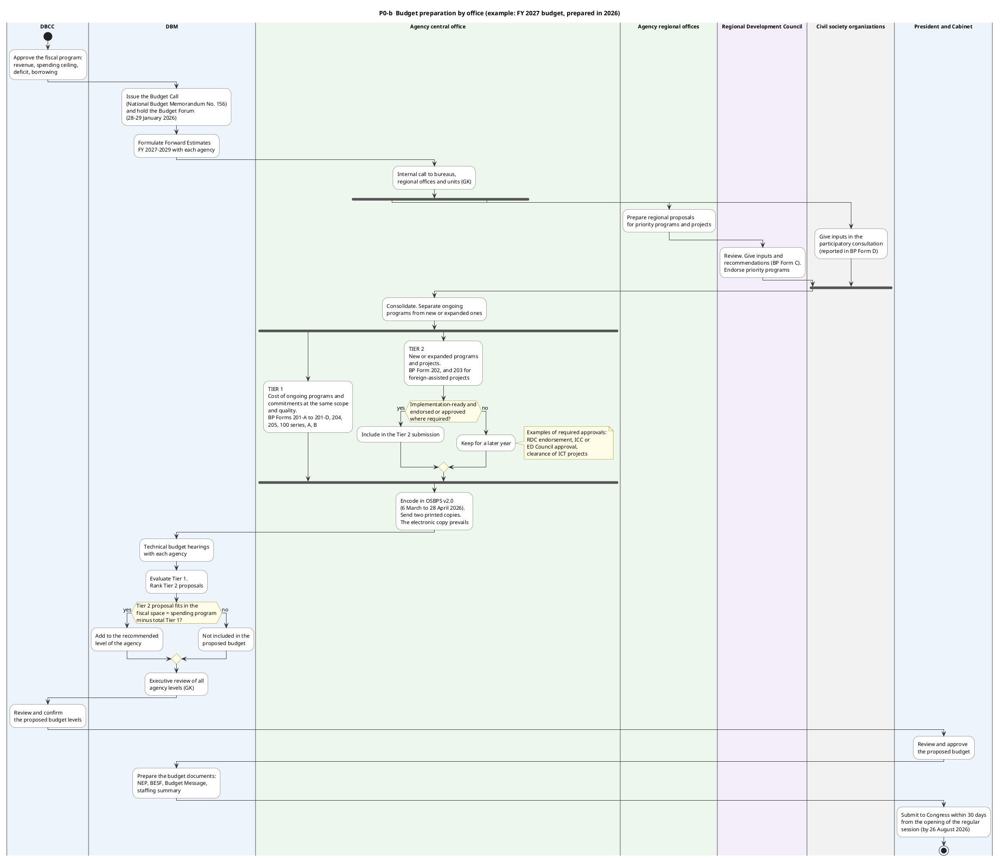
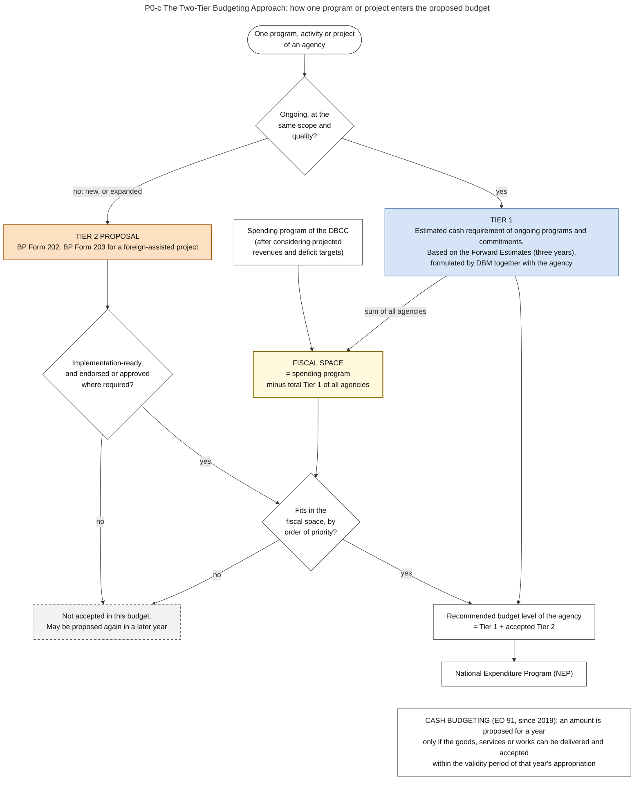

# P0. Preparation

*Part of the Philippine PFM Atlas. Facts as of 8 October 2026. The codes in the column "Basis" are explained in [Reference F](../reference/F_sources_and_verification.md). "GK" means general knowledge that I did not open in a source during this work.*

## 1. The phase in the budget cycle

Preparation is the first of the four phases of the budget cycle in the illustration of DBM. It starts with the Budget Call in January of the year before the budget year, and it ends when the President's Budget goes to Congress in July or August [DBM-CYCLE]. The illustration says: "The four phases of the Budget Cycle overlap in continuing cycles. While the Executive implements the Budget for the current year, it also prepares the Budget for the next fiscal year or defends it before Congress. At the same time, the government monitors, evaluates, and reports on actual performance year-round" [DBM-CYCLE].

| Chapter | Step | When (indicative) |
|---|---|---|
| P1 | Budget Call | January of the prior FY |
| P2 | Citizen engagement | Before Tier 1 and Tier 2 proposals |
| P3 | Regional Development Council consultations | Before Tier 1 and Tier 2 proposals |
| P4 | Program convergence | Before Tier 1 and Tier 2 proposals |
| P5 | Agency Tier 1 proposals: ongoing expenditures | February of the prior FY |
| P6 | Tier 1 deliberations | March of the prior FY |
| P7 | Budget Priorities Framework | April of the prior FY |
| P8 | Agency Tier 2 proposals: new or expanded spending | May of the prior FY |
| P9 | Tier 2 deliberations | June-July of the prior FY |
| P10 | Presentation to the President and Cabinet | July of the prior FY |
| P11 | Confirmation and finalization | July of the prior FY |
| P12 | The President's Budget submitted to Congress | July-August of the prior FY |

This chapter describes the phase as a whole: the question that it answers, the authorities, the steps, the information systems, the controls, the calendar and the reported weaknesses. The chapter of each step names the steps of diagram P0-a that correspond to it. This correspondence is an inference of the atlas, because the illustration of DBM does not name the steps of the diagram. Chapter P1 also holds the plans, the fiscal program and the fiscal risks that set the frame of the Budget Call.

## 2. The question this process answers

How does the Executive turn the total of the fiscal program and the requests of all agencies into one proposed budget for Congress?

## 3. The idea in plain words

Two things must be reconciled. From the top, the DBCC fixes the total that may be spent (chapter P1, section 3). From below, each agency states what it needs. The method that reconciles them is called the **Two-Tier Budgeting Approach**.

The method first fixes the cost of what the government already does. This is **Tier 1**. The Budget Call defines it as the "estimated cash requirements for ongoing program, activity, projects (P/A/Ps) and commitments at the same scope and quality" [NBM156]. Tier 1 is based on the **Forward Estimates**, which are the costs of ongoing programs for the next three years, formulated by DBM together with each agency.

What remains under the ceiling is the **fiscal space**. The Budget Call defines it as "the difference between the projected expenditure program (after considering projected revenues and deficit targets) and Tier 1" [NBM156]. Only this amount is available for new or expanded programs and projects. These are **Tier 2** proposals, and they compete with each other.

A case where the method works: an agency continues a program at the same scale. Its cost is in the Forward Estimates and passes into Tier 1 with little discussion. The discussion can then concentrate on new proposals.

A case where the method fails: the Forward Estimates are too high because a program was under-spent in earlier years. Tier 1 then takes space that is not needed, and good new proposals are refused. A second case of failure is outside the method: an item is added during legislation and never passed through either tier.

The law gives the general rules of this stage. Each head of an agency submits its request for appropriations "in accordance with the budget calendar, format, and such rules and regulations as may be issued", with its objectives, its link to the development plans, its expected results and unit costs, its staffing and its contingent liabilities [EO292-B6 s.14]. The proposals are to be judged "on the basis of their own merits and not on the basis of a given percentage or peso increase or decrease from a prior year's budget level", and each activity, new or ongoing, "using a zero-base approach" [EO292-B6 s.16]. The two-tier method is the present way of DBM to apply these rules: Tier 1 accepts the cost of ongoing work from the Forward Estimates, and Tier 2 examines new work on its merits. Whether Tier 1 meets the words of the law on a zero-base approach is a question that I leave open. I read these sections through summaries with quotations.

Other terms. The **Budget Call** is the DBM memorandum that starts the process. **BP forms** are the Budget Preparation forms that agencies complete. **OSBPS** is the Online Submission of Budget Proposals System of DBM. The **National Expenditure Program (NEP)** is the detailed proposed budget. The **Budget of Expenditures and Sources of Financing (BESF)** contains the fiscal tables.

## 4. Authorities and their roles

| Authority | Role in this process | Basis |
|---|---|---|
| DBCC | Sets the fiscal program before the Budget Call and confirms the proposed budget levels at the end | PRIMER, DBCC-PAGE |
| DBM | Issues the Budget Call, formulates Forward Estimates with agencies, holds technical budget hearings, evaluates proposals, prepares the budget documents | NBM156, PRIMER |
| Agency central office | Prepares Tier 1 and Tier 2, consults regions and civil society, encodes in OSBPS, defends the proposal | NBM156 |
| Agency regional offices | Prepare regional proposals and present them to the Regional Development Council | NBM156 |
| Regional Development Councils | Endorse regional priority programs and projects. Give inputs and recommendations, reported in BP Form C. The department secretary certifies that the consultation was held | NBM156 |
| DEPDev regional offices | Send consolidated resolutions of the councils to DBM | NBM156 |
| Civil society organizations | Give inputs in a participatory consultation, reported in BP Form D | NBM156 |
| President and Cabinet | Review and approve the proposed budget | PRIMER |
| President | Submits the budget to Congress within 30 days from the opening of the regular session. No proposal that involves an appropriation goes to Congress without the approval of the President | CONST VII.22, EO292-B6 s.11, s.22 |
| Government corporations | Their own budgets are approved by their boards. They enter the national budget process only for the support that they need from the national government (chapter E6, section 9) | EO292-B6 s.19 |

## 5. Steps

The steps are those of diagram P0-a. The dates are those of the FY 2027 budget, prepared in 2026.

| No. | Who acts | Towards whom | What is done or passed | Basis |
|---|---|---|---|---|
| 1 | DBCC | DBM | Fiscal program: revenue, spending ceiling, deficit, borrowing | PRIMER |
| 2 | DBM | Agency central office | Budget Call (National Budget Memorandum No. 156): policy, budget levels, forms, calendar. Budget Forum 28-29 January 2026 | NBM156, PRIMER |
| 3 | DBM | Agency central office | Forward Estimates for FY 2027-2029, formulated by DBM with the agency (basis of Tier 1) | NBM156 |
| 4 | Agency central office | Agency regional offices and units | Internal call for proposals | GK |
| 5 | Agency regional offices and units | Regional Development Council | Regional proposals for priority programs and projects | NBM156 |
| 6 | Regional Development Council | Agency central office | Inputs and recommendations (BP Form C). DEPDev regional offices send consolidated RDC resolutions to DBM | NBM156 |
| 7 | Agency central office | Civil society organizations | Consultation on proposed programs | NBM156 |
| 8 | Civil society organizations | Agency central office | Inputs (reported in BP Form D) | NBM156 |
| 9 | Agency central office | OSBPS v2.0 | TIER 1: cost of ongoing programs and commitments at the same scope and quality (BP Forms 201-A to 201-D, 204, 205, 100 series, A and B). Submission period 6 March to 28 April 2026 | NBM156 |
| 10 | Agency central office | OSBPS v2.0 | TIER 2: new or expanded programs and projects (BP Form 202, and 203 for foreign-assisted projects), implementation-ready and endorsed | NBM156 |
| 11 | Agency central office | DBM | Two printed copies. The electronic copy prevails | NBM156 |
| 12 | OSBPS v2.0 | DBM | Encoded proposals | NBM156 |
| 13 | DBM | Agency central office | Technical budget hearings: the agency justifies its proposal | PRIMER |
| 14 | DBM | (own action) | Evaluation and executive review. Tier 2 proposals compete for the fiscal space (spending program minus total Tier 1) | PRIMER, NBM156 |
| 15 | DBM | DBCC | Proposed budget levels | PRIMER |
| 16 | DBCC | President and Cabinet | Recommended budget | PRIMER |
| 17 | President and Cabinet | DBM | Approval by the President and the Cabinet | PRIMER |
| 18 | DBM | (own action) | Prepare the budget documents: National Expenditure Program (NEP), Budget of Expenditures and Sources of Financing (BESF), President's Budget Message, staffing summary | PRIMER. Staffing summary: GK |
| 19 | President and Cabinet | Congress | Submit the budget within 30 days from the opening of the regular session (for FY 2027: by 26 August 2026. Press reports: submitted on 11 August 2026) | CONST VII.22. Date of submission: NEP2027-NEWS |

## 6. Information systems

| System | Owner | Use in this process | Basis |
|---|---|---|---|
| OSBPS version 2.0 | DBM | Agencies encode the BP forms. Proposals must be submitted through this system, with two printed copies. If the two differ, the electronic copy prevails. Tags for climate change expenditure are made in the system | NBM156 |
| GMIS | DBM | The filled positions in the system are the basis of the personnel budget | GMIS |
| BPMS | DBM | Named by the Roadmap as a planning and budgeting system. I assume that DBM builds the proposed budget in it | ROADMAP2024. Function: GK |
| PIPOL | DEPDev | Source of the investment program. A separate system from OSBPS. The sources state that no standard project identifier exists and that a working group was created to link the two systems. They do not state how the content passes today | PIP-MEMO, ROADMAP2024, SFA1 |

## 7. Controls: what each one checks, and what it does not check

| Control | What it checks | What it does not check |
|---|---|---|
| Forward Estimates | That the cost of ongoing programs is agreed between DBM and the agency before the proposal | Whether the ongoing program should continue |
| Condition for Tier 2: implementation-ready, endorsed or approved where required | That a new project can start in the budget year and passed the bodies that must clear it | That it is the best use of the fiscal space |
| Technical budget hearing | That the agency can justify each amount | Proposals that enter later, during legislation |
| RDC and civil society consultation | That regions and civil society were heard | That their inputs were accepted |
| Cash budgeting rule | That only what can be delivered and accepted within the validity of the appropriation is proposed | Delays that arise later in procurement |
| Constitutional deadline | That the budget reaches Congress within 30 days from the opening of the session | |

## 8. Timing

| Date for the FY 2027 budget | Event | Basis |
|---|---|---|
| January 2026 | Budget Call issued (National Budget Memorandum No. 156) | NBM156 |
| 28 to 29 January 2026 | Budget Forum of DBM with agencies | NBM156 |
| 6 March to 28 April 2026 | Submission of Tier 1 and Tier 2 in OSBPS version 2.0 | NBM156 |
| 24 April 2026 | Deadline for encoding | NBM156 |
| 30 April 2026 | Actual obligations and the revenue program are due | NBM156 |
| Up to 26 August 2026 | Later activities of budget preparation | NBM156 |
| 10 July 2026 | The President and the Cabinet approve the proposed budget. A press report of 11 July says "on Friday" | NEP2027-NEWS |
| 11 August 2026 | DBM submits the National Expenditure Program for FY 2027 to the House of Representatives | NEP2027-NEWS |
| 26 August 2026 | Last day allowed for the submission: 30 days from 27 July 2026, the day of the opening of the regular session | CONST VII.22. Date of the opening: NEP2027-NEWS |

Press reports give a proposed total of about PHP 7.2 trillion for FY 2027. This is 6 percent, or PHP 407 billion, more than the PHP 6.793 trillion of FY 2026 [NEP2027-NEWS].

## 9. Variations and exceptions

- **Regional proposals.** A DBM press release of 26 January 2026 states that priority programs and projects in the regions must secure the endorsement of the Regional Development Council [NBM156].
- **Convergence programs.** Programs that several agencies implement jointly are budgeted jointly (BP Form 206) [NBM156].
- **Information and communications technology.** These projects pass a separate steering committee and need an information systems strategic plan [NBM156].
- **Infrastructure.** Proposals follow the Public Investment Program and the Three-Year Rolling Infrastructure Program for FY 2027 to 2029 [NBM156].
- **Government corporations.** They ask for subsidy or equity in the national budget, and separately submit a corporate operating budget to DBM. See chapter E6, section 9.
- **Local governments.** Their share in national taxes is computed by DBM from amounts certified by BIR, BOC and BTr, and is an automatic appropriation [MANDANAS]. See chapter E3, section 4.
- **Devolution.** The Budget Call includes a section on devolution to local governments [NBM156].
- **Performance targets.** Each program is proposed with indicators and targets [NBM156]. Chapter A1 follows a target through the year.
- **Contracts for more than one year.** The yearly amount of a Multi-Year Contractual Authority goes into Tier 1 of the proposal [CL2025-6]. See chapter E1, section 2.5.

## 10. Where the process fails in practice

| Reported weakness | Basis |
|---|---|
| The link between planning and budgeting depends on a working group, not on connected systems | ROADMAP2024 |
| Ceilings reach agencies late | ROADMAP2024 |
| Items are added by Congress without regional consultation | ROADMAP2024 |
| The composition of actual spending differed from the approved budget by more than 15 percent in each of the three years assessed (PEFA indicator 2.1, score D) | PEFA2025 |

## 11. Diagrams

### Diagram P0-a  Budget preparation: from the fiscal program to the President's budget (example: FY 2027 budget, prepared in 2026)

Code file: `../diagrams/mermaid/P0-a_budget_preparation_sequence.mmd`. Rendered image: [`../rendered/P0-a_budget_preparation_sequence.png`](../rendered/P0-a_budget_preparation_sequence.png).

- **Question:** who gives what to whom, in which order, between the decision on the total budget and the submission of the proposed budget to Congress?
- **Sources:** the order of steps 1, 2, 13, 15, 16, 17 and 19 follows the DBM primer [PRIMER]. Steps 2, 3 and 5 to 12, and the dates [NBM156] (National Budget Memorandum No. 156 and the DBM Budget Forum report). Deadline in step 19 [CONST VII.22]. Date of the actual submission of the FY 2027 budget in step 19, from press reports [NEP2027-NEWS]. The limit in the last note [CONST VI.25(1)].
- **General knowledge, not opened in a source here:** step 4 (internal call inside the agency), the working of the executive review in step 14, the list of documents in step 18 beyond NEP, BESF and Budget Message.
- **Forms:** BP = Budget Preparation form. The list of forms is in P12-a.

### Diagram P0-b  Budget preparation by office (example: FY 2027 budget, prepared in 2026) (PlantUML)

Code file: `../diagrams/plantuml/P0-b_budget_preparation_swimlane.puml`. Rendered image: [`../rendered/P0-b_budget_preparation_swimlane.png`](../rendered/P0-b_budget_preparation_swimlane.png).

- **Question:** which office is responsible for each activity of budget preparation, which activities run in parallel, and where are the decision points?
- **How to read it:** one column (lane) = one office. Diamond = a decision. Thick bar = parallel branches that must all finish.
- **Why PlantUML:** the two consultations run in parallel and the Tier 2 proposals pass through decisions. Mermaid has no lane diagram for this.
- **Sources:** [NBM156] for the two tiers, the consultations, OSBPS, the forms and the dates. [PRIMER] for the order of the review steps. [CONST VII.22] for the deadline.
- **General knowledge (GK), not opened in a source here:** the internal call in the agency and the name "Executive Review Board".

PlantUML code

### Diagram P0-c  The Two-Tier Budgeting Approach: how one program or project enters the proposed budget

Code file: `../diagrams/mermaid/P0-c_two_tier_budgeting.mmd`. Rendered image: [`../rendered/P0-c_two_tier_budgeting.png`](../rendered/P0-c_two_tier_budgeting.png).

- **Question:** why are some proposals accepted almost automatically while others must compete, and what decides the amount of money available for competition?
- **Idea:** the cost of what the government already does is fixed first (Tier 1). Only the money that remains under the spending ceiling (the fiscal space) is available for new or expanded programs (Tier 2).
- **Sources:** definitions of Tier 1, Tier 2 and fiscal space, Forward Estimates, BP Forms 202 and 203, conditions of readiness and endorsement [NBM156]. Cash budgeting rule in the last node [EO91].
- **General knowledge, not opened in a source here:** what happens to a proposal that is not included.

## 12. Verification status

- **Verified in a source:** the general rules of the Administrative Code on budget estimates and their evaluation, through summaries with quotations [EO292-B6 s.11, s.14, s.16, s.19, s.22]. The definitions of Tier 1, Tier 2 and fiscal space, the consultations, the forms by number and subject, OSBPS version 2.0, the dates [NBM156]. The order of the review steps [PRIMER]. The deadline and the limit on Congress [CONST].
- **General knowledge, to check:** the internal call inside the agency, how the executive review works, the staffing summary as a separate document, the detailed content of the NEP and BESF, what BPMS does.
- **Could not read:** the exact titles of some forms (Annex B) and the official calendar (Annex C) of the Budget Call.
- **From press reports only:** the dates of approval and of submission of the FY 2027 budget, and its total [NEP2027-NEWS].
