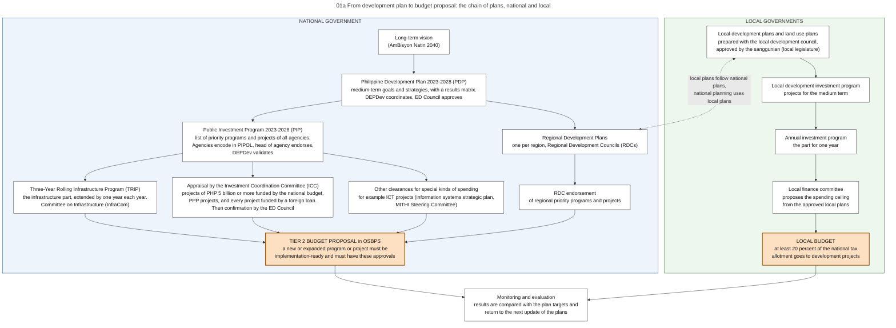
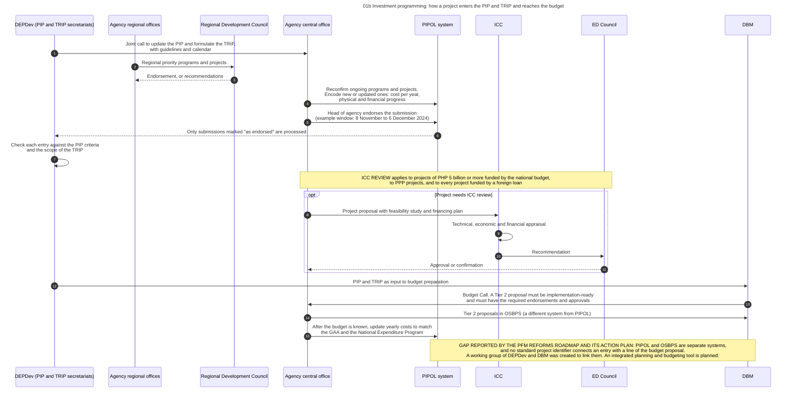

# 01. Planning and investment programming

*Part of the Philippine PFM Atlas. Facts as of 8 October 2026. The codes in the column "Basis" are explained in [Reference F](../reference/F_sources_and_verification.md). "GK" means general knowledge that I did not open in a source during this work.*

## 1. The question this process answers

Which programs and projects may ask for money in the budget, and who decided that they are priorities?

## 2. The idea in plain words

The budget covers one year. A road, a school program or an information system takes several years. The government therefore keeps plans for several years, and the budget of each year is meant to pay for one slice of those plans.

The plans form a chain. A development plan states goals for six years. An investment program lists the programs and projects that serve those goals, with their cost per year. Large projects are appraised one by one before they may be funded. Only then does a project appear in a budget proposal.

A case where the chain works: an agency lists a project in the investment program, obtains the required approvals, and proposes it in the budget as a new project (Tier 2, see chapter 03). The budget examiner can see that the project was planned and approved.

A case where the chain fails: an item enters the budget during legislation and was never in the investment program. The PFM Reforms Roadmap reports this as a gap: additions by Congress without regional consultation, ceilings that arrive late, and no single system that follows a proposal from plan to budget [ROADMAP2024].

Terms used in this chapter. The **Philippine Development Plan (PDP)** is the medium-term plan, now for 2023 to 2028. The **Public Investment Program (PIP)** is the list of priority programs and projects of all agencies for the same period. The **Three-Year Rolling Infrastructure Program (TRIP)** is the infrastructure part of that list for three years, extended by one year each year. **PIPOL** is the DEPDev web system in which agencies enter these programs and projects.

## 3. Authorities and their roles

| Authority | Role in this process | Basis |
|---|---|---|
| Department of Economy, Planning, and Development (DEPDev, the former NEDA) | Issues the yearly call to update the PIP and to formulate the TRIP. Operates PIPOL. Validates the entries of agencies | PIP-MEMO |
| Economy and Development Council (ED Council, the former NEDA Board) | Approves plans and confirms large projects. Its committees include the ICC and the Infrastructure Committee | AO37. Approval role: GK |
| Investment Coordination Committee (ICC) | Appraises projects of PHP 5 billion or more funded by the national budget, projects under public-private partnership, and every project funded by a foreign loan | ICC-NEWS |
| Infrastructure Committee | Works on the TRIP | NBM156, AO37 |
| Regional Development Councils (RDCs) | Endorse regional priority programs and projects. Give inputs on the regional budget proposals of agencies | NBM156 |
| Agencies (central office) | Enter programs and projects in PIPOL. The head of agency endorses the submission | PIP-MEMO |
| Agencies (regional offices) | Present regional proposals to the RDC | NBM156 |
| DBM | Receives the PIP and TRIP as input to budget preparation. Requires in the Budget Call that new projects have the required approvals | NBM156 |
| Local governments | Prepare local development plans and local investment programs. Their budgets must follow their approved plans | LGC s.305, s.316 |

## 4. Steps

The steps below are those of diagram 01b. The dates in steps 4 to 6 are those of the call for the FY 2026 budget, as an example.

| No. | Who acts | Towards whom | What is done or passed | Basis |
|---|---|---|---|---|
| 1 | DEPDev (PIP and TRIP secretariats) | Agency central office | Joint call to update the PIP and formulate the TRIP, with guidelines and calendar | PIP-MEMO |
| 2 | Agency regional offices | Regional Development Council | Regional priority programs and projects | NBM156 |
| 3 | Regional Development Council | Agency regional offices | Endorsement, or recommendations | NBM156 |
| 4 | Agency central office | PIPOL system | Reconfirm ongoing programs and projects. Encode new or updated ones: cost per year, physical and financial progress | PIP-MEMO |
| 5 | Agency central office | PIPOL system | Head of agency endorses the submission (example window: 8 November to 6 December 2024) | PIP-MEMO |
| 6 | PIPOL system | DEPDev (PIP and TRIP secretariats) | Only submissions marked "as endorsed" are processed | PIP-MEMO |
| 7 | DEPDev (PIP and TRIP secretariats) | (own action) | Check each entry against the PIP criteria and the scope of the TRIP | PIP-MEMO |
| 8 | Agency central office | ICC | Project proposal with feasibility study and financing plan | GK |
| 9 | ICC | (own action) | Technical, economic and financial appraisal | GK |
| 10 | ICC | ED Council | Recommendation | GK |
| 11 | ED Council | Agency central office | Approval or confirmation | GK |
| 12 | DEPDev (PIP and TRIP secretariats) | DBM | PIP and TRIP as input to budget preparation | NBM156 |
| 13 | DBM | Agency central office | Budget Call. A Tier 2 proposal must be implementation-ready and must have the required endorsements and approvals | NBM156 |
| 14 | Agency central office | DBM | Tier 2 proposals in OSBPS (a different system from PIPOL) | NBM156 |
| 15 | Agency central office | PIPOL system | After the budget is known, update yearly costs to match the GAA and the National Expenditure Program | PIP-MEMO |

## 5. Documents and identifiers

| Document | Identified by | Note |
|---|---|---|
| Philippine Development Plan and regional development plans | Title and period | The plans themselves were not opened |
| Entry of a program or project in PIPOL | The entry in PIPOL | It has no UACS code until the project enters the budget, and no standard project identifier connects it with a line of the budget proposal (see diagram 17b) |
| ICC and ED Council approval | Date and title of the project | Required before a Tier 2 proposal for a project in the coverage of the ICC |
| RDC resolution of endorsement | Resolution number | DEPDev regional offices send consolidated resolutions to DBM [NBM156] |

## 6. Information systems

| System | Owner | Use in this process | Basis |
|---|---|---|---|
| PIPOL | DEPDev | Agencies reconfirm ongoing programs and projects, enter new ones, report physical and financial progress, and update yearly costs after the budget is known | PIP-MEMO |
| OSBPS | DBM | Receives the budget proposal. It is a separate system from PIPOL. How the content of an entry in PIPOL reaches a budget form is not stated in the sources that I read | NBM156, ROADMAP2024 |
| Planned: an integrated planning and budgeting tool for the Public Investment Program | DBM and DEPDev | Design in 2026, pilot in 2026 and 2027, wider use from 2027. The plan leaves open whether PIPOL is upgraded or a new system is built | SFA1 |
| Planned: IPMRS | DBM, Procurement Service, GPPB Technical Support Office | An Integrated Project Monitoring and Reporting System. PIPOL will be assessed for fit with it | SFA6 |

## 7. Controls: what each one checks, and what it does not check

| Control | What it checks | What it does not check |
|---|---|---|
| Endorsement by the head of agency in PIPOL | That the agency supports the entry | That the project is ready or affordable |
| Validation by DEPDev | That the entry meets the criteria of the PIP and the scope of the TRIP | The detailed cost |
| ICC appraisal | Technical, economic and financial soundness of a large project (GK) | Projects below the threshold that are funded by the national budget |
| RDC endorsement | That a regional project is a regional priority | Projects that do not pass through the region |
| Budget Call condition | That a Tier 2 proposal is implementation-ready and has the required approvals | That the same item, once in the budget law, is still the one that was approved |

## 8. Timing

The call for the investment program is issued in the last quarter of the year, about fourteen months before the budget year starts. For the FY 2026 budget, agencies entered their programs and projects in PIPOL from 8 November to 6 December 2024 [PIP-MEMO]. The budget proposal followed in the first months of 2025. After the budget is passed, agencies update the yearly costs in PIPOL.

## 9. Variations and exceptions

- Projects in information and communications technology need a separate clearance. The Budget Call names an information systems strategic plan and a steering committee for these projects [NBM156].
- Projects funded by a grant are reviewed by DEPDev [ICC-NEWS].
- A partnership project with a private firm follows the Public-Private Partnership Code. A national project of PHP 15 billion or more needs the approval of the Council on the recommendation of the ICC. A smaller project needs the ICC when it requires money of the budget law [RA11966 s.7]. See chapter 19.
- Local governments have their own chain of plans. The local finance committee derives the spending ceiling from the approved local development plan, and at least 20 percent of the National Tax Allotment must go to development projects [LGC s.316, s.287]. See chapter 14.

## 10. Where the process fails in practice

| Reported weakness | Basis |
|---|---|
| PIPOL and OSBPS are separate systems. A working group of DEPDev and DBM was created to link them. No integrated system follows a proposal through its life | ROADMAP2024 |
| No standard project identifier exists, so a proposal is difficult to trace from planning to budgeting. The planning and the budgeting platforms lack interoperability. Many proposals and reports are still submitted on paper or in spreadsheet files | SFA1 |
| Budget ceilings reach agencies late in the planning period | ROADMAP2024 |
| Items are added during legislation without regional consultation | ROADMAP2024 |
| Project data are poorly integrated with fiscal planning and budget execution systems | SFA6 |

## 11. Diagrams

### Diagram 01a  From development plan to budget proposal: the chain of plans, national and local

Code file: `../diagrams/mermaid/01a_plan_hierarchy.mmd`. Rendered image: [`../rendered/01a_plan_hierarchy.png`](../rendered/01a_plan_hierarchy.png).

- **Question:** which plans must a program or project appear in before it can enter the budget, and who approves each plan?
- **How to read it:** left column = national government. Right column = local governments. Each arrow means "is the basis of". The orange node is the point where a plan becomes a request for money.
- **Sources:** PIP, TRIP, PIPOL, endorsement by the head of agency [PIP-MEMO]. PIP, TRIP, InfraCom, RDC endorsement, ICT plans and Tier 2 conditions in the Budget Call [NBM156]. ICC threshold of PHP 5 billion, PPP and foreign-loan projects [ICC-NEWS]. ED Council as successor of the NEDA Board, and its committees [AO37]. Local rules: budgets operationalize approved local development plans, local plans harmonized with national plans, national planning based on local planning, 20 percent for development projects [LGC s.305, s.287].
- **General knowledge, not opened in a source here:** the long-term vision, the names of regional plans and regional investment programs, the names of the local plans (land use plan, comprehensive development plan, local investment program, annual investment program), the results matrix, monitoring reports.

### Diagram 01b  Investment programming: how a project enters the PIP and TRIP and reaches the budget

Code file: `../diagrams/mermaid/01b_investment_programming_sequence.mmd`. Rendered image: [`../rendered/01b_investment_programming_sequence.png`](../rendered/01b_investment_programming_sequence.png).

- **Question:** who does what, in which system, from the call for projects to the point where the project may be proposed for funding?
- **Sources:** steps 1, 4, 5, 6, 7 and 15 [PIP-MEMO] (memorandum of 31 October 2024 for the FY 2026 budget, page 3 of 4 only). Steps 2, 3, 12, 13 and 14 [NBM156]. ICC coverage in the note [ICC-NEWS]. The gap in the last note [ROADMAP2024].
- **More sources:** the action plan of the Roadmap names as gaps that no standard project identifier exists and that the planning and budgeting platforms lack interoperability, and it plans an integrated planning and budgeting tool [SFA1].
- **General knowledge, not opened in a source here:** steps 8 to 11 (content of an ICC submission, appraisal, confirmation by the ED Council).
- **Dates:** the example dates are those of the call for the FY 2026 budget. Each yearly call sets its own dates.

## 12. Verification status

- **Verified in a source:** the use of PIPOL, endorsement by the head of agency and the example dates [PIP-MEMO]. The role of RDCs, the link to the Budget Call and the clearance of ICT projects [NBM156]. The coverage of ICC review [ICC-NEWS]. The committees of the ED Council [AO37]. The local rules [LGC].
- **General knowledge, to check:** the steps of ICC appraisal and confirmation (steps 8 to 11), the names and hierarchy of regional and local plans in diagram 01a, the approval of the development plan.
- **Could not read:** three of the four pages of the DEPDev memorandum. The definitions and thresholds of the PIP and the TRIP are therefore not verified.
