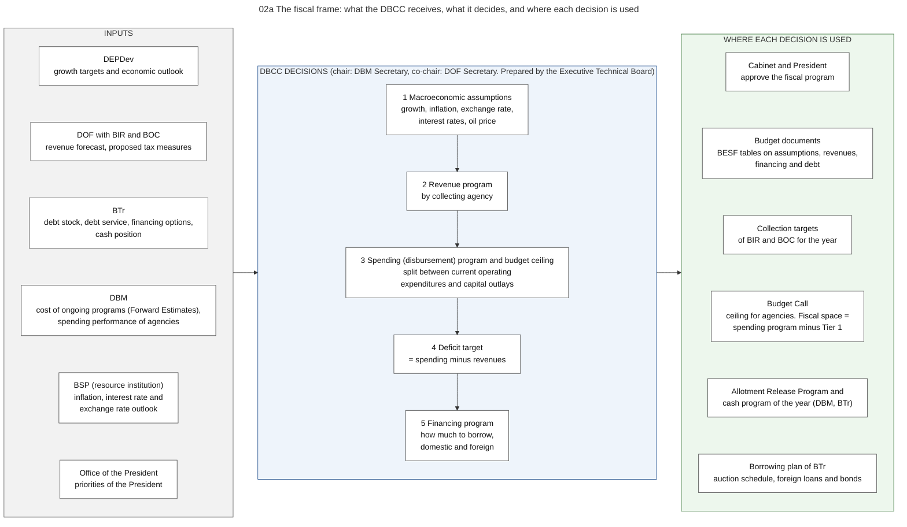

# 02. The fiscal framework

*Part of the Philippine PFM Atlas. Facts as of 8 October 2026. The codes in the column "Basis" are explained in [Reference F](../reference/F_sources_and_verification.md). "GK" means general knowledge that I did not open in a source during this work.*

## 1. The question this process answers

How large may the budget be in total, and who decides this before any agency writes a proposal?

## 2. The idea in plain words

The total of the budget is not the sum of what agencies ask for. It is decided first, from the top, by one committee. Agencies then receive a share of that total.

The decision follows from three numbers that depend on each other. If the government expects a certain revenue and accepts a certain deficit, the total it may spend is fixed: spending = revenue + deficit. The deficit must be financed, so the amount to borrow follows: borrowing = deficit + repayment of old debt that matures in the year, adjusted for any change in the cash balance.

A case where this works: revenue is collected as forecast, and agencies receive cash authority for all their allotments.

A case where this fails: revenue is lower than forecast. The total of allotments was already fixed by the budget law, but the cash is not there. The government must then borrow more, or DBM must slow the issue of cash authority (see chapter 11). This is why an agency can hold an allotment and still be unable to pay.

Terms used in this chapter. The **Development Budget Coordination Committee (DBCC)** is the committee that recommends these numbers. The **fiscal program** is the set of numbers for one year: revenue, disbursements, deficit and financing. The **Executive Technical Board** is the group of senior officials that prepares the work of the DBCC.

## 3. Authorities and their roles

| Authority | Role in this process | Basis |
|---|---|---|
| DBCC | Recommends to the Cabinet and the President: the level of the annual expenditure program and the ceilings, the split between current operating expenditures and capital outlays, the reliability of revenue estimates, tax measures, and the level of borrowing | DBCC-PAGE |
| DBM Secretary | Chairs the DBCC | DBCC-PAGE |
| Secretary of Finance | Co-chairperson of the DBCC since Administrative Order No. 37 of 13 August 2025 (with effect from 27 April 2025). DOF brings the revenue forecast | AO37 |
| DEPDev | Member. Brings the growth targets and the economic outlook | DBCC-PAGE. Content of its input: GK |
| Office of the President | Member | DBCC-PAGE, AO37, EO108 |
| BSP | Resource institution, not a member | DBCC-PAGE |
| Executive Technical Board | Prepares and clears the papers of the DBCC | DBCC-PAGE |
| BIR and BOC | Give the collection forecasts and receive collection targets | GK |
| BTr | Gives the debt service estimates and the financing options. Uses the fiscal program for its cash forecast and its borrowing plan | EO449, BTR-SITE |
| Cabinet and President | Approve the fiscal program | DBCC-PAGE |

History of the DBCC, as stated on the DBM page: it was created on 14 May 1970 by Executive Order No. 232 as the Presidential Development Budget Committee, was renamed in 1972, and has its present composition under Executive Order No. 292 of 1987 [DBCC-PAGE].

The rule in that order, the Administrative Code, is its section on budget levels. The budget department, the finance department, the planning authority and the central bank recommend to the President, within the committee, the total levels of revenue, expenditure and debt. The section also states two limits. "The ordinary income of government shall be used primarily to provide appropriations for current operations." And no appropriation may be proposed "unless the amount involved is covered by the ordinary income, or unless it is supported by a proposal creating additional sources of funds or revenue, including those generated from domestic and foreign borrowings, sufficient to cover the same" [EO292-B6 s.13]. I read this section through a summary with quotations.

## 4. Steps

This process has no fixed public sequence of documents, so it is described as inputs, decisions and uses (diagram 02a) and not as numbered steps.

| No. | Decision of the DBCC | Main input | Where the decision is used | Basis |
|---|---|---|---|---|
| 1 | Macroeconomic assumptions | Outlook from DEPDev, BSP and DOF | Tables of the Budget of Expenditures and Sources of Financing | DBCC-PAGE. List of assumptions: GK |
| 2 | Revenue program | Forecasts of BIR, BOC and BTr | Collection targets, cash forecast | DBCC-PAGE |
| 3 | Spending program and budget ceiling, split between current operating expenditures and capital outlays | Cost of ongoing programs (Forward Estimates), priorities | Budget Call. Fiscal space = spending program minus Tier 1 | DBCC-PAGE, NBM156 |
| 4 | Deficit target | Decisions 2 and 3 | Fiscal program | DBCC-PAGE |
| 5 | Financing program: level and sources of borrowing | Debt data and financing options of BTr | Borrowing plan of BTr | DBCC-PAGE, EO449 |

During budget execution the same numbers return in two places. The Allotment Release Program of the year must be consistent with the DBCC fiscal program (PHP 6.793 trillion for FY 2026) [NBC599]. The cash forecast of BTr covers the next three months and is updated [BTR-SITE].

## 5. Documents and identifiers

| Document | Issued by | Content | Basis |
|---|---|---|---|
| Fiscal program | DBCC | Revenue, disbursements, deficit, financing for the year | DBCC-PAGE |
| Budget of Expenditures and Sources of Financing (BESF) | DBM for the President | The fiscal tables sent to Congress with the budget | PRIMER |
| Allotment Release Program | DBM | Total of allotments that may be released in the year | NBC599 |
| Cash Operations Report | BTr | Actual revenue, disbursements, surplus or deficit and financing, each month | NBC599 |

## 6. Information systems

No single system is named in the sources for the work of the DBCC. The inputs come from the systems of each member: collection data from BIR, BOC and the treasury systems (chapter 10), debt data from BTr (chapter 11), and spending data from the reports of agencies in URS (chapter 08).

## 7. Controls: what each one checks, and what it does not check

| Control | What it checks | What it does not check |
|---|---|---|
| Ceiling in the Budget Call | That the sum of proposals stays inside the spending program | Whether each proposal is worth its cost |
| Rule that Congress may not increase the President's proposed appropriations [CONST VI.25(1)] | That the total proposed by the President is an upper limit for the items specified in the budget | The distribution between items. Unprogrammed appropriations and automatic appropriations follow other rules (chapter 04) |
| Allotment Release Program | That releases in the year stay inside the fiscal program | The timing of cash |
| Cash authority (NCA) | That payments in a period stay inside the cash plan | Whether obligations were already incurred |

## 8. Timing

The DBCC decides the numbers of a budget year before the Budget Call, which DBM issued in January for FY 2027 [NBM156]. It reviews the numbers again during the year (GK). The numbers of the current year are compared with actual results each month in the Cash Operations Report [NBC599].

## 9. Variations and exceptions

- The DBCC also recommends the consolidated public sector financial position, which includes government corporations and local governments [DBCC-PAGE]. Chapter 08, section 13, shows the rows of this table.
- The DBCC issues a Fiscal Risks Statement on events that would make revenue, spending or debt differ from the program. The latest statement that I found is that of 2023 [FRS2023]. See chapter 19.
- A reduction of the share of local governments in national taxes is possible only when the national government has an unmanageable public sector deficit, on the recommendation of the Secretaries of Finance, of the Interior and Local Government, and of Budget and Management, and never below 30 percent [LGC s.284].

## 10. Where the process fails in practice

| Reported weakness | Basis |
|---|---|
| The composition of actual spending differed from the approved budget by more than 15 percent in each of the three years assessed (PEFA indicator 2.1, score D). The assessment measured this by administrative classification | PEFA2025 |
| The current debt strategy of BTr does not meet the PEFA requirements for a medium-term debt strategy (PEFA indicator 13.3, score D). The recording and the approval of debt are rated A (indicators 13.1 and 13.2) | PEFA2025 |
| Cash forecasting is rated A (PEFA indicator 21.2): a cash flow committee makes a monthly forecast and updates it with the actual flows. Commitment controls are rated B (indicator 25.2): they limit commitments to the projected cash, but the assessment adds that cash availability is not always reliable | PEFA2025 |

## 11. Diagrams

### Diagram 02a  The fiscal frame: what the DBCC receives, what it decides, and where each decision is used

Code file: `../diagrams/mermaid/02a_fiscal_framework.mmd`. Rendered image: [`../rendered/02a_fiscal_framework.png`](../rendered/02a_fiscal_framework.png).

- **Question:** who decides the total size of the budget before any agency writes a proposal, from which inputs, and where does each decision go next?
- **How to read it:** left = inputs and who gives them. Middle = the five decisions of the Development Budget Coordination Committee (DBCC). Right = the document or process that uses each decision.
- **The rule that connects the decisions (an accounting identity):** revenues minus disbursements = deficit. The deficit must be covered by net borrowing or by using cash balances.
- **Sources:** DBCC members, the Executive Technical Board and the functions (spending level and ceilings, split between current operating expenditures and capital outlays, reliability of revenue estimates, tax measures, borrowing level, recommendation to the Cabinet and the President) [DBCC-PAGE]. Tier 1, Forward Estimates and fiscal space [NBM156]. Allotment Release Program consistent with the DBCC fiscal program [NBC599]. Cash forecast by BTr [BTR-SITE].
- **Chair:** the DBM page names the DBM Secretary as chair [DBCC-PAGE]. Administrative Order No. 37 of 13 August 2025 designates the Secretary of Finance as co-chairperson [AO37].
- **General knowledge, not opened in a source here:** the list of macroeconomic assumptions, the Medium-Term Fiscal Framework, the reviews during the year.

## 12. Verification status

- **Verified in a source:** the members, chair, functions and history of the DBCC [DBCC-PAGE]. The legal rule on budget levels, through a summary with quotations [EO292-B6 s.13]. The co-chairperson [AO37]. The definition of fiscal space [NBM156]. The Allotment Release Program and the Cash Operations Report [NBC599]. The three-month cash forecast [BTR-SITE].
- **General knowledge, to check:** the list of macroeconomic assumptions, the content of the input of each member, the reviews during the year, the names of the medium-term fiscal documents.
- **Not covered:** how the forecasts are made. The sources of fiscal risk are in chapter 19.
