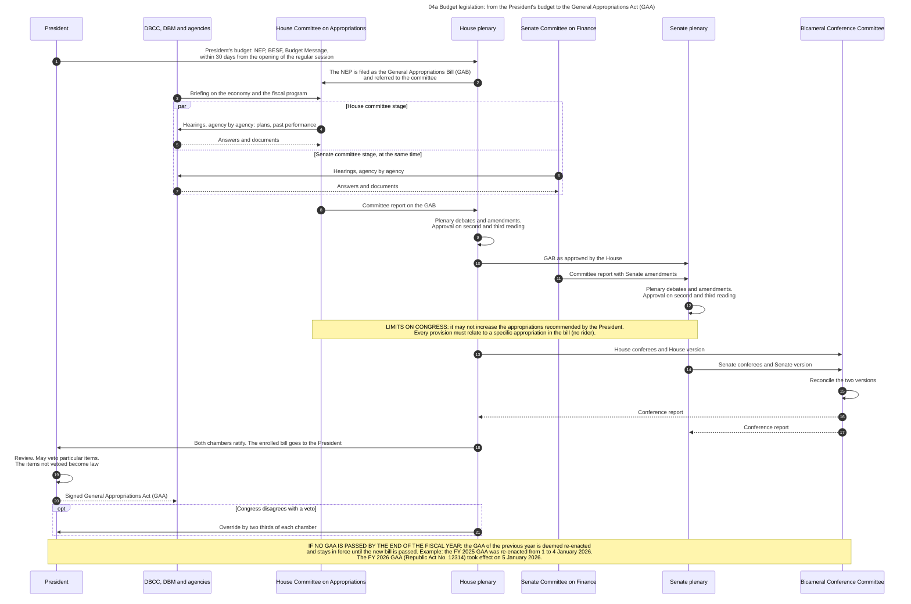
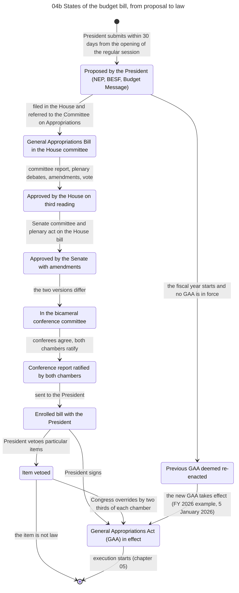
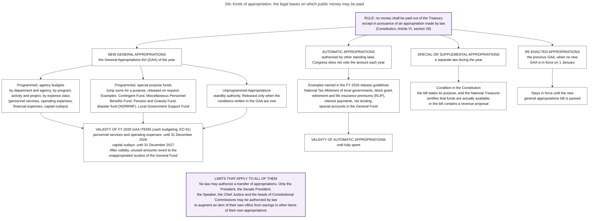

# 04. Budget legislation

*Part of the Philippine PFM Atlas. Facts as of 8 October 2026. The codes in the column "Basis" are explained in [Reference F](../reference/F_sources_and_verification.md). "GK" means general knowledge that I did not open in a source during this work.*

## 1. The question this process answers

How does the proposed budget become a law, what may Congress and the President each change, and what happens if no law is passed in time?

## 2. The idea in plain words

The Constitution contains one rule from which the whole process follows: "No money shall be paid out of the Treasury except in pursuance of an appropriation made by law" [CONST VI.29(1)]. An **appropriation** is this permission in a law. The yearly law that contains most appropriations is the **General Appropriations Act (GAA)**.

The powers are divided. The President proposes. Congress may reduce or rearrange but may not increase the appropriations recommended by the President for the operation of the government as specified in the budget [CONST VI.25(1)]. The President then signs, and may reject single items while approving the rest. This is the **item veto** [CONST VI.27(2)].

A case where the process works: the bill is passed and signed before 1 January, and execution starts on the first day of the fiscal year.

A case where it fails: no bill is passed by the end of the year. The Constitution then keeps the government running: the law of the preceding year is deemed re-enacted and stays in force until the new bill is passed [CONST VI.25(7)]. This happened for four days at the start of 2026. The FY 2025 law was deemed re-enacted until 4 January 2026, and the FY 2026 law, Republic Act No. 12314, took effect on 5 January 2026 [NBC599]. A long period of re-enactment causes problems: new programs have no appropriation, and programs that ended still have one (GK).

Terms. The **General Appropriations Bill (GAB)** is the budget in the form of a bill. The **bicameral conference committee** is the group of members of both chambers that reconciles their two versions. The **enrolled bill** is the final text sent to the President.

## 3. Authorities and their roles

| Authority | Role in this process | Basis |
|---|---|---|
| President | Submits the budget. Signs the bill or vetoes particular items | CONST VII.22, VI.27(2) |
| House of Representatives | Appropriation bills must originate here. Its Committee on Appropriations holds hearings and reports the bill. The plenary debates, amends and votes | CONST VI.24, INQ-GUIDE, PRIMER |
| Senate | May propose or concur with amendments. Its Committee on Finance holds hearings at the same time as the House. The plenary debates, amends and votes | CONST VI.24, INQ-GUIDE, PRIMER |
| Bicameral Conference Committee | Reconciles the two versions | INQ-GUIDE |
| DBCC, DBM and agencies | Explain and defend the proposal in the hearings | INQ-GUIDE. Briefing by the DBCC: GK |
| National Treasurer | Certifies that funds are actually available for a special appropriations bill | CONST VI.25(4) |

## 4. Steps

The steps are those of diagram 04a.

| No. | Who acts | Towards whom | What is done or passed | Basis |
|---|---|---|---|---|
| 1 | President | House plenary | President's budget: NEP, BESF, Budget Message, within 30 days from the opening of the regular session | CONST VII.22 |
| 2 | House plenary | House Committee on Appropriations | The NEP is filed as the General Appropriations Bill (GAB) and referred to the committee | PRIMER |
| 3 | DBCC, DBM and agencies | House Committee on Appropriations | Briefing on the economy and the fiscal program | NEP2027-NEWS (the House review of the FY 2027 budget opened with a briefing by the DBCC) |
| 4 | House Committee on Appropriations | DBCC, DBM and agencies | Hearings, agency by agency: plans, past performance | INQ-GUIDE, PRIMER |
| 5 | DBCC, DBM and agencies | House Committee on Appropriations | Answers and documents | INQ-GUIDE, PRIMER |
| 6 | Senate Committee on Finance | DBCC, DBM and agencies | Hearings, agency by agency | INQ-GUIDE, PRIMER |
| 7 | DBCC, DBM and agencies | Senate Committee on Finance | Answers and documents | INQ-GUIDE, PRIMER |
| 8 | House Committee on Appropriations | House plenary | Committee report on the GAB | PRIMER |
| 9 | House plenary | (own action) | Plenary debates and amendments. Approval on second and third reading | INQ-GUIDE. Three readings: CONST VI.26(2) |
| 10 | House plenary | Senate plenary | GAB as approved by the House | CONST VI.24 |
| 11 | Senate Committee on Finance | Senate plenary | Committee report with Senate amendments | PRIMER |
| 12 | Senate plenary | (own action) | Plenary debates and amendments. Approval on second and third reading | INQ-GUIDE. Three readings: CONST VI.26(2) |
| 13 | House plenary | Bicameral Conference Committee | House conferees and House version | INQ-GUIDE |
| 14 | Senate plenary | Bicameral Conference Committee | Senate conferees and Senate version | INQ-GUIDE |
| 15 | Bicameral Conference Committee | (own action) | Reconcile the two versions | INQ-GUIDE |
| 16 | Bicameral Conference Committee | House plenary | Conference report | INQ-GUIDE |
| 17 | Bicameral Conference Committee | Senate plenary | Conference report | INQ-GUIDE |
| 18 | House plenary | President | Both chambers ratify. The enrolled bill goes to the President | INQ-GUIDE |
| 19 | President | (own action) | Review. May veto particular items. The items not vetoed become law | CONST VI.27(2) |
| 20 | President | DBCC, DBM and agencies | Signed General Appropriations Act (GAA) | INQ-GUIDE |
| 21 | House plenary | President | Override by two thirds of each chamber | INQ-GUIDE |

## 5. What Congress and the President may and may not do

| Rule | Summary of the rule | Basis |
|---|---|---|
| Origin | Appropriation, revenue and tariff bills originate exclusively in the House. The Senate may propose or concur with amendments | CONST VI.24 |
| No increase | Congress may not increase the appropriations recommended by the President for the operation of the government as specified in the budget | CONST VI.25(1) |
| No rider | No provision may be in the general appropriations bill unless it relates specifically to a particular appropriation in it | CONST VI.25(2) |
| Three readings | No bill becomes a law unless it has passed three readings on separate days. Printed copies of the final text go to the members three days before passage, unless the President certifies that immediate enactment is necessary to meet a public calamity or emergency. At the last reading no amendment is allowed, and the vote is taken immediately | CONST VI.26(2) |
| Special appropriations | A special appropriations bill must state its purpose and be supported by funds actually available, as certified by the National Treasurer, or by a revenue proposal | CONST VI.25(4) |
| No transfer | No law may authorize a transfer of appropriations. Five officials may be authorized by law to augment an item of their own office from savings in their own appropriations: the President, the Senate President, the Speaker, the Chief Justice, the heads of Constitutional Commissions | CONST VI.25(5) |
| Reenactment | If the bill is not passed by the end of the fiscal year, the law of the preceding year is deemed re-enacted until the new bill is passed | CONST VI.25(7) |
| Item veto | The President may veto particular items. The veto does not affect the items not objected to | CONST VI.27(2) |
| Override | Congress may override a veto by two thirds | INQ-GUIDE |
| Content of the law | The law contains the programs and projects of each agency with their appropriations. It contains no list of single positions | EO292-B6 s.23 |
| No supplement from existing revenue | After the President has submitted the budget, Congress may pass no supplemental appropriation that is supported only by existing revenue measures | EO292-B6 s.27 |

## 6. Kinds of appropriation

Diagram 04c shows the kinds. The table gives the same content.

| Kind | What it is | Examples | Basis |
|---|---|---|---|
| New general appropriations, agency budgets | The amounts for each department and agency in the GAA, by program, activity and project and by expense class | Any agency budget | NBC599 |
| New general appropriations, special purpose funds | Lump sums for a purpose, released on request | Contingent Fund, Miscellaneous Personnel Benefits Fund, Pension and Gratuity Fund, disaster fund (chapter 15, section 5.1), Local Government Support Fund | NBC599 |
| Unprogrammed appropriations | Standby authority in the GAA, released only when conditions written in the law are met. For FY 2026 they are part of the total release program, net of vetoed purposes | | NBC599 s.3.2.1. Conditions: GK |
| Automatic appropriations | Authorized by standing laws. Congress does not vote the amount each year. The Administrative Code names three kinds: retirement premiums and government service insurance of personnel, principal and interest of the public debt, and guarantees of the national government that are called. It adds that no obligation and no payment is made from them except through a regular allotment | National Tax Allotment, block grant, retirement and life insurance premiums, interest payments, net lending, special accounts in the General Fund. Funding source codes of the accounting manual: 104102 retirement and life insurance premiums, 104108 tax refunds, 104109 debt principal, 104110 debt interest, 104251 Internal Revenue Allotment | NBC599, MANDANAS, EO292-B6 s.26, GAM-V1 Annex P |
| Special or supplemental appropriations | A separate law during the year | | CONST VI.25(4) |
| Re-enacted appropriations | The preceding GAA when no new one is in force | 1 to 4 January 2026 | CONST VI.25(7), NBC599 |
| Continuing appropriations | An appropriation that stays available for a purpose or project when the obligations are incurred after the budget year | Capital outlays within their period of validity | EO292-B6 s.2, s.28, GAM-V1 Ch.3 s.2 |

## 7. Documents and identifiers

| Document | Identified by | Basis |
|---|---|---|
| General Appropriations Bill | House bill number. For FY 2027: House Bill No. 10858 | INQ-GUIDE, GAB2027-NEWS |
| Committee reports, conference committee report | Report number | INQ-GUIDE. Numbering: GK |
| Enrolled bill | Bill number | INQ-GUIDE |
| General Appropriations Act | Republic Act number (No. 12314 for FY 2026, No. 12116 for FY 2025). Each line is identified by its UACS codes, which the general provisions require | NBC599, GAA2026-GP |

## 8. Information systems

The sources I read do not name a system for the legislative stage. The bill is prepared from the proposed budget in the systems of DBM (chapter 03), and the enacted amounts are loaded into the systems used for release (chapter 05). How the changes made by Congress are entered was not described in the sources (GK: by DBM after enactment).

## 9. Timing

| Time | Event | Basis |
|---|---|---|
| Fourth Monday of July | Regular session opens | GK (Constitution, Article VI, section 15) |
| Within 30 days after that | President submits the budget | CONST VII.22 |
| August to December | Hearings, plenary, bicameral conference | INQ-GUIDE for the order. Months: GK |
| FY 2027 budget: 11 August 2026 | DBM submits the National Expenditure Program, about PHP 7.2 trillion, to the House | NEP2027-NEWS |
| FY 2027 budget: 17 August 2026 | The House starts its review with a briefing by the DBCC | NEP2027-NEWS |
| FY 2027 budget: 9 October 2026 | First date by which the House planned to pass the General Appropriations Bill | NEP2027-NEWS |
| FY 2027 budget: by 7 October 2026 | The House approved House Bill No. 10858, of about PHP 7.2 trillion, on second reading. I read only the headline of this press report | GAB2027-NEWS |
| FY 2027 budget: 12 October 2026 (expected) | Third reading in the House, according to a press report of 6 October 2026. The report gives the rule of three days between the two readings as the reason for the later date | GAB2027-NEWS, CONST VI.26(2) |
| Before 1 January | Signature, so that execution can start with the fiscal year | GK |
| 5 January 2026 | The FY 2026 GAA took effect | NBC599 |

## 10. Variations and exceptions

- **Validity.** Under cash budgeting, FY 2026 appropriations for personnel services and for maintenance and other operating expenses are valid until 31 December 2026, and capital outlays until 31 December 2027. Automatic appropriations stay valid until fully spent. Unused amounts revert to the unappropriated surplus of the General Fund [NBC599 s.3.3, s.3.6][EO91]. The table in my copy of the circular was partly unreadable, so check these dates.
- **Items changed during legislation.** For increases and new items in the GAA, the release guidelines require a Special Budget Request, the approval of the Office of the President and revised performance targets. DBM checks alignment with the development plan, readiness, and a past spending capacity of at least 85 percent [NBC599 s.4.1.1].
- **Multi-year contracts.** A contract that lasts more than one year and is paid from local funds needs a Multi-Year Contractual Authority of DBM before any procurement activity starts. The obligations of a year may not exceed the cash appropriation of that year [IRR12009 s.9][CL2025-6][GAA2026-GP][EO91]. Chapter 06, section 5, gives the rules.
- **Promises that bind later budgets.** A partnership contract with a private firm, or a guarantee, creates payments in later years that no appropriation of today shows. See chapter 19.

## 11. Where the process fails in practice

| Reported weakness | Basis |
|---|---|
| Insertions can be made outside the regular process and are not approved in plenary (statement of a former member quoted by the press) | INQ-GUIDE |
| Additions by Congress without regional consultation | ROADMAP2024 |
| The legislature has no formal scrutiny of the audit reports on the annual financial reports. Hearings are held case by case (PEFA indicator 31, score D) | PEFA2025 |

## 12. Diagrams

### Diagram 04a  Budget legislation: from the President's budget to the General Appropriations Act (GAA)

Code file: `../diagrams/mermaid/04a_legislation_sequence.mmd`. Rendered image: [`../rendered/04a_legislation_sequence.png`](../rendered/04a_legislation_sequence.png).

- **Question:** which body acts on the budget bill at each stage, what may each body change, and what happens if no law is passed before the fiscal year starts?
- **Sources:** submission deadline [CONST VII.22]. Origin in the House, Senate may amend [CONST VI.24]. No increase above the President's recommendation, no rider, reenactment, augmentation only from savings [CONST VI.25]. Item veto [CONST VI.27(2)]. Three readings on separate days, printed copies of the final text three days before passage unless the President certifies the need for immediate enactment, no amendment at the last reading [CONST VI.26(2)]. Committee hearings, plenary, bicameral conference, ratification, transmission, signature, override by two thirds [INQ-GUIDE]. Senate hearings in parallel with the House [PRIMER]. Dates of the FY 2026 GAA and the four days of reenactment [NBC599].
- **From a press report:** step 3. The House review of the FY 2027 budget opened on 17 August 2026 with a briefing by the DBCC [NEP2027-NEWS].
- **General knowledge, not opened in a source here:** that the debate and the amendments belong to the second reading, the signing of the enrolled bill by the presiding officers, the veto message.

### Diagram 04b  States of the budget bill, from proposal to law

Code file: `../diagrams/mermaid/04b_bill_states.mmd`. Rendered image: [`../rendered/04b_bill_states.png`](../rendered/04b_bill_states.png).

- **Question:** in which state is the budget of a fiscal year at a given date, and which act moves it to the next state?
- **How to read it:** one box = one state of the document. The text on an arrow = the act and the body that performs it.
- **Sources:** [CONST VII.22] submission. [CONST VI.24] the bill starts in the House. [CONST VI.25(7)] reenactment. [CONST VI.27(2)] item veto. [INQ-GUIDE] the stages in Congress and the two-thirds override. [NBC599] the dates of the FY 2026 example.
- **General knowledge, not opened in a source here:** the names of the readings and the publication step.

### Diagram 04c  Kinds of appropriation: the legal bases on which public money may be paid

Code file: `../diagrams/mermaid/04c_appropriation_types.mmd`. Rendered image: [`../rendered/04c_appropriation_types.png`](../rendered/04c_appropriation_types.png).

- **Question:** the Constitution says that no money may be paid from the Treasury except under an appropriation made by law. Which kinds of such laws exist, and how long does each one stay valid?
- **How to read it:** top = the constitutional rule. Second row = the kinds of appropriation. Third row = examples and validity for FY 2026.
- **Sources:** the rule [CONST VI.29(1)]. Special appropriation bills and reenactment [CONST VI.25(4), VI.25(7)]. Limits on transfer and augmentation [CONST VI.25(5)]. Automatic appropriations named in the FY 2026 release guidelines, validity of FY 2026 appropriations, Unprogrammed Appropriations as part of the release program, special purpose funds [NBC599]. Automatic appropriation of the local government share [MANDANAS]. Cash budgeting [EO91].
- **Warning:** the validity table in my copy of the release guidelines was partly unreadable. Check section 3.3 of National Budget Circular No. 599 before relying on the dates.
- **Legal basis of three automatic appropriations:** retirement premiums and government service insurance of personnel, principal and interest of the public debt, and guarantees of the national government that are called [EO292-B6 s.26]. The accounting manual lists the funding source codes of the automatic appropriations [GAM-V1 Annex P].
- **General knowledge, not opened in a source here:** the conditions for releasing Unprogrammed Appropriations, and the legal bases of the other automatic appropriations.

## 13. Verification status

- **Verified in a source:** all constitutional rules, among them the rule of three readings [CONST]. The rules of the Administrative Code on the content of the law, on automatic appropriations, on supplements and on reversion, through summaries with quotations [EO292-B6 ss.23-28]. The funding source codes [GAM-V1 Annex P]. The order of the stages in Congress [INQ-GUIDE][PRIMER]. The dates of the FY 2026 example, the kinds of appropriation named in the release guidelines, the conditions for increases and new items [NBC599].
- **General knowledge, to check:** which part of the plenary work belongs to the second reading, the numbering of reports, the months of each stage, the conditions for unprogrammed appropriations.
- **Not opened:** the rules of the House and of the Senate, and the special provisions of the FY 2026 budget law on unprogrammed appropriations.
- **From press reports only:** the submission of the FY 2027 budget on 11 August 2026, the start of the House review with a briefing by the DBCC, and the first House target date [NEP2027-NEWS]. The number of the bill, its approval on second reading and the expected date of the third reading [GAB2027-NEWS]. Not checked: the vote on third reading, which was expected on 12 October 2026, and the stage in the Senate. I made no check of events after 8 October 2026.
