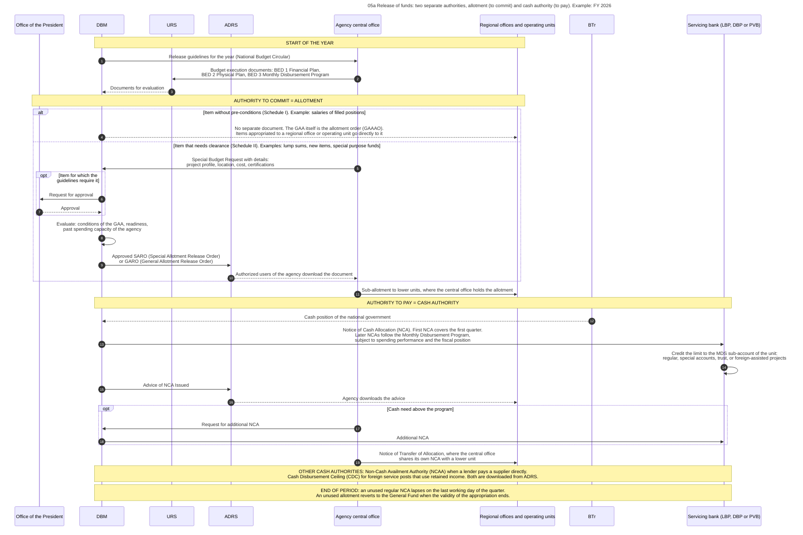
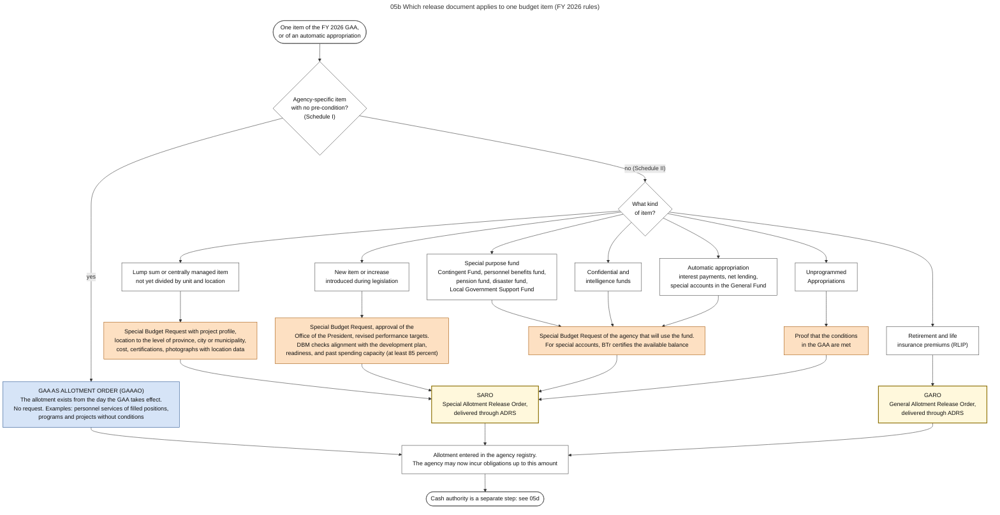
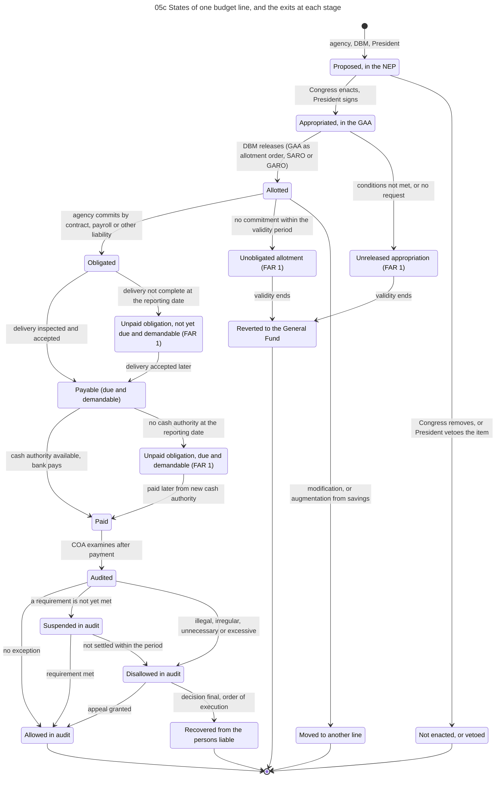
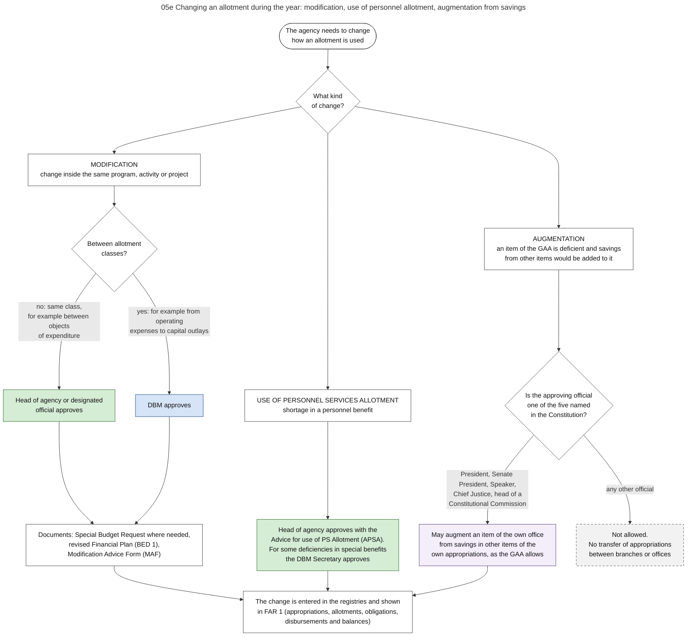

# 05. Release: allotment and cash authority

*Part of the Philippine PFM Atlas. Facts as of 8 October 2026. The codes in the column "Basis" are explained in [Reference F](../reference/F_sources_and_verification.md). "GK" means general knowledge that I did not open in a source during this work.*

## 1. The question this process answers

The budget law is in force. What must an agency hold before it may sign a contract, and what must it hold before it may pay?

## 2. The idea in plain words

An appropriation in the law does not yet allow an agency to act. Two further authorities are needed, and they are separate.

The first is the **allotment**. It allows the agency to commit the government, for example to sign a contract or to hire. A commitment of this kind is called an **obligation**. An allotment contains no cash. The Administrative Code defines the allotment as "an authorization issued by the Department of the Budget to an agency, which allows it to incur obligations for specified amounts contained in a legislative appropriation" [EO292-B6 s.2].

The second is the **cash authority**. Its main form is the **Notice of Cash Allocation (NCA)**. It is a limit: the largest amount that the agency may pay from its account at a servicing bank in a period. The accounting manual says: "The NCA specifies the maximum amount of withdrawal that an entity can make from a government bank for the period indicated" [GAM-V1 Ch.5 s.38]. The agency does not receive cash. The bank pays on the agency's order up to the limit, and the Treasury then repays the bank (chapter 07).

Why two authorities? Because they answer two different questions. The allotment answers "may the government make this commitment this year?", and the answer comes from the budget law. The cash authority answers "is there cash to pay this month?", and the answer comes from the cash position of the Treasury (chapter 11).

A case where the system works: an agency holds an allotment for a contract, the supplier delivers in June, and the NCA of the second quarter covers the payment.

A case where it fails: the supplier delivers on 28 June, the voucher is approved on 2 July, and the unused part of the second-quarter NCA lapsed on 30 June. The agency holds a valid obligation and an approved claim, and still cannot pay until a new NCA is issued. In the budget reports this claim appears as an unpaid obligation that is due and demandable.

Other terms. A **Special Allotment Release Order (SARO)** is the document by which DBM releases an allotment that needs clearance. A **General Allotment Release Order (GARO)** releases an allotment to all agencies for one common purpose. **GAA as allotment order** means that for items without conditions the law itself is the allotment and no document is issued. A **Special Budget Request** is the request of the agency for a SARO. An **operating unit** is an entity that receives release documents directly from DBM.

## 3. The law behind the two authorities

The yearly circular of DBM applies rules of the Administrative Code and of the Auditing Code. I read Book VI of the Administrative Code through summaries with quotations (Reference F), so the table gives the content of each section and quotes only the words that I recorded.

| Rule | Basis |
|---|---|
| Appropriations are made available for expenditure when the head of an agency submits a request for allotment. The year has four allotment periods of three months. The Secretary of Budget and Management approves the request and may change an allotment later | EO292-B6 s.33 |
| When receipts are expected to be lower than planned, the Secretary reduces the allotments, with the approval of the President and after notice to the agency | EO292-B6 s.33 |
| The program of expenditure that the President approves is "the basis for fund release during the fiscal period" | EO292-B6 s.34 |
| "An operational cash budget shall be implemented to ensure the availability of cash resources for priority development projects and to establish a sound basis for determining the level, type and timing of public borrowings." Its procedure is set jointly by the Secretary of Finance, the Secretary of Budget and Management and the Chairman of COA | EO292-B6 s.36 |
| The Secretary may set reserves against appropriations. The President may suspend the expenditure of allotted funds, except for the pay of permanent staff | EO292-B6 s.37, s.38 |
| No obligation and no payment without the certificate of the chief accountant that funds are available and that the allotment can be charged | EO292-B6 s.40, PD1445 s.86 |
| Heads of agencies "shall not incur nor authorize the incurrence of expenditures or obligations in excess of allotments". Those responsible are personally liable | EO292-B6 s.41 |
| An obligation or payment against these rules is void or illegal, and the officials and the receiver are liable for the amount | EO292-B6 s.43 |
| National funds "shall not be withdrawn from the National Treasury except upon warrant or other instruments of withdrawal approved by the Minister (Secretary) of Finance as recommended by the Treasurer of the Philippines" | PD1445 s.84 |
| Balances that are not spent at the end of the fiscal year revert to the unappropriated surplus of the General Fund, with exceptions for capital outlays and continuing appropriations. The budget law and the circular of each year set the periods of validity that apply | EO292-B6 s.28, NBC599 s.3.3, s.3.6 |

### 3.1 Authorities and their roles

| Authority | Role in this process | Basis |
|---|---|---|
| DBM | Issues the release guidelines of the year. Evaluates execution plans. Issues SARO, GARO, NCA and the other authorities. Approves changes between allotment classes | NBC599 |
| Office of the President | Approves the release of items for which the guidelines require it, for example increases and new items | NBC599 s.4.1.1 |
| Agency central office | Submits execution plans and Special Budget Requests. Passes allotment and cash authority to lower units where it holds them | NBC599. Passing to lower units: GK |
| Regional offices and operating units | Receive directly the funds that the law appropriates to them | NBC599 s.3.8 |
| Head of agency | Approves changes inside an allotment class and the use of personnel allotment | NBC599 s.5 |
| BTr | Certifies the balances of special accounts. Releases directly to subsidized corporations and local governments. Its cash position limits the cash authority | NBC599 |
| Government servicing banks (LBP, DBP, PVB) | Receive the NCA and record it as the limit of an MDS sub-account | NBC599 s.4.2.1.6 |
| Budget unit of the agency | Enters each appropriation and allotment in its registries, and sends a copy of each release document to the accounting unit | GAM-V1 Ch.3 s.8, s.9 |
| Accounting unit of the agency | Enters each NCA in the registry of the NCA and makes the journal entry for it. The collecting officer issues no official receipt for an NCA | GAM-V1 Ch.5 s.38, GAM-V2 App.30 |

## 4. Steps

The steps are those of diagram 05a, for FY 2026.

| No. | Who acts | Towards whom | What is done or passed | Basis |
|---|---|---|---|---|
| 1 | DBM | Agency central office | Release guidelines for the year (National Budget Circular) | NBC599 |
| 2 | Agency central office | URS | Budget execution documents: BED 1 Financial Plan, BED 2 Physical Plan, BED 3 Monthly Disbursement Program | NBC599 s.3.9 |
| 3 | URS | DBM | Documents for evaluation | NBC599 s.3.9 |
| 4 | DBM | Regional offices and operating units | No separate document. The GAA itself is the allotment order (GAAAO). Items appropriated to a regional office or operating unit go directly to it | NBC599 s.3.7, s.3.8 |
| 5 | Agency central office | DBM | Special Budget Request with details: project profile, location, cost, certifications | NBC599 s.4.1 |
| 6 | DBM | Office of the President | Request for approval | NBC599 s.4.1.1 |
| 7 | Office of the President | DBM | Approval | NBC599 s.4.1.1 |
| 8 | DBM | (own action) | Evaluate: conditions of the GAA, readiness, past spending capacity of the agency | NBC599 s.4.1.1 |
| 9 | DBM | ADRS | Approved SARO (Special Allotment Release Order) or GARO (General Allotment Release Order) | NBC599 s.3.7, ADRS |
| 10 | ADRS | Agency central office | Authorized users of the agency download the document | ADRS |
| 11 | Agency central office | Regional offices and operating units | Sub-allotment to lower units, where the central office holds the allotment | GK. Sub-allotments are listed in report FAR 1-B: JC2019-1 |
| 12 | BTr | DBM | Cash position of the national government | Inference from NBC599 s.4.2 |
| 13 | DBM | Servicing bank (LBP, DBP or PVB) | Notice of Cash Allocation (NCA). First NCA covers the first quarter. Later NCAs follow the Monthly Disbursement Program, subject to spending performance and the fiscal position | NBC599 s.4.2.1 |
| 14 | Servicing bank (LBP, DBP or PVB) | (own action) | Credit the limit to the MDS sub-account of the unit: regular, special accounts, trust, or foreign-assisted projects | NBC599 s.4.2.1.6 |
| 15 | DBM | ADRS | Advice of NCA Issued | ADRS |
| 16 | ADRS | Regional offices and operating units | Agency downloads the advice | ADRS |
| 17 | Agency central office | DBM | Request for additional NCA | NBC599 s.4.2.1 |
| 18 | DBM | Servicing bank (LBP, DBP or PVB) | Additional NCA | NBC599 s.4.2.1 |
| 19 | Agency central office | Regional offices and operating units | Notice of Transfer of Allocation, where the central office shares its own NCA with a lower unit | GAM-V1 Ch.3 s.3. Not mentioned in NBC599 |

## 5. Which release document applies

Diagram 05b is a decision tree. The table gives the same content.

| Kind of item | Release document | What the agency must do | Basis |
|---|---|---|---|
| Agency-specific item without pre-conditions (Schedule I). Examples: personnel services of filled positions, programs and projects without conditions | None. The GAA is the allotment order | Nothing. The allotment exists from the day the law takes effect | NBC599 s.3.7 |
| Lump sums and centrally managed items | SARO | Special Budget Request with project profile, location to the level of province, city or municipality, cost, certifications, photographs with location data | NBC599 |
| New items and increases introduced during legislation | SARO | Special Budget Request, approval of the Office of the President, revised performance targets | NBC599 s.4.1.1 |
| Special purpose funds: Contingent Fund, Miscellaneous Personnel Benefits Fund, pension fund, disaster fund, Local Government Support Fund | SARO | Special Budget Request of the agency that will use the fund | NBC599 |
| Confidential and intelligence funds | SARO | Special Budget Request | NBC599 |
| Automatic appropriations: interest payments, net lending, special accounts in the General Fund | SARO | Request. For special accounts, BTr certifies the balance | NBC599 |
| Retirement and life insurance premiums | GARO | None by each agency | NBC599 |
| Budgetary support to government corporations | Release document to BTr, which releases to the corporation | Special Budget Request. The amount must be in the corporate operating budget approved by the board | BSGC2026 |
| Unprogrammed appropriations | SARO | Proof that the conditions in the law are met | NBC599 s.3.2.1. Conditions: GK |

The national disaster fund has conditions of its own. Each use needs the approval of the President, who may consider the recommendation of the national disaster council. Twelve agencies also have a Quick Response Fund inside their own budget, which they may use immediately [GAA2026-NDRRMF]. Chapter 15, section 5.1, describes both.

## 6. Kinds of cash authority

Diagram 05d shows the kinds. The table gives the same content.

| Authority | Issued by | What it allows | Basis |
|---|---|---|---|
| Notice of Cash Allocation (NCA) | DBM, to the servicing bank | Payments from an MDS sub-account up to the amount stated. The first NCA of the year covers the first quarter, including retirement and life insurance premiums. Later NCAs follow the Monthly Disbursement Program of the full year, subject to the spending performance of the agency and the fiscal position. A regular NCA is a common fund: it may pay obligations of the current year and unpaid obligations of earlier years. Its unused balance lapses on the last working day of the quarter | NBC599 s.4.2.1, s.4.2.1.6 |
| Additional NCA | DBM | Payments above the program, on a justified request | NBC599 s.4.2.1 |
| Non-Cash Availment Authority (NCAA) | DBM, through ADRS | Covers the peso value of loan or grant proceeds used by direct payment, supplier's credit or constructive cash | NBC599 s.4.2.2.1 |
| Cash Disbursement Ceiling (CDC) | DBM, through ADRS | Lets the foreign service posts of two departments use income collected abroad, up to their released allotment | NBC599 s.4.2.2.2 |
| Tax Remittance Advice (TRA) | The agency, in the electronic filing system of BIR | Records taxes withheld by the agency as remitted to BIR without a transfer of cash. The agency, BIR and BTr each make an entry from the same advice | NBC599 (listed). Working: GAM-V1 Ch.5 s.38, Ch.6 ss.60-62 |
| Notice of Transfer of Allocation | The central office of an agency | Covers the cash requirements of its regional and operating units | GAM-V1 Ch.3 s.3. Not mentioned in the FY 2026 circular |

There are four kinds of MDS sub-account, kept at LBP, DBP and PVB: regular, special accounts in the General Fund, trust, and foreign-assisted projects [NBC599 s.4.2.1.6].

The accounting manual names the same authorities as the only bases for a payment: an agency may pay "based on the Notice of Cash Allocation (NCA), Notice of Transfer of Allocation (NTA), Cash Disbursement Ceiling (CDC) or other authority that may be provided by law" [GAM-V1 Ch.2 s.40]. Each authority has its own entry in the books of the agency (chapter 07, section 8). The Manual also says what the cash account for the NCA is not: it holds "no actual cash with the GSBs", the government servicing banks [GAM-V1 Ch.19 s.56].

## 7. Changes during the year

Diagram 05e shows three acts that are often confused.

| Act | Meaning | Who approves | Document | Basis |
|---|---|---|---|---|
| Modification | A change inside the same program, activity or project | DBM for a change between allotment classes. The head of agency for a change inside a class. Who approves a change between operating units is not clear from my copy of the circular | Special Budget Request where needed, revised Financial Plan, Modification Advice Form | NBC599 s.3.13, s.5.1 |
| Use of personnel allotment | Available personnel allotment covers a shortage in one personnel benefit | Head of agency. The DBM Secretary for some special benefits | Advice for use of PS Allotment | NBC599 s.5.2 |
| Augmentation | Savings from other items are added to an item that is deficient | Only the President, the Senate President, the Speaker, the Chief Justice and the heads of Constitutional Commissions, each for the own office | As the budget law provides | CONST VI.25(5), NBC599 s.3.14 |

## 8. States of a budget line

Diagram 05c follows one amount through its states. Each state is a ceiling for the next: appropriation ≥ allotment ≥ obligation ≥ disbursement. The balances between the states are the columns of report FAR 1 [JC2019-1].

| State | Meaning | Exit when it stops here |
|---|---|---|
| Appropriated | In the budget law | Unreleased appropriation |
| Allotted | Released by DBM | Unobligated allotment, or moved to another line |
| Obligated | Committed by contract, payroll or other liability | Unpaid obligation, not yet due and demandable |
| Payable | Delivery inspected and accepted. The books record the payable at this moment | Unpaid obligation, due and demandable |
| Paid | Bank paid the payee | |
| Audited | Examined by COA after payment | Allowed, suspended or disallowed (chapter 09) |

At the end of validity, unreleased appropriations and unobligated allotments revert to the unappropriated surplus of the General Fund [NBC599 s.3.6][EO292-B6 s.28].

Each state has a record in the agency. The budget unit enters the appropriation and the allotment in its registries, and the obligation in the registry and on the obligation request. The accounting unit enters the NCA in its registry of the NCA, and reverses the unused part at the end of the period: debit Subsidy from National Government, credit Cash-MDS, Regular [GAM-V1 Ch.3 ss.8-15, Ch.19 s.55]. Chapter 08, section 4, lists the records for each state.

## 9. Documents, identifiers and systems

| Document | System | Identified by | Basis |
|---|---|---|---|
| Budget Execution Documents: BED 1 Financial Plan, BED 2 Physical Plan, BED 3 Monthly Disbursement Program | URS | Agency and fiscal year | NBC599 s.3.9 |
| SARO, GARO | ADRS. Authorized users of the agency download the document | SARO or GARO number, with UACS codes | NBC599, ADRS |
| Advice of NCA Issued | ADRS | NCA number | ADRS |
| NCAA, CDC | ADRS | Document number | NBC599 |
| Record for public verification of a SARO or NCA document | Blockchain application of DBM | See chapter 16 | DBM-BLOCKCHAIN |
| Registry of appropriations and allotments, and registries of allotments, obligations and disbursements | Budget unit of the agency: paper, spreadsheet or the eBudget of COA | Reference to the number of the budget law, SARO or GARO | GAM-V2 App.8, App.9A, COA-GAS |
| Registry of the NCA | Accounting unit of the agency | Columns: allotment received, NCA received, NCA used, NCA not yet used, allotment not yet covered by an NCA | GAM-V2 App.30 |
| Allotments and NCAs in agencies that use BTMS | BTMS, which blocks obligations above the allotment and payments above the cash allocation | System record | BTMS-SITE |

## 10. Controls: what each one checks, and what it does not check

| Control | What it checks | What it does not check |
|---|---|---|
| Schedule II of the release guidelines | That items with conditions are cleared before release | Items in Schedule I, which need no clearance |
| Special Budget Request | Details of the item: profile, location, cost, readiness, past spending capacity | The later procurement and delivery |
| Allotment as ceiling for obligations | That commitments stay inside the released amount | Whether the commitment is useful |
| Certificate of the chief accountant before an obligation | That an allotment exists and is not yet used for another purpose | Whether cash will be there at payment |
| NCA as ceiling for payments | That payments in a period stay inside the cash plan | Whether a payment is due. That is the task of the voucher (chapter 07) |
| Registry of the NCA, read by the head of accounting before each voucher is certified | That the amount of this voucher is still inside the cash authority | Whether the claim is true |
| Quarterly lapse of the NCA | That unused cash authority does not accumulate | It can stop a payment that is due (see section 2) |
| Validity and reversion | That appropriations are used in their period | |

## 11. Timing for FY 2026

| Date | Event | Basis |
|---|---|---|
| 5 January 2026 | The FY 2026 budget law takes effect. DBM issues the release guidelines on the same day | NBC599 |
| Start of the year | Agencies submit execution plans through URS. The first NCA covers the first quarter | NBC599 |
| 10th day of each month | Monthly Report of Disbursements (FAR 4) of the month before | NBC599, JC2019-1 |
| Within 30 days after each quarter | Budget and Financial Accountability Reports | NBC599, JC2019-1 |
| Last working day of each quarter | Unused regular NCA lapses | NBC599 s.4.2.1.6 |
| 16 November 2026 | Last day for requests to DBM | NBC599 |
| 31 December 2026 | End of validity for personnel services and for maintenance and other operating expenses | NBC599 s.3.3 (check) |
| 31 December 2027 | End of validity for capital outlays of FY 2026 | NBC599 s.3.3 (check) |

## 12. Where the process fails in practice

| Reported weakness | Basis |
|---|---|
| The stock of expenditure arrears (claims that are due and unpaid) in 2023 was more than 10 percent of total expenditure (PEFA indicator 22.1, score D). Data on the stock are produced each year, but not all agencies comply with the reporting rules (indicator 22.2, score C) | PEFA2025 |
| Quarterly budget reports are issued within 8 weeks after the quarter (PEFA indicator 28.2, score C). Their accuracy is rated C because manual processes remain (indicator 28.3). Coverage through URS is rated B (indicator 28.1) | PEFA2025 |
| Manual processing and no integration between systems | ROADMAP2024 |

## 13. Diagrams

### Diagram 05a  Release of funds: two separate authorities, allotment (to commit) and cash authority (to pay). Example: FY 2026

Code file: `../diagrams/mermaid/05a_release_sequence.mmd`. Rendered image: [`../rendered/05a_release_sequence.png`](../rendered/05a_release_sequence.png).

- **Question:** after the GAA takes effect, what must an agency hold before it may sign a contract, and what must it hold before it may pay?
- **Idea:** an ALLOTMENT lets the agency commit the government (incur an obligation). It contains no cash. A NOTICE OF CASH ALLOCATION (NCA) lets the agency order payments up to a limit within a period. The two are issued separately and for different amounts and periods.
- **Sources:** all steps except 11, 12 and 19 [NBC599] (DBM National Budget Circular No. 599 of 5 January 2026). Digital delivery of SARO and of the advice of NCA through ADRS [ADRS][NBC599]. Submission of execution documents through URS [NBC599].
- **From the accounting manual of 2015, not from the FY 2026 circular:** step 19. The Manual defines the Notice of Transfer of Allocation as the "authority issued by the Central Office to its regional and operating units to cover the latter's cash requirements" [GAM-V1 Ch.3 s.3]. The FY 2026 circular does not mention it.
- **General knowledge, not opened in a source here:** step 11 (sub-allotment by the central office). The report FAR 1-B lists allotments and sub-allotments [JC2019-1], and I did not read a rule on the act itself. Step 12 (BTr informs DBM of the cash position) is my reading of the phrase "subject to the fiscal position".
- **Warning:** the table on NCA validity in my copy of the circular was partly unreadable.

### Diagram 05b  Which release document applies to one budget item (FY 2026 rules)

Code file: `../diagrams/mermaid/05b_release_decision_tree.mmd`. Rendered image: [`../rendered/05b_release_decision_tree.png`](../rendered/05b_release_decision_tree.png).

- **Question:** for one item of appropriation, does the agency already have its allotment when the GAA takes effect, or must it ask DBM first, and with which document does DBM answer?
- **How to read it:** follow the diamonds from the top. Blue = no request needed. Orange = a request to DBM is needed.
- **Sources:** all classes and examples come from the FY 2026 release guidelines, sections 3.7, 3.8, 4.1 and the two schedules [NBC599]. GAA as allotment order also in the FY 2026 GAA general provisions [GAA2026-GP].
- **Warning:** this is a summary of two long schedules. For a real item, check the schedules of National Budget Circular No. 599. Rules change with each year's circular.
- **General knowledge, not opened in a source here:** the conditions for Unprogrammed Appropriations.

### Diagram 05c  States of one budget line, and the exits at each stage

Code file: `../diagrams/mermaid/05c_budget_line_states.mmd`. Rendered image: [`../rendered/05c_budget_line_states.png`](../rendered/05c_budget_line_states.png).

- **Question:** an amount is in the budget but was not spent. At which stage did it stop, and who had the power to advance it?
- **Rule of the main line:** each stage is a ceiling for the next one. Appropriation >= allotment >= obligation >= disbursement.
- The four exits marked FAR 1 are the balance columns of report FAR No. 1 (Statement of Appropriations, Allotments, Obligations, Disbursements and Balances): unreleased appropriations, unobligated allotments, and unpaid obligations in two kinds.
- **Sources:** release by GAA as allotment order or by SARO or GARO, validity and reversion [NBC599]. FAR 1 and the definition of due and demandable [JC2019-1]. Modification and augmentation [NBC599][CONST VI.25(5)]. Audit after payment [COA2011-002]. Audit outcomes [COA2009-006].
- **Check each year:** the validity period of each kind of appropriation is fixed by that year's GAA and release guidelines.

### Diagram 05d  Kinds of disbursement authority: who issues each one, to whom, and what it allows

Code file: `../diagrams/mermaid/05d_cash_authorities.mmd`. Rendered image: [`../rendered/05d_cash_authorities.png`](../rendered/05d_cash_authorities.png).

- **Question:** an allotment contains no cash. Which document gives an agency the right to make payments, and which one applies in each situation?
- **How to read it:** left = issuer. Middle = the authority. Right = what the agency does with it. The last block shows payments that BTr makes directly to the receiver. They do not pass through the MDS sub-account of a spending agency. DBM still issues release documents for them: for the FY 2026 tax allotment it issued one SARO and the corresponding NCAs [NTA-PR].
- **Sources:** NCA rules, the four MDS sub-accounts, the three servicing banks, the Common Fund, NCAA, CDC, the listing of the Tax Remittance Advice, releases by BTr to corporations and local governments [NBC599]. Payment instruments LDDAP-ADA and check [CL2013-16A]. Monthly report of disbursements by type of authority, FAR 4 [JC2019-1]. The four disbursement authorities of the Manual: NCA, Non-Cash Availment Authority, Cash Disbursement Ceiling and Notice of Transfer of Allocation [GAM-V1 Ch.3 s.3, Ch.2 s.40]. The entries for each authority and for the Tax Remittance Advice [GAM-V1 Ch.5 s.38]. The NCA as a maximum amount of withdrawal [GAM-V1 Ch.5 s.38].
- **A difference between two sources:** the Notice of Transfer of Allocation is in the Manual of 2015 and is not mentioned in the FY 2026 circular [NBC599].
- **Warning on one abbreviation:** "NTA" has two meanings in Philippine PFM. In this diagram it is not used. In chapter 14 it means National Tax Allotment.

```mermaid
---
title: "05d  Kinds of disbursement authority: who issues each one, to whom, and what it allows"
config:
  flowchart:
    wrappingWidth: 480
---
flowchart LR

  DBM["DBM"]
  CO["Central office<br/>of an agency"]
  AG["The agency itself"]
  BTR["BTr"]

  NCA["NCA  Notice of Cash Allocation<br/>Maximum amount the agency may pay in a period.<br/>Sent to the servicing bank and credited to an MDS sub-account:<br/>regular, special accounts, trust, or foreign-assisted projects.<br/>A regular NCA is a common fund: it may pay obligations<br/>of the current year and unpaid obligations of earlier years.<br/>Unused amount lapses at the end of the quarter"]:::auth
  NOTA["Notice of Transfer of Allocation<br/>The central office covers the cash requirements<br/>of its regional and operating units"]:::auth
  NCAA["NCAA  Non-Cash Availment Authority<br/>Covers the peso value of loan or grant proceeds that the lender<br/>pays directly to a supplier, supplier's credit, or constructive cash.<br/>No cash passes through the agency"]:::auth
  CDC["CDC  Cash Disbursement Ceiling<br/>Lets foreign service posts (DFA, DMW) spend income<br/>they collected abroad, within their released allotment"]:::auth
  TRA["TRA  Tax Remittance Advice<br/>Records taxes withheld by the agency from its payments<br/>as paid to BIR, without any transfer of cash. The agency,<br/>BIR and BTr each make an entry from the same advice"]:::auth

  U1["Agency orders payments from the MDS sub-account:<br/>LDDAP-ADA (credit to payee accounts) or MDS check"]
  U2["Lower unit orders payments<br/>from its own MDS sub-account"]
  U3["Agency records the expenditure<br/>and the asset or expense in its books"]
  U4["Post pays its expenses from<br/>the money it holds abroad"]
  U5["BIR records a collection,<br/>the agency records the remittance"]
  U6["RELEASES MADE BY BTr DIRECTLY TO THE RECEIVER,<br/>not through the MDS sub-account of a spending agency:<br/>subsidy and equity to government corporations,<br/>National Tax Allotment and other shares of local governments,<br/>debt service"]

  DBM --> NCA --> U1
  CO --> NOTA --> U2
  DBM --> NCAA --> U3
  DBM --> CDC --> U4
  AG --> TRA --> U5
  BTR --> U6

  REP(["All of them are reported each month in FAR 4,<br/>Monthly Report of Disbursements, by type of authority"])
  U1 --> REP
  U2 --> REP
  U3 --> REP
  U4 --> REP
  U5 --> REP

  classDef default fill:#ffffff,stroke:#444444,color:#111
  classDef auth fill:#fde0c2,stroke:#a35200,color:#111
```

### Diagram 05e  Changing an allotment during the year: modification, use of personnel allotment, augmentation from savings

Code file: `../diagrams/mermaid/05e_modification_and_savings.mmd`. Rendered image: [`../rendered/05e_modification_and_savings.png`](../rendered/05e_modification_and_savings.png).

- **Question:** an agency needs to move money from one use to another during the year. Who may approve the change, and with which document?
- **Idea:** three different acts are often confused. (1) MODIFICATION changes the details of an allotment inside the same program, activity or project. (2) USE OF PERSONNEL ALLOTMENT covers a shortage in one personnel benefit from available personnel allotment. (3) AUGMENTATION adds to an item that is deficient from SAVINGS in other items, and the Constitution limits who may do it.
- **Sources:** modification, the Modification Advice Form, the Advice for use of PS Allotment, reports [NBC599 s.3.13, s.3.14, s.5]. Who may augment [CONST VI.25(5)].
- **Conflict between my two readings of the circular:** it is clear that DBM approves a change between allotment classes. It is not clear from the copy I read whether a change between operating units is approved by DBM or by the head of agency. Check section 5.1 of National Budget Circular No. 599.
- **General knowledge, not opened in a source here:** the definition of savings.

## 14. Verification status

- **Verified in a source:** release by the budget law itself or by SARO or GARO, the two schedules and their examples, the Special Budget Request, the rules on NCA, NCAA and CDC, the MDS sub-accounts and the three banks, the common fund, modification and augmentation, the dates [NBC599]. ADRS [ADRS]. The cash budgeting rule [EO91]. The rules of the Administrative Code on allotment, cash budget, reserves, certificate of funds, overdraft and reversion, read through summaries with quotations [EO292-B6]. The rule on withdrawals from the Treasury [PD1445 s.84]. The registries, the entry for the NCA, the Notice of Transfer of Allocation and the Tax Remittance Advice [GAM-V1 Ch.3, Ch.5 s.38][GAM-V2].
- **A difference between two sources:** the Manual of 2015 names the release document for items without conditions the General Appropriations Act Release Document, and lists the Notice of Transfer of Allocation. The FY 2026 circular says that the budget law itself is the allotment order, and does not mention the Notice of Transfer of Allocation. The chapter follows the circular for the year 2026.
- **General knowledge, to check:** sub-allotment by the central office, the conditions for unprogrammed appropriations.
- **Inference:** that BTr informs DBM of the cash position before NCAs are issued. The circular says only that later NCAs are "subject to" the fiscal position.
- **Could not read fully:** the tables of validity in sections 3.3 and 4.2.1.6 of the circular, and section 5.1 on changes between operating units.
