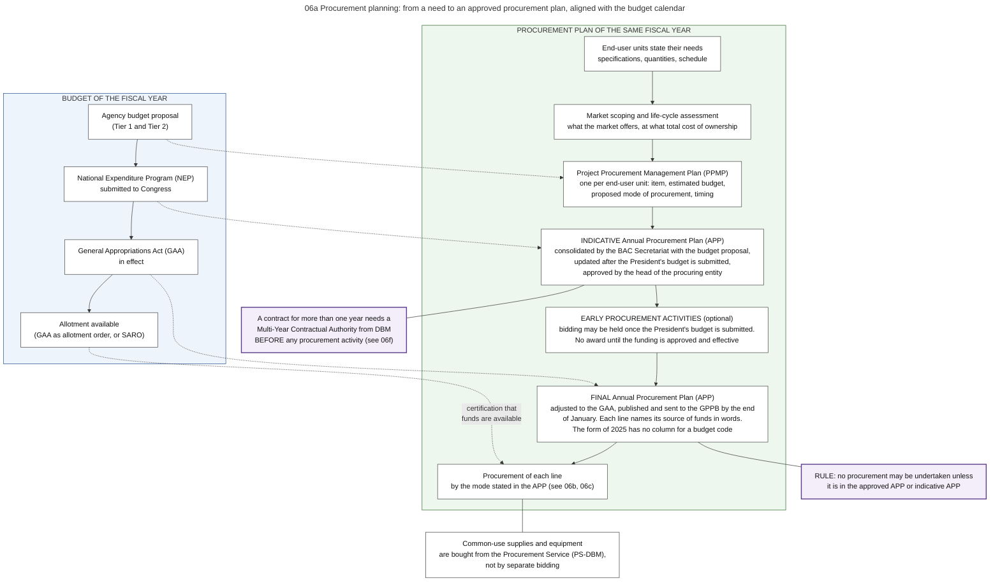
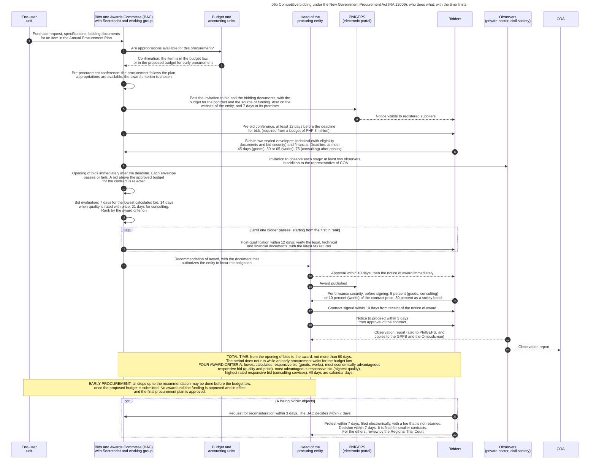
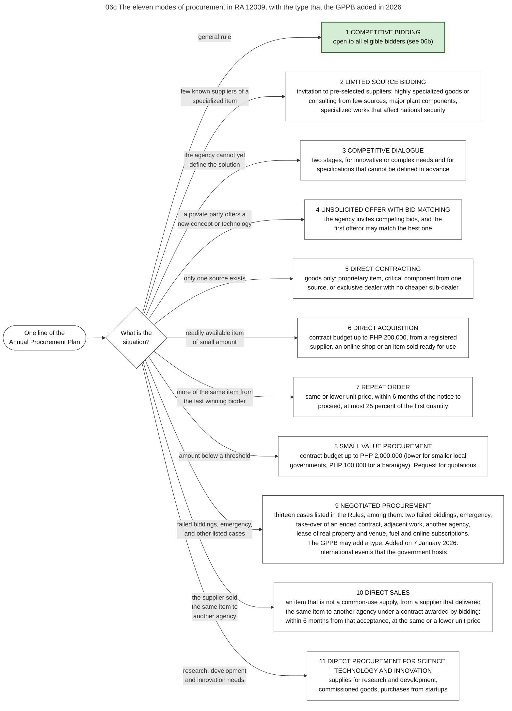
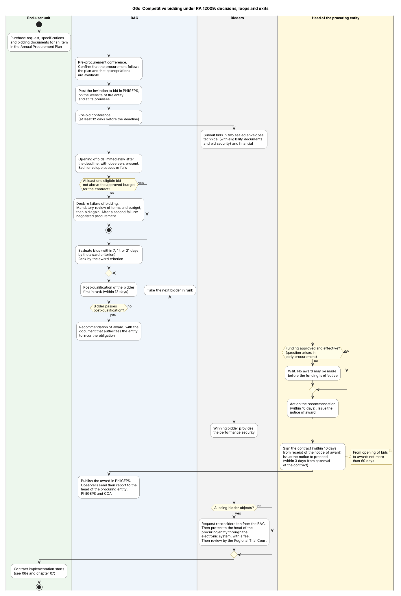
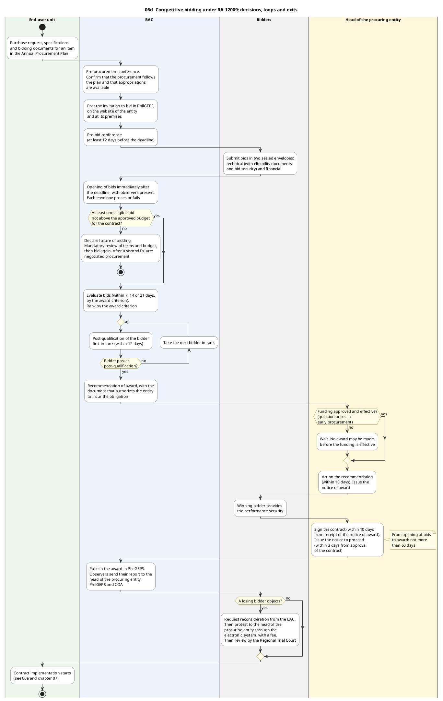
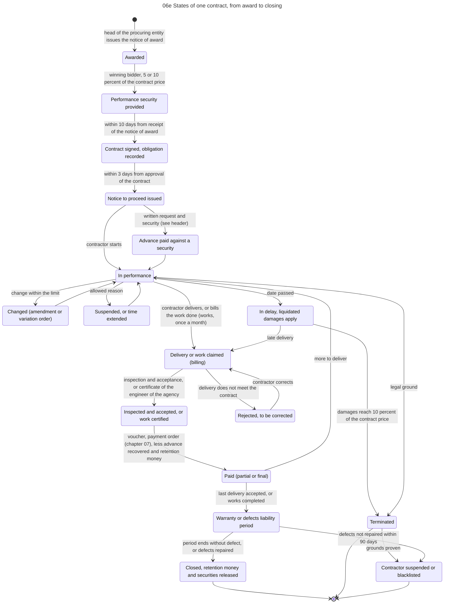
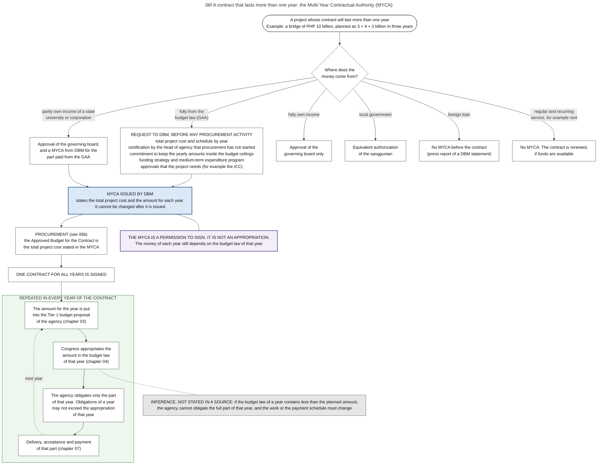
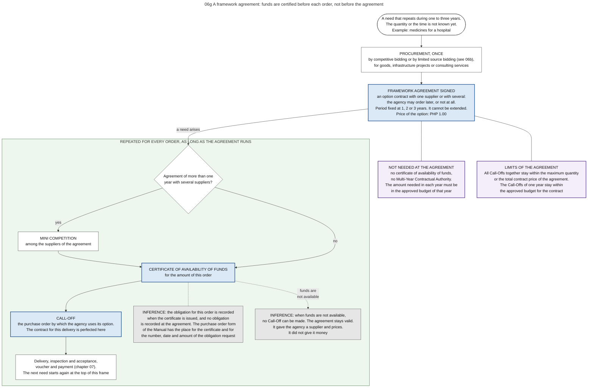

# 06. Procurement

*Part of the Philippine PFM Atlas. Facts as of 8 October 2026. The issuances of the GPPB after the Implementing Rules (sections 3.1 and 3.2, and the forms in section 5) were read on 12 October 2026. The codes in the column "Basis" are explained in [Reference F](../reference/F_sources_and_verification.md). "GK" means general knowledge that I did not open in a source during this work.*

## 1. The question this process answers

When an agency needs goods, works or services from the private sector, how does it choose the supplier, and how is this choice linked to the budget?

## 2. The idea in plain words

An agency may not buy from a supplier of its own choice without a procedure. The law requires a procedure in which suppliers compete under rules announced in advance, and in which a committee, not one person, decides. The general procedure is **competitive bidding**. Ten other modes exist for defined situations.

Procurement and the budget run at the same time, and the award needs a result from both. The agency may plan and even conduct the bidding before the budget law is in force. This is **early procurement**. But the law says: "No award of contract shall be made until the approval and effectivity of the appropriate funding" [RA12009 s.12].

A case where the procedure works: the item is in the procurement plan, the bidding is done in the last months of the year before, the budget law takes effect in January, and the contract is awarded in the same month. The agency has the whole year for delivery and payment.

A case where it fails: the bidding starts only after the allotment is released, and it fails twice because no bidder qualifies. The contract is signed in November. Delivery cannot be completed and accepted within the validity of the appropriation, and the money reverts. The budget records of the agency show an unobligated or unpaid amount, and nothing in those records says that the cause was in procurement.

Terms. The **head of the procuring entity** is the official who approves plans and awards, for an agency its head or an authorized official. The **Bids and Awards Committee (BAC)** conducts the procedure. The **Annual Procurement Plan (APP)** lists all procurement of the year. **PhilGEPS** is the electronic procurement portal. The **approved budget for the contract** is the ceiling for bids on one contract.

## 3. The law and its rules

| Fact | Basis |
|---|---|
| The law is Republic Act No. 12009, the New Government Procurement Act, of 20 July 2024. It repealed Republic Act No. 9184, with a transition period of three years | RA12009 s.115 |
| It covers goods, infrastructure projects and consulting services, from any source of funds, for national agencies, state universities, government corporations, government financial institutions and local governments | RA12009 s.4 |
| Its Implementing Rules are GPPB Resolution No. 02-2025 of 4 February 2025, published in the Official Gazette on 10 February 2025, in effect since 25 February 2025. A GPPB advisory of 31 July 2026 tells procuring entities to "use and cite only" this text | GPPB-ADV |
| I read the complete Implementing Rules, sections 1 to 117, in the text that was published on 10 February 2025. Where the Act and the Rules give different numbers of days or add conditions, the Rules decide the practice | IRR12009 |
| The Rules leave the details of each mode and of contract implementation to guidelines, manuals and standard forms of the GPPB. The standard forms were due within ninety days after the approval of the Rules, and procuring entities have a transition period of three years from the approval of the forms. Section 3.1 lists what the GPPB approved until 14 August 2026 | IRR12009 s.26.2, s.71.1.6, s.112.3, s.113.3 |
| Did the GPPB change the Rules after February 2025? The list of its resolutions to 14 August 2026 contains no resolution that amends a section of the Rules, as far as the titles show. Several resolutions add guidelines, and they declare some of these guidelines to be appendices or annexes of the Rules. One resolution of 6 October 2025 speaks of "proposed amendments" of the Rules that were then under review. I did not find a resolution that approves them | GPPB-LIST, GPPB2025-11 |
| Which law applies to an older procurement: Republic Act No. 9184 and its rules "shall be applicable in all procurement projects published prior to the effectivity of the IRR", which is 25 February 2025 | GPPB2025-05 |
| The standard forms were approved on 14 May 2025 and published on 23 June 2025. Their use is mandatory since 21 September 2025. The transition period of three years is counted from the approval of the forms: it "commenced on 14 May 2025", and procuring entities are "given until 15 May 2028" to comply fully. For a subject on which the GPPB has not yet issued a new guideline or form, entities may continue to use the one of the earlier law | GPPB2025-03, GPPB2025-05 |
| A different document must not be used: the "Implementing Rules and Regulations of Republic Act No. 12009 (1st Edition, as of 31 March 2026)", which the technical office of the GPPB had published. The GPPB withdrew it on 31 July 2026 and stated that it "should no longer be used as reference" | GPPB-ADV |

### 3.1 What the GPPB approved after the Rules

The question: the text of the Rules is of February 2025. What did the body that makes the rules add since then, and does an addition change a statement of this chapter?

How I read these documents. On 12 October 2026 I opened the page of the GPPB that lists its resolutions, and then fourteen resolutions, the two forms of the procurement plans and one advisory on their submission. For each one the tool returned a summary with short quotations, not the full text. The table gives the main rule of each resolution. Where a detail was not clear in the summary, the table says so.

| Approved | Resolution of the GPPB | What it adds | Basis |
|---|---|---|---|
| 14 May 2025 | No. 03-2025 | Standard forms, "the use of which shall be mandatory for all PEs" (PE means procuring entity): the market scoping form, the two procurement plans (section 5), the Philippine Bidding Documents for goods, for infrastructure projects and for consulting services, the contract form, the omnibus sworn statement, the declarations that may replace a bid security and a performance security, and the bid forms. Three forms are "Recommended Forms" and are not mandatory: the request for quotation, the notice of award and the abstract of bids | GPPB2025-03 |
| 18 September 2025 | No. 05-2025, with Circular No. 01-2025 | The transition: which law applies to which procurement, and from which date the new forms are mandatory (table above) | GPPB2025-05 |
| 25 September 2025 | No. 08-2025, with Circular No. 02-2025 | Guidelines for the purchase of agricultural and fishery products from accredited cooperatives and enterprises of farmers and fisherfolk, under the Sagip Saka Act, Republic Act No. 11321 (section 7) | GPPB2025-08 |
| 25 September 2025 | No. 09-2025 | The end of the earlier version of PhilGEPS and the use of the modernized version (section 9) | GPPB2025-09 |
| 25 September 2025 | No. 10-2025, with Circular No. 03-2025 | Guidelines for the Electronic Marketplace of PhilGEPS, with the modes of payment (section 9) | GPPB2025-10 |
| 6 October 2025 | No. 11-2025 | The Procurement Service receives an interim authority "to publish the BOI Registry through PhilGEPS, pending the review and approval of proposed amendments" of the Rules. BOI means beneficial ownership information. Under the Rules the GPPB keeps this registry | GPPB2025-11 |
| 25 November 2025 | No. 12-2025 | A decision tree for the choice of the mode of procurement, adopted as an annex of the Rules. It "serves only as a guide in identifying possible modes of procurement" (section 7) | GPPB2025-12 |
| 7 January 2026 | No. 01-2026 | A new type of negotiated procurement, for international events that the Philippine Government hosts. "Effective immediately." (section 7) | GPPB2026-01 |
| 15 January 2026 | No. 04-2026, with Circular No. 01-2026 | Guidelines for mode 11, direct procurement for science, technology and innovation. No monetary limit. Time limits in days: 3 for the committee, 7 for the documents of the supplier, 3 for the negotiation, 10 for the decision of the head of the procuring entity, 7 for the contract after the notice of award, 3 for the notice to proceed | GPPB2026-04 |
| 3 February 2026 | No. 10-2026, with Circular No. 06-2026 | The documents that an entity may require for each mode, declared an appendix of the Rules. "The eligibility documents enumerated in these Guidelines are exclusive". The tool reported that its reading of the table of documents was uncertain, so the atlas gives no cell of that table | GPPB2026-10 |
| 19 February 2026 | No. 08-2026, with Circulars No. 02-2026 to No. 05-2026 | The highest price that an entity may charge for bidding documents, how a tie between bidders is decided (both in section 6), printing through recognized government printers, and legal assistance and liability insurance for the members of the committee, paid from operating expenses | GPPB2026-08 |
| 23 July 2026 | No. 12-2026, with Circular No. 07-2026 | Guidelines for framework agreements (section 5) | GPPB2026-12 |
| 14 August 2026 | No. 17-2026, with Circular No. 08-2026 | Guidelines for procurement for disaster preparedness, anticipatory action, response and recovery (chapter 15, section 5.1) | GPPB2026-17 |
| 14 August 2026 | No. 20-2026, with Circular No. 09-2026 | Procurement during the election period of 2026 (section 3.2) | GPPB2026-20 |

The other resolutions on the list concern subjects that the atlas does not use: bidding documents of the public works department, trainers and the professionalization of procurement staff, information events on the new law, free trade agreements, working groups and a recognition program. Two numbers are not on the page, No. 06-2025 and No. 09-2026. The newest entry is No. 20-2026 [GPPB-LIST].

Three limits of this table. First, the page of the GPPB is long, and the tool read its first part, which holds the resolutions of 2025 and 2026. Second, I did not read a resolution approved after 14 August 2026, because the list has none. Third, most guidelines take effect fifteen days after their publication. The list gives a date of publication for some of them, and I did not compute the date of effect of each one.

### 3.2 A rule for a limited time: the election period of 2026

Elections of barangay officials and of youth councils are held on 2 November 2026. The election period is "from 3 October 2026 to 9 November 2026". A circular of the GPPB of 14 August 2026 applies the election law to procurement [GPPB2026-20]. This chapter is written inside that period.

| Rule | Dates |
|---|---|
| Procuring entities may continue their procurement activities | The whole election period |
| No release, disbursement or expenditure of public funds, "specifically the issuance of a Notice of Award", for public works and housing-related projects and for social welfare and services projects | 18 September to 1 November 2026 |
| Exceptions for public works, among them: maintenance without additional laborers, contracts awarded before 18 September 2026, preparatory work done before that date, some ongoing and foreign-assisted projects that are listed with the Commission on Elections, and emergency repair after a calamity. Routine expenses are an exception for social welfare and housing projects. The summary that I read gives more conditions for each exception | The same dates |
| Named programs of cash aid are "absolutely prohibited", except burial and medical assistance | 23 October to 2 November 2026 |
| No construction or maintenance of roads and bridges that are paid from barangay funds | 23 October to 1 November 2026 |
| A request for an exemption goes to the Commission on Elections, not to the GPPB | |

The circular names as its basis section 261, paragraphs (v) and (w), of the Omnibus Election Code and two resolutions of the Commission on Elections of 2026. I did not open them.

What this means for the main model: the rule stops the notice of award, which ends the choice of the supplier, and the release of money, for a part of the budget and for about six weeks. The body that can grant an exemption is outside PFM. A forecast of awards and payments for the fourth quarter of 2026 that does not know this rule will expect acts that the law does not allow in these weeks (Inference).

What I could not read: how the circular treats a payment that is due in this period on a contract that was awarded before it, for projects other than public works. The summary did not state it.

## 4. Authorities and their roles

| Authority | Role in this process | Basis |
|---|---|---|
| Head of the procuring entity | Approves the procurement plans. Approves or disapproves the recommendation of the BAC within 10 calendar days. Signs the contract and issues the notice to proceed. Decides protests within 7 calendar days. May not be a member of the BAC | IRR12009 s.7.7, s.66.2, s.84.1, s.41.2.5 |
| Bids and Awards Committee (BAC) | Five or seven officials, designated for one year and for not more than three terms in a row. One member represents the finance area. It conducts the conferences, receives and opens bids, evaluates, post-qualifies and recommends the award. Every six months it prepares a procurement monitoring report, which the head sends to the GPPB | IRR12009 s.41.2, s.42.1 |
| Chief accountant, and the treasurer in a local government | Certifies that funds are available before the contract (chapter 07). For that reason this officer "cannot be a regular member of the BAC" | IRR12009 s.41.2.5, PD1445 s.86 |
| Procurement unit, as BAC Secretariat | Supports the committee. Consolidates the plans of the units and prepares the Annual Procurement Plan | IRR12009 s.44 |
| End-user unit | States the need, scopes the market and prepares its procurement plan and the specifications | IRR12009 s.7.7.1, s.10 |
| Budget and accounting units | Supply the facts on funding. The pre-procurement conference confirms that appropriations are available. The recommendation of award carries the document that authorizes the entity "to incur obligations for a specified amount" | IRR12009 s.49.1, s.66.1 |
| Observers | At least two for each proceeding, in addition to the representative of COA: one from a private group of the sector and one from a civil society organization. They have no vote. They report to the head of the procuring entity, to PhilGEPS and to COA, with copies to the GPPB and the Ombudsman | IRR12009 s.43 |
| Bidders | Register in PhilGEPS and hold its certificate of registration. Submit bids and securities. Disclose their beneficial owners, which the GPPB keeps in an online registry that is open to the public. Since October 2025 the Procurement Service has an interim authority to publish this registry through PhilGEPS (section 3.1) | IRR12009 s.20.2.9, s.52.1, s.56, s.68, s.82.2 |
| Procurement Service (PS-DBM) | Manages PhilGEPS. All agencies buy common-use supplies and equipment only from it, when it has them | IRR12009 s.20.1.1, s.40.1 |
| Government Procurement Policy Board (GPPB) | Sets the rules and may make rules to connect databases. Chair: the Secretary of Budget and Management. Alternate chair: the head of the planning department. Members: the secretaries for public works, defense, education, interior and local government, and transportation, a representative of PS-DBM and one of the private sector. Its Technical Support Office is attached to DBM | IRR12009 s.91.2, s.91.3, s.23 |
| COA | Sends a representative to the proceedings. May verify the security and integrity of PhilGEPS at any time, and may be invited to the GPPB as resource person. Audits the contract and its payments after payment | IRR12009 s.43.1, s.22.1, s.91.2, COA2011-002 |

## 5. Planning

Diagram 06a shows how the procurement plan follows the budget.

| Stage of the budget | Stage of the procurement plan | Basis |
|---|---|---|
| Agency budget proposal | Each end-user unit states its needs, with market scoping and life-cycle assessment, in a Project Procurement Management Plan: buy or do the work with own staff, kind and quantity, mode, schedule, estimated budget, specifications. The BAC Secretariat consolidates the plans of the units into the indicative Annual Procurement Plan | RA12009 s.10, s.13, IRR12009 s.7, s.10 |
| National Expenditure Program submitted to Congress | The units revise their plans to the proposed amounts. The updated indicative plan is approved by the head of the procuring entity. Early procurement may start | RA12009 s.7, s.12, IRR12009 s.7, s.12 |
| General Appropriations Act in effect | Final Annual Procurement Plan, adjusted to the law, approved by the head of the procuring entity, published and sent to the GPPB by the end of January of the budget year. Each line names its source of funds in words (see the part on the forms of the two plans, below) | RA12009 s.7, IRR12009 s.7, APP-FORM2025 |
| Allotment available | Certification of availability of funds for each procurement. Award becomes possible | RA12009 s.49, s.12 |

Rule: no procurement may be undertaken unless it is in the approved Annual Procurement Plan or the indicative plan [RA12009 s.7]. The Rules add: "All procurement should be within the approved budget of the Procuring Entity" [IRR12009 s.7]. The plans of the units may be changed as often as needed during the year, and each approved change is entered in the Annual Procurement Plan [IRR12009 s.7].

### The forms of the two plans, and what links them to the budget

The GPPB approved standard forms for both plans on 14 May 2025. Their use is mandatory since 21 September 2025, and an advisory of 13 January 2026 requires the new form for the plan of 2026 [GPPB2025-03][GPPB2025-05][GPPB-TSO2026-2]. I read the column labels and the guide of both forms through a tool. The text that the tool returned was garbled in parts, so the table below should be compared with the printed forms. For the form of the annual plan I read two copies, and they agree.

| Form | Columns that concern the budget | Signatures | Basis |
|---|---|---|---|
| Project Procurement Management Plan, of each end-user unit | "Source of Funds", which must be "consistent with the agency's approved budget documents". "Estimated Budget / Authorized Budgetary Allocation (PhP)": the estimated budget in an indicative plan, the authorized allocation in a final plan | Prepared by the end-user unit and submitted by its head. No line on which a budget officer or an accountant certifies | PPMP-FORM2025 |
| Annual Procurement Plan, of the procuring entity | "Source of Funds". The guide names as examples the budget law, current or continuing, a corporate operating budget, an appropriation ordinance, internally generated income, a special purpose fund, a trust fund and a foreign-assisted fund. One sample entry is "GAA 2026 - Current Appropriation". "Estimated Budget / Approved Budget for the Contract (PhP)", which is based on the approved plan of the end-user unit. The other columns: project title, end-user unit, description, mode of procurement, early procurement (yes or no), criteria for bid evaluation, start and end of the procurement activity, procurement strategy or tools, remarks | Prepared by the BAC Secretariat, recommended by the chairperson of the committee, approved by the head of the procuring entity. No line that certifies funds | APP-FORM2025 |

What the two forms do not have: a column for a code of the budget classification. The tool found none of the words code, UACS, PAP and allotment class in either form. The form of 2015 began with a column "Code (PAP)", and the circular that prescribed it does not explain which code is meant [APP-FORM]. In the present forms the link is a text and an amount. A reader who wants to match a line of the plan with a line of the budget law must compare words and amounts. Chapter 17, section 6, shows what this means for the chain of numbers.

Two parts of the annual plan are not listed line by line. Common-use supplies that the entity will buy from the Procurement Service appear as a total amount. Small purchases by direct acquisition appear as miscellaneous items [APP-FORM2025].

Submission. The approved final plan goes to the GPPB by the end of January, and an updated plan follows after each semester. Since 2026 the entity submits through an online form: it gives a link to a folder that holds the plan, the procurement monitoring report and a certificate that the plan was posted on its website. The advisory says: "APP and PMR submitted via email shall no longer be accepted". The monitoring report still uses the form of the earlier law, until the GPPB issues a new one [GPPB-TSO2026-2].

### Early procurement

The Rules state four conditions [IRR12009 s.12].

| Condition | Section |
|---|---|
| The agency may start, but may not award, for goods, works or consulting services to be delivered in the next fiscal year, once the President's budget (or the local expenditure program, or the proposed corporate budget) is submitted | 12.1 |
| The head of the procuring entity must have approved the indicative Annual Procurement Plan | 12.2 |
| The budget for the contract may not exceed the amount in the indicative plan | 12.3 |
| No award until the funding is approved and in effect, and until the head of the procuring entity has approved the final plan. For a project that needs land: no award until the agency has a permit to enter, a deed of sale or donation, or a writ of possession | 12.4, 12.5 |

### Contracts for more than one year

An appropriation is valid for one year, but many contracts last longer. Diagram 06f shows what is needed. The question it answers: what allows an agency to sign one contract for several years, and where does the money of each year come from?

The answer has two parts. The **Multi-Year Contractual Authority (MYCA)** is a permission of DBM to sign. The budget law of each year provides the money of that year. The first does not replace the second.

| Rule | Basis |
|---|---|
| A MYCA "or similar documents shall be required before Procuring Entities commence any procurement activity" for a multi-year contract paid from local funds. DBM issues it. Its total project cost is the basis of the budget for the contract | IRR12009 s.9.1, s.5 |
| The request states the total project cost and the period. With it: a certification by the head of agency that procurement has not started, a commitment to keep the yearly amounts inside the budget ceilings, a funding strategy and a medium-term expenditure program, and the approvals that the project needs | CL2025-6 |
| A MYCA cannot be changed after it is issued | CL2025-6 |
| The yearly amounts go into the Tier 1 budget proposal of the agency. DBM evaluates them by the capacity of the agency to implement | CL2025-6 |
| Note printed on the MYCA form: "the actual obligations to be incurred in any given fiscal year shall in no case exceed the cash appropriation" of that year | CL2025-6 |
| State universities, government corporations and government financial institutions: when the project is paid partly from their own income, approval of the governing board and a MYCA for the part paid from the budget law. When it is paid fully from own income, approval of the governing board only | IRR12009 s.9.1, CL2025-6 |
| Local governments: an equivalent authorization of the sanggunian | IRR12009 s.9.1 |
| Regular and recurring services, for example rent and telecommunications, no longer need a MYCA. Their contracts may be renewed if funds are available | CL2025-6, IRR12009 s.18 |
| Projects financed by foreign loans do not need a MYCA before the contract is signed | GMA-MYCA (press report of a DBM statement) |

A case where it works: a bridge of PHP 10 billion is planned as 3, 4 and 3 billion in three years. DBM issues a MYCA for 10 billion. The agency signs one contract, and each budget law contains the amount of its year (example given by DBM [GMA-MYCA]).

A case where it fails: the budget law of the second year contains 2 billion, not 4. The MYCA is still valid, but the agency may obligate only 2 billion in that year. No source that I read says what the agency must then do with the contract (Inference).

### Framework agreements

The question: how can an agency fix the supplier and the prices now, when it does not know yet how much it will need, or when?

The Rules allow a **framework agreement**. It is "in the nature of an option contract" that states the terms of later contracts with one supplier or with several, "subject to the guidelines to be issued by the GPPB" [IRR12009 s.16]. The agency receives a right to order. It has no duty to order. The GPPB approved the guidelines on 23 July 2026. Diagram 06g shows the order of the acts.

| Rule of the guidelines | Basis |
|---|---|
| The agreement is procured by competitive bidding or by limited source bidding, for goods, infrastructure projects or consulting services | GPPB2026-12 |
| Its period is fixed at one, two or three years and cannot be extended | GPPB2026-12 |
| No Multi-Year Contractual Authority is needed before the agreement. The amount that is needed in each year must be in the approved budget of that year | GPPB2026-12 |
| The certificate of availability of funds (CAF) "shall not be required prior to the execution of a Framework Agreement." | GPPB2026-12 |
| An order under the agreement is named a Call-Off. It is the purchase order by which the agency uses its option. "The issuance of the CAF shall be required for every Call-Off." | GPPB2026-12 |
| The contract for a delivery is perfected at each Call-Off, not at the agreement. The price of the option is PHP 1.00 | GPPB2026-12 |
| When an agreement of more than one year has several suppliers, a competition among them, named a Mini Competition, comes before each Call-Off | GPPB2026-12 |
| All Call-Offs together stay within the maximum quantity or the total contract price of the agreement. The Call-Offs of one year stay within the approved budget for the contract | GPPB2026-12 |

What this changes in the main model. For an ordinary contract the certificate of funds comes once, before the contract (chapter 07). For a framework agreement it comes before each order. The form of the purchase order in the Manual has the place for this certificate, with the number, the date and the amount of the obligation request [GAM-V2 App.61]. The atlas concludes that the obligation is recorded for each Call-Off, and that the agreement itself is not an obligation in the budget records. This is an inference: I read the guidelines as a summary, and the summary does not name the obligation request.

A case where it works: a hospital needs medicines during the whole year and cannot say in January how many. It signs an agreement with fixed unit prices. In each quarter it orders what it needs, and each order has its own certificate of funds, within the allotment of that time.

A case where it fails: the need arises when the allotment is fully obligated, or before it is released. No certificate can be issued, so no Call-Off can be made, although the agreement is valid. The agreement gave the agency a supplier and prices. It did not give it money (Inference from the two rules on the certificate).

## 6. Steps of competitive bidding

The steps are those of diagram 06b. Diagram 06d shows the same procedure with its decision points and loops.

| No. | Who acts | Towards whom | What is done or passed | Basis |
|---|---|---|---|---|
| 1 | End-user unit | Bids and Awards Committee (BAC) with Secretariat and working group | Purchase request, specifications, bidding documents for an item in the Annual Procurement Plan | IRR12009 s.7.8. Purchase request: GAM-V2 App.60 |
| 2 | Bids and Awards Committee (BAC) with Secretariat and working group | Budget and accounting units | Are appropriations available for this procurement? | IRR12009 s.49.1. Who asks whom: GK |
| 3 | Budget and accounting units | Bids and Awards Committee (BAC) with Secretariat and working group | Confirmation: the item is in the budget law, or in the proposed budget for early procurement | IRR12009 s.49.1. Who asks whom: GK |
| 4 | Bids and Awards Committee (BAC) with Secretariat and working group | (own action) | Pre-procurement conference: the procurement follows the plan, appropriations are available, the award criterion is chosen | IRR12009 s.49.1, s.49.2 |
| 5 | Bids and Awards Committee (BAC) with Secretariat and working group | PhilGEPS (electronic portal) | Post the invitation to bid and the bidding documents, with the budget for the contract and the source of funding. Also on the website of the entity, and 7 days at its premises | IRR12009 s.50.2, s.50.3 |
| 6 | PhilGEPS (electronic portal) | Bidders | Notice visible to registered suppliers | IRR12009 s.20.2.1 |
| 7 | Bids and Awards Committee (BAC) with Secretariat and working group | Bidders | Pre-bid conference, at least 12 days before the deadline for bids (required from a budget of PHP 3 million) | IRR12009 s.51 |
| 8 | Bidders | Bids and Awards Committee (BAC) with Secretariat and working group | Bids in two sealed envelopes: technical (with eligibility documents and bid security) and financial. Deadline: at most 45 days (goods), 50 or 65 (works), 75 (consulting) after posting | IRR12009 s.54.1, s.54.5, s.52.1, s.56.2 |
| 9 | Bids and Awards Committee (BAC) with Secretariat and working group | Observers (private sector, civil society) | Invitation to observe each stage: at least two observers, in addition to the representative of COA | IRR12009 s.43.1 |
| 10 | Bids and Awards Committee (BAC) with Secretariat and working group | (own action) | Opening of bids immediately after the deadline. Each envelope passes or fails. A bid above the approved budget for the contract is rejected | IRR12009 s.58, s.59, s.60.1 |
| 11 | Bids and Awards Committee (BAC) with Secretariat and working group | (own action) | Bid evaluation: 7 days for the lowest calculated bid, 14 days when quality is rated with price, 21 days for consulting. Rank by the award criterion | IRR12009 s.61.2.5, s.61.7, s.62 |
| 12 | Bids and Awards Committee (BAC) with Secretariat and working group | Bidders | Post-qualification within 12 days: verify the legal, technical and financial documents, with the latest tax returns | IRR12009 s.63 |
| 13 | Bids and Awards Committee (BAC) with Secretariat and working group | Head of the procuring entity | Recommendation of award, with the document that authorizes the entity to incur the obligation | IRR12009 s.66.1 |
| 14 | Head of the procuring entity | Bidders | Approval within 10 days, then the notice of award immediately | IRR12009 s.66.2, s.66.3 |
| 15 | Head of the procuring entity | PhilGEPS (electronic portal) | Award published | GK |
| 16 | Bidders | Head of the procuring entity | Performance security, before signing: 5 percent (goods, consulting) or 10 percent (works) of the contract price, 30 percent as a surety bond | IRR12009 s.68 |
| 17 | Head of the procuring entity | Bidders | Contract signed within 10 days from receipt of the notice of award | IRR12009 s.66.5 |
| 18 | Head of the procuring entity | Bidders | Notice to proceed within 3 days from approval of the contract | RA12009 s.66 |
| 19 | Observers (private sector, civil society) | Head of the procuring entity | Observation report (also to PhilGEPS, and copies to the GPPB and the Ombudsman) | IRR12009 s.43.4 |
| 20 | Observers (private sector, civil society) | COA | Observation report | IRR12009 s.43.4 |
| 21 | Bidders | Bids and Awards Committee (BAC) with Secretariat and working group | Request for reconsideration within 3 days. The BAC decides within 7 days | IRR12009 s.83 |
| 22 | Bidders | Head of the procuring entity | Protest within 7 days, filed electronically, with a fee that is not returned. Decision within 7 days. It is final for smaller contracts. For the others: review by the Regional Trial Court | IRR12009 ss.83-85 |

### Time limits

All days are calendar days.

| Step | Limit | Basis |
|---|---|---|
| Posting of the invitation | Continuously in PhilGEPS and on the website of the entity, and 7 days at its premises. 3 days for some other modes | IRR12009 s.50.3 |
| Pre-bid conference | At least 12 days before the deadline for bids. Required when the budget for the contract is PHP 3 million or more | IRR12009 s.51 |
| Receipt of bids | Not later than 45 days after the last day of posting for goods, 50 days for works of PHP 50 million and below, 65 days for larger works, 75 days for consulting services | IRR12009 s.54.5 |
| Opening of bids | Immediately after the deadline | IRR12009 s.58 |
| Bid evaluation | 7 days for the lowest calculated bid. 14 days when quality is rated together with price. 21 days for consulting services | IRR12009 s.61.2.5, s.61.7, s.62 |
| Post-qualification | The bidder submits its documents within 5 days. The committee completes the check within 12 days. An extension to not more than 45 days is possible for goods and works, and to 30 days for consulting | IRR12009 s.63 |
| Decision of the head of the procuring entity on the recommendation | 10 days | IRR12009 s.66.2 |
| Performance security and contract signing | Within 10 days from the receipt of the notice of award | IRR12009 s.66.5 |
| Notice to proceed | Within 3 days from approval of the contract. The Rules do not repeat this period | RA12009 s.66 |
| From opening of bids to award | Not more than 60 days. The GPPB may adjust this to not more than 90 days. The period does not run while an early procurement waits for the budget law | IRR12009 s.67 |
| Validity of a bid | Not more than 120 days from the opening | IRR12009 s.57 |

### Award criteria

The pre-procurement conference chooses one of four criteria [IRR12009 s.49.2].

| Criterion | Used for | Basis |
|---|---|---|
| Lowest calculated responsive bid | Goods and infrastructure projects: the lowest financial bid that meets the requirements | IRR12009 s.49.2, s.61 |
| Most economically advantageous responsive bid | Goods and infrastructure projects in which quality is rated together with price. The weight of price is between 15 and 40 percent | IRR12009 s.49.2, s.61.3 |
| Most advantageous responsive bid | Goods and infrastructure projects in which the bid with the highest rated quality wins | IRR12009 s.49.2 |
| Highest rated responsive bid | Consulting services | IRR12009 s.49.2, s.62 |
| Ceiling | The approved budget for the contract is "the upper limit or ceiling for acceptable bid prices". There is no lower limit | IRR12009 s.60.1 |

### Eligibility and securities

| Subject | Rule | Basis |
|---|---|---|
| Eligibility | The certificate of registration in PhilGEPS, a statement of ongoing contracts, and proof of one completed contract of at least 50 percent of the budget for the contract within ten years. A measure of financial capacity that must at least equal the budget for the contract, or a committed line of credit | IRR12009 s.52 |
| Bid security | 2 percent of the budget for the contract in cash or a cashier's check, 5 percent as a bank draft, bank guarantee, letter of credit or surety bond, or a signed declaration instead of a security | IRR12009 s.56.2 |
| Performance security | Before the contract is signed. In cash, check, bank draft, bank guarantee or letter of credit: 5 percent of the contract price for goods and consulting services, 10 percent for infrastructure projects. As a surety bond: 30 percent. It stays in force until the certificate of final acceptance | IRR12009 s.68 |
| Failure of bidding | Declared when no bid arrives, when no bidder is eligible or responsive, or when the winner refuses the contract. A review is mandatory before the second bidding. After two failed biddings, negotiated procurement is allowed, and the budget for the contract may then be raised by not more than 20 percent | IRR12009 s.64, s.35.1 |
| One bid only | A single responsive bid may be awarded | IRR12009 s.65 |
| A tie between bidders after post-qualification | The tie is decided by a method that is "non-discretionary, non-discriminatory, and based solely on chance", for example by drawing lots. The bidding documents state the method | GPPB2026-08 |
| Price of the bidding documents | A highest price for each range of the budget for the contract: PHP 500 for a budget of PHP 500,000 and below, 1,000 up to 1 million, 5,000 up to 5 million, 10,000 up to 10 million, 25,000 up to 50 million, 50,000 up to 500 million, and 75,000 above 500 million | GPPB2026-08 |
| Documents that an entity may require | A circular of 3 February 2026 lists them for each mode. It says: "The eligibility documents enumerated in these Guidelines are exclusive". An expired permit of the mayor with the receipt for its renewal is accepted, and the valid permit must follow after the award and before payment | GPPB2026-10 |

## 7. The eleven modes

Diagram 06c lists the modes. The names and the number of modes are in sections 26 to 37 of the Act and in section 26.1 of the Implementing Rules. The conditions are from sections 27 to 37 of the Rules. The table gives the main condition of each mode, not the full legal text.

On 25 November 2025 the GPPB adopted a decision tree for the choice of the mode, as an annex of the Rules. The resolution says that the tree "serves only as a guide in identifying possible modes of procurement" and that its results "do not constitute a definitive determination" of the mode [GPPB2025-12]. I did not see the tree, because it was not in the text that the tool returned. Diagram 06c is my own arrangement of the modes. It is not that tree.

| No. | Mode | Main condition | Basis |
|---|---|---|---|
| 1 | Competitive Bidding | The general rule, open to all eligible bidders. Steps: publication, pre-bid conference, eligibility screening, opening, evaluation, post-qualification, award | IRR12009 s.27 |
| 2 | Limited Source Bidding | Invitation to pre-selected suppliers with proven capability, for highly specialized goods or consulting services from few sources, for major plant components, or for highly specialized works that affect national security | IRR12009 s.28 |
| 3 | Competitive Dialogue | Two stages. For innovative or complex purchases, for contracts that need prior negotiation, or when the specifications cannot be defined in advance | IRR12009 s.29 |
| 4 | Unsolicited Offer with Bid Matching | A supplier offers a new concept or technology. The agency invites competing bids, and the first offeror may match the best one. Evaluation within 60 days, which the head of the procuring entity may extend by 30 days | IRR12009 s.30 |
| 5 | Direct Contracting | Goods only: a proprietary item, a critical component from a specific source, or an exclusive dealer with no sub-dealer at a lower price and no suitable substitute | IRR12009 s.31 |
| 6 | Direct Acquisition | Supplies not available from the Procurement Service, other items and services, with a budget for the contract of not more than PHP 200,000. From a supplier registered in PhilGEPS, from an electronic shop, or an item sold ready for use | IRR12009 s.32 |
| 7 | Repeat Order | More of the same goods from the last winning bidder: unit price equal or lower, within 6 months of the notice to proceed, not more than 25 percent of the first quantity of each item | IRR12009 s.33 |
| 8 | Small Value Procurement | Budget for the contract of not more than PHP 2,000,000. At least three quotations are requested, and one is enough to proceed. Publication for 3 days when the budget is above PHP 200,000 | IRR12009 s.34 |
| 9 | Negotiated Procurement | Thirteen cases listed in the Rules, and types that the GPPB adds (tables below) | IRR12009 s.35 |
| 10 | Direct Sales | An item that is not a common-use supply, from a supplier that delivered the same item in a satisfactory way to another government agency under a contract awarded by bidding. Within 6 months from that acceptance, at the same or a lower unit price | IRR12009 s.36 |
| 11 | Direct Procurement for Science, Technology and Innovation | Supplies for research and development, commissioned goods, and purchases from startups. Guidelines of the GPPB of 15 January 2026 set no monetary limit and give a time limit for each step (section 3.1) | IRR12009 s.37, GPPB2026-04 |

The limit for small value procurement is lower for smaller local governments [IRR12009 s.34].

| Local government | Income class | Limit |
|---|---|---|
| Province | 1st to 3rd, 4th, 5th | PHP 2,000,000, 1,600,000, 1,200,000 |
| City | 1st and 2nd, 3rd, 4th, 5th | PHP 2,000,000, 1,600,000, 1,200,000, 800,000 |
| Municipality | 1st to 3rd, 4th and 5th | PHP 400,000, 200,000 |
| Barangay | All | PHP 100,000 |

The GPPB may review these amounts. The committee for bids may delegate modes 5 to 11 to the end-user unit or to the procurement unit [IRR12009 s.26.4, s.34].

The thirteen cases of negotiated procurement [IRR12009 s.35].

| No. | Case | Point that concerns payment or the budget |
|---|---|---|
| 35.1 | Two failed biddings | The budget for the contract may be raised by not more than 20 percent of the budget of the last failed bidding |
| 35.2 | Emergency | The procurement plan is revised afterwards, after the proper office confirms "that there are funds in the budget" |
| 35.3 | Take-over of a contract that was ended | |
| 35.4 | Work adjacent or contiguous to an ongoing project | |
| 35.5 | Agency to agency | A memorandum of agreement with the agency that serves |
| 35.6 | Scientific, scholarly or artistic work, exclusive technology and media services | |
| 35.7 | Highly technical consultants | |
| 35.8 | Defense cooperation agreements and inventory-based items | |
| 35.9 | Lease of real property and venue | |
| 35.10 | Participation of a non-governmental organization | Only when an appropriation law sets an amount aside for such organizations. The organization keeps separate bank accounts and records, which the procuring entity and COA may examine |
| 35.11 | Community participation: direct purchase of goods, among them agricultural and fishery products from local farmers and fisherfolk, and simple works negotiated with local communities | |
| 35.12 | United Nations agencies, international organizations and international financing institutions | |
| 35.13 | Direct retail purchase of fuel, oil and lubricants, charging of electric vehicles, and online subscriptions | "Payment may be made through cash advance, reimbursement or other allowable payment modalities". An online subscription may be paid by a government purchase card or by direct electronic payment with a credit card |

The list of section 35 can grow. The Rules end it with a power of the GPPB: it "may provide an amendment to the above enumeration or make an additional type of Negotiated Procurement", under four conditions. One of them is a finding that the existing modes "will be impossible or defeats the purpose of the procurement" [IRR12009 s.35].

Two more types stand in issuances of the GPPB. I read both as summaries.

| Type | Issuance | Content | Point that concerns payment or the budget | Basis |
|---|---|---|---|---|
| International events, conferences and summits that the Philippine Government hosts | Resolution No. 01-2026 of 7 January 2026. It names the power of section 35 as its basis and is "Effective immediately." | Lease of hotels, venues and office space, and goods and services such as audio-visual systems, event management and transportation. After the procurement plan is approved, a request for quotation or a pro-forma invoice goes to the identified supplier. A simplified negotiation follows, and the head of the procuring entity approves the award. Posting, a performance security and retention money are optional | The resolution has no rule on budget, funds or payment, and states no limit of amount | GPPB2026-01 |
| Agricultural and fishery products from accredited cooperatives and enterprises of farmers and fisherfolk. The guidelines name the mode Negotiated Procurement-Sagip Saka | Resolution No. 08-2025 with Circular No. 02-2025 of 25 September 2025, under the Sagip Saka Act, Republic Act No. 11321. The resolution declares the guidelines an appendix of the Rules | The supplier is registered in a registry of the agriculture department or in an equivalent one. The opportunity is posted for at least three calendar days. One proposal is enough. The committee verifies within seven calendar days. I found no limit of amount | The budget office validates the budget before the item enters the procurement plan. The price is set "at a level higher than the prevailing farmgate price". The supplier acknowledges the payment by signing the disbursement voucher, which then also serves as the delivery invoice. A supplier that is able to issue invoices must issue them | GPPB2025-08 |

Whether the second type is a form of case 35.11 or a separate type is not stated in what I read. Case 35.11 names the same products. The tool reported that it found no provision of the procurement law that the guidelines name as the basis of the mode, and that the exemption from bidding is in section 11 of the Sagip Saka Act. A circular of 3 February 2026 on documentary requirements names both types beside the cases of the Rules [GPPB2026-10].

Three rules apply to all modes. Splitting a contract to stay below a threshold is prohibited [IRR12009 s.39]. Small purchases by direct acquisition that are paid from the petty cash fund or by reimbursement are entered in the procurement plan as miscellaneous items, and the use of the petty cash fund follows a circular of COA [IRR12009 s.32.2]. The proceedings of larger biddings are recorded on video, the opening of bids is shown live, and the recordings are kept for at least five years [IRR12009 s.38].

## 8. After the award

Diagram 06e shows the states of a contract. The rules below are from Rule XI of the Implementing Rules and from its sections on warranty and sanctions. Chapter 07, section 7.2, follows the payments of one works contract with amounts.

| Event | Goods | Infrastructure projects | Basis |
|---|---|---|---|
| Change of the contract | Amendment to order: an increase of not more than 10 percent of the original contract price. The head of the procuring entity may approve up to 20 percent | Variation order: the total increase may not exceed 10 percent of the original contract price. In exceptional cases the head may authorize more than 10 and not more than 20 percent | IRR12009 s.71.1.1, s.71.2.1 |
| Advance payment | Not more than 15 percent of the contract amount against an irrevocable letter of credit or bank guarantee of the same amount, paid within 60 days from the signing. Not more than 15 percent for goods needed in a declared state of calamity. Not more than 50 percent for hotel and restaurant services, venues and lease of office space | Not more than 15 percent of the total contract price, in one sum or at most two instalments, only on the written request of the contractor and against an irrevocable standby letter of credit, a bank guarantee, or a surety bond | IRR12009 s.71.1.5, s.71.2.5 |
| Progress payment | "All progress payments shall first be charged against the advance payment until the latter has been fully exhausted" | Once a month the contractor may submit a statement of work accomplished. The engineer of the procuring entity checks it and certifies the amount. Materials and equipment that were delivered to the site and are not yet part of the works are not paid, unless the instructions to bidders say otherwise | IRR12009 s.71.1.5, s.71.2.7 |
| Retention money | For the warranty: 1 to 5 percent of every progress payment, or a special bank guarantee of 1 to 5 percent of the total contract price | 10 percent of each progress payment, counted on the amount due before any deduction, until 50 percent of the works are completed. It is due for release upon final acceptance of the works | IRR12009 s.90.1, s.71.2.8 |
| Delay | Damages of one tenth of one percent of the cost of the delayed goods for every day of delay | Damages of at least one tenth of one percent of the cost of the unperformed portion for every day of delay | IRR12009 s.71.1.4, s.71.2.4 |
| End of the contract for delay | The procuring entity may rescind the contract when the damages reach 10 percent of the total contract price | The same | IRR12009 s.71.1.4, s.71.2.4, s.97 |
| Right of the contractor to suspend | | After 15 days of notice, among other grounds for a delay in the payment of a progress billing "beyond forty-five (45) calendar days" after the claim was certified as complete | IRR12009 s.71.2.2 |
| Termination | For default (a failure of at least 10 percent of the contract price), for the convenience of the procuring entity, for unlawful acts, and for events beyond control. One ground of convenience: "Funding for the project has been withheld or reduced by higher authorities through no fault of the Procuring Entity" | For default (for example a delay of 15 percent or more against the schedule while the contract runs, or abandonment), for unlawful acts, for events beyond control, and by the contractor when the works are stopped for at least 60 days through no fault of its own | IRR12009 s.71.4 |
| Warranty | A warranty security for at least 3 months for expendable supplies and at least 1 year for other supplies, counted from acceptance | A defects liability period of one year from completion to final acceptance. After final acceptance a warranty against structural defects: 15 years for permanent structures, 5 years for semi-permanent ones, 2 years for others | IRR12009 s.90 |
| Price | Bid prices are fixed prices. For an infrastructure project a price escalation is possible only with prior approval of the GPPB, when the cost of a component rises by more than 10 percent | The same | IRR12009 s.89 |

Sanctions against suppliers: suspension for one year for a first offense and two years for a second, blacklisting for one or two years, and blacklisting without end for a third offense or for defects that are not repaired within ninety days. The order is uploaded to a portal of the GPPB within seven days [IRR12009 ss.98-105].

Three points connect this section with the budget and with payment.

- The rule on a delayed payment gives the contractor a right against the agency. When the cash authority is not sufficient at the end of a quarter (chapter 05), a certified bill can stay unpaid for more than 45 days, and the contractor may then suspend the work.
- The funding is a ground in two places. The head of the procuring entity may decline to award when "the source of funds for the project has been withheld or reduced through no fault of the Procuring Entity" [IRR12009 s.70]. After the award, the same fact is a ground to terminate a contract for goods or consulting services for convenience [IRR12009 s.71.4].
- For the retention money of works, the Rules of 2025 and the example of the Manual of 2015 count on different amounts (chapter 07, section 7.2).

Diagram 07g shows what follows when a delivery is not accepted or a contract is ended.

## 9. Documents, identifiers and systems

| Document | Identified by | System | Basis |
|---|---|---|---|
| Purchase request | Number of the request, with the responsibility center code | Agency records | GAM-V2 App.60 |
| Project Procurement Management Plan | Number of the plan, fiscal year, end-user unit | Agency records | IRR12009 s.7, PPMP-FORM2025 |
| Annual Procurement Plan line | Line of the plan, with the title of the project and the source of funds in words. The form of 2025 has no budget code | Agency records. Published on the website of the agency and sent to the GPPB through an online form | APP-FORM2025, GPPB-TSO2026-2, IRR12009 s.7 |
| Multi-Year Contractual Authority | MYCA number. The form also has the organization code, the name of the project, the fund source code and the amount for each year | DBM | CL2025-6 |
| Invitation to bid, bidding documents, award | PhilGEPS reference number (GK). The invitation states the budget for the contract and the source of funding | PhilGEPS, and the website of the entity | IRR12009 s.50.2, s.50.3 |
| Contract or purchase order | Contract or order number. The form of the purchase order also carries the number, date and amount of the obligation request, and the mode of procurement | Agency records. In BTMS the purchase order is a record from which the obligation request can be created | GAM-V2 App.61, BTMS-SITE |
| Observers' report | Procurement | Sent to the head of the procuring entity, PhilGEPS and COA, with copies to the GPPB and the Ombudsman | IRR12009 s.43.4 |
| Statement of work accomplished | Contract, billing period | Agency records. Certified by the engineer of the procuring entity | IRR12009 s.71.2.7 |

PhilGEPS is by law the single electronic portal for procurement, and the Rules say that it "shall maintain an integrated system that covers procurement planning until payment" [IRR12009 s.20.1.1]. The Rules list its features: bulletin board, electronic catalogue, virtual store, electronic marketplace, electronic bidding, electronic small value procurement, electronic reverse auction, electronic payment, registry and open data [IRR12009 s.20.2]. The payment feature must allow the approval of a request for payment after delivery and must be able to interface with the bank of the procuring entity [IRR12009 s.20.2.8]. The performance of procuring entities is to be tracked "to monitor the settlement of their obligations" to suppliers [IRR12009 s.22.2.2]. The Roadmap states that about 60 percent of the budget passes through procurement and that a government purchase card was started with Land Bank in August 2023 [ROADMAP2024]. The website of the Procurement Service names two facilities of the modernized PhilGEPS for common-use supplies and equipment: a Virtual Store, and an eMarketplace whose first items are motor vehicles, airline tickets, software licences and cloud computing services [PS-FAQ]. The Rules themselves speak of the time "Pending the mandatory implementation of the electronic bidding facility of the PhilGEPS" [IRR12009 s.50.3.3]. An interface between PhilGEPS and BTMS is planned [CL2025-8].

The state of the portal in September 2025, from a resolution of the GPPB [GPPB2025-09]:

| Fact | Basis |
|---|---|
| Two versions existed at the same time: the earlier one, PhilGEPS 1.5, and the modernized one | GPPB2025-09 |
| As of 31 August 2025, 69 agencies used a "minimum of four (4) modules of the mPhilGEPS e-Bidding Facility": the Annual Procurement Plan, the purchase request, the bid notice, and the award notice for alternative modes | GPPB2025-09 |
| New postings in the earlier version ended in three steps: on 31 October 2025 for entities that used the electronic bidding facility, on 31 December 2025 for entities that used other features of the modernized version, and on 28 February 2026 for all others. From 1 March 2026 the earlier version takes no new posting, and only procurements that were already posted are completed in it | GPPB2025-09 |
| The aim is the "complete decommissioning of PhilGEPS 1.5 by the first semester of 2026". The Procurement Service may change the dates with notice to the GPPB | GPPB2025-09 |
| The GPPB asked the Procurement Service for an updated plan for the features that section 20.2 of the Rules requires. The resolution does not state the status of the payment feature | GPPB2025-09 |

What I could not verify: whether these dates were kept, and which features are in use in October 2026. The resolution is of September 2025.

The Electronic Marketplace. Guidelines of the GPPB of 25 September 2025 replace the pilot guidelines of 2024. A procuring entity orders common-use supplies and equipment from merchants that the Procurement Service has qualified, and the Procurement Service validates the order within three calendar days. The guidelines name three modes of payment: an eWallet, which is an online payment facility that PhilGEPS issues, a Government Purchase Card, and other authorized electronic modes. With the eWallet the entity "must have sufficient balance in their eWallet" before it completes the order. The entity inspects the delivery within three calendar days and uploads an inspection and acceptance report. The Procurement Service then pays the merchant [GPPB2025-10]. So the entity must hold the balance before the order, and the merchant is paid after the acceptance. How an entity deposits money in the eWallet, and how its books show the balance, is not stated in what I read. The Manual of 2015 has an account for a similar case, the advance to the Procurement Service (chapter 07, section 7.3).

The Rules do not use the documents of budget execution. I searched the text for the words obligation request, disbursement voucher, Notice of Cash Allocation, allotment, UACS, BTMS and accounts payable, and found none of them. The Rules connect procurement to the budget in six places: the budget for the contract must be within the appropriation [IRR12009 s.5]; the procurement plan follows the budget calendar [IRR12009 s.7.7]; a contract over several years needs the authority of DBM [IRR12009 s.9]; the pre-procurement conference confirms the appropriations [IRR12009 s.49.1]; the recommendation of award carries the document that authorizes the obligation [IRR12009 s.66.1]; and no award is made in an early procurement before the funding is in effect [IRR12009 s.12.4]. The certificate of the accountant, the obligation request and the voucher are rules of budget execution and accounting (chapter 07).

## 10. Controls: what each one checks, and what it does not check

| Control | What it checks | What it does not check |
|---|---|---|
| Annual Procurement Plan | That each procurement was planned and approved, and names a source of funds | That the need is real. Which budget line pays: the form of 2025 names the source of funds in words and has no budget code |
| Confirmation of appropriations at the pre-procurement conference, and certificate of funds before the contract | That an appropriation or an expected appropriation covers the contract | That cash will be available at payment |
| The chief accountant is not a regular member of the BAC | That the officer who certifies the funds does not also recommend the award | |
| Publication in PhilGEPS | That all eligible suppliers can know of the opportunity | That enough suppliers respond |
| Decision by a committee, with observers | That no single person chooses the supplier | The quality of specifications written by the end-user |
| Ceiling on bids | That no bid above the approved budget for the contract wins | That the approved budget itself is reasonable |
| Post-qualification | That the best bidder really has the stated documents and capacity | Performance after the award |
| Performance security, retention money and warranty security | That the government holds money or a guarantee when the supplier fails | That the work is good. Only the inspection shows this |
| Protest | That a losing bidder can ask for a second decision. A fee that is not returned must be paid | The decision is made by the head of the same procuring entity, not by an independent body. It is final for goods of PHP 20 million and below, works of PHP 50 million and below and consulting of PHP 10 million and below |
| Rule on award in early procurement | That no contract is awarded without effective funding | |

## 11. Where the process fails in practice

| Reported weakness | Basis |
|---|---|
| The law does not establish a separate, independent body for procurement complaints (PEFA indicator 24.4, score D). The assessment examined the earlier law, Republic Act No. 9184. Under the 2024 Act and its Rules a protest is also decided by the head of the procuring entity. Courts other than the Supreme Court may not stop a procurement by a restraining order | PEFA2025, IRR12009 ss.83-87 |
| Project and procurement data are not integrated with budget execution systems | SFA6 |

## 12. Diagrams

### Diagram 06a  Procurement planning: from a need to an approved procurement plan, aligned with the budget calendar

Code file: `../diagrams/mermaid/06a_procurement_planning.mmd`. Rendered image: [`../rendered/06a_procurement_planning.png`](../rendered/06a_procurement_planning.png).

- **Question:** what must exist before an agency may start a procurement, and how does the procurement plan follow the budget from proposal to law?
- **How to read it:** left column = the budget of the same fiscal year. Right column = the procurement plan. Each horizontal dotted arrow shows which budget document a version of the plan is based on.
- **Sources:** Annual Procurement Plan (APP), approval by the head of the procuring entity, no procurement outside the approved or indicative APP [RA12009 s.7]. Market scoping [RA12009 s.10]. Early procurement and the rule on award [RA12009 s.12]. Life-cycle assessment [RA12009 s.13]. Common-use supplies through the Procurement Service [RA12009 s.20, s.40]. Certification of availability of funds at the pre-procurement conference [RA12009 s.49].
- **The form of the plan:** the form that is mandatory since 21 September 2025 has twelve columns, among them the source of funds as a text. It has no column for a budget code. I read its column labels and its guide through a tool, in two copies [APP-FORM2025][GPPB2025-05]. The form of 2015 had a column "Code (PAP)", which its circular does not explain [APP-FORM]. Submission of the plan to the GPPB through an online form [GPPB-TSO2026-2].
- **Checked in the implementing rules in october 2026 [IRR12009]:** the Project Procurement Management Plan (PPMP) of each end-user unit and its content, the indicative plan prepared with the budget proposal and revised after the President's budget is submitted, the final plan approved by the head of the procuring entity, published and sent to the GPPB by the end of January of the budget year (section 7); the Approved Budget for the Contract (section 5); market scoping led by the end-user unit (section 10); early procurement from the submission of the President's budget, with no award before the funding is in effect and the final plan is approved (section 12); the Multi-Year Contractual Authority before any procurement activity for a contract of more than one year (section 9).

### Diagram 06b  Competitive bidding under the New Government Procurement Act (RA 12009): who does what, with the time limits

Code file: `../diagrams/mermaid/06b_competitive_bidding_sequence.mmd`. Rendered image: [`../rendered/06b_competitive_bidding_sequence.png`](../rendered/06b_competitive_bidding_sequence.png).

- **Question:** from the request of the end-user to the notice to proceed, which body acts at each step, and how long may each step take?
- **Sources:** the steps and the time limits are those of the Implementing Rules of Republic Act No. 12009, in the text published on 10 February 2025 [IRR12009]: procurement plan s.7.8, pre-procurement conference s.49.1, the four award criteria s.49.2, posting s.50.3, pre-bid conference s.51, eligibility s.52, two envelopes and the periods for bids s.54, bid security s.56, opening s.58, preliminary examination s.59, ceiling s.60, evaluation s.61 and s.62, post-qualification s.63, recommendation and award s.66, total period s.67, performance security s.68, observers s.43, protest ss.83-85, early procurement s.12. The period for the notice to proceed is from the Act [RA12009 s.66]: the Rules repeat the ten days for the contract and do not state this period.
- **A difference between the act and the rules in my notes:** for the opening of bids I noted one day after the deadline from the Act, and the Rules say that the bids are opened immediately after the deadline [IRR12009 s.58]. The diagram follows the Rules.
- **Limit:** later amendments of the Rules are not in the text that I read. The Rules leave the details of each step to manuals and standard forms of the GPPB, which I did not open.
- **General knowledge, not opened in a source here:** who asks whom in steps 2 and 3 (the Rules require that the conference confirms the availability of appropriations, and they do not describe the exchange), and the publication of the award in step 15.

### Diagram 06c  The eleven modes of procurement in RA 12009, with the type that the GPPB added in 2026

Code file: `../diagrams/mermaid/06c_procurement_modes.mmd`. Rendered image: [`../rendered/06c_procurement_modes.png`](../rendered/06c_procurement_modes.png).

- **Question:** competitive bidding is the general rule. Which other modes does the law allow, and for what kind of situation is each one meant?
- **How to read it:** left = the kind of situation. Right = the mode. The order of the modes follows sections 26 to 37 of the Act.
- **Sources:** the names and the number of the modes [RA12009 ss.26-37][IRR12009 s.26.1]. The mode must be stated in the Annual Procurement Plan [RA12009 s.7]. The conditions and amounts of each mode are from sections 27 to 37 of the Implementing Rules, in the text published on 10 February 2025 [IRR12009]. The committee for bids may delegate modes 5 to 11 to the end-user unit or the procurement unit [IRR12009 s.26.4]. Common-use supplies are bought only from the Procurement Service, when it has them [IRR12009 s.40.1]. Splitting of a contract to stay below a threshold is prohibited [IRR12009 s.39].
- **Limit:** the lines give the main condition only. The thirteen cases of negotiated procurement are listed in chapter 06, section 7. Do not rely on this diagram for a legal decision on the mode.
- **After the rules:** the Rules let the GPPB add a type of negotiated procurement under four conditions [IRR12009 s.35]. The GPPB added one on 7 January 2026, for international events that the government hosts [GPPB2026-01]. Guidelines of 25 September 2025 name one more mode of negotiation, for agricultural and fishery products from accredited cooperatives and enterprises of farmers and fisherfolk [GPPB2025-08]. Guidelines of 15 January 2026 give the steps of mode 11 [GPPB2026-04]. I read these three documents as summaries with short quotations.
- **This is not the decision tree of the gppb:** on 25 November 2025 the GPPB adopted a decision tree for the choice of the mode, as a guide and as an annex of the Rules [GPPB2025-12]. I did not see that tree. This diagram is my own arrangement of the modes.

### Diagram 06d  Competitive bidding under RA 12009: decisions, loops and exits (PlantUML)

Code file: `../diagrams/plantuml/06d_competitive_bidding_swimlane.puml`. Rendered image: [`../rendered/06d_competitive_bidding_swimlane.png`](../rendered/06d_competitive_bidding_swimlane.png).

- **Question:** where can a competitive bidding stop or return to an earlier step, and who decides at each of these points?
- **How to read it:** one column (lane) = one actor. Diamond = decision. The sequence diagram 06b shows the same process as messages; this diagram shows the branches and loops.
- **Why PlantUML:** the process has loops (next bidder in rank) and exits (failure of bidding). Mermaid has no lane diagram with loops.
- **Sources:** the Implementing Rules of Republic Act No. 12009, text published on 10 February 2025 [IRR12009] ss.12, 43, 49, 51, 54, 58, 59, 60, 61, 62, 63, 64, 66, 67, 68, 83-85. Failure of bidding and what follows it [IRR12009 s.64, s.35.1]. The period for the notice to proceed is from the Act [RA12009 s.66].
- **Limit:** later amendments of the Rules are not in the text that I read. All days are calendar days.

PlantUML code

### Diagram 06e  States of one contract, from award to closing

Code file: `../diagrams/mermaid/06e_contract_implementation.mmd`. Rendered image: [`../rendered/06e_contract_implementation.png`](../rendered/06e_contract_implementation.png).

- **Question:** after the award, through which states does a contract pass, which events remove it from the normal path, and which limit applies to each event?
- **How to read it:** the middle line is the normal path. The states on the sides are the exits and the returns. An arrow without text that returns to "In performance" means that the work continues.
- **Short labels:** "change within the limit" = an amendment to order (goods) or a variation order (works) of not more than 10 percent of the original contract price, or up to 20 percent with the approval of the head of the procuring entity. "allowed reason" = a reason for suspension or extension that the rules allow. "date passed" = the completion date passed: for each day of delay, damages of one tenth of one percent of the cost of the part that is not performed. "legal ground" = default of the contractor, convenience of the procuring entity (for example when the funding is withheld), unlawful acts, or an event beyond control.
- **The advance:** for works, an advance of not more than 15 percent of the contract price, only on the written request of the contractor and against an irrevocable standby letter of credit, a bank guarantee or a surety bond. For goods: 15 percent against a letter of credit or bank guarantee of the same amount. Diagram 07i follows the amounts.
- **Sources:** the Implementing Rules of Republic Act No. 12009, text published on 10 February 2025 [IRR12009]: award, contract and securities ss.66-69. Amendment to order and variation order s.71.1.1, s.71.2.1. Suspension and extension s.71.1.2, s.71.2.2, s.71.2.3. Liquidated damages s.71.1.4, s.71.2.4, s.97. Advance payment s.71.1.5, s.71.2.5. Progress payment and retention money s.71.2.7, s.71.2.8. Termination s.71.4. Warranty s.90. Sanctions ss.98-105. Period for the notice to proceed [RA12009 s.66]. Multi-year contracts need a Multi-Year Contractual Authority [IRR12009 s.9][CL2025-6]. No payment before a certificate that the delivery was inspected and accepted, except an approved advance [PD1445 s.88].
- **A difference inside the rules:** for goods, the damages are counted on the cost of the delayed goods [IRR12009 s.71.1.4]. The general rule counts them on the cost of the unperformed portion [IRR12009 s.97].
- **Limit:** later amendments of the Rules are not in the text that I read. The Rules leave other details of contract implementation to manuals of the GPPB, which I did not open [IRR12009 s.71.1.6].

### Diagram 06f  A contract that lasts more than one year: the Multi-Year Contractual Authority (MYCA)

Code file: `../diagrams/mermaid/06f_multi_year_contracts.mmd`. Rendered image: [`../rendered/06f_multi_year_contracts.png`](../rendered/06f_multi_year_contracts.png).

- **Question:** an appropriation is valid for one year, but a bridge takes three years to build. What allows an agency to sign one contract for the whole work, and where does the money of each year come from?
- **Idea:** two different permissions are needed. The MYCA allows the agency to SIGN a contract for more than one year. The budget law of each year provides the MONEY of that year. The first does not replace the second.
- **How to read it:** top = which authorization is needed, by source of money. Middle = from the MYCA to the contract. Bottom frame = what is repeated in every year of the contract.
- **Sources:** the MYCA is defined as the authority to procure multi-year projects in the form and under the conditions set by DBM [IRR12009 s.5]. It is required before any procurement activity for locally funded multi-year contracts, DBM issues it, and its total project cost is the basis of the Approved Budget for the Contract. The cases by source of money: sections 9.1.1 to 9.1.4 [IRR12009 s.9]. Request documents, no change after issue, yearly amounts in the Tier 1 proposal, the note on the form about yearly obligations, and the rule that regular and recurring services no longer need a MYCA [CL2025-6]. DBM issues the MYCA under the cash budgeting order [EO91]. Renewal of contracts for regular and recurring services when funds are available [IRR12009 s.18].
- **From a press report of a DBM statement [GMA-MYCA]:** the example of a bridge of PHP 10 billion programmed at 3, 4 and 3 billion in three years, and the statement that projects financed by foreign loans do not need a MYCA before the contract is signed.
- **Inference:** the grey box at the bottom. No source that I read says what the agency does when the budget law of a year contains less than the amount planned for that year.

### Diagram 06g  A framework agreement: funds are certified before each order, not before the agreement

Code file: `../diagrams/mermaid/06g_framework_agreement.mmd`. Rendered image: [`../rendered/06g_framework_agreement.png`](../rendered/06g_framework_agreement.png).

- **Question:** an agency fixes a supplier and prices now, and does not know yet how much it will buy, or when. At which moment must funds be certified, and at which moment is the government bound to pay?
- **Idea:** the agreement gives the agency a right to order and no duty to order. Each order is a separate purchase order, named a Call-Off, and each one needs its own certificate of funds. In the main model of the atlas, the allotment and the award meet in a contract. Here they meet once for every order, and not at the agreement.
- **How to read it:** top = the agreement, which is made once. Green frame = what is repeated for every order. Purple boxes = rules of the agreement. Grey boxes = two inferences of mine.
- **Sources:** the framework agreement as an option contract, subject to guidelines of the GPPB [IRR12009 s.16]. The guidelines of 23 July 2026: the modes by which the agreement is procured, the period of one to three years, no Multi-Year Contractual Authority, no certificate of funds before the agreement, a certificate for every Call-Off, the Call-Off as the purchase order, the competition among several suppliers, the limits of quantity and price, the price of the option [GPPB2026-12]. The form of the purchase order, with the place for the certificate and for the number of the obligation request [GAM-V2 App.61].
- **Limit:** I read the guidelines through a tool that returned a summary with short quotations, not the full text. The guidelines take effect 15 days after their publication. I did not read the date of publication.
- **Inference:** the two grey boxes. First, that the obligation is recorded when the certificate for an order is issued. Second, that no Call-Off can be made when funds are not available. The summary of the guidelines does not name the obligation request.
- **Example:** the example in the first box is mine. It is not from a source.

## 13. Verification status

- **Verified in a source:** the whole chapter except the points named below is from the Act [RA12009] and from the complete Implementing Rules in the text published on 10 February 2025 [IRR12009]: coverage, planning, early procurement, the eleven modes and the thirteen cases of negotiated procurement, the steps and time limits of competitive bidding, the four award criteria, eligibility and securities, roles, observers, PhilGEPS, contract implementation, protest, warranty and sanctions. The status of the Rules and the withdrawn edition [GPPB-ADV]. The rules of the Multi-Year Contractual Authority [CL2025-6]. The facilities of the modernized PhilGEPS [PS-FAQ]. The forms of the purchase request and of the purchase order [GAM-V2 App.60, App.61].
- **Read as summaries with short quotations, on 12 October 2026:** the list of resolutions of the GPPB to 14 August 2026 [GPPB-LIST], and the fourteen resolutions of section 3.1: the standard forms and the transition [GPPB2025-03][GPPB2025-05], the two added types of negotiated procurement [GPPB2026-01][GPPB2025-08], the state of PhilGEPS and the Electronic Marketplace [GPPB2025-09][GPPB2025-10], the registry of beneficial owners [GPPB2025-11], the decision tree [GPPB2025-12], the guidelines for mode 11 [GPPB2026-04], documentary requirements [GPPB2026-10], the price of bidding documents and the rule for a tie [GPPB2026-08], framework agreements [GPPB2026-12], the election period [GPPB2026-20]. The columns of the two forms of the procurement plans, in a text that was garbled in parts [APP-FORM2025][PPMP-FORM2025], the form of 2015 [APP-FORM], and the advisory on submission [GPPB-TSO2026-2].
- **Limits of the sources:** I did not read the full text of any guideline of the GPPB. I did not open the standard bidding documents, the contract form and the other standard forms, the annex with the decision tree, or the table of documentary requirements. I did not find a resolution that approves the amendments of the Rules that a resolution of October 2025 calls proposed. The Rules contain two wrong references to their own sections: section 50.3.2 cites section 35.9 for small value procurement, which is section 34, and section 35.11 for the participation of non-governmental organizations, which is section 35.10.
- **General knowledge, to check:** the PhilGEPS reference number, who asks whom about the funding before the pre-procurement conference, the publication of the award.
- **Inference:** what follows when a yearly appropriation is lower than the yearly amount of a multi-year contract. The link between a cash authority that is not sufficient and the right of the contractor to suspend the work (section 8). That the obligation under a framework agreement is recorded for each Call-Off, and that no Call-Off can be made when funds are not available (section 5). What the election rule means for a forecast of awards and payments (section 3.2).
- **Not opened:** DBM Circular Letter No. 2023-7, which Circular Letter No. 2025-6 amends. COA Circular No. 2012-001, which the Rules name for the petty cash fund. The Omnibus Election Code and the resolutions of the Commission on Elections that the circular of section 3.2 names. The Sagip Saka Act.
