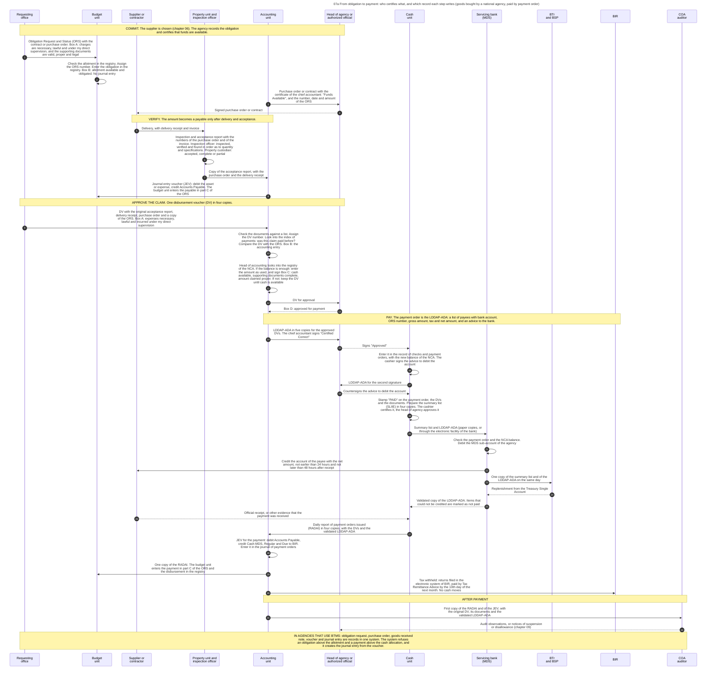
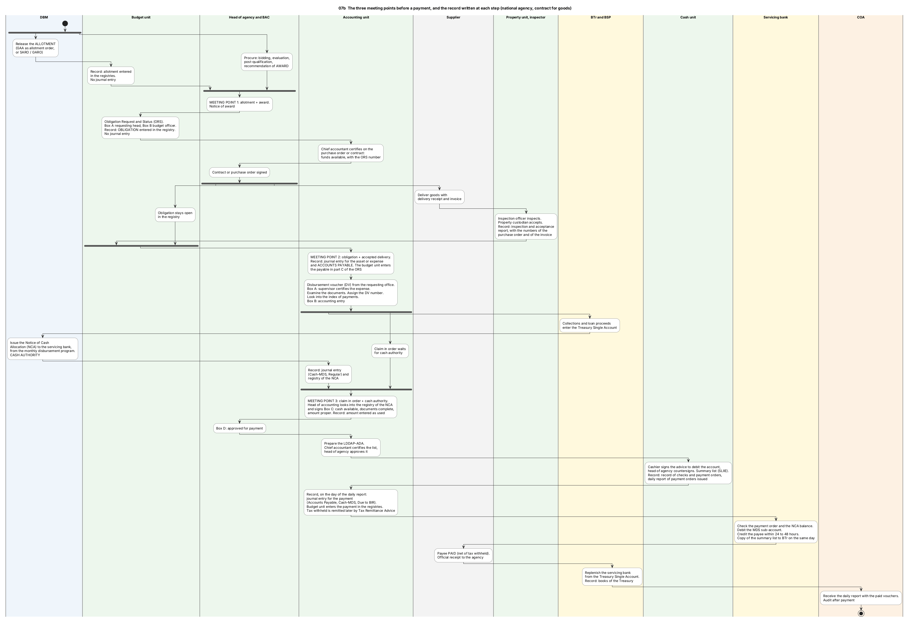
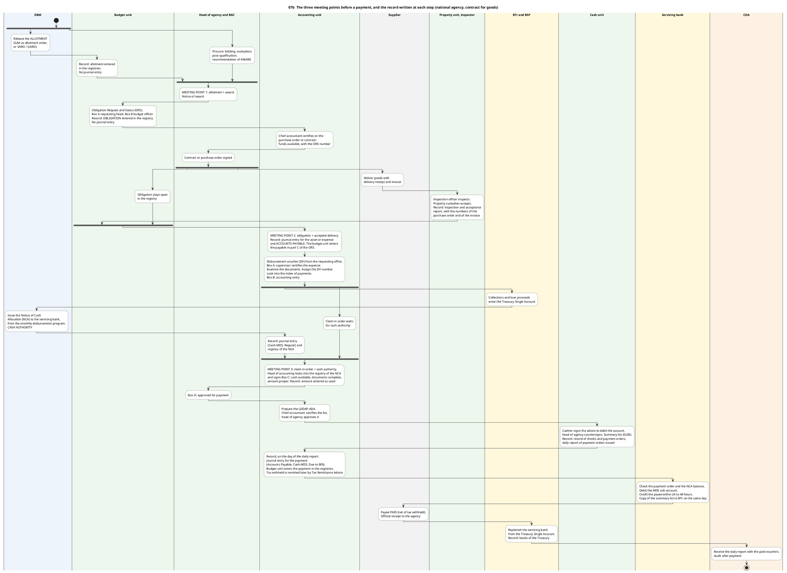
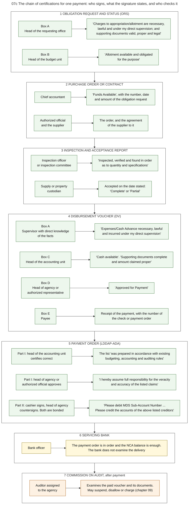
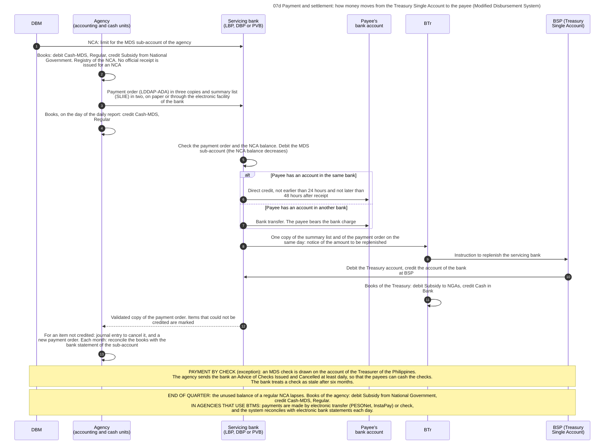
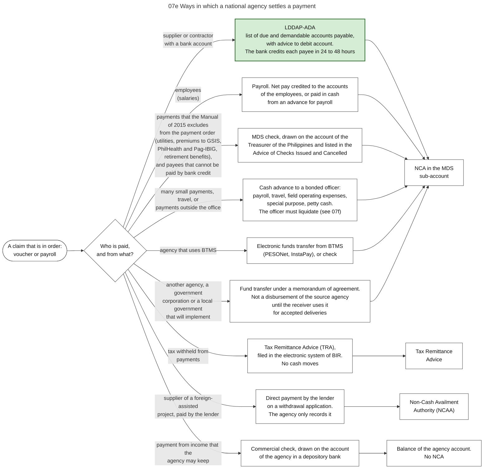
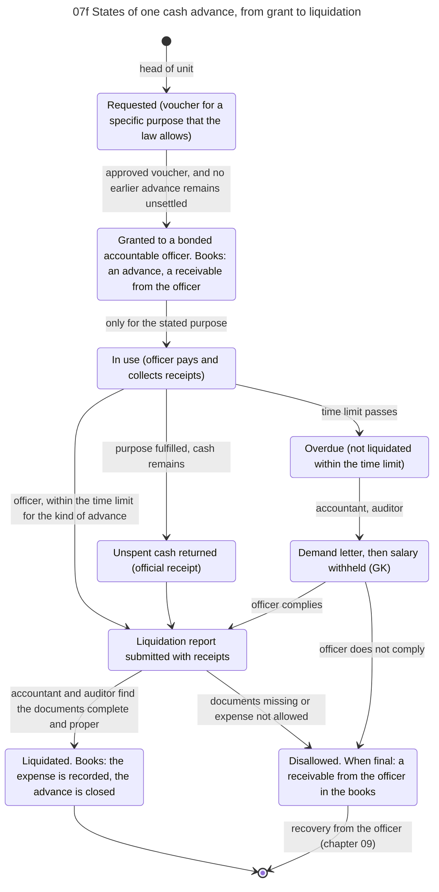
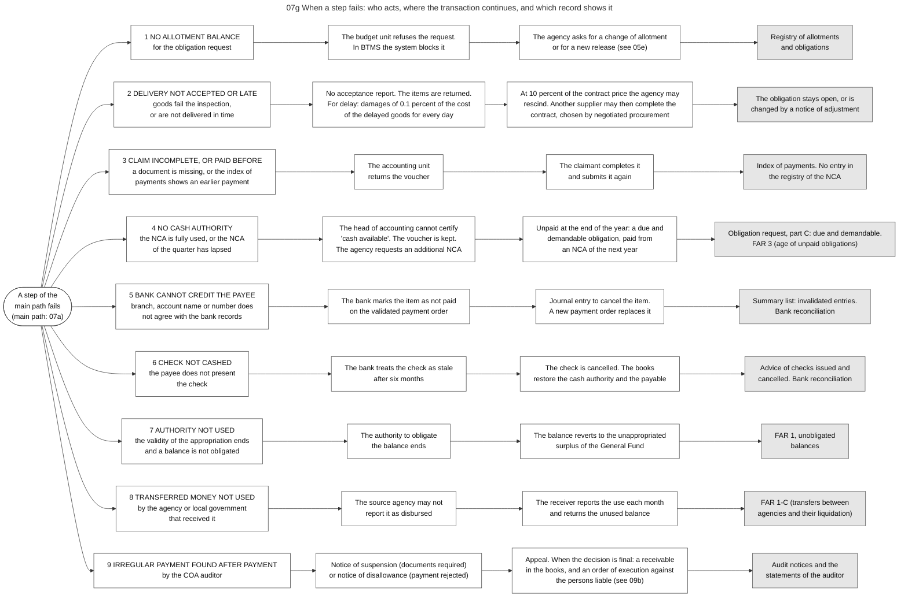
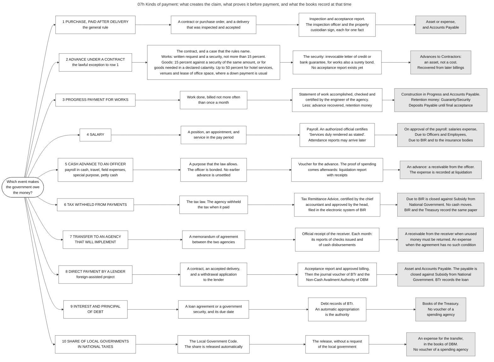
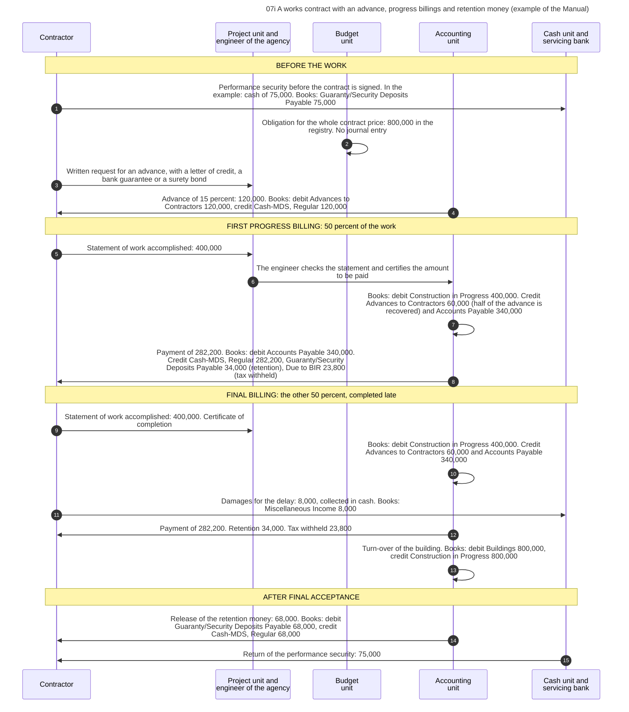

# 07. Obligation, verification and payment

*Part of the Philippine PFM Atlas. Facts as of 8 October 2026. The codes in the column "Basis" are explained in [Reference F](../reference/F_sources_and_verification.md). "GK" means general knowledge that I did not open in a source during this work.*

## 1. The question this process answers

For one payment to a supplier: which officer states which fact, in which document, which record is written at each step, and through which accounts does the money move? And what replaces the contract and the accepted delivery in the other kinds of payment?

The main source of this chapter is the Government Accounting Manual for National Government Agencies of 2015: Volume I for the procedures and the entries [GAM-V1], Volume II for the forms [GAM-V2]. Where a later rule changed the Manual, the chapter gives the later rule and says so.

## 2. The idea in plain words

A payment is the last act of several lines of work that run at the same time. Three things must each be true before money may leave, and each is made true by a different party.

1. **The government is committed, within its authority.** The agency holds an allotment and has recorded an obligation against it. The head of the budget unit states this in Box B of the obligation request [GAM-V2 App.11].
2. **The other party has a claim.** For a purchase: the goods, services or works were delivered, inspected and accepted. Two officers state this in the acceptance report, each for one fact [GAM-V2 App.62]. The accounting unit then records a payable. The budget reports call such an amount **due and demandable** [JC2019-1]. Other kinds of payment have another event in this place (section 7.1).
3. **Cash may be used.** The agency holds a cash authority (NCA) with enough balance. The head of accounting states this in Box C of the voucher, after a look into the registry of the NCA [GAM-V1 Ch.6 s.12][GAM-V2 App.32].

Diagram 07b shows these three meeting points. A drawing with one line of steps hides them, and this is the main reason why the process is hard to see as a whole.

A record is written at each of these moments. The obligation enters a registry. The accepted delivery produces a journal entry for the payable. The certified voucher is entered in the registry of the NCA. The payment order produces a journal entry for the payment. No record waits for the end of the process. Diagram 07a names the record at each step.

A case where the process works: the three facts are all true in the same month, and the supplier is paid within days after acceptance.

A case where it fails: the delivery is accepted and the payable is recorded, but the NCA of the quarter has lapsed or is fully used. The head of accounting cannot sign Box C. The Manual says that he or she "notes that cash is not yet available" and that the voucher is kept [GAM-V1 Ch.6 s.12]. The claim is valid and stays unpaid. The reverse failure also exists: cash authority is available but the delivery is not accepted before the quarter ends, and the cash authority lapses unused.

A case where two meeting points occur on one day: for many regular expenses, for example a utility bill, the obligation request reaches the budget unit together with the voucher [GAM-V1 Ch.6 s.12]. The obligation is then recorded on the day on which the claim is examined. For a purchase with a contract or a purchase order, the obligation is recorded before the order is signed, because the order carries the number of the obligation request [GAM-V2 App.61].

A case where the first meeting point occurs many times for one procurement: under a framework agreement the supplier and the prices are fixed first, and no certificate of funds is needed for the agreement. A certificate is needed for each order under it. The guidelines of the GPPB of July 2026 name such an order a Call-Off [GPPB2026-12]. Chapter 06, section 5, and diagram 06g give the rules.

Terms. The **Obligation Request and Status (ORS)** is the document that charges an amount to an allotment. The **disbursement voucher (DV)** is the document that approves one claim for payment. **Accounts payable** are "valid and legal obligations" of an agency "for which, goods/services/projects have been delivered/rendered/completed and accepted". The **LDDAP-ADA** (List of Due and Demandable Accounts Payable with Advice to Debit Account) is the payment order to the bank: a list of creditors with the amounts, and below it an instruction to the bank to debit the account of the agency. The **Modified Disbursement System (MDS)** is the arrangement in which servicing banks pay on agency orders and the Treasury repays the banks. A **journal entry voucher (JEV)** records one transaction in the accounting books. The **registry of the NCA** (in the Manual: Registry of Allotments and Notice of Cash Allocation, RANCA) is the list in which the accounting unit compares the allotments received, the NCAs received and the NCAs used [GAM-V1 Ch.6 s.2, s.3].

## 3. Authorities and their roles

| Actor | Role in this process | Basis |
|---|---|---|
| Requesting office (end-user) | Requests the obligation and certifies it (ORS Box A). Prepares the voucher. Its supervisor certifies the claim (DV Box A) | GAM-V1 Ch.3 s.11, Ch.6 s.12. GAM-V2 App.11, App.32 |
| Budget unit | Certifies that allotment is available and obligated (ORS Box B). Keeps the registries of appropriations, allotments, obligations and disbursements. Keeps the original obligation request as the record of each obligation | GAM-V1 Ch.3 ss.5-17 |
| Property (supply) unit and inspection officer | The custodian receives the delivery. The inspection officer inspects it. The custodian accepts it and prepares the voucher for a delivery of goods | GAM-V1 Ch.8 s.15. GAM-V2 App.62 |
| Accounting unit | Certifies before a contract that funds are available. Examines the claim, assigns the voucher number, keeps the index of payments and the registry of the NCA, makes the accounting entry (DV Box B), certifies cash and completeness (DV Box C), makes journal entries, certifies the list of the payment order | PD1445 s.86. GAM-V1 Ch.2 s.36, Ch.6 s.3, s.12, s.51 |
| Head of agency or authorized representative | Approves the voucher (DV Box D). Approves the list of the payment order and countersigns the advice to the bank | PD1445 s.91. GAM-V1 Ch.6 s.12, s.51 |
| Cash unit | Signs the advice to the bank. Keeps the record of checks and payment orders. Prepares the summary list and the daily report of payment orders issued. Delivers the documents to the bank | GAM-V1 Ch.6 ss.51-56 |
| Servicing bank (LBP, DBP or PVB) | Debits the MDS sub-account, credits the payee, sends a copy of the documents to BTr, returns the validated payment order | GAM-V1 Ch.6 s.2, s.56. CL2013-16A, NBC599 |
| BTr and BSP | Replenish the servicing bank from the Treasury Single Account. BTr records the payment in the books of the national government | CL2013-16A, PRIMER, GAM-V1 Annex H |
| BIR | Receives the tax withheld, by Tax Remittance Advice | GAM-V1 Ch.6 ss.60-62 |
| COA auditor | Receives the first copy of the daily report with the original vouchers. Examines after payment | GAM-V1 Ch.6 s.56. COA2011-002 |

Two rules of the law separate these roles. No member of the accounting unit or of the internal control unit of the agency may be designated to draw checks [PD1445 s.92]. Payments to creditors need "the specific approval of the head of the agency concerned or his duly authorized representative" [PD1445 s.91].

## 4. Steps from obligation to payment

The steps are those of diagram 07a. The example is a purchase of goods that is paid by payment order.

| No. | Who acts | Towards whom | What is done or passed | Basis |
|---|---|---|---|---|
| 1 | Requesting office | Budget unit | Obligation Request and Status (ORS) with the contract or purchase order. Box A: charges are necessary, lawful and under my direct supervision, and the supporting documents are valid, proper and legal | GAM-V1 Ch.3 s.11, s.15. GAM-V2 App.11 |
| 2 | Budget unit | (own action) | Check the allotment in the registry. Assign the ORS number. Enter the obligation in the registry. Box B: allotment available and obligated. No journal entry | GAM-V1 Ch.3 s.15. GAM-V2 App.11 |
| 3 | Accounting unit | Head of agency or authorized official | Purchase order or contract with the certificate of the chief accountant: "Funds Available", and the number, date and amount of the ORS | GAM-V2 App.61. PD1445 s.86 |
| 4 | Head of agency or authorized official | Supplier or contractor | Signed purchase order or contract | GAM-V2 App.61 |
| 5 | Supplier or contractor | Property unit and inspection officer | Delivery, with delivery receipt and invoice | GAM-V1 Ch.8 s.15. GAM-V2 App.62 |
| 6 | Property unit and inspection officer | (own action) | Inspection and acceptance report with the numbers of the purchase order and of the invoice. Inspection officer: inspected, verified and found in order as to quantity and specifications. Property custodian: accepted, complete or partial | GAM-V1 Ch.8 s.15. GAM-V2 App.62 |
| 7 | Property unit and inspection officer | Accounting unit | Copy of the acceptance report, with the purchase order and the delivery receipt | GAM-V1 Ch.8 s.15. GAM-V2 App.62 |
| 8 | Accounting unit | Budget unit | Journal entry voucher (JEV): debit the asset or expense, credit Accounts Payable. The budget unit enters the payable in part C of the ORS | GAM-V1 Ch.8 s.15, Annex H. GAM-V2 App.11 |
| 9 | Requesting office | Accounting unit | DV with the original acceptance report, delivery receipt, purchase order and a copy of the ORS. Box A: expenses necessary, lawful and incurred under my direct supervision | GAM-V1 Ch.6 s.12, Ch.8 s.15. GAM-V2 App.32 |
| 10 | Accounting unit | (own action) | Check the documents against a list. Assign the DV number. Look into the index of payments: was this claim paid before? Compare the DV with the ORS. Box B: the accounting entry | GAM-V1 Ch.6 s.12. GAM-V2 App.32 |
| 11 | Accounting unit | (own action) | Head of accounting looks into the registry of the NCA. If the balance is enough: enter the amount as used, and sign Box C: cash available, supporting documents complete, amount claimed proper. If not: keep the DV until cash is available | GAM-V1 Ch.6 s.12. GAM-V2 App.32 |
| 12 | Accounting unit | Head of agency or authorized official | DV for approval | GAM-V1 Ch.6 s.12. GAM-V2 App.32 |
| 13 | Head of agency or authorized official | Accounting unit | Box D: approved for payment | GAM-V1 Ch.6 s.12. GAM-V2 App.32 |
| 14 | Accounting unit | Head of agency or authorized official | LDDAP-ADA in five copies for the approved DVs. The chief accountant signs "Certified Correct" | GAM-V1 Ch.6 s.51, s.56 |
| 15 | Head of agency or authorized official | Cash unit | Signs "Approved" | GAM-V1 Ch.6 s.51, s.56 |
| 16 | Cash unit | (own action) | Enter it in the record of checks and payment orders, with the new balance of the NCA. The cashier signs the advice to debit the account | GAM-V1 Ch.6 s.51, s.56 |
| 17 | Cash unit | Head of agency or authorized official | LDDAP-ADA for the second signature | GAM-V1 Ch.6 s.51, s.56 |
| 18 | Head of agency or authorized official | Cash unit | Countersigns the advice to debit the account | GAM-V1 Ch.6 s.51, s.56 |
| 19 | Cash unit | (own action) | Stamp "PAID" on the payment order, the DVs and the documents. Prepare the summary list (SLIIE) in four copies. The cashier certifies it, the head of agency approves it | GAM-V1 Ch.6 s.51, s.56 |
| 20 | Cash unit | Servicing bank (MDS) | Summary list and LDDAP-ADA (paper copies, or through the electronic facility of the bank) | GAM-V1 Ch.6 s.56, s.58. eMDS |
| 21 | Servicing bank (MDS) | (own action) | Check the payment order and the NCA balance. Debit the MDS sub-account of the agency | CL2013-16A. What the bank checks: GK |
| 22 | Servicing bank (MDS) | Supplier or contractor | Credit the account of the payee with the net amount, not earlier than 24 hours and not later than 48 hours after receipt | GAM-V1 Ch.6 s.2, s.56 |
| 23 | Servicing bank (MDS) | BTr and BSP | One copy of the summary list and of the LDDAP-ADA on the same day | GAM-V1 Ch.6 s.56, CL2013-16A |
| 24 | BTr and BSP | Servicing bank (MDS) | Replenishment from the Treasury Single Account | CL2013-16A, PRIMER |
| 25 | Servicing bank (MDS) | Cash unit | Validated copy of the LDDAP-ADA. Items that could not be credited are marked as not paid | GAM-V1 Ch.6 s.54, s.56. CL2018-14 |
| 26 | Supplier or contractor | Cash unit | Official receipt, or other evidence that the payment was received | GAM-V1 Ch.6 s.53, s.56 |
| 27 | Cash unit | Accounting unit | Daily report of payment orders issued (RADAI) in four copies, with the DVs and the validated LDDAP-ADA | GAM-V1 Ch.6 s.52, s.56 |
| 28 | Accounting unit | (own action) | JEV for the payment: debit Accounts Payable, credit Cash-MDS, Regular and Due to BIR. Enter it in the journal of payment orders | GAM-V1 Ch.6 s.54, s.57 |
| 29 | Accounting unit | Budget unit | One copy of the RADAI. The budget unit enters the payment in part C of the ORS and the disbursement in the registry | GAM-V1 Ch.6 s.56, Ch.3 ss.16-17 |
| 30 | Accounting unit | BIR | Tax withheld: returns filed in the electronic system of BIR, paid by Tax Remittance Advice by the 10th day of the next month. No cash moves | GAM-V1 Ch.6 ss.60-62 |
| 31 | Accounting unit | COA auditor | First copy of the RADAI and of the JEV, with the original DV, its documents and the validated LDDAP-ADA | GAM-V1 Ch.6 s.56 |
| 32 | COA auditor | Head of agency or authorized official | Audit observations, or notices of suspension or disallowance (chapter 09) | COA2011-002, COA2009-006 |

Notes on the steps.

- **Step 3 and the order of the certificate.** The Auditing Code requires the certificate of the accounting official before a contract is entered into, and makes a contract without it void [PD1445 ss.86-87]. The form of the purchase order has a place for it, with the number of the obligation request [GAM-V2 App.61]. The step list of the Manual for a construction contract shows another order: the head signs, then the chief accountant certifies, then the budget unit prepares the obligation request for the whole contract price [GAM-V1 Ch.10 s.47].
- **Step 8 and the moment of the payable.** The worked example of the Manual records the payable at delivery, from the delivery receipt and the acceptance report [GAM-V1 Annex H]. Its section on payment orders says that payables are recorded "based on approved DVs" [GAM-V1 Ch.6 s.57]. The steps follow the worked example.
- **Step 10.** The voucher number has four parts: fund cluster, year, month, and a serial number with one series for each fund cluster and year [GAM-V1 Ch.6 s.12]. The instructions of the form print a shorter pattern [GAM-V2 App.32]. The number is written on every sheet of the supporting documents.
- **Step 19.** The documents are stamped "PAID" before they go to the bank [GAM-V1 Ch.6 s.56].
- **Step 22.** The Manual says "not later than 48 hours but not earlier than 24 hours" [GAM-V1 Ch.6 s.2]. A later circular says within the next two banking days [CL2018-14].
- **Step 27.** The daily report contains all approved payment orders of the day, "including those not yet delivered" to the bank [GAM-V1 Ch.6 s.52]. The agency also sends a copy of this report to the office that posts it on the website of the agency [GAM-V1 Ch.6 s.56].

## 5. Who certifies what

Diagram 07c shows the chain of certifications. The table gives the same content. Words in quotation marks are read on the forms.

| Document | Signatory | What the signature states | Checked by someone outside the agency before payment? | Basis |
|---|---|---|---|---|
| ORS, Box A | Head of the requesting office | "Charges to appropriation/allotment are necessary, lawful and under my direct supervision; and supporting documents valid, proper and legal" | No | GAM-V2 App.11 |
| ORS, Box B | Head of the budget unit | "Allotment available and obligated for the purpose" | No | GAM-V2 App.11 |
| Purchase order | Chief accountant | "Funds Available", with the number, date and amount of the ORS | No | GAM-V2 App.61, PD1445 s.86 |
| Inspection and acceptance report, first part | Inspection officer or inspection committee | "Inspected, verified and found in order as to quantity and specifications" | No | GAM-V2 App.62 |
| Inspection and acceptance report, second part | Supply or property custodian | Accepted on the date stated, "Complete" or "Partial" | No | GAM-V2 App.62 |
| DV, Box A | Supervisor with direct knowledge of the facts | "Expenses/Cash Advance necessary, lawful and incurred under my direct supervision" | No | GAM-V2 App.32 |
| DV, Box B | Accounting staff | The accounting entry: account titles, codes, debit and credit | No | GAM-V2 App.32 |
| DV, Box C | Head of the accounting unit | "Cash available". "Supporting documents complete and amount claimed proper" | No | GAM-V2 App.32 |
| DV, Box D | Head of agency or authorized representative | "Approved for Payment" | No | GAM-V2 App.32 |
| DV, Box E | Payee | Receipt of the payment, with the number of the check or payment order and of the official receipt | | GAM-V2 App.32 |
| LDDAP-ADA, part I | Head of accounting certifies, head of agency approves | The list "was prepared in accordance with existing budgeting, accounting and auditing rules and regulations". The head of agency adds: "I hereby assume full responsibility for the veracity and accuracy of the listed claims" | No | GAM-V2 App.42 |
| LDDAP-ADA, part II | Cashier signs, head of agency countersigns. Both must be bonded | "Please debit MDS Sub-Account Number". "Please credit the accounts of the above listed creditors" | The bank checks the payment order and the NCA balance. It does not examine the delivery | GAM-V2 App.42, GAM-V1 Ch.6 s.51. Bank checks: GK |

What this table shows: before payment, the facts "the goods were delivered" and "the delivery meets the order" are stated only by officers of the agency. COA lifted its pre-audit in 2011 and examines after payment. It may restore pre-audit where internal control is inadequate [COA2011-002].

The Manual lists seven basic requirements for every disbursement, and names the officer who is responsible for each [GAM-V1 Ch.2 s.36].

| No. | Requirement | Officer who certifies or ensures it |
|---|---|---|
| a | Allotment is available for the obligation | Budget officer |
| b | The obligation is properly charged against the allotment | Chief accountant |
| c | Funds are available, certified before a contract is entered into | Chief accountant |
| d | Cash is available and the supporting documents are complete | Chief accountant, from the registry of allotments and NCA |
| e | The transaction is legal and conforms with the rules | Requesting and approving officials |
| f | Proper evidence establishes the validity of the claim | Head of the requesting unit |
| g | The disbursement is approved | Head of agency or authorized representative |

A difference inside the Manual: the form of the voucher has five boxes, A to E. The text of the procedure for checks calls the certificate of the accountant "Box B", the approval "Box C" and the receipt of the payee "Box D" [GAM-V1 Ch.6 s.12]. This atlas follows the form.

## 6. How the money moves

The steps are those of diagram 07d.

| No. | Who acts | Towards whom | What is done or passed | Basis |
|---|---|---|---|---|
| 1 | DBM | Servicing bank (LBP, DBP or PVB) | NCA: limit for the MDS sub-account of the agency | NBC599 |
| 2 | Agency (accounting and cash units) | (own action) | Books: debit Cash-MDS, Regular, credit Subsidy from National Government. Registry of the NCA. No official receipt is issued for an NCA | GAM-V1 Ch.5 s.38, Ch.6 s.3 |
| 3 | Agency (accounting and cash units) | Servicing bank (LBP, DBP or PVB) | Payment order (LDDAP-ADA) in three copies and summary list (SLIIE) in two, on paper or through the electronic facility of the bank | GAM-V1 Ch.6 s.56, s.58. eMDS |
| 4 | Agency (accounting and cash units) | (own action) | Books, on the day of the daily report: credit Cash-MDS, Regular | GAM-V1 Ch.6 s.52, s.54 |
| 5 | Servicing bank (LBP, DBP or PVB) | (own action) | Check the payment order and the NCA balance. Debit the MDS sub-account (the NCA balance decreases) | CL2013-16A. What the bank checks: GK |
| 6 | Servicing bank (LBP, DBP or PVB) | Payee's bank account | Direct credit, not earlier than 24 hours and not later than 48 hours after receipt | GAM-V1 Ch.6 s.2 |
| 7 | Servicing bank (LBP, DBP or PVB) | Payee's bank account | Bank transfer. The payee bears the bank charge | GAM-V1 Ch.6 s.2 |
| 8 | Servicing bank (LBP, DBP or PVB) | BTr | One copy of the summary list and of the payment order on the same day: notice of the amount to be replenished | GAM-V1 Ch.6 s.56, CL2013-16A |
| 9 | BTr | BSP (Treasury Single Account) | Instruction to replenish the servicing bank | PRIMER, CL2013-16A. Entries at BSP: GK |
| 10 | BSP (Treasury Single Account) | Servicing bank (LBP, DBP or PVB) | Debit the Treasury account, credit the account of the bank at BSP | PRIMER, CL2013-16A. Entries at BSP: GK |
| 11 | BTr | (own action) | Books of the Treasury: debit Subsidy to NGAs, credit Cash in Bank | GAM-V1 Annex H |
| 12 | Servicing bank (LBP, DBP or PVB) | Agency (accounting and cash units) | Validated copy of the payment order. Items that could not be credited are marked | GAM-V1 Ch.6 s.53, s.56. CL2018-14 |
| 13 | Agency (accounting and cash units) | (own action) | For an item not credited: journal entry to cancel it, and a new payment order. Each month: reconcile the books with the bank statement of the sub-account | GAM-V1 Ch.6 s.54, Ch.21. PD1445 s.74 |

Four points follow from these steps.

- The agency holds no cash for its regular budget. It holds a limit at the bank. The books of the agency call this limit "Cash-Modified Disbursement System (MDS), Regular". The Manual says of this account that "there is no actual cash with the GSBs" [GAM-V1 Ch.19 s.56]. GSB means government servicing bank.
- The bank pays first. A copy of the summary list and of the payment order goes to BTr on the same day, so that BTr knows in advance how much will be paid and can replenish the fund from which the bank pays. The sources call this fund the MDS Seed Fund [CL2013-16A][GAM-V1 Ch.6 s.56].
- Cash leaves the Treasury Single Account at the replenishment, not at the issue of the NCA.
- One payment has three dates in three sets of records. The agency credits its account on the day of the daily report. The bank credits the payee one or two days after it receives the payment order. The Treasury records the amount when the bank has paid [GAM-V1 Ch.6 s.2, s.54, Annex H]. The monthly bank reconciliation explains the differences between the first two [GAM-V1 Ch.21]. Chapter 08, section 4.2, shows the three sets of records side by side.

A check is the exception. An MDS check is "chargeable against the account of the Treasurer of the Philippines", and the agency sends the bank an Advice of Checks Issued and Cancelled at least daily, so that the payees can cash the checks [GAM-V1 Ch.6 s.2][GAM-V2 App.39]. The electronic facility of LBP was adopted as a mode of disbursement by a joint order of DBM and DOF of 12 March 2015, to make it easier to reconcile the payments of agencies with the accounts of BTr at that bank [GAM-V1 Ch.6 s.58].

## 7. Kinds of payment, and ways to settle them

### 7.1 What replaces the contract and the accepted delivery

Sections 4 to 6 follow a purchase that is paid after delivery. This is the general rule of the law: no payment under a contract "except upon a certification by the head of the agency concerned" that the services or supplies "have been duly inspected and accepted" [PD1445 s.88]. In other kinds of payment another event creates the claim, and another document proves it. The legal authority, the cash and the records are needed in the same way. Diagram 07h compares ten kinds. The table gives the same content.

| No. | Kind of payment | What creates the claim | Document that proves it before payment | What the books record at that time | Basis |
|---|---|---|---|---|---|
| 1 | Purchase, paid after delivery | A contract or purchase order, and a delivery that was inspected and accepted | Inspection and acceptance report, signed by the inspection officer and by the property custodian | Asset or expense, and Accounts Payable | PD1445 s.88, GAM-V1 Ch.8 s.15, GAM-V2 App.62 |
| 2 | Advance under a contract | The contract, and a case that the rules name (section 7.2) | A security: irrevocable letter of credit or bank guarantee, for works also a surety bond. No acceptance report exists yet | Advances to Contractors, which is an asset. It is recovered from later billings | IRR12009 s.71.1.5, s.71.2.5. GAM-V1 Ch.6 s.57, Ch.10 s.8 |
| 3 | Progress payment for works | Work done, billed not more often than once a month | Statement of work accomplished, checked and certified by the engineer of the agency | Construction in Progress and Accounts Payable. The retention money is held as Guaranty/Security Deposits Payable | IRR12009 s.71.2.7, s.71.2.8. GAM-V1 Ch.10 s.8 |
| 4 | Salary | A position, an appointment, and service in the pay period | Payroll. An authorized official certifies "Services duly rendered as stated" | On approval of the payroll: salaries expense, Due to Officers and Employees, Due to BIR and to the insurance bodies | GAM-V2 App.33. GAM-V1 Ch.6 s.19, Annex H |
| 5 | Cash advance to an officer | A purpose that the law allows. The officer is bonded and has no earlier advance that is unsettled | Voucher for the advance. The proof of spending comes afterwards: a liquidation report with receipts | An advance, which is a receivable from the officer. The expense is recorded at liquidation | PD1445 s.89. GAM-V1 Ch.6 ss.14-39 |
| 6 | Tax withheld from payments | The tax law. The agency withheld the tax when it paid | Tax Remittance Advice, certified by the chief accountant and approved by the head, filed in the electronic system of BIR | Due to BIR is closed against Subsidy from National Government. No cash moves | GAM-V1 Ch.5 s.38, Ch.6 ss.60-62 |
| 7 | Transfer to an agency that will implement | A memorandum of agreement between the two agencies | Official receipt of the receiver. Each month, its reports of checks issued and of cash disbursements | A receivable from the receiver when unused money must be returned. An expense when the agreement has no such condition | GAM-V1 Ch.6 s.63. NBC599 s.3.4 |
| 8 | Direct payment by a lender | A contract, an accepted delivery, and a withdrawal application to the lender | Acceptance report and approved billing. Then the journal voucher of BTr and the Non-Cash Availment Authority of DBM | Asset and Accounts Payable. The payable is closed against Subsidy from National Government. BTr records the loan | GAM-V1 Ch.6 ss.66-68. NBC599 s.4.2.2.1 |
| 9 | Interest and principal of debt | A loan agreement or a government security, and its due date | Debt records of BTr. An automatic appropriation is the authority | Books of the Treasury. No voucher of a spending agency | EO292-B6 s.26, EO449 |
| 10 | Share of local governments in national taxes | The Local Government Code. The share is released automatically | The release, without a request of the local government | An expense for the transfer, in the books of DBM | LGC s.286, ALGU2026, GAM-V1 Ch.5 s.18 |

Two more kinds are in other chapters: the refund of a tax (chapter 10, section 10) and cash aid to persons (chapter 15, section 5.2). I did not read the rules on their documents.

In rows 2 and 5 the money leaves before anything is delivered. The rules answer this in two ways. They require a security or a bond, so that the money can be recovered. And the books record a receivable, not an expense, so that the amount stays visible until it is settled.

A point on row 4. The Manual states that "Payrolls are prepared in advance and some agencies pay their employees through the banking system. All these are done before reports of attendance are submitted, making it impossible to know the exact amount to be paid in case there are absences without pay". An overpayment is then demanded back and recorded as a receivable from the employee [GAM-V1 Ch.6 s.48]. So the certificate on the payroll, and not the attendance record, is the proof that exists before the payment.

### 7.2 Advance payment, progress payment and retention money

The rule and its exception. The Auditing Code says: "Except with the prior approval of the President (Prime Minister) the government shall not be obliged to make an advance payment for services not yet rendered or for supplies and materials not yet delivered under any contract therefor" [PD1445 s.88]. An order of the President of 2011 gave this approval for goods under the earlier procurement law [MO15-2011]. The Implementing Rules of the procurement law of 2024 name the following cases [IRR12009 s.71].

| Subject | Goods | Works (infrastructure projects) | Basis |
|---|---|---|---|
| Advance payment | Not more than 15 percent of the contract amount, against an irrevocable letter of credit or bank guarantee of the same amount, paid within 60 days from the signing of the contract. Also 15 percent for goods needed in an area under a declared state of calamity. A single advance of not more than 50 percent for hotel and restaurant services, the use of conference areas and the lease of office space, where a down payment is standard practice | Not more than 15 percent of the total contract price, in one amount or at most two instalments. Only on the written request of the contractor, and against an irrevocable standby letter of credit, a bank guarantee, or a surety bond callable upon demand | IRR12009 s.71.1.5, s.71.2.5 |
| Recovery of the advance | "All progress payments shall first be charged against the advance payment until the latter has been fully exhausted" | A part of the advance is deducted from each progress payment | IRR12009 s.71.1.5, s.71.2.7 |
| Progress payment | | Once a month the contractor may submit a statement of work accomplished. The representative or engineer of the agency checks it and certifies the amount. Materials and equipment that were delivered to the site and are not yet part of the works are not paid, unless the instructions to bidders say otherwise | IRR12009 s.71.2.7 |
| Retention money | For the warranty: 1 to 5 percent of every progress payment, or a special bank guarantee of 1 to 5 percent of the contract price. Released after the warranty period: at least three months for expendable supplies and one year for other supplies | 10 percent of the amount due before any deduction, from every progress payment until 50 percent of the works are completed. No further retention after that when the work is satisfactory and on schedule. Due for release upon final acceptance | IRR12009 s.90.1, s.71.2.8 |
| Damages for delay | One tenth of one percent of the cost of the delayed goods for every day. When the total reaches 10 percent of the contract price, the agency may rescind | At least one tenth of one percent of the cost of the unperformed portion for every day. The same limit of 10 percent | IRR12009 s.71.1.4, s.71.2.4, s.97 |
| Change of the contract | Amendment to order: an increase of not more than 10 percent of the original price, or 20 percent with approval of the head of the procuring entity | Variation orders: not more than 10 percent in total, in exceptional cases up to 20 percent | IRR12009 s.71.1.1, s.71.2.1 |
| Late payment by the agency | | The contractor may suspend the work when a certified progress billing is unpaid for more than 45 days | IRR12009 s.71.2.2 |
| Performance security, before the contract is signed | 5 percent of the contract price in cash or bank instruments, or 30 percent as surety bond | 10 percent in cash or bank instruments, or 30 percent as surety bond | IRR12009 s.68 |

A case where the exception works: a contractor needs money to bring equipment to the site. The contractor asks in writing, posts a bank guarantee of 15 percent, and receives 15 percent. If the contractor does nothing, the agency calls the guarantee. The government has lost no money.

A case where it fails: an advance is paid without a security, or the security ends before the advance is recovered. The money has then left without a delivery and without a means to recover it. The bidder states in its sworn statement that a failure to perform after an advance payment "shall be sufficient grounds to constitute criminal liability" [IRR12009 s.54.3].

Diagram 07i follows one works contract with the amounts of the worked example of the Manual. The steps are those of the diagram.

| No. | Who acts | Towards whom | What is done or passed | Basis |
|---|---|---|---|---|
| 1 | Contractor | Cash unit and servicing bank | Performance security before the contract is signed. In the example: cash of 75,000. Books: Guaranty/Security Deposits Payable 75,000 | IRR12009 s.68. Amount and entry: GAM-V1 Ch.10 s.8 |
| 2 | Budget unit | (own action) | Obligation for the whole contract price: 800,000 in the registry. No journal entry | GAM-V1 Ch.10 s.47. Amount: GAM-V1 Ch.10 s.8 |
| 3 | Contractor | Project unit and engineer of the agency | Written request for an advance, with a letter of credit, a bank guarantee or a surety bond | IRR12009 s.71.2.5 |
| 4 | Accounting unit | Contractor | Advance of 15 percent: 120,000. Books: debit Advances to Contractors 120,000, credit Cash-MDS, Regular 120,000 | GAM-V1 Ch.10 s.8 |
| 5 | Contractor | Project unit and engineer of the agency | Statement of work accomplished: 400,000 | IRR12009 s.71.2.7. Amount: GAM-V1 Ch.10 s.8 |
| 6 | Project unit and engineer of the agency | Accounting unit | The engineer checks the statement and certifies the amount to be paid | IRR12009 s.71.2.7. Amount: GAM-V1 Ch.10 s.8 |
| 7 | Accounting unit | (own action) | Books: debit Construction in Progress 400,000. Credit Advances to Contractors 60,000 (half of the advance is recovered) and Accounts Payable 340,000 | GAM-V1 Ch.10 s.8 |
| 8 | Accounting unit | Contractor | Payment of 282,200. Books: debit Accounts Payable 340,000. Credit Cash-MDS, Regular 282,200, Guaranty/Security Deposits Payable 34,000 (retention), Due to BIR 23,800 (tax withheld) | GAM-V1 Ch.10 s.8 |
| 9 | Contractor | Project unit and engineer of the agency | Statement of work accomplished: 400,000. Certificate of completion | IRR12009 s.71.2.7. Certificate of completion: GAM-V1 Ch.10 s.47. Amount: GAM-V1 Ch.10 s.8 |
| 10 | Accounting unit | (own action) | Books: debit Construction in Progress 400,000. Credit Advances to Contractors 60,000 and Accounts Payable 340,000 | GAM-V1 Ch.10 s.8 |
| 11 | Contractor | Cash unit and servicing bank | Damages for the delay: 8,000, collected in cash. Books: Miscellaneous Income 8,000 | GAM-V1 Ch.10 s.8 |
| 12 | Accounting unit | Contractor | Payment of 282,200. Retention 34,000. Tax withheld 23,800 | GAM-V1 Ch.10 s.8 |
| 13 | Accounting unit | (own action) | Turn-over of the building. Books: debit Buildings 800,000, credit Construction in Progress 800,000 | GAM-V1 Ch.10 s.8 |
| 14 | Accounting unit | Contractor | Release of the retention money: 68,000. Books: debit Guaranty/Security Deposits Payable 68,000, credit Cash-MDS, Regular 68,000 | GAM-V1 Ch.10 s.8, IRR12009 s.71.2.8 |
| 15 | Cash unit and servicing bank | Contractor | Return of the performance security: 75,000 | GAM-V1 Ch.10 s.8, IRR12009 s.68 |

The arithmetic of the example, for a contract price of PHP 800,000.

| Occasion | Cash to the contractor | Kept as retention money | Tax withheld | Books of the agency |
|---|---|---|---|---|
| Advance of 15 percent | 120,000 | | | Advances to Contractors 120,000 |
| First billing, 400,000, less 60,000 of the advance: payable 340,000 | 282,200 | 34,000 | 23,800 | Construction in Progress 400,000 |
| Final billing, 400,000, less 60,000 of the advance: payable 340,000 | 282,200 | 34,000 | 23,800 | Construction in Progress 400,000, then Buildings 800,000 |
| Release of the retention money | 68,000 | -68,000 | | Guaranty/Security Deposits Payable closed |
| Total | 752,400 | 0 | 47,600 | Buildings 800,000 |

The cash and the tax add to 800,000, the contract price. The damages of 8,000 for the delay are collected separately in the example and are income of the government.

Three differences between the example of 2015 and the rules of 2025. The example retains 10 percent of the payable after the advance is recovered, which is 34,000. The rules of 2025 base the retention on the amount due before any deduction, and they stop the retention after 50 percent of the works when the work is satisfactory and on schedule. The performance security of the example is 75,000, and 10 percent of the contract price would be 80,000. The example computes the damages on the contract price, and the rules of 2025 use the cost of the unperformed portion.

### 7.3 Instruments of payment

The Manual names six modes of disbursement: checks (MDS checks or commercial checks), cash out of a cash advance, advice to debit the account, tax remittance advice, working fund or cash disbursement ceiling, and direct payment [GAM-V1 Ch.6 s.7]. Diagram 07e shows which instrument applies in which situation. The table gives the same content.

| Situation | Instrument | Cash authority that it uses | Basis |
|---|---|---|---|
| Supplier or contractor with a bank account | LDDAP-ADA. The bank credits the payee not earlier than 24 hours and not later than 48 hours after it receives the payment order. A later circular says within the next two banking days. When the account of the payee is in another bank, the payee bears the bank charge | NCA | GAM-V1 Ch.6 s.2, s.50. CL2013-16A, CL2018-14, eMDS |
| Employees | Payroll. Net pay is credited to the accounts of the employees, or paid in cash from an advance for payroll | NCA | GAM-V1 Ch.6 s.15, s.57 |
| Payments that the Manual of 2015 excludes from the payment order: terminal leave and retirement benefits, premiums to GSIS, PhilHealth and Pag-IBIG, bills of utility companies, and other payables that cannot conveniently be paid by bank credit | MDS check. Checks are listed in the Advice of Checks Issued and Cancelled. A later circular limits checks to payees that cannot conveniently be paid by bank credit, and the agency needs a clearance of BTr to buy MDS checks | NCA | GAM-V1 Ch.6 s.50, s.12. CL2018-14, eMDS |
| Many small payments, travel, or payments outside the office | Cash advance to a bonded officer, who must liquidate it (section 7.4, diagram 07f) | NCA | PD1445 s.89, GAM-V1 Ch.6 ss.14-39 |
| Tax withheld from payments | Tax Remittance Advice, filed with the returns in the electronic system of BIR by the 10th day of the following month. No cash moves | Tax Remittance Advice | GAM-V1 Ch.6 ss.60-62, NBC599 |
| Supplier of a foreign-assisted project, paid by the lender | Direct payment by the lender on a withdrawal application | Non-Cash Availment Authority | GAM-V1 Ch.6 ss.66-68, NBC599 s.4.2.2.1 |
| Another agency, corporation or local government that will implement | Fund transfer by check to the trust account of the receiver. Not a disbursement of the source agency in the budget reports until the receiver uses it for accepted deliveries | NCA | GAM-V1 Ch.6 s.63, NBC599 s.3.4 |
| Payment from income that the agency may keep | Commercial check, drawn on the account of the agency in a depository bank | None. The balance of the account is the limit | GAM-V1 Ch.6 s.2, s.8 |
| Common-use supplies bought from the Procurement Service | The voucher is prepared on the approved request for the supplies, and the payment goes directly to the Procurement Service. The books show an advance to the Procurement Service as a receivable until delivery | NCA | GAM-V1 Ch.8 s.15, Ch.6 s.13 |
| Common-use supplies ordered in the Electronic Marketplace of PhilGEPS | An eWallet that PhilGEPS issues, a Government Purchase Card, or another authorized electronic mode. With the eWallet the entity must hold a sufficient balance before the order. The Procurement Service pays the merchant after the entity accepts the goods. How money is deposited in the eWallet, and how the books of the entity show the balance, is not stated in what I read | Not stated | GPPB2025-10 |
| Online subscription without a local provider | Government purchase card, or direct electronic payment by credit card | Not stated | IRR12009 s.35.13 |
| Agency that uses BTMS | Electronic funds transfer (PESONet, InstaPay) or check | NCA | CL2025-8 |

### 7.4 Cash advances

A cash advance is money given to a named officer before the expense exists. Diagram 07f shows its states. The law states three rules: "No cash advance shall be given unless for a legally authorized specific purpose. A cash advance shall be reported on and liquidated as soon as the purpose for which it was given has been served. No additional cash advance shall be allowed to any official or employee unless the previous cash advance given to him is first settled or a proper accounting thereof is made" [PD1445 s.89].

| Kind of advance | For what | Limit on amount or time | Account in the books | Basis |
|---|---|---|---|---|
| Advance for payroll | Salaries, wages, allowances and honoraria paid in cash by a regular disbursing officer | Equal to the net amount of the payroll of the pay period. Liquidated within 5 days after the end of the pay period | Advances for Payroll | GAM-V1 Ch.6 s.15, s.19 |
| Advance for travel | Official travel | Local travel: liquidated within 30 days after return. Foreign travel: within 60 days | Advances to Officers and Employees | GAM-V1 Ch.6 ss.25-29 |
| Advance for operating expenses | Field offices that keep no complete set of books | Requirements of two months | Advances for Operating Expenses | GAM-V1 Ch.6 ss.20-24 |
| Advance to a special disbursing officer | A special purpose or an undertaking with a time limit, on the explicit authority of the head of the agency | As the authority states | Advances to Special Disbursing Officer | GAM-V1 Ch.6 s.2, ss.30-34 |
| Petty cash fund | Small expenses that cannot conveniently be paid by check or payment order | Requirements of one month. Replenished when at least 75 percent is used. In the Manual of 2015: not more than PHP 15,000 for one transaction, and no splitting of a transaction. Whether this amount is still in force: not verified | Petty Cash | GAM-V1 Ch.6 ss.35-39 |

Further rules of the Manual: except for travel, the officer must be bonded, and the advance may not exceed the bond. Only permanently appointed officials may be designated as disbursing officers. A cash advance may not be transferred from one officer to another, and may not be used to cash checks or to liquidate another advance [GAM-V1 Ch.6 s.14]. The detailed rules are in COA Circular No. 97-002, which I did not open.

## 8. Accounting entries

The entries are those of the Manual, with the account titles of the Revised Chart of Accounts. The eight-digit number is the account code.

| Event | Record | Basis |
|---|---|---|
| Budget law received | Entry in the registry of appropriations and allotments. No journal entry | GAM-V1 Annex H |
| Allotment received | Entry in the registries of the budget unit. No journal entry | GAM-V1 Annex H |
| Obligation | The obligation request is entered in the registry of allotments, obligations and disbursements. No journal entry | GAM-V1 Ch.3 s.15, Annex H |
| Receipt of the NCA | Debit Cash-Modified Disbursement System (MDS), Regular (10104040). Credit Subsidy from National Government (40301010) | GAM-V1 Ch.5 s.38 |
| Delivery accepted | Debit the asset, inventory or expense account. Credit Accounts Payable (20101010). The payable is then entered in part C of the obligation request | GAM-V1 Annex H, Ch.8 s.15 |
| Payroll approved | Debit Salaries and Wages-Regular (50101010) and the allowance accounts. Credit Due to BIR (20201010), Due to GSIS (20201020), Due to Pag-IBIG (20201030), Due to PhilHealth (20201040) and Due to Officers and Employees (20101020) | GAM-V1 Ch.6 s.19, Annex H |
| Payment of a payable | Debit Accounts Payable. Credit Cash-MDS, Regular for the net amount, and Due to BIR for tax withheld | GAM-V1 Ch.6 s.57 |
| Advance to a contractor | Debit Advances to Contractors (19902010). Credit Cash-MDS, Regular | GAM-V1 Ch.6 s.57, Ch.10 s.8 |
| Cash advance for payroll | Debit Advances for Payroll (19901020). Credit Cash-MDS, Regular. At liquidation: debit Due to Officers and Employees, credit Advances for Payroll | GAM-V1 Ch.6 s.19 |
| Remittance of tax withheld by Tax Remittance Advice | Debit Cash-Tax Remittance Advice (10104070), credit Subsidy from National Government. Then debit Due to BIR, credit Cash-Tax Remittance Advice | GAM-V1 Ch.5 s.38 |
| Non-Cash Availment Authority for a direct payment by a lender | Debit Accounts Payable. Credit Subsidy from National Government | GAM-V1 Ch.5 s.38, Ch.6 s.68 |
| Stale or spoiled check cancelled | Debit Cash-MDS, Regular. Credit Accounts Payable | GAM-V1 Ch.6 s.45 |
| Disallowance that is final and executory | Debit Receivables-Disallowances/Charges (10305010). Credit the expense account of the year, or Accumulated Surplus/(Deficit) for an earlier year | GAM-V1 Ch.6 ss.46-47 |
| Unused NCA at the end of the period | Debit Subsidy from National Government. Credit Cash-MDS, Regular | GAM-V1 Ch.19 s.55 |

Chapter 08, section 4, places these entries beside the entries of the registries, of the Treasury and of BIR for the same events.

## 9. Documents, identifiers and systems

The column "It quotes" lists the fields of the form that hold the number of another record. Appendix numbers are those of Volume II of the Manual.

| Document | Own number | It quotes | System today | In BTMS | Basis |
|---|---|---|---|---|---|
| ORS (Appendix 11) | Serial number assigned by the budget unit: allotment class, funding source code, year, month, serial | Payee, responsibility center, program (MFO/PAP), UACS object code. No field for a contract number. The contract appears only in the text field "Particulars" | Registry of the agency on paper, spreadsheet, or the eBudget of COA | Obligation request, created manually, from a commitment, or from an approved purchase order | GAM-V2 App.11, COA-GAS, BTMS-SITE |
| Purchase order (Appendix 61) | P.O. number | Supplier and its tax number, mode of procurement, number and date of the ORS | Paper | Purchase order | GAM-V2 App.61. BTMS: CL2025-8 |
| Inspection and acceptance report (Appendix 62) | IAR number | Number and date of the purchase order, invoice number, responsibility center | Paper, four copies | Goods received note | GAM-V2 App.62. BTMS: CL2025-8 |
| DV (Appendix 32) | DV number assigned by the accounting unit: fund cluster, year, month, serial | ORS number, payee and its tax or employee number, responsibility center, program. After payment: number of the check or payment order, official receipt, JEV number | Paper, four copies, with the accounting system of the agency | Voucher linked to an approved obligation request, matched with purchase order and goods received note | GAM-V2 App.32, GAM-V1 Ch.6 s.12, BTMS-SITE |
| JEV (Appendix 36) | JEV number | Responsibility center, accounts with UACS object codes | eNGAS or other software | Created by the system from the voucher | GAM-V2 App.36, COA-GAS, BTMS-SITE |
| LDDAP-ADA (Appendix 42) | Number: funding source code, month, serial, year | In the head: fund cluster, bank branch and MDS sub-account. Per line: creditor, bank account, ORS number, allotment class, gross, tax, net. The line has no field for the DV number, the object code or a contract number. Filled forms that agencies publish also show an NCA number in the head | Paper to the bank in five copies, or the electronic facility of the bank | Payment extract to the bank. Electronic transfer | GAM-V2 App.42, GAM-V1 Ch.6 s.56, LDDAP-FORM, eMDS, BTMS-SITE |
| Summary list of payment orders (Appendix 53) | Control number | Numbers, dates and amounts of the payment orders, by allotment class. Entries of earlier payment orders that were invalidated | Paper. Four copies in the procedure text. The instructions of the form say five copies and list four | Not stated | GAM-V2 App.53, GAM-V1 Ch.6 s.56 |
| Daily report of payment orders issued, RADAI (Appendix 13), and of checks issued, RCI (Appendix 35) | Report number | Per line: number of the payment order or check, DV or payroll number, ORS number, responsibility center, payee, UACS object code, amount | Paper, four copies. A copy for the website of the agency | Not stated | GAM-V2 App.13, App.35. GAM-V1 Ch.6 s.56 |
| Index of payments (Appendix 38) | One sheet for each creditor | DV or payroll number, then the number of the check or payment order | Paper or the accounting system | Not stated | GAM-V2 App.38 |

The line of the daily report is the one place in the forms where the number of the payment order, of the voucher and of the obligation request, the payee and the object code stand together. Chapter 17 uses this fact.

## 10. Controls: what each one checks, and what it does not check

| Control | What it checks | What it does not check |
|---|---|---|
| ORS Box B, and the registry balance that is taken at every entry | The commitment is inside the allotment | That the contract was properly procured (chapter 06) |
| Certificate of the accountant before a contract | That an appropriation covers the contract. A contract without it is void | That cash will be available at payment |
| Inspection and acceptance by two officers | The delivery exists and meets the order | Nothing outside the agency confirms it before payment |
| Index of payments | That the same claim is not paid twice | A second claim under another name or number |
| DV Box C, from the registry of the NCA | Documents are complete, cash authority is available, the amount is proper | The truth of the acceptance report |
| Separation of duties: request, budget, accounting, approval and payment are done by different officers. No member of the accounting unit signs checks | That no single officer can commit and pay | Agreement between several officers |
| Bonding of the officers who sign the advice to the bank and of the officers who hold cash | That a loss can be recovered | |
| Bank check of the payment order | The payment order and the NCA balance | The reason for the payment |
| Payment to the bank account of the payee | That the payee named in the order receives the money | That the payee is the true supplier of the delivery |
| Monthly bank reconciliation | That the books of the agency agree with the bank statement of the sub-account | It is made after the month. The 2025 assessment rates it partial |
| Monthly count of accountable forms by serial number | That no check, receipt or payment order form is missing | |
| System checks in BTMS | No obligation above the allotment, no payment above the cash allocation or bank balance, voucher matched with purchase order and goods received note, bank reconciliation each day | That the goods received note is true |
| Audit after payment | Legality, regularity and documents of the paid transaction | It happens after the money has left the Treasury |

Basis of the rows: GAM-V1 Ch.3 s.10, PD1445 ss.86-87, GAM-V2 App.62, GAM-V1 Ch.6 s.12, PD1445 s.92, GAM-V1 Ch.6 s.51, GAM-V1 Ch.21, GAM-V2 App.67, BTMS-SITE, COA2011-002, PEFA2025. What the bank checks: GK.

## 11. Timing

A claim becomes payable when the delivery is accepted. It can be paid only while the NCA of the quarter has balance. The first NCA of FY 2026 covers the first quarter. Unused regular NCA lapses on the last working day of the quarter [NBC599]. The bank must credit the payees within the next two banking days after it receives the payment order with its summary list [CL2018-14]. In the electronic facility of LBP, payees are credited within 24 to 48 hours after the agency approves the payment order [eMDS]. Tax withheld is remitted by the 10th day of the following month [GAM-V1 Ch.6 s.62]. Each month the agency reports its payments by type of authority in FAR 4, by the 10th day of the next month [JC2019-1]. The bank reconciliation is prepared within ten days from the receipt of the monthly bank statement and submitted within twenty days [GAM-V1 Ch.21].

## 12. When a step fails

Sections 4 to 7 describe the path when every check succeeds. Diagram 07g shows what happens when a check fails. The question it answers: who acts, where does the transaction continue, and in which record can a reader see the failure?

The idea: each failure leads to a different next step. Some failures stop it before any record is made (rows 1 and 3). Some leave an obligation or a transfer that remains unsettled for months (rows 2, 4 and 8). Some end an authority (row 7). Two concern a payment that is already ordered or made (rows 5, 6 and 9). A model of the process that contains only the main path cannot represent unpaid obligations, lapsed authority or recovered payments.

| No. | What fails | Who acts, and how | Where the transaction continues | Record that shows it | Basis |
|---|---|---|---|---|---|
| 1 | No allotment balance for the obligation request | The budget unit refuses the request. In BTMS the system blocks an obligation above the allotment | The agency asks for a change of allotment or for a new release (diagram 05e) | Registry of allotments and obligations | GAM-V1 Ch.3 s.10, NBC599 s.3.13, CL2025-8 |
| 2 | The delivery is not accepted, or is late | No acceptance report is issued. Items that do not conform are returned to the supplier. For delay the supplier owes damages of one tenth of one percent of the cost of the delayed goods for every day | When the damages reach 10 percent of the contract price, the agency may rescind. Another supplier may then complete the contract, chosen by negotiated procurement | The obligation stays open, or is changed by a notice of adjustment | GAM-V1 Ch.8 s.15, IRR12009 s.71.1.4, s.35.3, GAM-V1 Ch.3 ss.13-14 |
| 3 | The claim is incomplete, or was paid before | The accounting unit returns the voucher. It finds an earlier payment in the index of payments | The claimant completes the claim and submits it again | Index of payments. No entry in the registry of the NCA | GAM-V1 Ch.6 s.12 |
| 4 | No cash authority: the NCA is fully used, or the NCA of the quarter has lapsed | The head of accounting cannot certify "Cash available". The voucher is kept. The agency requests an additional NCA from DBM | If the claim is unpaid at the end of the year, it is a due and demandable obligation. A regular NCA of a later period also covers payables of earlier years | Part C of the obligation request. FAR 3 (age of unpaid obligations), FAR 4 (monthly disbursements) | GAM-V1 Ch.6 s.12, GAM-V2 App.11, NBC599 s.4.2, JC2019-1 |
| 5 | The bank cannot credit the payee, because the branch, the account name or the account number does not agree with its records | The bank marks the item as not paid on the validated payment order | The accounting unit makes a journal entry to cancel the item. A new payment order replaces it, with a certified copy of the paid voucher | Summary list, part for invalidated entries. Bank reconciliation | GAM-V1 Ch.6 s.54, GAM-V2 App.53, CL2018-14 |
| 6 | A check is not cashed | The bank treats a check as stale after six months. The law says that a check that is outstanding for two years is not paid | The check is cancelled, and the books restore the cash authority and the payable. A new check may replace it | Advice of checks issued and cancelled. Bank reconciliation: outstanding checks | GAM-V1 Ch.6 ss.44-45, PD1445 s.97 |
| 7 | The validity of the appropriation ends and a balance is not obligated | The authority to obligate the balance ends | The balance reverts to the unappropriated surplus of the General Fund | FAR 1, unobligated balances | NBC599 s.3.6, EO292-B6 s.28 |
| 8 | Money was transferred to another agency or local government and is not used | The source agency may not report it as disbursed | The receiver reports within ten days after each month and returns the unused balance | FAR 1-C | NBC599 s.3.4, GAM-V1 Ch.6 s.63, JC2019-1 |
| 9 | The auditor finds an irregular payment after payment | Notice of suspension (documents required) or notice of disallowance (payment rejected) | Appeal. When the decision is final and executory: a receivable in the books, and an order of execution against the persons liable (diagram 09b) | Audit notices and statements | COA2009-006, GAM-V1 Ch.6 s.46 |

Row 4 is the most frequent case in the reports: the stock of expenditure arrears in 2023 was above 10 percent of expenditure [PEFA2025]. Diagram 08c explains why such an amount is an expense and a payable in the books, an obligation in the registry, and not yet a disbursement.

A further case concerns accounts payable that stay unpaid for a long time. The Auditing Code lets COA revert to the General Fund any balance of accounts payable "which has been outstanding for two years or more and against which no actual claim, administrative or judicial, has been filed" [PD1445 s.98].

## 13. Where the process fails in practice

| Reported weakness | Basis |
|---|---|
| The stock of expenditure arrears in 2023 was more than 10 percent of total expenditure (PEFA indicator 22.1, score D). Not all agencies comply with the rules on reporting arrears (indicator 22.2, score C) | PEFA2025 |
| A part of the advances, in particular advances to government corporations, was not liquidated at the end of 2023 (PEFA indicator 27.3, score C). Bank reconciliation is partial (indicator 27.1, score C) | PEFA2025 |
| Internal controls on expenditure other than salaries are rated A in two dimensions (PEFA indicators 25.1 and 25.3, which in the PEFA method are the segregation of duties and the compliance with payment rules). Commitment controls are rated B (indicator 25.2) | PEFA2025. Names of the dimensions: GK |
| Duplicate preparation of reports, manual processing, no integration of systems | ROADMAP2024 |

## 14. Diagrams

### Diagram 07a  From obligation to payment: who certifies what, and which record each step writes (goods bought by a national agency, paid by payment order)

Code file: `../diagrams/mermaid/07a_obligation_to_payment_sequence.mmd`. Rendered image: [`../rendered/07a_obligation_to_payment_sequence.png`](../rendered/07a_obligation_to_payment_sequence.png).

- **Question:** for one payment to a supplier, which officer certifies which fact, in which document, which record is written at each step, and which checks are made by someone outside the agency before the money leaves?
- **What the diagram shows:** every certification before step 20 is made by an officer of the agency itself. The first outside check is by the servicing bank (step 20). The bank checks the payment order and the cash limit. It does not check the delivery. COA examines after payment. The records are written during the process: the obligation at step 2, the payable at steps 7 and 8, the use of the cash authority at step 11, the payment at steps 27 and 28.
- **Sources:** the steps follow the Government Accounting Manual. Obligation [GAM-V1 Ch.3 s.15]. Delivery, inspection, acceptance and the entry for the payable [GAM-V1 Ch.8 s.15, Annex H]. Examination of the voucher, index of payments and registry of the NCA [GAM-V1 Ch.6 s.12]. Payment order, its summary list, the copies and the daily report [GAM-V1 Ch.6 ss.50-57]. Tax withheld [GAM-V1 Ch.6 ss.60-62]. The wording of the certificates is that of the forms [GAM-V2 App.11, App.32, App.42, App.61, App.62]. Certificate of funds before a contract [PD1445 s.86]. Copy of the summary list to BTr and replenishment [CL2013-16A]. Electronic facility of the bank [eMDS]. Two banking days [CL2018-14]. Audit after payment [COA2011-002]. System controls of BTMS in the last note [BTMS-SITE][CL2025-8].
- **Differences inside the sources:** (1) the form of the voucher has five boxes, A to E [GAM-V2 App.32]. The text of the procedure calls the certificate of the accountant Box B and the approval Box C [GAM-V1 Ch.6 s.12]. The diagram follows the form. (2) The worked example of the Manual records the payable at delivery [GAM-V1 Annex H]. Another section says that payables are recorded "based on approved DVs" [GAM-V1 Ch.6 s.57]. The diagram follows the worked example. (3) The Manual lets the cashier certify the summary list [GAM-V1 Ch.6 s.56]. The circular of 2013 names the head of accounting [CL2013-16A].
- **General knowledge, not opened in a source here:** what the bank checks in step 20.

### Diagram 07b  The three meeting points before a payment, and the record written at each step (national agency, contract for goods) (PlantUML)

Code file: `../diagrams/plantuml/07b_obligation_to_payment_swimlane.puml`. Rendered image: [`../rendered/07b_obligation_to_payment_swimlane.png`](../rendered/07b_obligation_to_payment_swimlane.png).

- **Question:** which lines of work must BOTH be finished before the next step of a payment may happen, and which record does each unit write at its step?
- **Idea:** a payment needs three meetings. (1) An allotment and an award must both exist before the contract is signed and the obligation is recorded. (2) The obligation and an accepted delivery must both exist before the amount is a payable. (3) The claim in order and a cash authority (NCA) must both exist before the head of accounting certifies "cash available" on the voucher. The payment order follows the third meeting.
- **How to read it:** one column (lane) = one actor. A thick bar that opens = branches run in parallel. The thick bar that closes = ALL branches must be finished (AND-join). A line that starts with "Record:" names what is written at that step.
- **Why PlantUML:** Mermaid has no activity diagram with lanes and AND-joins. The Mermaid diagram 00d shows the same structure as a net without lanes.
- **Where the meeting points are:** the Manual places the check of the NCA at Box C of the voucher [GAM-V1 Ch.6 s.12], and its worked example records the payable at the accepted delivery [GAM-V1 Annex H].
- **Sources:** [NBC599] allotment and NCA. [RA12009 s.12] no award before funding. [PD1445 s.86] certificate of funds before a contract. [GAM-V1 Ch.3 s.15] obligation. [GAM-V1 Ch.8 s.15] delivery, inspection, acceptance. [GAM-V1 Ch.6 s.12, s.56] voucher, registry of the NCA, payment order, daily report. [GAM-V2 App.11, App.32, App.42, App.62] wording of the forms. [GAM-V1 Annex H] entries of the agency and of the Treasury. [CL2013-16A] copy to BTr and replenishment. [COA2011-002] audit after payment.
- **General knowledge (GK), not opened in a source here:** what the bank checks before it debits the sub-account.

PlantUML code

### Diagram 07c  The chain of certifications for one payment: who signs, what the signature states, and who checks it

Code file: `../diagrams/mermaid/07c_voucher_certifications.mmd`. Rendered image: [`../rendered/07c_voucher_certifications.png`](../rendered/07c_voucher_certifications.png).

- **Question:** a payment depends on several signatures. What exactly does each signature assert, and is that assertion checked by anyone outside the agency before the money leaves?
- **How to read it:** each row is one document. Left = who signs. Right = what the signature states, in the words of the form where the text is in quotation marks. The colour of the row shows who makes the statement: green = an officer of the agency, yellow = the bank, orange = the auditor.
- **What the diagram shows:** the facts "the goods were delivered" and "the delivery meets the order" are stated only by officers of the agency, and by two different officers. The bank checks the payment order. COA checks the substance, after payment. The officer who certifies that funds and cash are available (the accountant) is never the officer who signs the advice to the bank (the cashier).
- **Sources:** the words in quotation marks are read on the forms of the Manual: obligation request [GAM-V2 App.11], purchase order [GAM-V2 App.61], inspection and acceptance report [GAM-V2 App.62], disbursement voucher [GAM-V2 App.32], payment order [GAM-V2 App.42]. The seven basic requirements for a disbursement and the officer who certifies each [GAM-V1 Ch.2 s.36]. Certificate of funds before a contract [PD1445 s.86][EO292-B6 s.40]. Signatories of the payment order, who must be bonded [GAM-V1 Ch.6 s.51]. No member of the accounting unit or of the internal control unit may be designated to draw checks [PD1445 s.92]. Pre-audit by COA lifted in 2011, COA may restore it where internal control is inadequate [COA2011-002].
- **A difference inside the manual:** the form of the voucher has five boxes, A to E. The text of the procedure calls the certificate of the accountant "Box B", the approval "Box C" and the receipt "Box D" [GAM-V1 Ch.6 s.12]. This diagram follows the form.
- **General knowledge, not opened in a source here:** what the bank checks, and the role of the internal audit unit.

### Diagram 07d  Payment and settlement: how money moves from the Treasury Single Account to the payee (Modified Disbursement System)

Code file: `../diagrams/mermaid/07d_payment_settlement_sequence.mmd`. Rendered image: [`../rendered/07d_payment_settlement_sequence.png`](../rendered/07d_payment_settlement_sequence.png).

- **Question:** the agency holds no cash for its regular budget. Through which accounts does the money pass when the agency pays, at which moment does cash leave the Treasury, and on which date does each party record the payment?
- **Idea:** under the Modified Disbursement System (MDS) the servicing bank pays first, from a fund that the Treasury keeps filled. The NCA is only a limit recorded at the bank. The Manual says of the account Cash-MDS in the books of the agency that "there is no actual cash with the GSBs" [GAM-V1 Ch.19 s.56]. Cash leaves the Treasury Single Account when BTr replenishes the bank for payments already made.
- **Three dates for one payment:** the agency credits its account Cash-MDS on the day of the daily report of payment orders issued. That report also contains payment orders that are not yet delivered to the bank [GAM-V1 Ch.6 s.52, s.54]. The bank credits the payee 24 to 48 hours after it receives the payment order [GAM-V1 Ch.6 s.2]. The Treasury records the subsidy to the agency when the bank has paid [GAM-V1 Annex H]. The monthly bank reconciliation explains the differences [GAM-V1 Ch.21].
- **Sources:** NCA credited to MDS sub-accounts at LBP, DBP and PVB, lapsing at the end of the quarter [NBC599]. Receipt of the NCA in the books, no official receipt [GAM-V1 Ch.5 s.38]. Payment order, summary list, copies, same-day copy to BTr for the replenishment of the MDS Seed Fund, validated copy, invalidated items [GAM-V1 Ch.6 ss.50-56][CL2013-16A]. Daily replenishment of servicing banks [PRIMER]. Electronic facility of LBP, adopted by a joint order of DBM and DOF of 12 March 2015 [GAM-V1 Ch.6 s.58][eMDS]. Checks, the daily advice of checks issued and cancelled, stale checks [GAM-V1 Ch.6 s.2, s.12, s.44]. Bank reconciliation [GAM-V1 Ch.21][PD1445 s.74]. Entry for the unused NCA [GAM-V1 Ch.19 s.55]. Treasury Single Account as a unified structure of government bank accounts [BTR-SITE]. Daily bank reconciliation in BTMS, payments by PESONet and InstaPay [BTMS-SITE][CL2025-8].
- **General knowledge, not opened in a source here:** steps 9 and 10 (the instruction to BSP and the entries at BSP).

### Diagram 07e  Ways in which a national agency settles a payment

Code file: `../diagrams/mermaid/07e_payment_modes.mmd`. Rendered image: [`../rendered/07e_payment_modes.png`](../rendered/07e_payment_modes.png).

- **Question:** which instrument does an agency use to pay, depending on who is paid and from which source?
- **How to read it:** left = the situation. Middle = the instrument. Right = the cash authority or the account that it uses (see 05d).
- **Sources:** the Manual names six modes of disbursement: checks (MDS or commercial), cash from a cash advance, advice to debit the account, tax remittance advice, working fund or cash disbursement ceiling, and direct payment [GAM-V1 Ch.6 s.7]. Payment order (LDDAP-ADA) as the mode for accounts payable, and the four kinds of payment that are excluded from it [GAM-V1 Ch.6 s.50][CL2013-16A]. MDS checks and commercial checks [GAM-V1 Ch.6 s.2, s.8]. Advice of Checks Issued and Cancelled [GAM-V1 Ch.6 s.12][eMDS]. Checks only for payees that cannot be paid by bank credit [CL2018-14]. Salaries through bank accounts, and advances for payroll [GAM-V1 Ch.6 s.15, s.57]. Petty cash: not more than PHP 15,000 for one transaction in the Manual of 2015 [GAM-V1 Ch.6 ss.35-39]. Tax Remittance Advice [GAM-V1 Ch.6 ss.60-62]. Direct payment by a lender and the Non-Cash Availment Authority [GAM-V1 Ch.6 ss.66-68][NBC599 s.4.2.2.1]. Transfers to another agency [GAM-V1 Ch.6 s.63][NBC599 s.3.4]. Purchases from the Procurement Service are paid directly to it [GAM-V1 Ch.8 s.15]. Online subscriptions by purchase card or credit card [IRR12009 s.35.13]. Electronic transfer from BTMS [CL2025-8].
- **Not verified:** whether the limit of PHP 15,000 for one petty cash payment is still in force.

### Diagram 07f  States of one cash advance, from grant to liquidation

Code file: `../diagrams/mermaid/07f_cash_advance_states.mmd`. Rendered image: [`../rendered/07f_cash_advance_states.png`](../rendered/07f_cash_advance_states.png).

- **Question:** a cash advance leaves the Treasury before any delivery is accepted. How does the government ensure that the money is later accounted for?
- **Idea:** a cash advance is money given to a named officer, who is personally accountable for it until he or she presents proof of how it was spent (liquidation) and returns the rest. In the books the money is a receivable from the officer until then, and not an expense.
- **Sources:** the three rules of the law: only for a legally authorized specific purpose, to be liquidated as soon as the purpose is served, and no new advance before the earlier one is settled [PD1445 s.89]. Bond, permanent appointment of disbursing officers, no transfer between officers [GAM-V1 Ch.6 s.14]. Time limits: an advance for payroll within 5 days after the end of the pay period, local travel within 30 days after return, foreign travel within 60 days [GAM-V1 Ch.6 s.15, ss.25-29]. Petty cash: replenished when 75 percent is used, never closed at the end of the year [GAM-V1 Ch.6 ss.35-39]. The accounts: Advances for Payroll, Advances to Officers and Employees, Advances for Operating Expenses, Advances to Special Disbursing Officer [GAM-V1 Ch.5 s.38, Ch.6 s.19]. A disallowance enters the books only when it is final and executory, as a receivable [GAM-V1 Ch.6 s.46]. Bonding is administered by BTr [EO449]. Weakness reported: a part of the advances, in particular advances to government corporations, was not liquidated at the end of 2023 (indicator 27.3, score C) [PEFA2025].
- **General knowledge, not opened in a source here:** the demand letter and the withholding of salary. They are in COA Circular No. 97-002, which the Manual names and which I did not open.

### Diagram 07g  When a step fails: who acts, where the transaction continues, and which record shows it

Code file: `../diagrams/mermaid/07g_when_a_step_fails.mmd`. Rendered image: [`../rendered/07g_when_a_step_fails.png`](../rendered/07g_when_a_step_fails.png).

- **Question:** diagrams 07a and 07b show the path when every check succeeds. What happens when one check fails, and where can a reader of the records see that it failed?
- **How to read it:** each row is one kind of failure, in the order of the process. The rows are separate cases, not a sequence. Column 1 = what fails. Column 2 = who acts and how. Column 3 = where the transaction continues. Column 4 (grey) = the record or report in which the failure is visible.
- **Why it matters for a process model:** each row is a path that leaves the main sequence. A model that contains only the main sequence cannot represent unpaid obligations, lapsed authority or recovered payments.
- **Sources:** row 1, the registry balance is taken at every entry to prevent obligations above the allotment [GAM-V1 Ch.3 s.10]; changes of allotment and their approval [NBC599 s.3.13]; BTMS refuses an obligation above the allotment [CL2025-8]. Row 2, items that do not conform are returned to the supplier [GAM-V1 Ch.8 s.15]; damages of one tenth of one percent of the cost of the delayed goods for every day of delay, and the right to rescind when they reach 10 percent of the contract price [IRR12009 s.71.1.4]; take-over of an ended contract by negotiated procurement [IRR12009 s.35.3]; notice of adjustment of an obligation [GAM-V1 Ch.3 ss.13-14]. Row 3, check of completeness and of the index of payments [GAM-V1 Ch.6 s.12]. Row 4, the voucher is kept when the registry of the NCA shows no balance [GAM-V1 Ch.6 s.12]; a regular NCA lapses at the end of the quarter, additional NCAs, and the regular NCA covers payables of the current and of earlier years [NBC599 s.4.2]; aging of unpaid obligations in FAR 3 and monthly disbursements in FAR 4 [JC2019-1]. Row 5, a payment order may be invalidated when the bank branch, the account name or the account number does not agree with the bank records; journal entry and new payment order [GAM-V1 Ch.6 s.54]; remarks of the bank [CL2018-14]. Row 6, stale checks and the entry that restores the payable [GAM-V1 Ch.6 ss.44-45]; the law gives two years [PD1445 s.97]. Row 7, unused balances revert to the unappropriated surplus of the General Fund [NBC599 s.3.6][EO292-B6 s.28]. Row 8, transfers are not disbursements until the receiver has used them for accepted deliveries [NBC599 s.3.4]; reports of the receiver within ten days after each month and return of the unused balance [GAM-V1 Ch.6 s.63]; report FAR 1-C [JC2019-1]. Row 9, notices of suspension and of disallowance, appeal, finality, order of execution [COA2009-006]; a disallowance enters the books only when it is final and executory [GAM-V1 Ch.6 s.46].
- **Weakness reported:** the stock of expenditure arrears in 2023 was above 10 percent of expenditure (indicator 22.1, score D) [PEFA2025].

### Diagram 07h  Kinds of payment: what creates the claim, what proves it before payment, and what the books record at that time

Code file: `../diagrams/mermaid/07h_kinds_of_claim.mmd`. Rendered image: [`../rendered/07h_kinds_of_claim.png`](../rendered/07h_kinds_of_claim.png).

- **Question:** a purchase is paid after a contract and an accepted delivery. What replaces these two things in the other kinds of payment, which document proves the claim before the money leaves, and what do the books show at that moment?
- **Idea:** every payment needs legal authority, cash and records in the same way (diagram 00d). The kinds of payment differ only in the event that makes the government owe the money, and in the document that proves this event. In rows 2 and 5 the money leaves before anything is delivered. The rules then require a security or a bond, and the books record a receivable and not an expense.
- **How to read it:** each row is one kind of payment. The rows are separate cases, not a sequence. Column 1 = the kind of payment. Column 2 = the event that creates the claim. Column 3 = the document that proves the event, and the officer who states it. Column 4 (grey) = what the books of the agency record at that time.
- **Sources:** row 1 [PD1445 s.88][GAM-V1 Ch.8 s.15][GAM-V2 App.62]. Row 2 [IRR12009 s.71.1.5, s.71.2.5][GAM-V1 Ch.6 s.57, Ch.10 s.8]. Row 3 [IRR12009 s.71.2.7, s.71.2.8][GAM-V1 Ch.10 s.8]. Row 4 [GAM-V2 App.33][GAM-V1 Ch.6 s.19, s.48, Annex H]. Row 5 [PD1445 s.89][GAM-V1 Ch.6 ss.14-39]. Row 6 [GAM-V1 Ch.5 s.38, Ch.6 ss.60-62]. Row 7 [GAM-V1 Ch.6 s.63][NBC599 s.3.4]. Row 8 [GAM-V1 Ch.6 ss.66-68][NBC599 s.4.2.2.1]. Row 9 [EO292-B6 s.26][EO449]. Row 10 [LGC s.286][ALGU2026][GAM-V1 Ch.5 s.18].
- **Not in the diagram:** the refund of a tax and cash aid to persons. Their steps are in chapters 10 and 15, and I did not read the rules on their documents.
- **Limit:** the Manual is of 2015. The accounts and the forms are those of the Manual. The limits on advances, retention and damages are those of the procurement rules of 2025.

### Diagram 07i  A works contract with an advance, progress billings and retention money (example of the Manual)

Code file: `../diagrams/mermaid/07i_advance_progress_retention.mmd`. Rendered image: [`../rendered/07i_advance_progress_retention.png`](../rendered/07i_advance_progress_retention.png).

- **Question:** when a contractor receives an advance and is then paid by progress billings, which amounts leave the Treasury on which occasion, what is retained, and what do the books show at each step?
- **Idea:** the advance is not a cost. It is money of the government in the hands of the contractor, covered by a security, and it is recovered from the later billings. A part of each payment is kept as retention money until final acceptance. Over the whole contract the payments, the retention and the tax together equal the contract price.
- **The example:** the amounts and the accounts are those of the worked example of the Manual for a building of PHP 800,000 [GAM-V1 Ch.10 s.8]. The Manual is of 2015 and its example follows the rules of that time.
- **The rules of 2025:** advance of not more than 15 percent, on the written request of the contractor and against an irrevocable standby letter of credit, a bank guarantee or a surety bond [IRR12009 s.71.2.5]. Progress billing not more often than once a month, checked and certified by the engineer of the agency. Deductions: work already paid, the part of the advance that is recovered, retention money, third-party liabilities, uncorrected defects [IRR12009 s.71.2.7]. Retention of 10 percent of the amount due before any deduction, from every progress payment until 50 percent of the works are completed, and released upon final acceptance [IRR12009 s.71.2.8]. Performance security before the contract is signed: 10 percent for works in cash or bank instruments, 30 percent as surety bond [IRR12009 s.68]. Damages for delay: at least one tenth of one percent of the cost of the unperformed portion for every day [IRR12009 s.71.2.4]. Defects liability period of one year from completion [IRR12009 s.90.2.2].
- **Differences between the example and the rules of 2025:** (1) the example retains 10 percent of the payable after the advance is recovered (34,000). The rules of 2025 base the retention on the amount due before any deduction, and stop it after 50 percent of the works when the work is satisfactory and on schedule. (2) The performance security of the example is 75,000. Ten percent of the contract price would be 80,000. (3) The example computes the damages as one tenth of one percent of the contract. The rules of 2025 use the cost of the unperformed portion.
- **Check of the arithmetic:** cash to the contractor 120,000 + 282,200 + 282,200 + 68,000 = 752,400. Tax withheld 23,800 + 23,800 = 47,600. Together 800,000, the contract price.

## 15. Verification status

- **Verified in a source:** the steps of the obligation, of the delivery, of the voucher and of the payment order, the copies and their receivers, the index of payments, the registry of the NCA, the daily report, the entries and the account codes, the kinds of cash advance and their time limits, the transfer of funds, the direct payment by a lender, cancelled checks and disallowances, all read in the text of Volume I of the Manual [GAM-V1]. The fields and the certificates of the forms, read in the form files and their instructions [GAM-V2]. The rule against advance payment, the certificate of funds, cash advances, the approval of payments, the separation of the accounting unit from the signing of checks, stale checks and old payables, read in the text of the Auditing Code [PD1445]. Advance payment, progress payment, retention money, damages, variation orders and securities, read in the text of the Implementing Rules [IRR12009]. The copy of the summary list to BTr [CL2013-16A]. The electronic facility of the bank [eMDS]. The period of two banking days, the remarks of the bank on items not paid, and the cases in which checks may still be used [CL2018-14]. Audit after payment [COA2011-002]. System checks in BTMS [BTMS-SITE].
- **Differences inside the sources, stated in the text:** the boxes of the voucher in the form and in the procedure text. The moment at which the payable is recorded. The order of the certificate of funds and the signature of the contract. The officer who certifies the summary list. The period for the credit to the payee (24 to 48 hours, or two banking days). The period after which a check is stale (six months at the bank, two years in the law). The basis of the retention money in the example of 2015 and in the rules of 2025.
- **General knowledge, to check:** what the bank checks before it debits the sub-account, the instruction of BTr to BSP and the entries at BSP, the demand letter for an overdue cash advance.
- **Not verified:** whether the limit of PHP 15,000 for one petty cash payment is still in force. How the approval of the President for advance payments under the Auditing Code relates in law to the procurement rules of 2025. Which parts of the Manual of 2015 were changed by later circulars of COA, other than the threshold for property (chapter 13).
- **Read as summaries on 12 October 2026:** the rule on the certificate of funds under a framework agreement [GPPB2026-12], and the modes of payment in the Electronic Marketplace of PhilGEPS [GPPB2025-10].
- **Not opened:** COA Circular No. 2012-001 on documentary requirements, COA Circular No. 97-002 on cash advances, the manuals on contract implementation that the GPPB is to issue.
