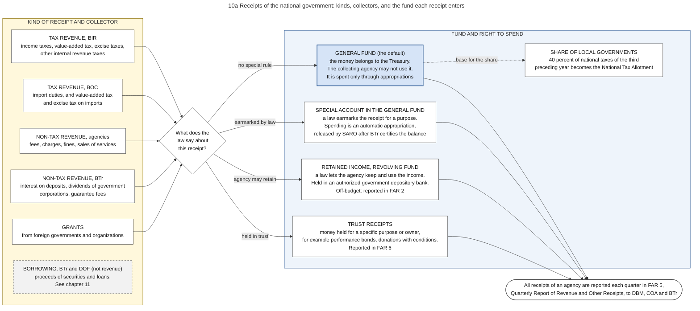
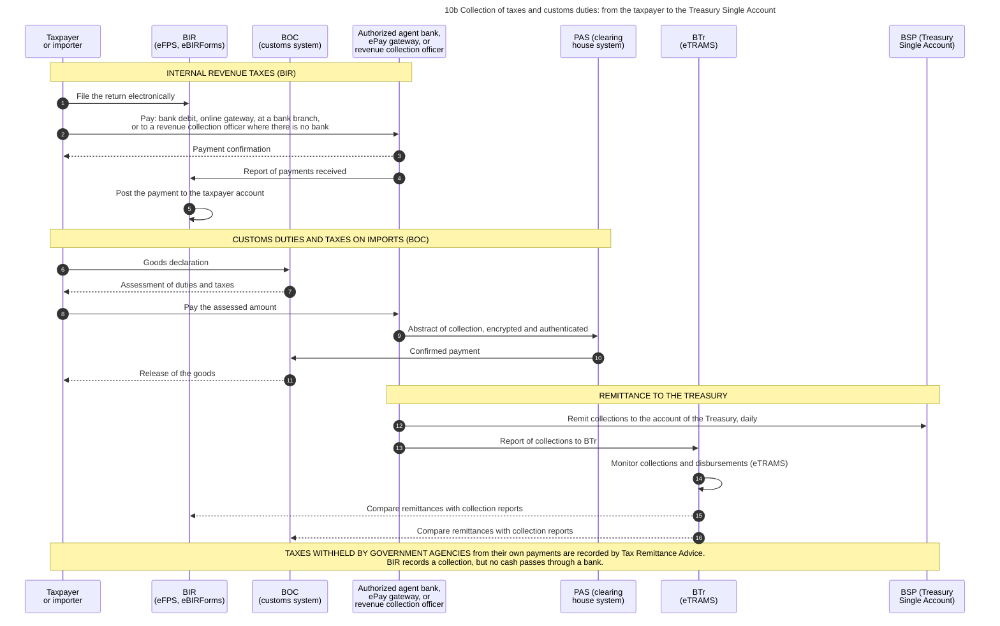
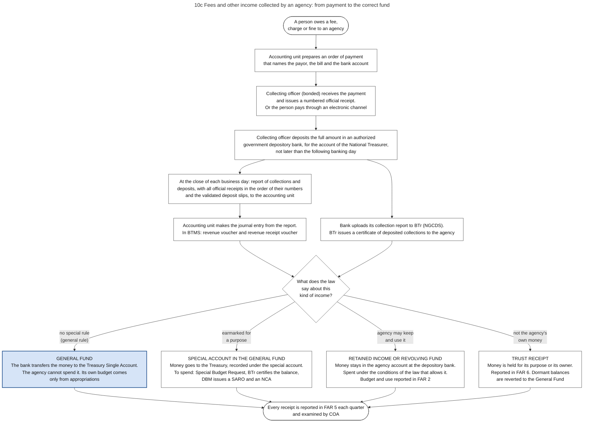
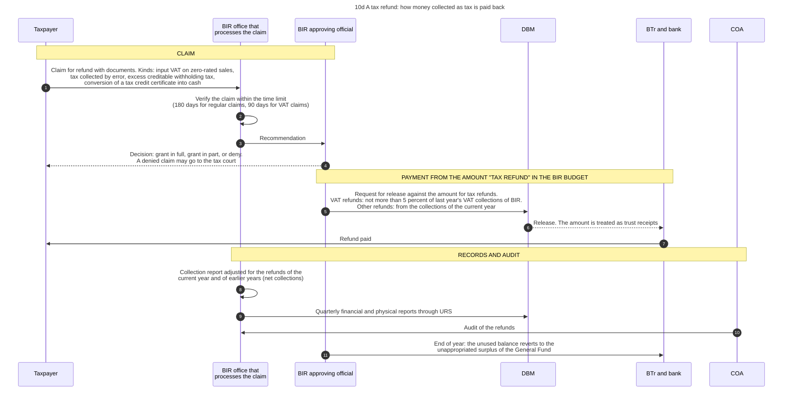

# 10. Revenue and other receipts

*Part of the Philippine PFM Atlas. Facts as of 8 October 2026. The codes in the column "Basis" are explained in [Reference F](../reference/F_sources_and_verification.md). "GK" means general knowledge that I did not open in a source during this work.*

## 1. The question this process answers

Which kinds of money does the national government receive, how does each kind reach the Treasury, and may the office that collects the money also spend it?

## 2. The idea in plain words

The office that collects money is normally not the office that may spend it. A tax office collects taxes but its own budget comes from an appropriation like that of any other agency. All collections go to one place, the Treasury, and from there they are spent only through appropriations. This rule is what makes the budget complete: if agencies could spend what they collect, part of public money would never be examined by Congress.

The law states the rule in three parts. Income of agencies is deposited in the National Treasury and credited to the General Fund unless a law provides otherwise [PD1445 s.65]. Every payment is acknowledged immediately: "No payment of any nature shall be received by a collecting officer without immediately issuing an official receipt in acknowledgment thereof" [PD1445 s.68]. Collecting officers "shall remit or deposit intact the full amounts" that they collect, and the treasury of the agency deposits them with the government depository "not later than the following banking day" [PD1445 s.69]. The accounting manual adds that no temporary receipt may be used for public funds, and that official receipts are numbered in advance and issued in the strict order of their numbers [GAM-V1 Ch.2 s.4].

The exceptions are all made by law, and each has its own kind of fund.

- A law earmarks a receipt for a purpose. The money is in the Treasury but in a **special account in the General Fund**, and may be spent only for that purpose.
- A law lets an agency keep and use its income. This is **retained income** or a **revolving fund**. It stays in a bank account of the agency, outside the yearly appropriation.
- The money is not the government's own: it is held for a purpose or for another party. These are **trust receipts**.

A case where the rule works: a taxpayer pays through a bank, the bank remits to the Treasury on the same or the next day, and the cash is available for all payments of the government. The 2025 PEFA assessment found that BIR and BOC transfer their collections daily into the Treasury Single Account (indicator 20.2, score A) [PEFA2025].

A case where it fails: an agency keeps income in its own account under a special law, and this money is reported only in periodic reports. The Roadmap plans to include such off-budget accounts in BTMS or URS [SFA6].

Terms. An **authorized agent bank** is a bank that may receive tax payments. An **authorized government depository bank** is a bank that may receive the collections of agencies. The **General Fund** is the fund for all money that no law places elsewhere.

## 3. Kinds of receipt

Diagram 10a shows the kinds and the funds. The table gives the same content.

| Kind | Collector | Enters which fund | Basis |
|---|---|---|---|
| Internal revenue taxes | BIR, through authorized agent banks, electronic gateways and revenue collection officers | General Fund, except taxes earmarked by law | BIR-PAY, CONST VI.29(3) |
| Duties and taxes on imports | BOC, through authorized agent banks | General Fund | PAS |
| Fees, charges and fines | The agency that renders the service, through its collecting officers and depository banks | General Fund by default. Special account, retained income or trust receipt where a law says so | PD1445 s.65, GAA2026-GP |
| Income of the Treasury: interest, dividends of government corporations (at least 50 percent of annual net earnings), guarantee fees | BTr | General Fund | BSGC2026, EO449 |
| Grants | Receiving agency or the Treasury | As the grant agreement and the law provide. In the example of the Manual a foreign grant in cash is received by BTr, which records it as a deferred credit. The agency that implements receives an NCA. The grant becomes income in the books of BTr when the agency reports that the project is complete | GAM-V1 Ch.5 s.27 |
| Taxes that agencies withhold from their own payments | The paying agency, by Tax Remittance Advice | General Fund. No cash moves: the advice produces entries in the books of the agency, of BIR and of BTr | GAM-V1 Ch.5 s.38 |
| Proceeds of borrowing | BTr and DOF | Treasury. Borrowing is financing, not revenue (chapter 11) | EO449 |

Forty percent of the national taxes collected in the third fiscal year before the budget year is the share of local governments [LGC s.284][MANDANAS]. See chapter 14.

## 4. Authorities and their roles

| Authority | Role in this process | Basis |
|---|---|---|
| Congress | Passes tax laws. Revenue and tariff bills start in the House | CONST VI.24 |
| DOF | Revenue policy and forecasts. Supervises BIR and BOC | DBCC-PAGE (revenue estimates in the DBCC). Supervision: GK |
| BIR | Receives returns, posts payments to taxpayer accounts | BIR-PAY. Posting: GK |
| BOC | Receives goods declarations, assesses duties and taxes, releases goods after payment | PAS. Declaration and release: GK |
| Authorized agent banks | Receive payments, report them, remit to the Treasury | BIR-PAY, PAS, PEFA2025 |
| Philippine Clearing House Corporation | Operates the system by which banks send abstracts of customs collections to BOC | PAS |
| Accounting unit of an agency | Prepares the order of payment on which the collecting officer collects. Makes the journal entry from the daily report of the collecting officer or from the report of the bank. Sends the quarterly report of revenue to COA, DBM and BTr | GAM-V1 Ch.5 s.40, s.41, s.42 |
| Collecting officers of agencies | Issue official receipts, deposit the full amount not later than the following banking day, and report each day. They must be bonded | PD1445 s.68, s.69, s.101, GAM-V1 Ch.5 s.39 |
| Permanent Committee: the Secretary of Finance as chair, the Secretary of Budget and Management and the Chairman of COA | Makes the rules under which receipts are recorded as income of special, fiduciary and trust funds. Monitors all funds other than the General Fund, and may recommend to the President that amounts return to the General Fund | PD1445 s.65, s.66, EO292-B6 s.45, GAM-V1 Ch.5 s.4 |
| Authorized government depository banks | Receive agency collections and upload collection reports to BTr | EO449, BTR-SYS |
| BTr | Receives the money in the Treasury Single Account, monitors collections, certifies balances of special accounts, examines the books of collecting officers through its regional offices | EO449, BTR-SITE, BTR-SYS, NBC599 |
| COA | Audits revenue. May examine the papers of revenue collection to see that all amounts found due were collected. Its auditor examines the reports of collecting officers within thirty days. May issue a Notice of Charge for revenue not assessed or collected | PD1445 s.28, s.64, COA2009-006 |

## 5. Steps for taxes and customs duties

The steps are those of diagram 10b.

| No. | Who acts | Towards whom | What is done or passed | Basis |
|---|---|---|---|---|
| 1 | Taxpayer or importer | BIR (eFPS, eBIRForms) | File the return electronically | BIR-PAY |
| 2 | Taxpayer or importer | Authorized agent bank, ePay gateway, or revenue collection officer | Pay: bank debit, online gateway, at a bank branch, or to a revenue collection officer where there is no bank | BIR-PAY |
| 3 | Authorized agent bank, ePay gateway, or revenue collection officer | Taxpayer or importer | Payment confirmation | GK |
| 4 | Authorized agent bank, ePay gateway, or revenue collection officer | BIR (eFPS, eBIRForms) | Report of payments received | GK |
| 5 | BIR (eFPS, eBIRForms) | (own action) | Post the payment to the taxpayer account | GK |
| 6 | Taxpayer or importer | BOC (customs system) | Goods declaration | GK |
| 7 | BOC (customs system) | Taxpayer or importer | Assessment of duties and taxes | GK |
| 8 | Taxpayer or importer | Authorized agent bank, ePay gateway, or revenue collection officer | Pay the assessed amount | PAS |
| 9 | Authorized agent bank, ePay gateway, or revenue collection officer | PAS (clearing house system) | Abstract of collection, encrypted and authenticated | PAS |
| 10 | PAS (clearing house system) | BOC (customs system) | Confirmed payment | PAS |
| 11 | BOC (customs system) | Taxpayer or importer | Release of the goods | GK |
| 12 | Authorized agent bank, ePay gateway, or revenue collection officer | BSP (Treasury Single Account) | Remit collections to the account of the Treasury, daily | PEFA2025 |
| 13 | Authorized agent bank, ePay gateway, or revenue collection officer | BTr (eTRAMS) | Report of collections to BTr | GK. The source describes NGCDS only for authorized government depository banks: BTR-SYS |
| 14 | BTr (eTRAMS) | (own action) | Monitor collections and disbursements (eTRAMS) | BTR-SYS |
| 15 | BTr (eTRAMS) | BIR (eFPS, eBIRForms) | Compare remittances with collection reports | GK |
| 16 | BTr (eTRAMS) | BOC (customs system) | Compare remittances with collection reports | GK |

### Channels of BIR

| Purpose | Channel | Basis |
|---|---|---|
| Filing of returns | eFPS for taxpayers enrolled in it. eBIRForms for others. Software of accredited tax software providers. Manual filing only when the systems are not available | BIR-PAY |
| Attachments to returns | Electronic submission facilities of BIR | BIR-PAY |
| Payment | Authorized agent banks. Revenue collection officers, who accept cash only up to PHP 20,000 and checks without limit. Electronic gateways: the portals of LBP and DBP, the online facility of a private bank, and two payment providers that accept cards and electronic wallets | BIR-PAY |

### Channel of BOC

The banks collect customs duties and taxes and send abstracts of collection to BOC through Payment Application Secure, a system that the Philippine Clearing House Corporation has operated for the banks since October 1996 under an agreement between the bankers' association and BOC. The abstracts are encrypted and authenticated [PAS].

## 6. Steps for fees collected by an agency

Diagram 10c shows the steps and the four possible funds. The steps and the forms are those of the accounting manual. "App." is the number of the form in its Volume II.

| No. | Step | Who | Basis |
|---|---|---|---|
| 1 | Order of payment: it names the payor, the bill and the bank account for the deposit | Accounting unit | GAM-V1 Ch.5 s.40, GAM-V2 App.28 |
| 2 | Payment received. Official receipt issued immediately, in three copies: for the payor, for the report, for the file | Collecting officer | PD1445 s.68, GAM-V1 Ch.5 s.40 |
| 3 | Collection entered in the cash receipts record | Collecting officer | GAM-V2 App.29 |
| 4 | Deposit of the full amount in an authorized government depository bank "for the account of the National Treasurer", with deposit slips in three copies and a list of the deposited collections | Collecting officer | GAM-V1 Ch.5 s.40, PD1445 s.69 |
| 5 | At the close of the business day: report of collections and deposits in four copies, with all official receipts in the order of their numbers, the cancelled ones included, and with the validated deposit slips. The head of the cash unit signs it | Collecting officer, head of the cash unit | GAM-V1 Ch.5 s.39, s.40, GAM-V2 App.26 |
| 6 | Journal entry from the report, certified by the chief accountant and entered in the cash receipts journal. In BTMS: revenue voucher and revenue receipt voucher | Accounting unit | GAM-V1 Ch.5 s.40, CL2025-8 |
| 7 | For collections that payors make directly at a bank: the bank sends a consolidated report of daily collections, and the accounting unit makes the journal entry from it | Bank, accounting unit | GAM-V1 Ch.5 s.41 |
| 8 | Bank uploads its collection report to BTr. BTr issues a certificate of deposited national collections to the agency | Bank, BTr | BTR-SYS |
| 9 | The money goes to the fund that the law provides: General Fund, special account, retained income, or trust | BTr, agency | PD1445 s.65, GAA2026-GP |
| 10 | Receipts reported each quarter, within 30 days, to COA, DBM and BTr (report FAR 5) | Chief accountant | GAM-V1 Ch.5 s.42, JC2019-1 |

Three rules for cases that go wrong. A check that the bank does not honour: the official receipt is cancelled, the amount becomes a receivable, and the payor may settle only in cash or by certified check [GAM-V1 Ch.5 s.32, s.34]. More cash than the receipts show: the difference is taken as income of the government [GAM-V1 Ch.5 s.35]. Less cash than the receipts show: the difference is a receivable from the collecting officer [GAM-V1 Ch.5 s.35].

### What the books show for revenue

| Kind of revenue | When it is recorded | Entry | Basis |
|---|---|---|---|
| A fee for a service | When the service is rendered or billed, "or if not practicable, when fees are collected" | Billing: debit Accounts Receivable, credit the income account. Collection: debit Cash-Collecting Officers. Remittance to the Treasury: debit Cash-Treasury/Agency Deposit, Regular | GAM-V1 Ch.5 s.7, Annex H |
| A tax | When it is collected. "The cash basis of accounting shall be applied by all government agencies in the recognition of revenue from non-exchange transaction until a reliable model of measurement of this revenue is developed." | In the books of BIR, for a payment through a bank: debit Cash-Treasury/Agency Deposit, Regular, credit the account of the tax, for example Income Tax | GAM-V1 Ch.5 s.12, Annex H |
| The same remittance in the books of the Treasury | When the money arrives | Debit Cash in Bank, credit Cash-Treasury/Agency Deposit, Regular | GAM-V1 Annex H |

Three consequences follow.

- A tax that is assessed and not yet paid is in general not an asset in the books. The stock of revenue arrears that an assessment reports (section 11) therefore comes from the records of the tax offices and not from the accounts.
- Tax revenue is recorded at the gross amount. An expense that the government pays through the tax system is recorded as an expense and is not deducted from the revenue [GAM-V1 Ch.5 s.19].
- A tax expenditure is a concession of the tax law to certain taxpayers. It is revenue that is not collected. The Manual says that it creates no asset, liability, revenue or expense, so the books do not show it [GAM-V1 Ch.5 s.20].

## 7. The four funds and the right to spend

| Fund | Where the cash is | How the agency may spend it | Report | Basis |
|---|---|---|---|---|
| General Fund | Treasury Single Account. In the books of the agency the remitted amount is recorded in the account Cash-Treasury/Agency Deposit, Regular, which is closed at the end of the year | Not at all from the receipt. Only through its appropriation | FAR 5 for the receipt, FAR 1 for the spending | PD1445 s.65, GAA2026-GP, GAM-V1 Ch.19 s.57 |
| Special account in the General Fund | Treasury Single Account, recorded under the special account | Special Budget Request. BTr certifies the balance. DBM issues a SARO and an NCA under the sub-account for special accounts | FAR 5, FAR 1 | NBC599 |
| Retained income, revolving fund | Agency account in an authorized government depository bank | Under the law that allows it. Revolving funds must be self-liquidating | FAR 5, FAR 2 | GAA2026-GP, JC2019-1 |
| Trust receipts | Trust account | Only for the purpose of the trust. Dormant balances are reverted to the General Fund | FAR 5, FAR 6 | GAA2026-GP, JC2019-1, PD1445 s.84 |

The accounting manual keeps separate books for each group of funds. It calls the groups fund clusters: 01 for the regular agency fund, 03 and 04 for special accounts, 05 for internally generated funds (retained income), 06 for business related funds (revolving funds), 07 for trust receipts [GAM-V1 Ch.2 s.13]. Chapter 15 describes the clusters.

## 8. Information systems

| System | Owner | Use | Basis |
|---|---|---|---|
| eFPS, eBIRForms | BIR | Returns | BIR-PAY |
| Electronic payment gateways | Banks and payment providers | Tax payments | BIR-PAY |
| E2M customs system | BOC | Declarations and assessment. The page of BOC on its modernization calls it the "currently implemented E2M customs module" and plans a new Customs Processing System as "one single and unified system". The page gives 2024 as the target year. The present state is not verified | BOC-MOD. What the system holds: GK |
| TradeNet | DOF, built by DICT | The platform of the National Single Window for permits of imports and exports, adopted in 2017 for 66 agencies and 10 economic zones. The present state is not verified | TRADENET |
| Payment Application Secure | Philippine Clearing House Corporation | Abstracts of customs collections from banks to BOC | PAS |
| NGCDS | BTr | Authorized government depository banks upload daily and monthly collection reports. BTr issues certificates of deposited national collections to the agencies | BTR-SYS |
| eTRAMS | BTr, developed with LBP | Monitoring of revenue collections and disbursements of the national government. Who sends the data on tax and customs collections is not described in the sources I read | BTR-SYS, BTR-SITE |
| URS | DBM | FAR 5 | JC2019-1 |
| BTMS | DBM | Receipt management in agencies that use it | CL2025-8 |
| Planned: eGovPay platform | DICT with the working group on digital payments | A common platform for payments to government | SFA6 |

## 9. Controls: what each one checks, and what it does not check

| Control | What it checks | What it does not check |
|---|---|---|
| Payment through banks, not to the tax office | That the officer who assesses does not handle the money | The correctness of the assessment |
| Numbered official receipts | That every payment received is recorded | Payments for which no receipt was issued |
| Order of payment prepared by the accounting unit | That the officer who receives the money does not decide alone what is due | The correctness of the bill |
| Deposit of the full amount by the following banking day | That collections are not used before deposit | |
| Daily report with every official receipt in the order of its number, the cancelled ones included | That no receipt is missing between two numbers | A payment for which no receipt was issued |
| Bonding of collecting officers | That a loss can be recovered | |
| Examination of the reports of collecting officers by the auditor within thirty days | That the reports agree with the receipts and the deposits | |
| Three records of one payment (revenue agency, bank, Treasury) | That what was paid equals what was remitted | Taxes that were never assessed |
| Certification of the balance of a special account by BTr | That an earmarked fund is not overspent | |
| Audit of revenue, Notice of Charge | Under-assessment and under-collection | |

## 10. Refunds: money collected as tax that is paid back

A tax that was collected must sometimes be returned: the taxpayer paid too much, paid by error, or has a right to recover the value-added tax on its purchases. Diagram 10d answers the question: from which authority is a refund paid, and how does it change the reported collections?

The idea: a refund is not spending for a program, but it is money that leaves the Treasury. The Constitution allows no payment from the Treasury without an appropriation [CONST VI.29(1)]. The budget law therefore contains an amount for refunds in the budget of BIR. A refund also reduces net revenue, so a figure of collections must say whether it is before or after refunds.

The steps are those of diagram 10d.

| No. | Who acts | Towards whom | What is done or passed | Basis |
|---|---|---|---|---|
| 1 | Taxpayer | BIR office that processes the claim | Claim for refund with documents. Kinds: input VAT on zero-rated sales, tax collected by error, excess creditable withholding tax, conversion of a tax credit certificate into cash | GAA2025-BIR, TRIB-REFUND |
| 2 | BIR office that processes the claim | (own action) | Verify the claim within the time limit (180 days for regular claims, 90 days for VAT claims) | TRIB-REFUND. Period for VAT claims: GK |
| 3 | BIR office that processes the claim | BIR approving official | Recommendation | GK |
| 4 | BIR approving official | Taxpayer | Decision: grant in full, grant in part, or deny. A denied claim may go to the tax court | GK |
| 5 | BIR approving official | DBM | Request for release against the amount for tax refunds. VAT refunds: not more than 5 percent of last year's VAT collections of BIR. Other refunds: from the collections of the current year | GAA2025-BIR. The request to DBM: GK |
| 6 | DBM | BTr and bank | Release. The amount is treated as trust receipts | GAA2025-BIR. Form of the release: GK |
| 7 | BTr and bank | Taxpayer | Refund paid | GK |
| 8 | BIR office that processes the claim | (own action) | Collection report adjusted for the refunds of the current year and of earlier years (net collections) | GAA2025-BIR |
| 9 | BIR office that processes the claim | DBM | Quarterly financial and physical reports through URS | GAA2025-BIR |
| 10 | COA | BIR office that processes the claim | Audit of the refunds | GAA2025-BIR |
| 11 | BIR approving official | BTr and bank | End of year: the unused balance reverts to the unappropriated surplus of the General Fund | GAA2025-BIR |

| Rule | Content | Basis |
|---|---|---|
| Amount | PHP 13,913,626,214 in the FY 2025 budget of BIR under the heading "Tax Refund". I did not find the FY 2026 text | GAA2025-BIR |
| Limit for VAT refunds | 5 percent of the total VAT collections of BIR in the preceding year | GAA2025-BIR |
| Other refunds | Paid from the tax collections of the current year | GAA2025-BIR |
| Kind of fund | The amount is "treated as trust receipts". The unused balance at the end of the year reverts to the unappropriated surplus of the General Fund | GAA2025-BIR |
| Conditions | The collection report of BIR is adjusted for the refunds of the current and of earlier years. The refunds are audited by COA | GAA2025-BIR |
| Periods for BIR to act | 180 days from the submission of the claim with complete documents for regular claims. Two years for claims on the dissolution of a business | TRIB-REFUND (press report on BIR issuances of 29 September 2026) |

A case where the figures can be compared: collections of BIR in two years, both after refunds.

A case where the comparison fails: the collections of one year are reported before refunds and those of the next year after refunds. The difference then appears as a decrease of revenue that did not occur.

Two related facts from the accounting manual. Its list of funding sources has a code for tax refunds among the automatic appropriations, 104108, and a code 104105 for "Customs duties and taxes, including tax expenditures" [GAM-V1 Annex P]. The Manual describes the tax expenditure fund as "a subsidy released by the DBM to government-owned or controlled corporations and government financial institutions to settle customs duties and other taxes arising from the importation of goods" [GAM-V1 Ch.5 s.20]. The Administrative Code has the rule behind it: government bodies pay taxes and duties, and a body that a law exempts may ask for a subsidy of the same amount, which is recorded as revenue and as expenditure of the General Fund [EO292-B6 s.20]. The budget law of FY 2025 treats the refund amount as trust receipts, as the table says. I did not read how the two descriptions relate.

Not read: the refund rules of the Tax Code and of the Bureau of Customs.

## 11. Where the process fails in practice

| Reported weakness | Basis |
|---|---|
| The stock of revenue arrears is below 40 percent of yearly collections, but more than 75 percent of the arrears are older than 12 months (PEFA indicator 19.4, score D). Under the cash basis for taxes, these arrears are not receivables in the accounts (section 6) | PEFA2025, GAM-V1 Ch.5 s.12 |
| Accounts of foreign-funded projects and trust accounts with a legal basis remain outside the Treasury Single Account (PEFA indicator 21.1, score C) | PEFA2025 |
| Off-budget accounts are not in the main systems | SFA6 |

## 12. Diagrams

### Diagram 10a  Receipts of the national government: kinds, collectors, and the fund each receipt enters

Code file: `../diagrams/mermaid/10a_revenue_classification.mmd`. Rendered image: [`../rendered/10a_revenue_classification.png`](../rendered/10a_revenue_classification.png).

- **Question:** which kinds of money does the national government receive, who collects each kind, and may the collecting agency use the money?
- **How to read it:** left = kind of receipt and collector. Middle = the rule that decides the fund. Right = the fund and who may spend from it.
- **Sources:** revenue and tariff bills start in the House [CONST VI.24]. A tax levied for a special purpose is a special fund [CONST VI.29(3)]. Income of agencies goes to the National Treasury and to the General Fund unless a law provides otherwise, numbered receipts, deposit of the full amount [PD1445 s.65, s.68, s.69]. Taxes are recorded when they are collected [GAM-V1 Ch.5 s.12]. Collections as General Fund income, special accounts, trust receipts, revolving funds [GAA2026-GP]. Special accounts released as automatic appropriations, BTr certifies balances [NBC599]. Off-budget funds in fund clusters 05 and 06, trust receipts in cluster 07, report FAR 5 [JC2019-1]. Dividends of corporations, at least 50 percent of net earnings [BSGC2026]. Share of local governments from national taxes [LGC s.284][MANDANAS]. BTr functions [EO449].
- **General knowledge, not opened in a source here:** the list of taxes under each collector, privatization proceeds, examples of retained income.

### Diagram 10b  Collection of taxes and customs duties: from the taxpayer to the Treasury Single Account

Code file: `../diagrams/mermaid/10b_tax_and_customs_collection_sequence.mmd`. Rendered image: [`../rendered/10b_tax_and_customs_collection_sequence.png`](../rendered/10b_tax_and_customs_collection_sequence.png).

- **Question:** BIR and BOC assess taxes, but they do not hold the money. Through which channels does the money reach the Treasury, and which records must agree afterwards?
- **Idea:** three parties each keep a record of the same payment: the revenue agency (what was assessed and paid), the collecting bank (what was received), and the Treasury (what was remitted). Reconciliation means comparing these three records.
- **Sources:** filing channels eFPS, eBIRForms and tax software providers, payment through authorized agent banks, revenue collection officers and ePay gateways [BIR-PAY]. Payment Application Secure, operated by the Philippine Clearing House Corporation, by which banks send abstracts of customs collections to BOC [PAS]. Daily transfer of collections to the Treasury Single Account [PEFA2025]. eTRAMS monitors revenue collections and disbursements of the national government [BTR-SYS]. NGCDS is described only for authorized government depository banks, which receive agency collections (see 10c) [BTR-SYS]. Treasury Single Account at BSP [BTR-SITE][ROADMAP2024]. Tax Remittance Advice [NBC599].
- **General knowledge, not opened in a source here:** steps 3, 4 and 5 (bank confirmation, bank report to BIR, posting), steps 6, 7 and 11 (customs declaration, assessment, release of goods), step 13 (how the banks that collect taxes report to BTr), steps 15 and 16 (comparison of remittances with collection reports).

### Diagram 10c  Fees and other income collected by an agency: from payment to the correct fund

Code file: `../diagrams/mermaid/10c_agency_collections.mmd`. Rendered image: [`../rendered/10c_agency_collections.png`](../rendered/10c_agency_collections.png).

- **Question:** an agency collects a fee. What must the collecting officer do with the money, and under which condition may the agency itself spend it?
- **How to read it:** the upper part is the same for every collection. The lower part depends on what the law says about that kind of income.
- **Sources:** numbered official receipt immediately for every payment, deposit of the full amount not later than the following banking day, income to the National Treasury and the General Fund unless a law provides otherwise [PD1445 s.65, s.68, s.69]. The steps, the forms and the copies: order of payment prepared by the accounting unit, official receipt, cash receipts record, deposit through a depository bank for the account of the National Treasurer, daily report of collections and deposits, journal entry [GAM-V1 Ch.5 s.39, s.40][GAM-V2 App.26, App.28, App.29]. Bonding of accountable officers [PD1445 s.101]. Banks upload collection reports, BTr issues deposit certificates [BTR-SYS]. General Fund, special accounts, trust receipts, revolving funds in the general provisions [GAA2026-GP]. Release of special accounts after BTr certifies the balance [NBC599]. FAR 5, FAR 2, FAR 6 [JC2019-1]. Receipt records in BTMS (revenue voucher, revenue receipt voucher) [CL2025-8].
- **The entries:** collection: debit Cash-Collecting Officers, credit the income account or Accounts Receivable. Remittance: debit Cash-Treasury/Agency Deposit, Regular, credit Cash-Collecting Officers. The books of the Treasury: debit Cash in Bank, credit Cash-Treasury/Agency Deposit, Regular [GAM-V1 Annex H].
- **General knowledge, not opened in a source here:** electronic collection channels of each agency.

### Diagram 10d  A tax refund: how money collected as tax is paid back

Code file: `../diagrams/mermaid/10d_tax_refund_sequence.mmd`. Rendered image: [`../rendered/10d_tax_refund_sequence.png`](../rendered/10d_tax_refund_sequence.png).

- **Question:** a tax that was collected must sometimes be returned. From which authority is it paid, and how does it change the reported collections?
- **Idea:** a refund is not spending for a program, but it is still money that leaves the Treasury. The Constitution allows no payment from the Treasury without an appropriation, so the budget law contains an amount for refunds in the budget of the Bureau of Internal Revenue. A refund reduces net revenue. A report of collections must therefore say whether it is before or after refunds.
- **Sources:** the rule that money leaves the Treasury only under an appropriation [CONST VI.29(1)]. The amount for "Tax Refund" in the BIR budget, its treatment as trust receipts, the limit of VAT refunds to 5 percent of the VAT collections of BIR in the preceding year, payment of other refunds from the collections of the current year, the adjustment of the collection report, the audit by COA, and the reversion of the unused balance [GAA2025-BIR]. This is the text of the FY 2025 budget law. I did not find the FY 2026 text.
- **From a press report [TRIB-REFUND]:** BIR issuances of 29 September 2026 on refund claims, and the period of 180 days for regular claims.
- **General knowledge, not opened in a source here:** the period of 90 days for VAT refund claims (section 112 of the Tax Code), the appeal to the Court of Tax Appeals, and the way in which the cash reaches the taxpayer (steps 6 and 7). Refunds of customs duties by the Bureau of Customs follow separate rules that I did not read.

## 13. Verification status

- **Verified in a source:** the rules on collections in the Auditing Code, now read in the full text [PD1445 ss.63-71]. The steps, forms and entries for the collections of an agency, the cash basis for taxes, and the treatment of tax expenditures [GAM-V1 Ch.5, Annex H][GAM-V2]. The channels of BIR, through a professional summary of the BIR circular [BIR-PAY]. The customs channel [PAS]. The treasury systems [BTR-SYS]. The kinds of fund in the general provisions [GAA2026-GP]. The reports [JC2019-1]. Daily transfer to the Treasury [PEFA2025]. The amount and the rules for tax refunds in the FY 2025 budget law [GAA2025-BIR]. The name of the customs system and the planned new system [BOC-MOD]. TradeNet as adopted in 2017 [TRADENET].
- **General knowledge, to check:** bank confirmation and bank reports to BIR, how the banks that collect taxes report to BTr, posting to taxpayer accounts, the customs declaration, assessment and release, the comparison between BIR, BOC and BTr, the decision on a refund claim and the way in which the cash of a refund reaches the taxpayer.
- **A precise wording of the deposit rule:** the Auditing Code does not say that collections are deposited "intact and daily". It says: in full, and with the government depository not later than the following banking day.
- **From a press report only:** the periods for BIR to act on refund claims [TRIB-REFUND].
- **Not covered:** tax policy, assessment, taxpayer audit and enforcement, the refund rules of the Tax Code and of customs, tax expenditures.
