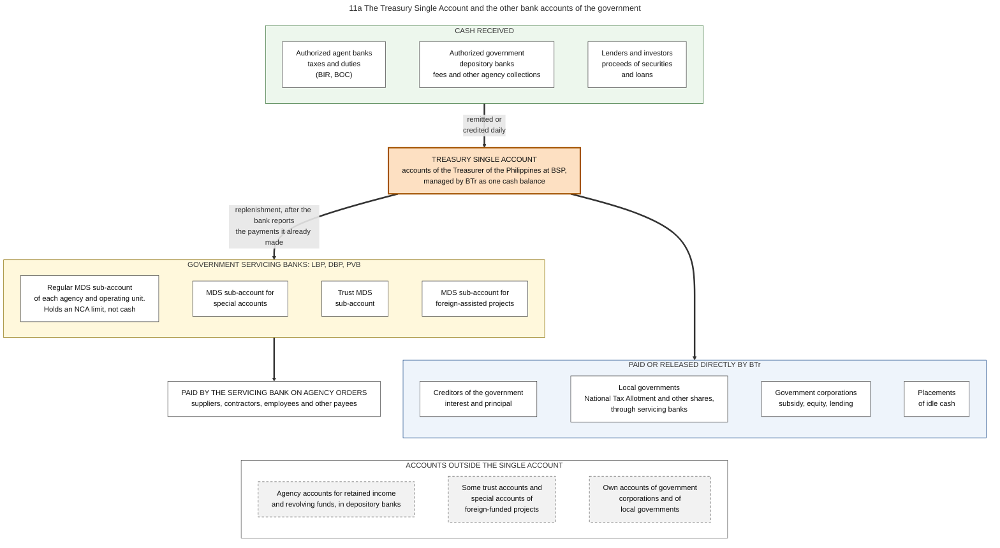
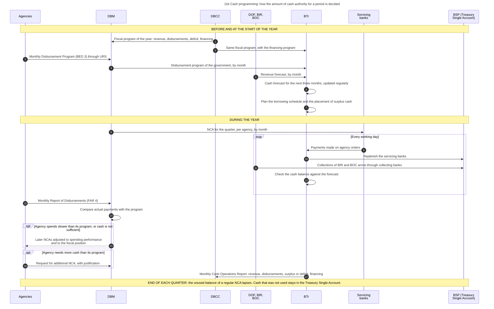
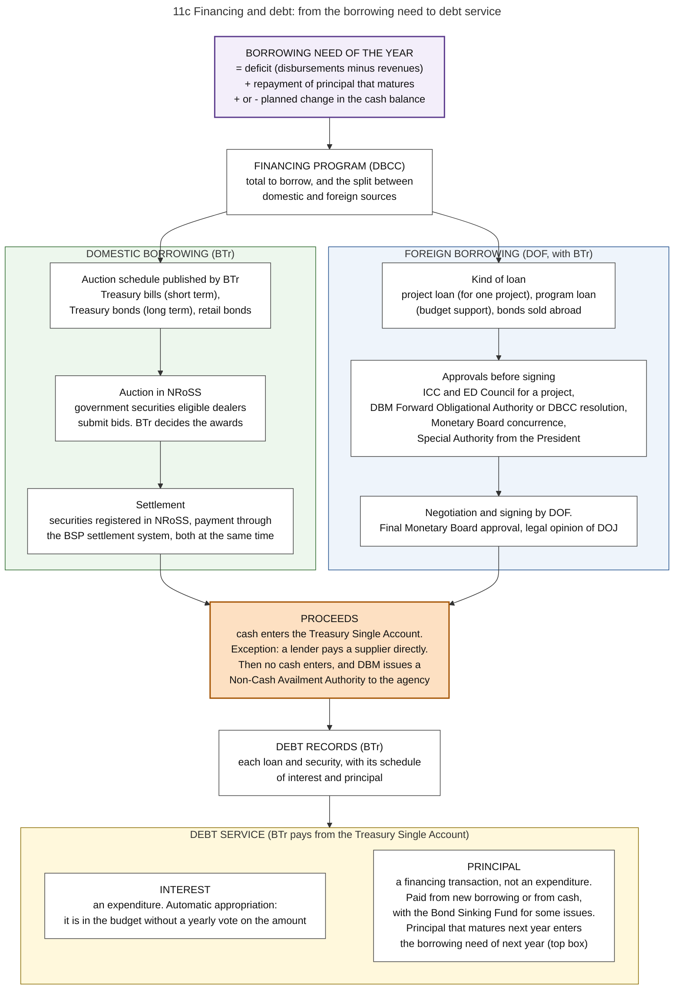
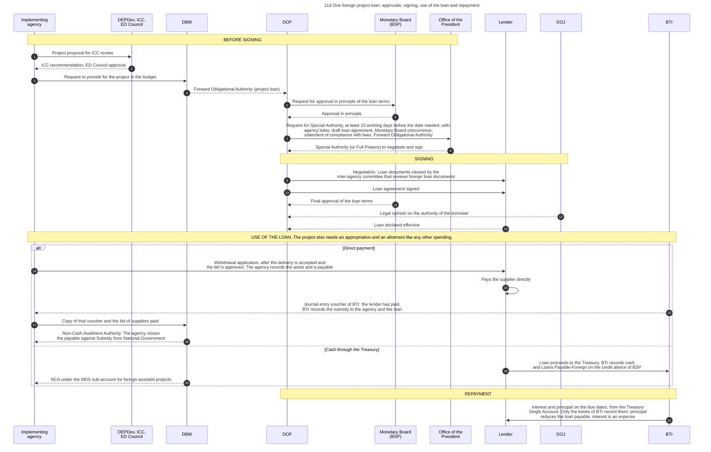

# 11. Treasury: cash, the Treasury Single Account, borrowing and debt

*Part of the Philippine PFM Atlas. Facts as of 8 October 2026. The codes in the column "Basis" are explained in [Reference F](../reference/F_sources_and_verification.md). "GK" means general knowledge that I did not open in a source during this work.*

## 1. The question this process answers

Where is the cash of the national government held, who decides how much may be paid in a period, and how is the gap between receipts and payments financed?

## 2. The idea in plain words

The budget fixes how much may be spent in a year. It does not fix when the cash arrives. Tax collections are uneven during the year, and payments become due on their own dates. One office must therefore hold all the cash as one balance, forecast its movement, and borrow or invest so that money is there on the day a payment is due. This office is the **Bureau of the Treasury (BTr)**.

Three arrangements make this possible.

1. **One balance.** The **Treasury Single Account (TSA)** is, in the words of BTr, "a unified structure of government bank accounts" [BTR-SITE]. It is not one account and it is not software. It is a rule about bank accounts: the cash of the government is consolidated at the central bank so that BTr can see and use it as one amount.
2. **Limits, not cash, for agencies.** An agency does not hold cash for its regular budget. It holds a limit (the NCA) at a servicing bank. The bank pays, and BTr repays the bank. Cash therefore stays in the single balance until the moment of payment. The accounting manual states the same fact for the books of an agency: for its account of the NCA "there is no actual cash with the GSBs", the government servicing banks [GAM-V1 Ch.19 s.56].
3. **A cash program.** BTr forecasts cash for the next three months [BTR-SITE]. DBM issues NCAs within that forecast. When cash is not sufficient, BTr borrows. When there is more than needed, BTr places it. The Administrative Code requires this: an operational cash budget, "to ensure the availability of cash resources for priority development projects and to establish a sound basis for determining the level, type and timing of public borrowings" [EO292-B6 s.36].

One rule of law stands behind all three. National funds "shall not be withdrawn from the National Treasury except upon warrant or other instruments of withdrawal approved by the Minister (Secretary) of Finance as recommended by the Treasurer of the Philippines" [PD1445 s.84]. The temporary investment of cash that is not needed immediately is not a disbursement [PD1445 s.84].

A case where this works: collections arrive daily, the forecast is close to the actual amounts, and cash is available for all NCAs that were issued. The 2025 PEFA assessment rates cash forecasting with the highest score, A (indicator 21.2) [PEFA2025].

A case where it fails: money is held in accounts outside the single balance, for example agency accounts for retained income or accounts of foreign-funded projects. The government then borrows and pays interest while it holds idle cash elsewhere. The same assessment states that accounts of foreign-funded projects and trust accounts with a legal basis remain outside the single account (indicator 21.1, score C) [PEFA2025].

Terms. **Modified Disbursement System (MDS)**: the arrangement of sub-accounts at servicing banks through which agencies pay. **Government securities**: Treasury bills and bonds, which are promises of the government to pay. **Debt service**: payment of interest and repayment of principal. **Financing**: borrowing and repayment, which are not revenue and not expenditure.

## 3. Authorities and their roles

| Authority | Role in this process | Basis |
|---|---|---|
| BTr | Manages the cash resources of the national government. Keeps the books of its cash transactions: in the words of the accounting manual, it "accounts for the cash, public debt and related transactions" of the national government, and the books of every agency are reconciled with its cash records. Issues, services and redeems government securities. Controls and services public debt. Administers the Bond Sinking Fund. Is principal custodian of the financial assets of the national government. Forecasts cash. Releases to local governments and subsidized corporations | EO449, BTR-SITE, NBC599, GAM-V1 Ch.2 s.8 |
| DOF | Policy on borrowing and debt. Negotiates and signs foreign loans | MC51. Policy role: GK |
| DBCC | Recommends the level of borrowing in the fiscal program | DBCC-PAGE |
| DBM | Issues NCAs from the monthly disbursement programs of agencies, subject to spending performance and the fiscal position. Issues the Forward Obligational Authority for a project loan | NBC599, MC51 |
| BSP | Holds the Treasury Single Account. Operates the settlement system. Its Monetary Board gives prior concurrence to foreign loans | ROADMAP2024, NRoSS, CONST VII.20 |
| Government servicing banks | Pay on agency orders and are replenished. Send to BTr, on the day of receipt, a copy of each summary list and payment order, so that BTr knows which payments and which replenishment to expect. Report to each agency at the end of each month the state of its account | CL2013-16A, NBC599, GAM-V1 Ch.6 s.56, PD1445 s.74 |
| Dealers in government securities | Bid in the auctions | NRoSS |
| President and Office of the President | The President may contract or guarantee foreign loans. The Office issues the Special Authority to negotiate and sign | CONST VII.20, MC51 |
| DEPDev, ICC, ED Council | Review every project to be funded by a foreign loan | ICC-NEWS |
| DOJ | Legal opinion on the loan | ODA |

Structure of BTr under its reorganization order: an Asset Management Service for cash receipts and disbursements, the investment of idle balances and the Bond Sinking Fund; a Liability Management Service for borrowing and the tracking of public debt; an Accounting Service; and regional, provincial and district offices that examine the books of national collecting officers and local treasurers [EO449]. The present structure may differ.

## 4. The bank accounts

Diagram 11a shows the accounts. The table gives the same content.

| Account | Held at | Holds | Basis |
|---|---|---|---|
| Treasury Single Account | BSP | The cash of the national government as one balance | BTR-SITE, ROADMAP2024 |
| Collection accounts | Authorized agent banks and authorized government depository banks | Collections on their way to the Treasury. Remitted or credited daily | PEFA2025, EO449 |
| MDS sub-accounts: regular, special accounts in the General Fund, trust, foreign-assisted projects | LBP, DBP, PVB | A limit (NCA) for each agency and operating unit, not cash | NBC599 s.4.2.1.6 |
| Accounts for retained income and revolving funds | Authorized government depository banks | Cash that an agency may keep under a law. Outside the single account | GAA2026-GP |
| Some trust accounts and special accounts of foreign-funded projects | Banks | Outside the single account | PEFA2025 |
| Accounts of government corporations and of local governments | Banks | Their own money. Outside the national single account | GK |

Legal basis of the single account named by BTr: Executive Order No. 55 of 2011, Executive Order No. 338 of 1996 and Executive Order No. 431 of 2005 [BTR-SITE].

## 5. Steps of cash programming

The steps are those of diagram 11b.

| No. | Who acts | Towards whom | What is done or passed | Basis |
|---|---|---|---|---|
| 1 | DBCC | DBM | Fiscal program of the year: revenue, disbursements, deficit, financing | DBCC-PAGE |
| 2 | DBCC | BTr | Same fiscal program, with the financing program | DBCC-PAGE |
| 3 | Agencies | DBM | Monthly Disbursement Program (BED 3) through URS | NBC599 s.3.9 |
| 4 | DBM | BTr | Disbursement program of the government, by month | GK |
| 5 | DOF, BIR, BOC | BTr | Revenue forecast, by month | GK |
| 6 | BTr | (own action) | Cash forecast for the next three months, updated regularly | BTR-SITE |
| 7 | BTr | (own action) | Plan the borrowing schedule and the placement of surplus cash | EO449. Link to the forecast: GK |
| 8 | DBM | Servicing banks | NCA for the quarter, per agency, by month | NBC599 s.4.2.1 |
| 9 | Servicing banks | BTr | Payments made on agency orders | CL2013-16A |
| 10 | BTr | BSP (Treasury Single Account) | Replenish the servicing banks | PRIMER, CL2013-16A |
| 11 | DOF, BIR, BOC | BSP (Treasury Single Account) | Collections of BIR and BOC arrive through collecting banks | PEFA2025 |
| 12 | BTr | (own action) | Check the cash balance against the forecast | GK |
| 13 | Agencies | DBM | Monthly Report of Disbursements (FAR 4) | JC2019-1 |
| 14 | DBM | (own action) | Compare actual payments with the program | Inference from NBC599 s.4.2.1 |
| 15 | DBM | Agencies | Later NCAs adjusted to spending performance and to the fiscal position | NBC599 s.4.2.1 |
| 16 | Agencies | DBM | Request for additional NCA, with justification | NBC599 s.4.2.1 |
| 17 | BTr | DBCC | Monthly Cash Operations Report: revenue, disbursements, surplus or deficit, financing | NBC599 |

## 6. Financing and debt

Diagram 11c shows the flow from the borrowing need to debt service.

| Stage | Content | Basis |
|---|---|---|
| Borrowing need of the year | Deficit, plus repayment of principal that matures in the year, adjusted for the planned change in the cash balance | GK |
| Financing program | Total to borrow and the split between domestic and foreign sources, recommended by the DBCC | DBCC-PAGE |
| Domestic borrowing | BTr sells government securities in auctions. Bids are submitted, awards are confirmed and results are settled in NRoSS, the National Registry of Scripless Securities, which replaced two older systems. The system is linked to the BSP settlement system, so that the securities and the payment are exchanged at the same time | NRoSS, BTR-SYS. Kinds of securities and auction calendar: GK |
| Foreign borrowing | Loans for projects, loans for budget support, and bonds sold abroad. Approvals: see section 7 | MC51, ODA. Kinds: GK |
| Rule on the use of loan proceeds | Spending that is financed by borrowing is part of the expenditure program of the agency. Loan proceeds, in cash or in kind, may not be used without a release of funds | EO292-B6 s.29 |
| Proceeds in cash | Cash enters the Treasury. On the credit advice of BSP, BTr records the cash and the liability Loans Payable-Foreign. The agency then receives an NCA like for any other spending | GAM-V1 Annex I, NBC599 s.4.2.1.6 |
| Proceeds without cash: a lender pays a supplier directly | The agency records the accepted delivery and a payable, and sends a withdrawal application to the lender. The lender pays. BTr records the loan and sends a journal entry voucher to the agency. The agency sends a copy to DBM. DBM issues a Non-Cash Availment Authority, and the agency closes the payable against Subsidy from National Government | GAM-V1 Ch.6 ss.66-68, Annex I, NBC599 s.4.2.2.1 |
| Debt records | BTr accounts for the public debt of the national government. The loan is a liability in the books of BTr, not in the books of the agency that uses it | GAM-V1 Ch.2 s.8, Annex I, EO449. System: GK |
| Interest | An expense in the books of BTr. Interest on a loan of the national government is not added to the cost of the asset in the books of the agency. It is an automatic appropriation: it is in the budget without a yearly vote on the amount | GAM-V1 Annex I, Ch.10 s.8, EO292-B6 s.26, NBC599 |
| Principal | Also an automatic appropriation. In the books of BTr the repayment reduces the liability and is not an expense. In the presentation of the budget it is a financing transaction, not an expenditure | EO292-B6 s.26, GAM-V1 Annex I. Presentation in the budget: GK |
| Limit on automatic appropriations | No obligation and no payment from an automatic appropriation except through a regular allotment | EO292-B6 s.26 |

The accounting manual lists the funding source codes of the automatic appropriations. Among them are 104109 for debt principal amortization, 104110 for debt interest payments and 104280 for net lending to government corporations [GAM-V1 Annex P].

This chapter covers debt that exists. Payments that may become due later, because of a guarantee or a partnership contract, are in chapter 19. A guarantee of the national government that is called is also paid from an automatic appropriation [EO292-B6 s.26]. BTr publishes the deficit and the outstanding debt of the national government. Press reports of its data give a deficit of PHP 264.3 billion for June 2026 and a debt of PHP 19.07 trillion at the end of June 2026 [BTR-DATA].

## 7. Steps of one foreign project loan

The steps are those of diagram 11d. The order of approvals follows one loan described by DOF and a circular of the Office of the President. It is an example, not a general rule.

| No. | Who acts | Towards whom | What is done or passed | Basis |
|---|---|---|---|---|
| 1 | Implementing agency | DEPDev, ICC, ED Council | Project proposal for ICC review | ICC-NEWS, ODA |
| 2 | DEPDev, ICC, ED Council | Implementing agency | ICC recommendation, ED Council approval | ICC-NEWS, ODA |
| 3 | Implementing agency | DBM | Request to provide for the project in the budget | GK |
| 4 | DBM | DOF | Forward Obligational Authority (project loan) | ODA, MC51 |
| 5 | DOF | Monetary Board (BSP) | Request for approval in principle of the loan terms | ODA |
| 6 | Monetary Board (BSP) | DOF | Approval in principle | ODA |
| 7 | DOF | Office of the President | Request for Special Authority, at least 10 working days before the date needed, with: agency letter, draft loan agreement, Monetary Board concurrence, statement of compliance with laws, Forward Obligational Authority | MC51 |
| 8 | Office of the President | DOF | Special Authority (or Full Powers) to negotiate and sign | MC51, ODA |
| 9 | DOF | Lender | Negotiation. Loan documents cleared by the inter-agency committee that reviews foreign loan documents | ODA |
| 10 | DOF | Lender | Loan agreement signed | MC51 |
| 11 | Monetary Board (BSP) | DOF | Final approval of the loan terms | ODA |
| 12 | DOJ | DOF | Legal opinion on the authority of the borrower | ODA |
| 13 | Lender | DOF | Loan declared effective | GK |
| 14 | Implementing agency | Lender | Withdrawal application, after the delivery is accepted and the bill is approved. The agency records the asset and a payable | GAM-V1 Ch.6 ss.66-68, Annex I |
| 15 | Lender | (own action) | Pays the supplier directly | GAM-V1 Ch.6 ss.66-68, Annex I |
| 16 | BTr | Implementing agency | Journal entry voucher of BTr: the lender has paid. BTr records the subsidy to the agency and the loan | GAM-V1 Ch.6 ss.66-68, Annex I |
| 17 | Implementing agency | DBM | Copy of that voucher and the list of suppliers paid | GAM-V1 Ch.6 ss.66-68, Annex I |
| 18 | DBM | Implementing agency | Non-Cash Availment Authority. The agency closes the payable against Subsidy from National Government | NBC599 s.4.2.2.1, GAM-V1 Ch.6 ss.66-68 |
| 19 | Lender | BTr | Loan proceeds to the Treasury. BTr records cash and Loans Payable-Foreign on the credit advice of BSP | GAM-V1 Annex I |
| 20 | DBM | Implementing agency | NCA under the MDS sub-account for foreign-assisted projects | NBC599 s.4.2.1.6, GAM-V1 Annex I |
| 21 | BTr | Lender | Interest and principal on the due dates, from the Treasury Single Account. Only the books of BTr record them: principal reduces the loan payable, interest is an expense | EO449, GAM-V1 Annex I |

Documents that DOF sends to the Office of the President with a request for Special Authority for a loan: the letter of the proponent agency, the draft loan agreement, the concurrence of the Monetary Board, a statement of compliance with laws, and the Forward Obligational Authority of DBM for a project loan or a resolution of the DBCC for a program loan. The request must arrive at least ten working days before the date needed. The authority is given in writing as a Special Authority, and may also be given as Full Powers [MC51].

## 8. Documents and identifiers

| Document | Issued by | Identified by | Basis |
|---|---|---|---|
| NCA | DBM | NCA number | NBC599 |
| Summary list of payment orders (copy for BTr) | Agency, through the bank | Number of the list | CL2013-16A, GAM-V1 Ch.6 s.56, GAM-V2 App.53 |
| Journal entry voucher of BTr for a direct payment by a lender | BTr | Number of the voucher | GAM-V1 Ch.6 ss.66-68 |
| Cash Operations Report | BTr | Month | NBC599 |
| Government security | BTr | Registry entry in NRoSS (GK: each issue has an identifying number) | NRoSS |
| Loan agreement | DOF and lender | Loan number | MC51 |
| Forward Obligational Authority | DBM | Document number | MC51, ODA |
| Special Authority | Office of the President | Date | MC51 |
| Non-Cash Availment Authority | DBM | Document number | NBC599 |

## 9. Information systems

| System | Owner | Use | Basis |
|---|---|---|---|
| eTRAMS | BTr, with LBP | Monitoring of collections and disbursements | BTR-SYS |
| NGCDS | BTr | Collection reports of banks | BTR-SYS |
| NRoSS | BTr | Auctions, registry and settlement of securities | NRoSS, BTR-SYS |
| BSP settlement system | BSP | Settlement between banks and the Treasury accounts | NRoSS. Details: GK |
| Electronic facility of the servicing bank (eMDS of LBP) | Bank | Payment orders of agencies | eMDS |
| URS | DBM | Monthly disbursement programs and FAR 4 | NBC599, JC2019-1 |
| BTr accounting and debt systems | BTr | Books of cash and debt. Named by the Roadmap, not described | ROADMAP2024 |
| BTMS, later stage | DBM | Treasury modules are planned after the Budget Execution Module | CL2025-8 |

## 10. Controls: what each one checks, and what it does not check

| Control | What it checks | What it does not check |
|---|---|---|
| Approval of the instruments of withdrawal by the Secretary of Finance, on the recommendation of the Treasurer | That no money leaves the Treasury without the two officials who are responsible for the cash | The merit of the payment |
| NCA | That payments of an agency in a period stay inside the cash plan | That the payment is due (chapter 07) |
| Reconciliation of the books of each agency with the cash records of BTr, and monthly bank reconciliation | That the agency, the bank and BTr record the same payments | It finds a difference after the payment, not before |
| Quarterly lapse of unused NCA | That unused limits do not accumulate | It can delay a valid payment |
| Single balance at BSP | That all cash is visible and usable | Accounts outside the structure |
| Prior concurrence of the Monetary Board | The effect of a foreign loan on the external position | The merit of the project |
| ICC review | The merit of a project funded by a foreign loan | |
| Special Authority | That the President has authorized the negotiation and the signing | |
| Settlement of securities against payment | That BTr receives the money when it delivers the security | |

## 11. Where the process fails in practice

| Reported finding | Basis |
|---|---|
| BIR and BOC transfer collections daily to the single account (PEFA indicator 20.2, score A). A cash flow committee makes a monthly cash forecast and updates it with the actual flows (indicator 21.2, score A) | PEFA2025 |
| Accounts of foreign-funded projects and trust accounts with a legal basis remain outside the single account, so the consolidation of cash balances is partial (PEFA indicator 21.1, score C) | PEFA2025 |
| The current debt strategy of BTr does not meet the PEFA requirements for a medium-term debt strategy (PEFA indicator 13.3, score D). The recording and the approval of debt are rated A (indicators 13.1 and 13.2) | PEFA2025 |
| Systems named for cash management are separate: NGCDS, eTRAMS, the MDS, payment orders, a payment platform and a cash planning report | ROADMAP2024 |

## 12. Diagrams

### Diagram 11a  The Treasury Single Account and the other bank accounts of the government

Code file: `../diagrams/mermaid/11a_tsa_account_structure.mmd`. Rendered image: [`../rendered/11a_tsa_account_structure.png`](../rendered/11a_tsa_account_structure.png).

- **Question:** in which bank accounts is the cash of the national government held, and which accounts are outside the single account?
- **Idea:** the Treasury Single Account (TSA) is not one account and not software. BTr defines it as a unified structure of government bank accounts. The balances are consolidated at the central bank so that BTr can see and use the cash as one amount. Agencies hold spending limits (NCA) at servicing banks, not cash.
- **How to read it:** thick arrows = cash. Grey boxes with a dashed border = accounts that are not part of the single account.
- **Sources:** definition and legal basis of the TSA (EO 55 of 2011, EO 338 of 1996, EO 431 of 2005), eTRAMS for collections reported by BIR, BOC and agencies [BTR-SITE]. TSA at BSP [ROADMAP2024]. MDS sub-accounts (regular, special accounts, trust, foreign-assisted projects) at LBP, DBP and PVB [NBC599]. Daily replenishment of servicing banks, the MDS seed fund [PRIMER][CL2013-16A]. Same-day deposit of collections with authorized government depository banks, investment of idle balances, Bond Sinking Fund [EO449]. Daily transfer of collections, some foreign-funded and trust accounts outside the TSA [PEFA2025]. Shares of local governments released directly by BTr through servicing banks [GAA2026-GP]. Releases to corporations through BTr [BSGC2026]. Revolving funds in authorized depository banks [GAA2026-GP].
- **General knowledge, not opened in a source here:** the names of the Treasury accounts at BSP, the settlement system of BSP, the arrangement by which depository banks transfer balances to BSP.

### Diagram 11b  Cash programming: how the amount of cash authority for a period is decided

Code file: `../diagrams/mermaid/11b_cash_programming_sequence.mmd`. Rendered image: [`../rendered/11b_cash_programming_sequence.png`](../rendered/11b_cash_programming_sequence.png).

- **Question:** an agency has an allotment and an approved claim, but DBM gives it less cash authority than it asked for. Who decided the amount, and from which information?
- **Idea:** allotments are fixed by the budget. Cash arrives daily from taxes and borrowing. The cash program matches the planned payments of all agencies to the expected cash. The NCA is the instrument that keeps payments inside that plan.
- **Sources:** fiscal program of the DBCC [DBCC-PAGE]. Monthly Disbursement Program (BED 3) as the basis of the NCA, first NCA for the first quarter, later NCAs subject to spending performance and the fiscal position, quarterly lapse, Cash Operations Report [NBC599]. Three-month cash forecast under DOF Department Order No. 032.2015 [BTR-SITE]. DBM issues the disbursement program and NCAs, BTr coordinates daily cash needs with large spending agencies, systems used [ROADMAP2024]. Daily collections to the Treasury Single Account, cash forecasting rated A [PEFA2025]. Bank collection reports through NGCDS [BTR-SYS]. Replenishment of servicing banks [CL2013-16A][PRIMER]. BTr invests idle balances and manages borrowing [EO449].
- **General knowledge, not opened in a source here:** steps 4 and 5 (how the forecasts of revenue and of disbursements reach BTr), step 7 (how the borrowing schedule follows the forecast).

### Diagram 11c  Financing and debt: from the borrowing need to debt service

Code file: `../diagrams/mermaid/11c_financing_and_debt.mmd`. Rendered image: [`../rendered/11c_financing_and_debt.png`](../rendered/11c_financing_and_debt.png).

- **Question:** how is the amount to borrow decided, through which channels does the government borrow, which approvals are needed, and how is the debt paid?
- **How to read it:** top = the need. Middle = the two channels (domestic, foreign) with their approvals. Bottom = where the proceeds go, how the debt is recorded and how it is serviced.
- **Sources:** DBCC recommends the level of borrowing [DBCC-PAGE]. BTr issues, services and redeems government securities, tracks public debt, coordinates borrowing with BSP and DBM, administers the Bond Sinking Fund [EO449]. Auctions, registry and settlement in NRoSS, dealers (GSEDs), settlement through the BSP payment system with delivery versus payment [NRoSS][BTR-SYS]. The President may contract foreign loans with the prior concurrence of the Monetary Board [CONST VII.20]. Special Authority from the President, documents required, DBM Forward Obligational Authority for project loans, DBCC resolution for program loans [MC51]. ICC review of every project funded by a foreign loan [ICC-NEWS]. Sequence of approvals in one loan [ODA]. Non-Cash Availment Authority for direct payments, MDS sub-account for foreign-assisted projects [NBC599]. Interest payments and net lending as automatic appropriations [NBC599]. The current debt strategy of BTr does not meet the PEFA requirements for a medium-term debt strategy (indicator 13.3, score D), while recording and approval of debt are rated A [PEFA2025].
- **General knowledge, not opened in a source here:** the formula for the gross borrowing need, the names of the instruments (Treasury bills, Treasury bonds, retail bonds, global bonds), the Auction Committee, the rule that repayment of principal is a financing transaction and not an expenditure in the presentation of the budget (in the accounts of BTr, principal reduces the liability Loans Payable and interest is an expense [GAM-V1 Annex I]), the legal basis of the automatic appropriation for debt service, the debt recording system.

### Diagram 11d  One foreign project loan: approvals, signing, use of the loan and repayment

Code file: `../diagrams/mermaid/11d_foreign_loan_sequence.mmd`. Rendered image: [`../rendered/11d_foreign_loan_sequence.png`](../rendered/11d_foreign_loan_sequence.png).

- **Question:** a project is to be financed by a foreign loan. Which bodies must approve before the loan is signed, and how does the loan money reach the project?
- **Sources:** ICC review of every project funded by a foreign loan [ICC-NEWS]. Order of approvals seen in one concessional loan (approval by the NEDA Board, DBM Forward Obligational Authority, Monetary Board approval in principle, Special Presidential Authority, clearance of the Inter-Agency Committee for the Review of Foreign Loan Documents, final Monetary Board approval, legal opinion of DOJ) [ODA]. Documents that DOF sends to the Office of the President and the lead time of 10 working days [MC51]. Prior concurrence of the Monetary Board [CONST VII.20]. Non-Cash Availment Authority for direct payment, MDS sub-account for foreign-assisted projects [NBC599]. The steps and the entries of a direct payment by the lender, of a cash availment and of the debt service [GAM-V1 Ch.6 ss.66-68, Annex I]. Loan proceeds may be used only after a release of funds [EO292-B6 s.29]. Tier 2 profile of foreign-assisted projects, BP Form 203 [NBM156]. BTr services the debt [EO449].
- **Note:** the ED Council replaced the NEDA Board in 2025 [AO37]. The loan in the source was approved before that change.
- **General knowledge, not opened in a source here:** step 3 (request to provide for the project in the budget) and step 13 (declaration of effectiveness).

## 13. Verification status

- **Verified in a source:** the rule on withdrawals from the Treasury and the monthly report of depositories [PD1445 s.84, s.74]. The cash budget, the automatic appropriation of debt service and the rule on loan proceeds, read through summaries with quotations [EO292-B6 s.26, s.29, s.36]. The entries of BTr and of the agency for loan proceeds, for a direct payment by a lender and for debt service [GAM-V1 Ch.6 ss.66-68, Annex I]. The functions and structure of BTr [EO449]. The definition and legal basis of the single account, the three-month forecast [BTR-SITE]. The MDS sub-accounts, the banks and the rules on NCA [NBC599]. The copy of the summary list to BTr [CL2013-16A]. NRoSS and its link to the BSP settlement system [NRoSS][BTR-SYS]. The constitutional rule on foreign loans [CONST VII.20]. The documents for the Special Authority [MC51]. The approvals of one loan [ODA].
- **General knowledge, to check:** how forecasts reach BTr, the formula of the borrowing need, the kinds of securities, the auction calendar and the body that decides awards, the treatment of principal in the presentation of the budget, the debt recording system, the conditions of effectiveness of a loan.
- **Inference:** that DBM compares actual payments with the program before it adjusts later NCAs.
- **Not opened:** BTr and DOF circulars, laws on borrowing.
