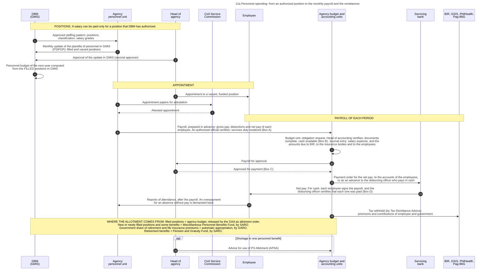
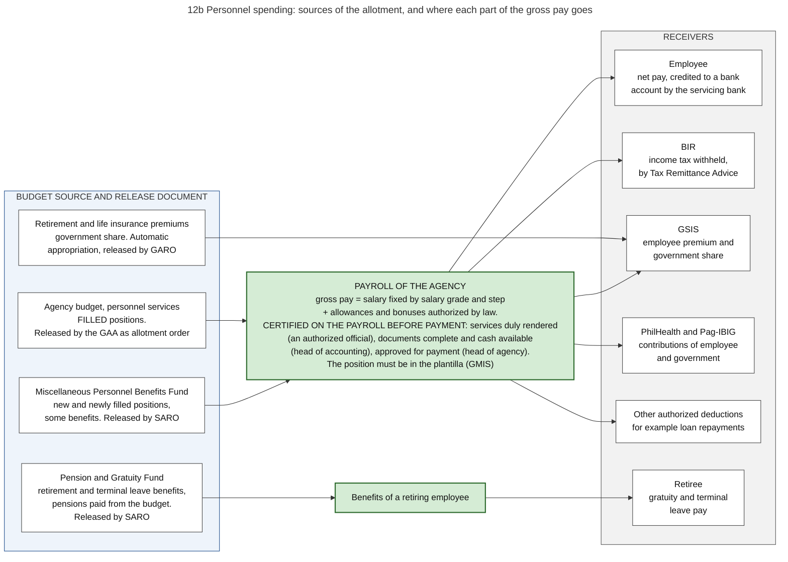

# 12. Personnel and payroll

*Part of the Philippine PFM Atlas. Facts as of 8 October 2026. The codes in the column "Basis" are explained in [Reference F](../reference/F_sources_and_verification.md). "GK" means general knowledge that I did not open in a source during this work.*

## 1. The question this process answers

Salaries are paid without procurement. What replaces the contract and the delivery, who controls the number of positions and the amount of pay, and to whom does each part of the gross pay go?

## 2. The idea in plain words

In a purchase, three things limit the payment. A contract fixes what is owed, a bid fixes the price, and an acceptance report proves that the supplier performed (chapters 06 and 07). Personnel spending has none of these three. Three other things replace them.

1. **The position replaces the contract.** A salary may be paid only for a position that DBM has authorized and that a person holds by a valid appointment.
2. **The salary schedule replaces the bid.** The pay of a position follows from its salary grade and step under the compensation rules. The agency and the employee do not negotiate it.
3. **A certificate on the payroll replaces the acceptance report.** On the payroll an authorized official certifies: "Services duly rendered as stated" [GAM-V2 App.33]. The attendance record supports this certificate, but it is not always there before the payment. The accounting manual says: "Payrolls are prepared in advance and some agencies pay their employees through the banking system. All these are done before reports of attendance are submitted, making it impossible to know the exact amount to be paid in case there are absences without pay" [GAM-V1 Ch.6 s.48]. An overpayment is then demanded back from the employee.

Points 1 and 2 are general knowledge. Point 3 is from the Manual. The sources that I opened also confirm the central record that supports point 1: DBM keeps the list of positions of every agency in the Government Manpower Information System (GMIS), each agency updates its part every month, and DBM computes the personnel budget from the positions that are filled [GMIS].

Two rules of law show how the budget treats personnel in a different way. The budget law does not list the single positions: it "shall not contain any itemization of personal services", and the Secretary of Budget and Management prepares that list for the approval of the President [EO292-B6 s.23, s.21]. And when the President suspends the spending of an agency, the pay of permanent staff is the one item that the law excepts [EO292-B6 s.38].

Because the pay of one position is fixed, the total cost depends almost only on the number of filled positions. The main control of personnel spending is therefore the control of the list of positions, and not the check of each payment. This is my conclusion from the three points.

A case where the process works: a position is in the list, it is filled, and the agency budget of the year already contains its salary. The allotment exists from the first day of the budget law, because personnel services of filled positions are released by the law itself without a release document [NBC599]. The payroll of each period is then a routine payment.

A case where it fails: an agency fills a vacant position in the middle of the year. The agency budget contains no money for it, because the budget was computed from the positions that were filled when the budget was prepared. The money is in a central fund, the Miscellaneous Personnel Benefits Fund, and it is released by a SARO [GMIS][NBC599]. A second process, the request for this release, must therefore proceed at the same time as the payroll (inference from the two sources).

A second case where it fails: the agency does not update its list in GMIS. The personnel budget of the next year is then computed from a wrong number of filled positions (inference from the rule that the budget follows the filled positions).

Terms. A **plantilla** is the list of the authorized positions of an agency, with the person who holds each one. **PSIPOP** (Personal Services Itemization and Plantilla of Personnel) is the form of this list that is kept in **GMIS**. The **Miscellaneous Personnel Benefits Fund** and the **Pension and Gratuity Fund** are central funds in the budget law, outside the budgets of the agencies. **Retirement and life insurance premiums** are the share that the government pays as employer for the insurance of its employees (GK for this description). An **Advice for use of PS Allotment (APSA)** is the document by which available personnel allotment is used for a shortage in one personnel benefit. A **Tax Remittance Advice** records tax withheld by an agency as paid to BIR without a movement of cash.

## 3. Authorities and their roles

| Authority | Role in this process | Basis |
|---|---|---|
| DBM | Keeps GMIS. Computes the personnel budget of each agency from the filled positions. Releases the central funds for personnel. Authorizes positions and their classification | GMIS, NBC599. Authorization of positions and the document used for it: GK |
| Personnel unit of the agency | Encodes the monthly update of the plantilla in GMIS. Prepares the payroll | GMIS. Who prepares the payroll: GK |
| Authorized official of the office concerned | Certifies on the payroll that the services were rendered (Box A) | GAM-V2 App.33 |
| Head of agency | Is the second approver of the update in GMIS. Appoints. Approves the payroll for payment (Box C). Approves the Advice for use of PS Allotment | GMIS, GAM-V2 App.33, NBC599 s.5.2. Appointment: GK |
| Civil Service Commission | Attests appointments | GK |
| Budget and accounting units of the agency | The budget unit records the obligation. The head of accounting certifies on the payroll that the documents are complete and that cash is available (Box B). The accounting unit makes the journal entries | GAM-V1 Ch.3 s.15, Ch.6 s.19, GAM-V2 App.33 |
| Disbursing officer | Where pay is given in cash: receives an advance equal to the net amount of the payroll, pays, lets each employee sign the payroll, certifies that each one was paid (Box D), and liquidates the advance within five days after the pay period | GAM-V1 Ch.6 s.15, s.18, GAM-V2 App.33 |
| Servicing bank | Credits net pay to the accounts of employees, or pays the advance of the disbursing officer | GAM-V1 Ch.6 s.18, s.57 |
| BIR | Receives the income tax withheld, by Tax Remittance Advice | NBC599, GAM-V1 Ch.5 s.38 |
| GSIS, PhilHealth, Pag-IBIG | Receive premiums and contributions of the employee and of the government as employer. These remittances are not paid through the list of creditors of a payment order | GAM-V1 Ch.6 s.19, s.50, Annex H. Government share: NBC599 |
| Congress | Appropriates the agency budgets and the two central funds. The budget law contains the personnel amount of each program, and no list of positions. Sets the pay rules by law | NBC599 (the funds), EO292-B6 s.21, s.23. Pay rules: GK |
| COA | Audits payrolls after payment | COA2011-002 |

## 4. Steps

The steps are those of diagram 12a.

| No. | Who acts | Towards whom | What is done or passed | Basis |
|---|---|---|---|---|
| 1 | DBM (GMIS) | Agency personnel unit | Approved staffing pattern: positions, classification, salary grades | GK |
| 2 | Agency personnel unit | DBM (GMIS) | Monthly update of the plantilla of personnel in GMIS (PSIPOP): filled and vacant positions | GMIS |
| 3 | Head of agency | DBM (GMIS) | Approval of the update in GMIS (second approver) | GMIS |
| 4 | DBM (GMIS) | (own action) | Personnel budget of the next year computed from the FILLED positions in GMIS | GMIS |
| 5 | Head of agency | Employee | Appointment to a vacant, funded position | GK |
| 6 | Agency personnel unit | Civil Service Commission | Appointment papers for attestation | GK |
| 7 | Civil Service Commission | Agency personnel unit | Attested appointment | GK |
| 8 | Agency personnel unit | Agency budget and accounting units | Payroll, prepared in advance: gross pay, deductions and net pay of each employee. An authorized official certifies: services duly rendered (Box A) | GAM-V2 App.33, GAM-V1 Ch.6 s.48 |
| 9 | Agency budget and accounting units | (own action) | Budget unit: obligation request. Head of accounting certifies: documents complete, cash available (Box B). Journal entry: salary expense, and the amounts due to BIR, to the insurance bodies and to the employees | GAM-V1 Ch.3 s.15, Ch.6 s.19, GAM-V2 App.33 |
| 10 | Agency budget and accounting units | Head of agency | Payroll for approval | GAM-V2 App.33 |
| 11 | Head of agency | Agency budget and accounting units | Approved for payment (Box C) | GAM-V2 App.33 |
| 12 | Agency budget and accounting units | Servicing bank | Payment order for the net pay: to the accounts of the employees, or as an advance to the disbursing officer who pays in cash | GAM-V1 Ch.6 s.15, s.57 |
| 13 | Servicing bank | Employee | Net pay. For cash: each employee signs the payroll, and the disbursing officer certifies that each one was paid (Box D) | GAM-V1 Ch.6 s.18, GAM-V2 App.33 |
| 14 | Employee | Agency personnel unit | Reports of attendance, after the payroll. An overpayment for an absence without pay is demanded back | GAM-V1 Ch.6 s.48 |
| 15 | Agency budget and accounting units | BIR, GSIS, PhilHealth, Pag-IBIG | Tax withheld (by Tax Remittance Advice), premiums and contributions of employee and government | GAM-V1 Ch.5 s.38, Ch.6 s.19, Annex H |
| 16 | Head of agency | Agency budget and accounting units | Advice for use of PS Allotment (APSA) | NBC599 s.5.2 |

### The certificates on the payroll

The form of the payroll has five boxes. Words in quotation marks are read on the form [GAM-V2 App.33].

| Box | Signatory | What the signature states |
|---|---|---|
| A | An authorized official | "Services duly rendered as stated" |
| B | Head of the accounting unit | "Supporting documents complete and proper; and cash available" in a stated amount |
| C | Head of agency or authorized representative | "APPROVED FOR PAYMENT" |
| D | Disbursing officer | "Each employee whose name appears on the payroll has been paid the amount as indicated opposite his/her name" |
| E | Accounting unit | The number and date of the obligation request, and the number of the journal entry voucher |

For each employee the payroll has the name, the position, the employee number, the compensations, the deductions, the net amount due and a column for the signature of the recipient. Above the signatures the form prints the statement of the employees: "We acknowledge receipt of cash shown opposite our name as full compensation for services rendered for the period covered" [GAM-V2 App.33].

### The entries

The example of the Manual has a gross pay of 50,000 and deductions of 9,400 [GAM-V1 Ch.6 s.19].

| Event | Entry | Basis |
|---|---|---|
| The payroll is approved | Debit Salaries and Wages-Regular 35,000 and the allowance account 15,000. Credit Due to BIR 5,000, Due to GSIS 3,200, Due to Pag-IBIG 500, Due to PhilHealth 600, Other Payables 100, and Due to Officers and Employees 40,600 | GAM-V1 Ch.6 s.19 |
| Pay in cash: the advance is given to the disbursing officer | Debit Advances for Payroll 40,600. Credit Cash-MDS, Regular | GAM-V1 Ch.6 s.19 |
| The disbursing officer has paid and reports | Debit Due to Officers and Employees. Credit Advances for Payroll | GAM-V1 Ch.6 s.19 |
| Pay through the accounts of the employees | Debit Cash in Bank-Local Currency, Current Account, credit Cash-MDS, Regular. Then debit Due to Officers and Employees, credit Cash in Bank | GAM-V1 Ch.6 s.57 |
| An employee was paid for days of absence without pay | Debit Due from Officers and Employees, until the amount is returned | GAM-V1 Ch.6 s.48 |

The budget unit posts the same events in its registry and on the obligation request: the obligation, then the payable when the payroll is approved, then the payment [GAM-V1 Annex H].

## 5. Where the allotment comes from

Diagram 12b shows the four sources on its left side. The table gives the same content.

| Part of personnel spending | Budget item | Release document | Basis |
|---|---|---|---|
| Salaries and benefits of positions that are filled | Personnel services in the budget of the agency | None. The budget law itself is the allotment order | NBC599 s.3.7, GMIS |
| New positions, positions filled during the year, and some benefits | Miscellaneous Personnel Benefits Fund, a special purpose fund | SARO | GMIS, NBC599 |
| Government share of retirement and life insurance premiums | An automatic appropriation. The law lists it among the items that are appropriated without a yearly vote | GARO. The first NCA of the year includes this item | NBC599, EO292-B6 s.26 |
| Retirement benefits, and pensions that are paid from the budget | Pension and Gratuity Fund, a special purpose fund | SARO | GMIS, NBC599. Terminal leave pay and the kinds of pension: GK |

When the allotment for one personnel benefit is not sufficient and allotment for another is available, the head of agency may approve the use by an Advice for use of PS Allotment. For some special benefits the approval of the DBM Secretary is needed [NBC599 s.5.2].

Savings may not pay for new positions or for higher salaries, unless a law specifically allows it [EO292-B6 s.39]. The accounting manual gives each of the three central items its own funding source code: 104102 for retirement and life insurance premiums, 101406 for the Miscellaneous Personnel Benefits Fund and 101407 for the Pension and Gratuity Fund [GAM-V1 Annex P].

Not every person who works for an agency is on this payroll. The procurement rules say that the engagement of a worker under a contract of service or a job order is not procurement [IRR12009 s.4.4]. I did not read the rules under which such workers are engaged and paid.

## 6. Where each part of the gross pay goes

Diagram 12b shows the receivers on its right side.

| Part of the gross pay | Receiver | How it is settled | Basis |
|---|---|---|---|
| Net pay | Employee | Credit to a bank account through the servicing bank, or cash from the disbursing officer. Both are charged to the NCA | GAM-V1 Ch.6 s.15, s.57 |
| Income tax withheld | BIR | Tax Remittance Advice. No cash moves. The agency debits Cash-Tax Remittance Advice and credits Subsidy from National Government, then debits Due to BIR and credits Cash-Tax Remittance Advice | NBC599, GAM-V1 Ch.5 s.38 |
| Premium of the employee and share of the government | GSIS | Remittance by the agency, by MDS check in the example of the Manual | GAM-V1 Annex H. Release of the government share: NBC599 |
| Contributions of the employee and of the government | PhilHealth, Pag-IBIG | Remittance by the agency, by MDS check in the example of the Manual | GAM-V1 Annex H |
| Other authorized deductions, for example loan repayments | The creditor named in the authorization | Remittance by the agency. The account in the books is Other Payables | GAM-V1 Ch.6 s.19. Kinds of deduction: GK |
| Benefits of a retiring employee | Retiree | Payment from the Pension and Gratuity Fund | GMIS, NBC599 |

## 7. Documents and identifiers

| Document or record | Identified by | It quotes or contains | Basis |
|---|---|---|---|
| Position in the plantilla | Item number of the position | Position title, salary grade, the holder or "vacant" | GK |
| PSIPOP record in GMIS | Agency and position | Filled or vacant status. Updated every month | GMIS |
| Appointment | Appointee and position | The position item | GK |
| Budget Preparation Form 201-A | Agency and budget year | Personnel services proposed | NBM156 |
| Budget Preparation Forms 204 and 205 | Agency and budget year | Staff who are not permanent. List of retirees | NBM156 |
| Payroll | Payroll number and period | Each employee with employee number, compensations, deductions, net amount due and signature. The number and date of the obligation request, and the number of the journal entry voucher | GAM-V2 App.33 |
| Obligation request, journal entry voucher | Their own numbers | As in chapter 07. The payroll replaces the voucher | GAM-V1 Ch.3 s.11, GAM-V2 App.33 |
| Payment order with the list of net pay | Its number | Accounts of the employees, number of the obligation request | GAM-V2 App.42 |
| Report of cash disbursements of the disbursing officer | Period | The paid payrolls. It is the liquidation of the advance | GAM-V1 Ch.6 s.18 |
| Tax Remittance Advice | Its number | Tax withheld | NBC599 |
| Advice for use of PS Allotment | Its number | The personnel allotment that is used | NBC599 |

## 8. Information systems

| System | Owner | Use in this process | Basis |
|---|---|---|---|
| GMIS with PSIPOP | DBM | List of positions and holders. Three roles: an end-user in the personnel unit who encodes, a first approver, and the head of agency as second approver | GMIS |
| OSBPS | DBM | Budget forms on personnel services | NBM156 |
| Payroll system of the agency | Each agency | Computation of pay and deductions. A separate system in each agency | GK |
| Facility of the servicing bank | Bank | Credit of net pay | GK |
| URS | DBM | Disbursement programs. The Roadmap says that GMIS, URS and PSIPOP are used for the submission of the monthly disbursement program | ROADMAP2024 |
| BTMS | DBM | In agencies that use it: all payments, including personnel services, are recorded in the system. The Advice for use of PS Allotment is one of its transactions | CL2025-8 |
| Planned: NGHRPS | Not stated in the part I could read | One system for human resources and payroll of the national government | SFA6 |

## 9. Controls: what each one checks, and what it does not check

| Control | What it checks | What it does not check |
|---|---|---|
| A position must be authorized and listed in GMIS | That no salary is paid for a position that does not exist | That the holder works |
| Monthly update with two approvers | That the list is current, and that the head of agency is responsible for it | That the data entered are true |
| Personnel budget computed from filled positions, with the money for vacant and new positions in a central fund | That an agency holds no personnel allotment for positions that are empty | |
| Attestation of the appointment | That the appointee meets the rules for the position | Attendance and performance |
| Pay fixed by grade and step | That the amount is not negotiated | |
| Certificate "Services duly rendered" on the payroll | That an official who knows the work states that it was done | It is signed before the reports of attendance arrive. An absence is found afterwards |
| Attendance record | That service was rendered in the period | The quality of the service |
| Certificate of the head of accounting and approval by the head of agency | That documents are complete and that cash is available | The truth of the certificate in Box A |
| Signature of each recipient, and certificate of the disbursing officer | For pay in cash: that each named person received the amount | That the named person exists and works. The assessment of 2025 says that ghost workers may still be found |
| Audit after payment | Legality and regularity of the payroll | It happens after the payment |

The first three rows follow from the sources named in section 3. The rows on the certificates of the payroll are from its form [GAM-V2 App.33] and from the Manual [GAM-V1 Ch.6 s.48]. The rows on attestation, on pay by grade and on the attendance record are general knowledge.

## 10. Timing

| Time | Event | Basis |
|---|---|---|
| Every month | Update of the plantilla in GMIS | GMIS |
| During budget preparation | Forms 201-A, 204 and 205 with the proposal of the agency | NBM156 |
| Start of the year | Personnel allotment of filled positions exists by the budget law. The first NCA covers the first quarter, including retirement and life insurance premiums | NBC599 |
| Each pay period | Payroll, payment, remittances | GK |
| During the year | Requests for release from the two central funds | NBC599 |

## 11. What the 2025 assessment reports

| Finding | Basis |
|---|---|
| Payroll controls as a whole are rated D+ (PEFA indicator 23) | PEFA2025 |
| DBM operates a central personnel information system, and the payroll is reconciled every month (indicator 23.1, score B) | PEFA2025 |
| Data on changes to the payroll were not provided to the assessors, so this part could not be scored (indicator 23.2, score D*) | PEFA2025 |
| Internal control of payroll is rated B (indicator 23.3). The page says that "ghost workers may still be identified". A ghost worker is a name on the payroll of a person who does not exist or does not work | PEFA2025. Name of the dimension: GK |
| A strong system of yearly payroll audit exists (indicator 23.4, score A) | PEFA2025 |
| A single system for human resources and payroll is planned, which shows that the present systems are separate | SFA6. The conclusion is my inference |

## 12. Diagrams

### Diagram 12a  Personnel spending: from an authorized position to the monthly payroll and the remittances

Code file: `../diagrams/mermaid/12a_position_to_payroll_sequence.mmd`. Rendered image: [`../rendered/12a_position_to_payroll_sequence.png`](../rendered/12a_position_to_payroll_sequence.png).

- **Question:** salaries are paid without any procurement. What replaces the contract and the delivery, and who controls each step?
- **Idea:** for personnel, the place of the contract is taken by an authorized position with a valid appointment. The place of the acceptance report is taken by a certificate on the payroll that the services were rendered. The amount is fixed by law (salary grade and step), not by a bid. The main control is the list of positions kept by DBM.
- **A fact from the manual that changes the order of the steps:** payrolls are prepared in advance, before the reports of attendance arrive. An overpayment for an absence without pay is therefore found after the payment and is demanded back [GAM-V1 Ch.6 s.48].
- **Sources:** monthly update of the plantilla of personnel in GMIS with an encoder and two approvers, personnel budget based on filled positions, Miscellaneous Personnel Benefits Fund for unfilled and new positions, Pension and Gratuity Fund, BP Forms 204 and 205 [GMIS][NBM156]. Allotment for filled positions through the GAA as allotment order, retirement and life insurance premiums by GARO, special purpose funds by SARO, Advice for use of PS Allotment [NBC599]. Tax Remittance Advice [NBC599]. Planned National Government HR and Payroll System [SFA6]. The form of the payroll with its certificates A to D [GAM-V2 App.33]. The entries for the payroll, the advance to the disbursing officer and its liquidation within five days after the pay period [GAM-V1 Ch.6 s.15, s.18, s.19]. Salaries paid through the accounts of the employees [GAM-V1 Ch.6 s.57]. Tax withheld by Tax Remittance Advice, and remittance to the insurance bodies [GAM-V1 Ch.5 s.38, Annex H].
- **General knowledge, not opened in a source here:** step 1 (the document by which DBM approves positions), and steps 5 to 7 (appointment and attestation by the Civil Service Commission).

### Diagram 12b  Personnel spending: sources of the allotment, and where each part of the gross pay goes

Code file: `../diagrams/mermaid/12b_personnel_funding_and_deductions.mmd`. Rendered image: [`../rendered/12b_personnel_funding_and_deductions.png`](../rendered/12b_personnel_funding_and_deductions.png).

- **Question:** from which budget items is personnel spending paid, and to whom does each peso of gross pay go?
- **How to read it:** left = budget source and release document. Middle = the payroll. Right = receivers.
- **Sources:** the four sources and their release documents [NBC599][GMIS]. Tax Remittance Advice [NBC599]. Personnel services as the first expense class in the budget forms, lists of non-permanent positions and of retirees [NBM156].
- **From the accounting manual:** the certificates on the payroll [GAM-V2 App.33]. The deductions and the bodies that receive them, as accounts of the books: Due to BIR, Due to GSIS, Due to Pag-IBIG, Due to PhilHealth, Other Payables, and the net pay as Due to Officers and Employees [GAM-V1 Ch.6 s.19, Annex H]. Payment of net pay through the accounts of the employees, or in cash by an advance to the disbursing officer [GAM-V1 Ch.6 s.15, s.57]. The funding source codes of the three central items [GAM-V1 Annex P].
- **General knowledge, not opened in a source here:** the components of gross pay, and the attestation of the appointment.

## 13. Verification status

- **Verified in a source:** the form of the payroll and its certificates [GAM-V2 App.33]. The entries, the advance for payroll, the rule on overpayment and the remittances [GAM-V1 Ch.5 s.38, Ch.6 s.15, s.18, s.19, s.48, s.57, Annex H]. The rules of the Administrative Code on personal services, read through summaries with quotations [EO292-B6 s.21, s.23, s.26, s.38, s.39]. The monthly update of the plantilla in GMIS and its three roles, the personnel budget based on filled positions, the two central funds [GMIS]. The release documents for each source, the Advice for use of PS Allotment, the Tax Remittance Advice [NBC599]. The budget forms [NBM156]. The scores on payroll controls [PEFA2025]. The planned system [SFA6].
- **General knowledge, to check:** the document by which DBM authorizes positions, appointment and attestation, the pay rules, the form of the attendance record, who prepares the payroll.
- **Inference:** the two failure cases in section 2.
- **Not opened:** the compensation laws, the rules of the Civil Service Commission, the DBM rules on the two central funds, the rules for workers under a contract of service or a job order.
