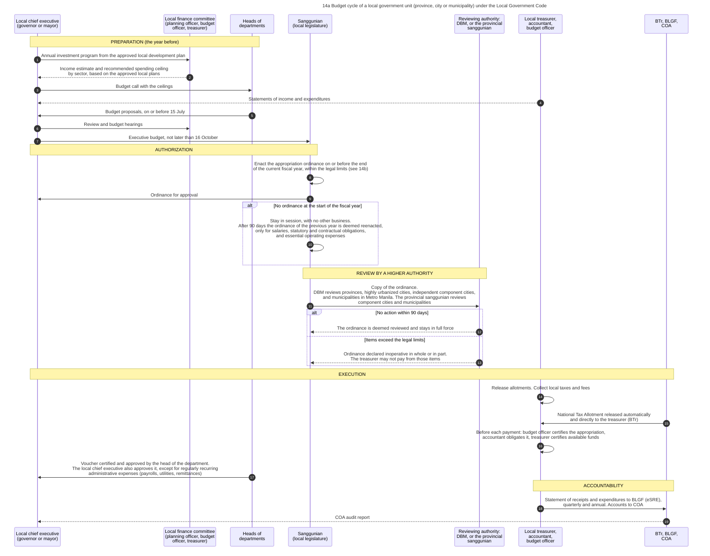
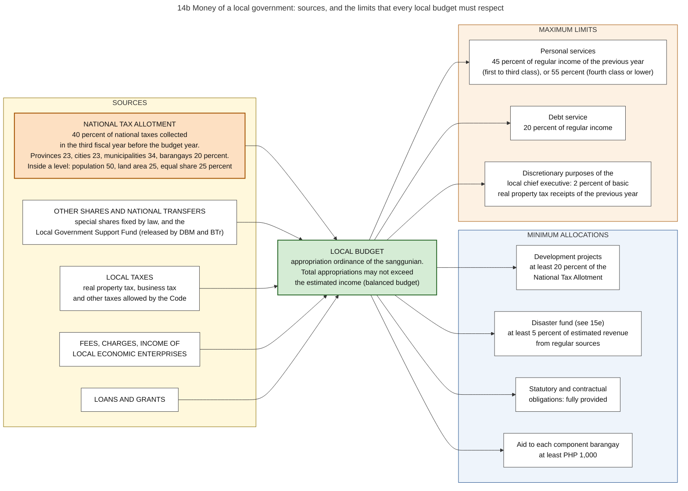
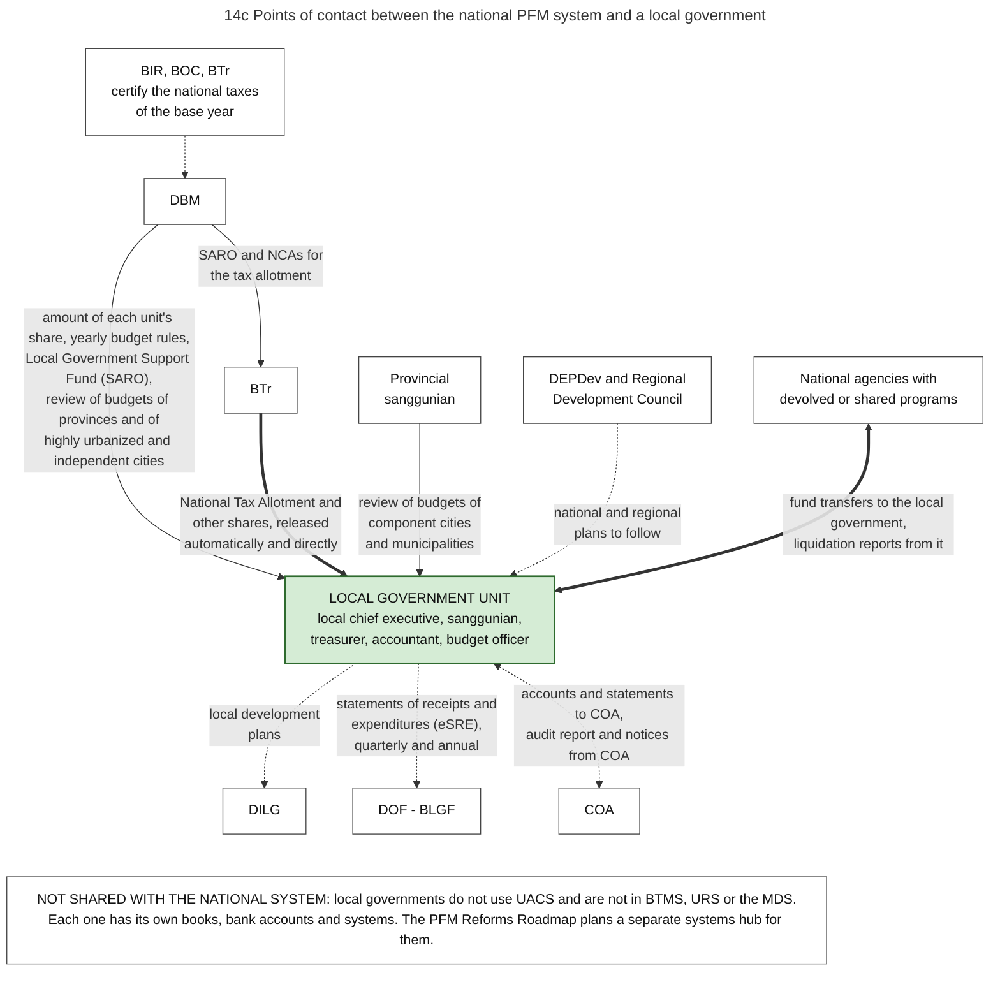
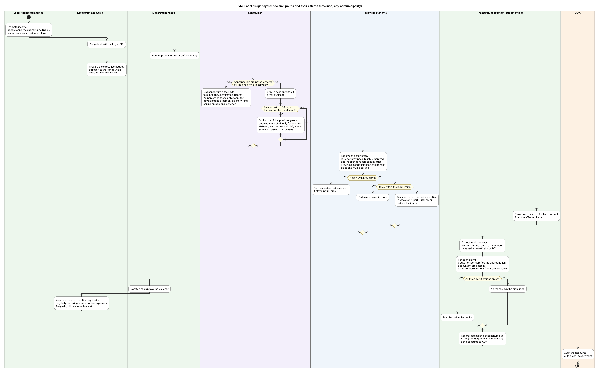
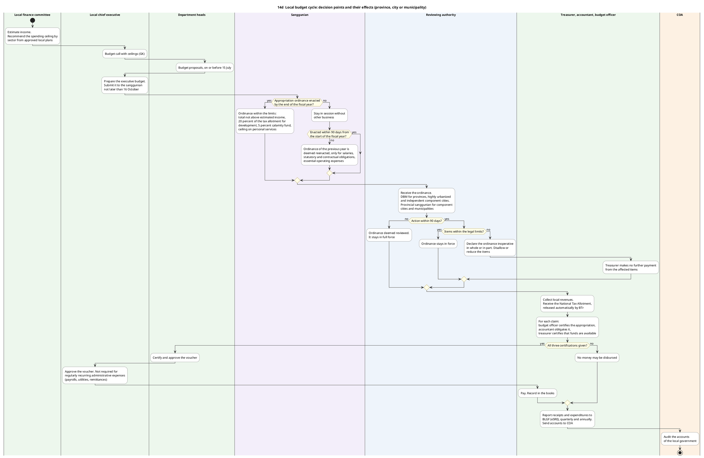
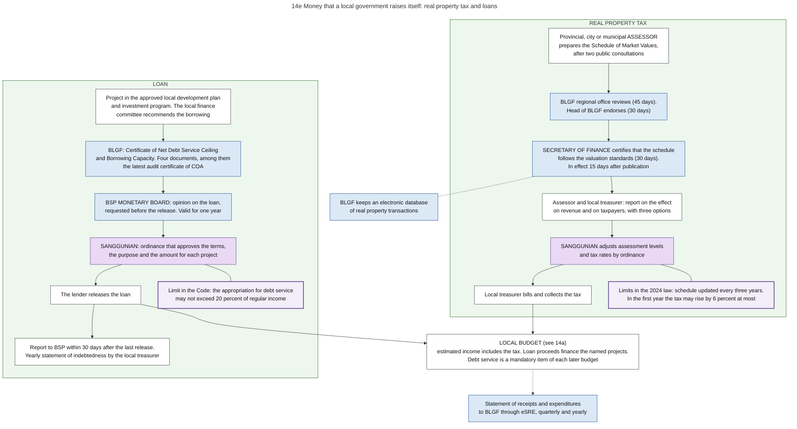
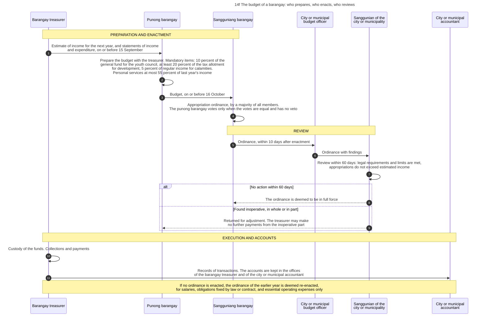

# 14. Local governments

*Part of the Philippine PFM Atlas. Facts as of 8 October 2026. The codes in the column "Basis" are explained in [Reference F](../reference/F_sources_and_verification.md). "GK" means general knowledge that I did not open in a source during this work.*

## 1. The question this process answers

A local government has its own budget, separate from the budget law of the national government. Where does its money come from, who decides and who checks its budget, and at which points does it meet the national system?

## 2. The idea in plain words

A local government unit (a province, a city, a municipality or a barangay) is a separate government. It has its own treasury, its own budget, its own legislature and its own accounts. Its yearly cycle repeats the national cycle on a smaller scale. The local chief executive (the governor or the mayor) corresponds to the President. The sanggunian (the local legislature) corresponds to Congress.

Three things differ from the national cycle.

1. **A large part of the income is a share of national taxes, and it arrives without a decision each year.** The share is 40 percent of the national taxes collected in the third fiscal year before the current one [LGC s.284][MANDANAS]. The law appropriates it automatically [MANDANAS][ALGU2026], and the national government may not withhold it [LGC s.286][CONST X.6].
2. **National law fixes parts of the local budget.** It sets minimum amounts for some purposes and maximum amounts for others [LGC s.287, s.324, s.325].
3. **A higher authority reviews the budget after it is enacted.** DBM reviews the appropriation ordinances of provinces, of highly urbanized cities, of independent component cities and of the municipalities in Metro Manila. The provincial sanggunian reviews those of component cities and municipalities [LGC s.326, s.327]. The national budget has no review of this kind.

A case where the cycle works: the governor submits the executive budget by 16 October, the sanggunian enacts the ordinance before the year ends, and the reviewing authority finds it inside the legal limits or takes no action within 90 days. The ordinance is then in full force [LGC s.318, s.319, s.327].

A case where it fails: the sanggunian does not enact the ordinance before the fiscal year starts. It must stay in session and may consider no other business. If 90 days pass from the start of the fiscal year, the ordinance of the previous year is deemed reenacted, and only for salaries and wages of existing positions, statutory and contractual obligations, and essential operating expenses [LGC s.323]. New projects cannot start.

A second case where it fails: the review finds that items exceed a legal limit. The reviewing authority declares the ordinance inoperative in whole or in part, and the treasurer may make no further payment from the affected items [LGC s.327].

Terms. The **National Tax Allotment (NTA)** is the share of local governments in national taxes. Its older name is Internal Revenue Allotment. The **local finance committee** is the group of three local officers that estimates income and recommends the spending ceilings. An **appropriation ordinance** is the local law that authorizes the budget. **BLGF** is the Bureau of Local Government Finance of DOF. **eSRE** is the electronic Statement of Receipts and Expenditures, the reporting system of local treasurers.

## 3. Authorities and their roles

| Authority | Role in this process | Basis |
|---|---|---|
| Local chief executive | Prepares the executive budget and submits it to the sanggunian not later than 16 October. Failure to submit is subject to criminal and administrative penalties. Approves vouchers, except for regularly recurring administrative expenses | LGC s.318, s.344 |
| Local finance committee: the planning and development officer, the budget officer and the treasurer | Estimates the income that can reasonably be expected. Recommends tax, revenue and borrowing measures. Recommends the level of yearly spending and the ceilings for economic, social and general services, based on the approved local development plans. Recommends the split between current operating expenditures and capital outlays. Assists the sanggunian in reviewing budgets. Reviews costs and accomplishments twice a year | LGC s.316 |
| Heads of departments and offices | Submit budget proposals to the local chief executive on or before 15 July. Certify and approve the vouchers and payrolls of the funds under their control | LGC s.317, s.344 |
| Sanggunian | Enacts the yearly budget by an appropriation ordinance, on or before the end of the current fiscal year | LGC s.319 |
| DBM | Reviews the ordinances of provinces, highly urbanized cities, independent component cities and municipalities in Metro Manila. Computes the share of each unit in the tax allotment. Issues the release documents | LGC s.326, MANDANAS, NTA-PR |
| Provincial sanggunian | Reviews the ordinances of component cities and municipalities within 90 days from receipt | LGC s.327 |
| BIR, BOC and BTr | Certify to DBM the national taxes of the base year | MANDANAS |
| BTr | Releases the tax allotment and the other shares directly to the local governments through authorized government servicing banks. Under its 1997 reorganization order, its field offices examine the books of local treasurers | ALGU2026, GAA2026-GP, EO449 |
| Local budget officer | Certifies that an appropriation exists, before any payment | LGC s.344 |
| Local accountant | Obligates the appropriation | LGC s.344 |
| Local treasurer | Collects and keeps the funds. Certifies that funds are available for the purpose. Reports receipts and expenditures to BLGF | LGC s.344, eSRE. Collection and custody: GK |
| BLGF | Keeps eSRE and receives the reports of local treasurers | eSRE |
| DILG | Receives copies of the local development plans. General supervision | LGC s.287. Supervision: GK |
| COA | Audits the accounts of local governments | CONST IX-D.2 |

## 4. Steps of the cycle

The steps are those of diagram 14a, for a province, a city or a municipality.

| No. | Who acts | Towards whom | What is done or passed | Basis |
|---|---|---|---|---|
| 1 | Local chief executive (governor or mayor) | Local finance committee (planning officer, budget officer, treasurer) | Annual investment program from the approved local development plan | GK |
| 2 | Local finance committee (planning officer, budget officer, treasurer) | Local chief executive (governor or mayor) | Income estimate and recommended spending ceiling by sector, based on the approved local plans | LGC s.316 |
| 3 | Local chief executive (governor or mayor) | Heads of departments | Budget call with the ceilings | GK |
| 4 | Local treasurer, accountant, budget officer | Local chief executive (governor or mayor) | Statements of income and expenditures | LGC s.318 |
| 5 | Heads of departments | Local chief executive (governor or mayor) | Budget proposals, on or before 15 July | LGC s.317 |
| 6 | Local chief executive (governor or mayor) | Local finance committee (planning officer, budget officer, treasurer) | Review and budget hearings | GK |
| 7 | Local chief executive (governor or mayor) | Sanggunian (local legislature) | Executive budget, not later than 16 October | LGC s.318 |
| 8 | Sanggunian (local legislature) | (own action) | Enact the appropriation ordinance on or before the end of the current fiscal year, within the legal limits (see 14b) | LGC s.319, s.324, s.325 |
| 9 | Sanggunian (local legislature) | Local chief executive (governor or mayor) | Ordinance for approval | GK |
| 10 | Sanggunian (local legislature) | (own action) | Stay in session, with no other business. After 90 days the ordinance of the previous year is deemed reenacted, only for salaries, statutory and contractual obligations, and essential operating expenses | LGC s.323 |
| 11 | Sanggunian (local legislature) | Reviewing authority: DBM, or the provincial sanggunian | Copy of the ordinance. DBM reviews provinces, highly urbanized cities, independent component cities, and municipalities in Metro Manila. The provincial sanggunian reviews component cities and municipalities | LGC s.326, s.327 |
| 12 | Reviewing authority: DBM, or the provincial sanggunian | Sanggunian (local legislature) | The ordinance is deemed reviewed and stays in full force | LGC s.327 |
| 13 | Reviewing authority: DBM, or the provincial sanggunian | Sanggunian (local legislature) | Ordinance declared inoperative in whole or in part. The treasurer may not pay from those items | LGC s.327 |
| 14 | Local treasurer, accountant, budget officer | (own action) | Release allotments. Collect local taxes and fees | GK |
| 15 | BTr, BLGF, COA | Local treasurer, accountant, budget officer | National Tax Allotment released automatically and directly to the treasurer (BTr) | LGC s.286, GAA2026-GP, ALGU2026 |
| 16 | Local treasurer, accountant, budget officer | (own action) | Before each payment: budget officer certifies the appropriation, accountant obligates it, treasurer certifies available funds | LGC s.344 |
| 17 | Heads of departments | Local chief executive (governor or mayor) | Voucher certified and approved by the head of the department. The local chief executive also approves it, except for regularly recurring administrative expenses (payrolls, utilities, remittances) | LGC s.344 |
| 18 | Local treasurer, accountant, budget officer | BTr, BLGF, COA | Statement of receipts and expenditures to BLGF (eSRE), quarterly and annual. Accounts to COA | eSRE. Accounts to COA: CONST IX-D.2 |
| 19 | BTr, BLGF, COA | Local chief executive (governor or mayor) | COA audit report | CONST IX-D.2. Form of the report: GK |

Diagram 14d shows the same cycle with its three decision points and what follows from each answer.

### What a budget proposal of a department must contain

Section 317 of the Code lists the content: the objectives and projects with their costs, the organizational chart and staffing pattern, the functions and expected results for the next year, the relation of the proposal to the local development plan, the estimated expenditures with figures of the past, current and next year, and reports of accomplishment. Proposals are grouped under economic, social and general services, and are divided into current operating expenditures and capital outlays [LGC s.317].

### The certifications before a payment

No money may be disbursed unless three officers have acted: the local budget officer certifies that an appropriation exists, the local accountant obligates it, and the local treasurer certifies that funds are available. The head of the department or office that controls the fund certifies and approves the voucher or payroll as to validity, propriety and legality. The local chief executive must also approve the voucher. This last approval is not required for regularly recurring administrative expenses, for example payrolls of regular employees, charges for light, water and telephone, and remittances to government creditor agencies. For a special or trust fund, the administrator of the fund approves [LGC s.344].

## 5. Where the money comes from

Diagram 14b shows the sources on its left side.

| Source | Rule | Basis |
|---|---|---|
| National Tax Allotment | 40 percent of the national taxes collected in the third fiscal year before the current one. In a year of unmanageable public sector deficit the President may reduce it to not less than 30 percent, on the recommendation of the Secretaries of Finance, of the Interior and Local Government, and of Budget and Management, after consulting the presiding officers of Congress and the presidents of the leagues of local governments | LGC s.284 |
| Base of the allotment | All national taxes, not only internal revenue taxes. The Supreme Court decided this on 3 July 2018. The decision became final on 10 April 2019 and was applied from FY 2022 | MANDANAS |
| Division among levels | Provinces 23 percent, cities 23 percent, municipalities 34 percent, barangays 20 percent | LGC s.285 |
| Division inside a level | For provinces, cities and municipalities: population 50 percent, land area 25 percent, equal sharing 25 percent. For barangays: at least PHP 80,000 a year for each barangay with 100 or more inhabitants, and the rest by population (60 percent) and equal sharing (40 percent) | LGC s.285 |
| Newly converted cities | For three years after its conversion, a municipality that becomes a city brings its allotment as a municipality into the allotment of cities. This rule is in section 450 of the Code, as amended in 2022. The same law does not change the shares of section 285 | RA11683 |
| Amount in FY 2026 | PHP 1,190,509,672,000, automatically appropriated | ALGU2026 |
| Release in FY 2026 | DBM issued one SARO and the corresponding NCAs on 26 January 2026 for the requirement of the full year. BTr releases directly to the local governments through authorized government servicing banks | NTA-PR, ALGU2026 |
| In the accounts of the national government | The accounting manual shows the transfer as an entry in the books of DBM: a debit to an expense account for assistance to local governments and a credit to Cash-MDS, Regular. The example of the Manual uses the account Financial Assistance to Local Government Units, while its chart of accounts also has an account named Internal Revenue Allotment. The Manual of 2015 still uses the earlier name of the share | GAM-V1 Ch.5 s.18, GAM-V3 Ch.2 |
| Other shares in national taxes | Special shares fixed by other laws, released after the collecting agencies certify the actual collections and remit them to BTr | ALGU2026. The list of shares: GK |
| Local Government Support Fund | A special purpose fund in the national budget, released by SARO | NBC599 |
| Local taxes, fees and charges | A local government may create its own sources of revenue. The largest is usually the tax on real property (section 5.1) | CONST X.5. The list of local taxes: GK |
| Loans and grants | The local finance committee recommends borrowing measures. A loan needs two approvals from outside the local government before it is released (section 5.2) | LGC s.316, DOF-LGULOAN |

The Code says that the share is released quarterly, within five days after the end of each quarter, directly to the provincial, city, municipal or barangay treasurer, and that it is not subject to "any lien or holdback" by the national government, which means that the national government may not keep any part of it for a claim of its own [LGC s.286]. How often the cash is credited to the local governments at present is not stated in the sources I read.

### 5.1 Real property tax

Diagram 14e shows the two sources that a local government controls itself. The question it answers: which steps and which outside approvals does a local government need for its property tax and for a loan?

The idea: the local government decides its own tax rates and its own loans, but in both cases a national office checks one technical input before the sanggunian may decide. For the property tax the input is the schedule of market values. For a loan it is the capacity to repay.

A law of 2024, the Real Property Valuation and Assessment Reform Act, changed the first input [RA12001].

| Step | Who acts | Period | Section |
|---|---|---|---|
| Prepare the Schedule of Market Values, after two public consultations | Provincial, city or municipal assessor | Update within two years of the law, then every three years | 15, 19 |
| Review and endorse | BLGF regional office, then the head of BLGF | 45 days, then 30 days | 15, 16 |
| Certify that the schedule follows the valuation standards | Secretary of Finance | 30 days. Without action the existing schedule stays. Effect 15 days after publication | 16 |
| Report on the effect on revenue and on taxpayers, with three options | Assessor with the local treasurer | 30 days | 17 |
| Adjust assessment levels and tax rates by ordinance | Sanggunian | | 18 |
| Limit of the increase | In the first year of a new schedule the tax may rise by 6 percent at most | | 29 |
| Database | BLGF keeps an electronic database of real property transactions. Registers of deeds, BIR, notaries and others send it the data | | 22, 24 |
| Money for the work | Each sanggunian appropriates a Real Property Tax Administration Fund each year | | 32 |

The billing and collection of the tax by the local treasurer, its division between province, municipality and barangay, and the additional levy for the Special Education Fund are from general knowledge. They are in Book II of the Code, which I did not open.

### 5.2 Loans

| Rule | Content | Basis |
|---|---|---|
| Power | "Local Government Units are empowered under Section 296 of the Local Government Code (LGC) to create indebtedness." The loan must pay for projects in the approved local development plan and investment program | DOF-LGULOAN |
| First control | Certificate of Net Debt Service Ceiling and Borrowing Capacity, issued by BLGF. Four documents: a letter of the local chief executive with the lender, the terms and the purpose; a certification of existing loans by the local treasurer; the latest annual audit certificate of COA with the financial reports of three years; a certification of the lender on deposits | DOF-LGULOAN |
| Second control | Opinion of the Monetary Board of the central bank, requested before the loan is released. It is valid for one year. No opinion is issued when the loan is already released in part or in full | DOF-LGULOAN |
| Decision | Ordinance of the sanggunian that approves the terms, the purpose and the amount for each project | DOF-LGULOAN |
| Limit in every budget | The appropriation for debt service may not exceed 20 percent of regular income | LGC s.324(b) |
| Reports | Report to the central bank within 30 days after the last release. Yearly Statement of Indebtedness, Payments and Balances by the provincial, city or municipal treasurer | DOF-LGULOAN |

A case where the control works: a city asks for a loan that would raise its yearly debt service above the ceiling. BLGF certifies a lower capacity, and the opinion of the Monetary Board covers only the amount inside that capacity.

A case where it fails: the income used for the certificate was the income of a year that will not repeat, for example a year with a large single receipt. The certificate is correct by its formula, and the debt service is still too high for the normal income of the city. The formula of the ceiling is not stated in the source I read.

## 6. Limits that national law sets on every local budget

Diagram 14b shows the limits on its right side.

| Limit | Content | Basis |
|---|---|---|
| Balance | Total appropriations may not exceed the estimated income | LGC s.324(a) |
| Statutory and contractual obligations | Must be provided in full | LGC s.324(b) |
| Debt service | Not more than 20 percent of regular income | LGC s.324(b) |
| Aid to component barangays | At least PHP 1,000 for each barangay | LGC s.324(c) |
| Disaster fund | The Code sets a calamity fund of 5 percent of estimated revenue from regular sources. The disaster law of 2010 replaced it by the Local Disaster Risk Reduction and Management Fund of not less than 5 percent, of which 30 percent is a Quick Response Fund. Unspent amounts go to a special trust fund for five years (diagram 15e) | LGC s.324(d), RA10121 (read in two documents that quote the law) |
| Development projects | At least 20 percent of the yearly tax allotment | LGC s.287 |
| Personal services | Not more than 45 percent of the total yearly income from regular sources of the preceding fiscal year, for first to third class units. 55 percent for fourth class or lower | LGC s.325(a) |
| Discretionary purposes of the local chief executive | Not more than 2 percent of the actual receipts from basic real property tax in the preceding calendar year | LGC s.325(h) |
| Barangay youth council | 10 percent of the general fund of the barangay | BB4 |

The Code also states general principles of local fiscal administration. Among them: no money may be paid from the local treasury except under an appropriation ordinance or a law; local funds are spent only for public purposes; trust funds are used only for their purpose; accountable officers must be bonded; local budgets must put the approved local development plans into operation and must agree with the national development plans; and the budget must be balanced [LGC s.305].

## 7. Points of contact with the national system

Diagram 14c shows the contacts. The table gives the same content.

| National body | What passes, and in which direction | Basis |
|---|---|---|
| BIR, BOC, BTr | Certification of the national taxes of the base year, to DBM | MANDANAS |
| DBM | To each local government: the amount of its share. To BTr: the SARO and the NCAs for the tax allotment. To local governments: releases from the Local Government Support Fund, and the review of ordinances | MANDANAS, NTA-PR, NBC599, LGC s.326 |
| BTr | To the local government: the tax allotment and other shares, through authorized government servicing banks | ALGU2026, GAA2026-GP |
| Provincial sanggunian | To component cities and municipalities: the review of their ordinances | LGC s.327 |
| DEPDev and the Regional Development Council | National and regional plans, with which local plans must agree | LGC s.305 |
| National agencies | Fund transfers to a local government that implements a project. The source agency does not report the money as disbursed until the local government has used it for accepted deliveries | NBC599 s.3.4 |
| DILG | From the local government: copies of the development plans | LGC s.287 |
| BLGF | From the local treasurer: statements of receipts and expenditures through eSRE, quarterly and yearly | eSRE |
| DBM and Congress | From the local government: quarterly reports on the use of the shares under the item "Allocations to Local Government Units", sent by electronic means and published on its website, with a written notice to DBM, to both chambers and to their committees on appropriations and finance. The text that I could read does not make clear whether this duty covers the tax allotment or only the special shares | ALGU2026 |
| COA | From the local government: its accounts. To it: the audit report and notices | CONST IX-D.2 |

**What is not shared.** Local governments are not users of UACS [UACS-FAQ]. BTMS is for national agencies that have appropriations in the budget law [CL2025-8], and URS and the MDS sub-accounts serve national agencies and their operating units [NBC599]. From this I conclude that a local government is outside these three systems (inference). Each local government has its own books, bank accounts and tools. The Roadmap names a separate systems hub for local governments [ROADMAP2024].

## 8. Barangays

A barangay is the smallest local government. Diagram 14f shows who performs each role for its budget. The steps are those of the diagram.

| No. | Who acts | Towards whom | What is done or passed | Basis |
|---|---|---|---|---|
| 1 | Barangay treasurer | Punong barangay | Estimate of income for the next year, and statements of income and expenditure, on or before 15 September | BB4 |
| 2 | Punong barangay | (own action) | Prepare the budget with the treasurer. Mandatory items: 10 percent of the general fund for the youth council, at least 20 percent of the tax allotment for development, 5 percent of regular income for calamities. Personal services at most 55 percent of last year's income | BB4 |
| 3 | Punong barangay | Sangguniang barangay | Budget, on or before 16 October | BB4 |
| 4 | Sangguniang barangay | (own action) | Appropriation ordinance, by a majority of all members. The punong barangay votes only when the votes are equal and has no veto | BB4 |
| 5 | Sangguniang barangay | City or municipal budget officer | Ordinance, within 10 days after enactment | BB4 |
| 6 | City or municipal budget officer | Sanggunian of the city or municipality | Ordinance with findings | BB4 |
| 7 | Sanggunian of the city or municipality | (own action) | Review within 60 days: legal requirements and limits are met, appropriations do not exceed estimated income | BB4 |
| 8 | Sanggunian of the city or municipality | Sangguniang barangay | The ordinance is deemed to be in full force | BB4 |
| 9 | Sanggunian of the city or municipality | Punong barangay | Returned for adjustment. The treasurer may make no further payments from the inoperative part | BB4 |
| 10 | Barangay treasurer | (own action) | Custody of the funds. Collections and payments | BB4 |
| 11 | Barangay treasurer | City or municipal accountant | Records of transactions. The accounts are kept in the offices of the barangay treasurer and of the city or municipal accountant | BB4 |

| Rule | Content | Basis |
|---|---|---|
| Share in the tax allotment | 20 percent of the total goes to the barangays. Each barangay with 100 or more inhabitants receives at least PHP 80,000 a year | LGC s.285 |
| Mandatory items | 10 percent of the general fund for the youth council (Sangguniang Kabataan). At least 20 percent of the tax allotment for development. 5 percent of regular income for calamities, now the disaster fund of section 6 | BB4 |
| Limit on personal services | 55 percent of the income actually realized in the preceding year | BB4 |
| Head of the barangay in the council | Votes only when the votes are equal. Has no veto | BB4 |
| No ordinance | The ordinance of the earlier year is deemed re-enacted, for salaries, obligations fixed by law or contract, and essential operating expenses only | BB4 |
| Accounts | Kept in the offices of the barangay treasurer and of the city or municipal accountant. The barangay treasurer has custody of the funds | BB4 |
| Small purchases | Small value procurement up to PHP 100,000 | IRR12009 s.34 |

The source of the steps is an older DBM document of questions and answers. It cites sections 329 to 334 of the Code, which I did not open. DBM issued a Barangay Budgeting Manual, 2026 Edition, by Local Budget Circular No. 170 of 4 May 2026 [LBC-LIST]. I could not open the manual. It may have changed forms or dates.

## 9. Documents and identifiers

| Document | Identified by | Basis |
|---|---|---|
| Annual investment program | Local government and year | GK |
| Budget proposals of departments | Department and year | LGC s.317 |
| Executive budget | Local government and year | LGC s.318 |
| Appropriation ordinance | Ordinance number and year | LGC s.319 |
| Review action of DBM or of the provincial sanggunian | The ordinance reviewed | LGC s.326, s.327 |
| Certifications before payment, voucher, payroll | Local document numbers | LGC s.344 |
| Statement of receipts and expenditures | Local government and period | eSRE |
| Quarterly report on the use of the shares (see section 7 for the limit of this statement) | Local government and quarter | ALGU2026 |
| Audit report | Local government and year | GK |

Local governments use account codes prescribed by COA for local governments, not UACS (GK for the first part, [UACS-FAQ] for the second).

## 10. Information systems

| System | Owner | Use | Basis |
|---|---|---|---|
| eSRE | BLGF | Official fiscal and financial reports of local governments, quarterly and yearly | eSRE |
| Local budget, treasury and accounting tools | Each local government | Own records | GK |
| Database of real property transactions | BLGF | Data from registers of deeds, BIR, notaries and others, for the valuation of real property | RA12001 s.22, s.24 |
| PhilGEPS | PS-DBM | Procurement. The procurement law covers local governments | RA12009 s.4, s.20 |
| Planned hub for local governments | Not stated | The Roadmap figure names eBudget, eCAT, ePFMAT, National Tax Allotment and the National Wealth Portal. The functions of eCAT and ePFMAT are not explained in the sources I read | ROADMAP2024 |

## 11. Controls: what each one checks, and what it does not check

| Control | What it checks | What it does not check |
|---|---|---|
| Ceilings recommended by the local finance committee | That planned spending follows the expected income | |
| Deadline of 16 October with penalties | That the sanggunian receives the budget in time | The quality of the budget |
| Review by DBM or by the provincial sanggunian | That the ordinance respects the limits of sections 324 and 325 | Whether the spending is wise. No action within 90 days means the ordinance is deemed reviewed |
| Limited reenactment after 90 days | That a local government without a budget pays only salaries, obligations and essential expenses | |
| Three certifications before each payment | Appropriation, obligation, available funds | That the delivery was made |
| Approval of the voucher by the department head, and by the local chief executive | Validity, propriety and legality of the claim | Recurring administrative expenses do not need the approval of the local chief executive |
| Automatic release, with no amount withheld | That the national government cannot delay or reduce the share | How the local government uses it |
| eSRE reports and the quarterly reports on shares | That the national government and the public can see local receipts and spending | |
| Audit by COA | The accounts after payment | |

## 12. Timing

| Date or period | Event | Basis |
|---|---|---|
| On or before 15 July | Budget proposals of department heads | LGC s.317 |
| Not later than 16 October | Executive budget to the sanggunian. Barangay budget to the sangguniang barangay | LGC s.318, BB4 |
| On or before 31 December | Enactment of the appropriation ordinance | LGC s.319 |
| 90 days from the start of the fiscal year | If there is still no ordinance: limited reenactment of the previous one | LGC s.323 |
| 90 days from receipt | Review of the ordinance. No action means deemed reviewed | LGC s.327 |
| On or before 15 September | The barangay treasurer gives the estimate of income to the punong barangay | BB4 |
| 10 days after enactment | The barangay ordinance is sent for review | BB4 |
| 60 days | Review of a barangay ordinance. No action means that it is in full force | BB4 |
| Every three years | General revision of the Schedule of Market Values | RA12001 s.19 |
| One year | Validity of an opinion of the Monetary Board on a local loan | DOF-LGULOAN |
| Quarterly and yearly | eSRE reports. Quarterly reports on the use of the shares | eSRE, ALGU2026 |
| 26 January 2026 | SARO and NCAs for the FY 2026 tax allotment of the full year | NTA-PR |

## 13. What the 2025 assessment reports

The 2025 PEFA assessment covers the central government. Local governments appear in it only where national money passes to them.

| Finding | Basis |
|---|---|
| The rules for transfers to local government units are clear (PEFA indicators 7.1 and 7.2, both score A) | PEFA2025 |
| The page that I read gives no finding on the monitoring of local governments (indicator 10.2) | PEFA2025 |

## 14. Diagrams

### Diagram 14a  Budget cycle of a local government unit (province, city or municipality) under the Local Government Code

Code file: `../diagrams/mermaid/14a_lgu_budget_sequence.mmd`. Rendered image: [`../rendered/14a_lgu_budget_sequence.png`](../rendered/14a_lgu_budget_sequence.png).

- **Question:** a local government has its own budget, separate from the GAA. Who prepares, enacts, reviews and executes it, and by which dates?
- **Idea:** the local cycle repeats the national cycle on a smaller scale, in which the local chief executive (governor or mayor) corresponds to the President and the sanggunian (local legislature) corresponds to Congress. One step has no national equivalent: a higher authority reviews the enacted budget.
- **Sources:** Republic Act No. 7160, sections read one by one [LGC]: local finance committee s.316, budget proposals of department heads on or before 15 July s.317, executive budget to the sanggunian by 16 October s.318, enactment by the end of the fiscal year s.319, failure to enact and reenactment after 90 days s.323, budgetary requirements s.324, general limitations s.325, review by DBM s.326, review by the provincial sanggunian within 90 days and its effects s.327, certifications before disbursement s.344, automatic release of the national tax share s.286 and release by BTr through authorized government servicing banks [ALGU2026], fundamental principles s.305. Reports of local treasurers to BLGF through eSRE [eSRE]. COA audits local governments [CONST IX-D]. Barangay review within 60 days [BB4].
- **General knowledge, not opened in a source here:** step 1 (annual investment program), step 3 (budget call of the local chief executive), step 6 (budget hearings), step 9 (approval of the ordinance by the local chief executive), the first half of step 14 (release of allotments inside the local government).

### Diagram 14b  Money of a local government: sources, and the limits that every local budget must respect

Code file: `../diagrams/mermaid/14b_lgu_funds_and_mandatory_allocations.mmd`. Rendered image: [`../rendered/14b_lgu_funds_and_mandatory_allocations.png`](../rendered/14b_lgu_funds_and_mandatory_allocations.png).

- **Question:** where does the money of a local government come from, and which parts of its budget are fixed by national law?
- **How to read it:** left = sources. Middle = the local budget. Right = minimum allocations (must spend at least) and maximum limits (may not spend more than).
- **Sources:** share of 40 percent of national taxes of the third preceding fiscal year, possible reduction to not less than 30 percent [LGC s.284]. Base widened from internal revenue taxes to all national taxes by the Supreme Court, applied from FY 2022 [MANDANAS]. Division among levels and the formula [LGC s.285]. Republic Act No. 11683 of 2022 does not change these shares. It lets a newly converted city bring its allotment as a municipality into the allotment of cities for three years [RA11683]. Automatic and direct release, no lien or holdback [LGC s.286][CONST X.6]. At least 20 percent for development projects [LGC s.287]. Budgetary requirements [LGC s.324]. General limitations [LGC s.325]. Power to create own revenue sources [CONST X.5]. Local Government Support Fund [NBC599]. Barangay rules [BB4].
- **General knowledge, not opened in a source here:** the list of local taxes, the shares in national wealth and other special shares, the special education fund. The later law that turned the 5 percent calamity fund into the local disaster risk reduction and management fund was read only in two documents that quote it [RA10121].

### Diagram 14c  Points of contact between the national PFM system and a local government

Code file: `../diagrams/mermaid/14c_national_local_interfaces.mmd`. Rendered image: [`../rendered/14c_national_local_interfaces.png`](../rendered/14c_national_local_interfaces.png).

- **Question:** a local government follows its own cycle. At which points does a national body give it money, review its decisions, or receive its reports?
- **How to read it:** upper part = bodies that give money, rules or reviews to the local government. Lower part = bodies that receive information from it. Thick arrow = money. Thin arrow = a decision or review. Dotted arrow = information. An arrow with two heads shows the two things named in its label, one in each direction.
- **Sources:** BIR, BOC and BTr certify the base, DBM computes each share, automatic appropriation [MANDANAS]. Release by BTr directly to the beneficiary local governments through authorized government servicing banks [ALGU2026][GAA2026-GP][LGC s.286]. For FY 2026 DBM issued one SARO and the corresponding NCAs on 26 January 2026 for the tax allotment of the full year [NTA-PR]. Review of ordinances by DBM and by the provincial sanggunian [LGC s.326, s.327]. Development plans furnished to DILG [LGC s.287]. Harmonization of local and national plans [LGC s.305]. eSRE to BLGF [eSRE]. COA audit [CONST IX-D]. Transfers from national agencies are not disbursed until used [NBC599 s.3.4]. Local Government Support Fund by SARO [NBC599]. Local governments do not use UACS [UACS-FAQ]. Planned systems hub for local governments [ROADMAP2024].
- **General knowledge, not opened in a source here:** general supervision by the President through DILG, appointment of local treasurers by the Secretary of Finance, certificates of borrowing capacity from BLGF.

### Diagram 14d  Local budget cycle: decision points and their effects (province, city or municipality) (PlantUML)

Code file: `../diagrams/plantuml/14d_lgu_budget_swimlane.puml`. Rendered image: [`../rendered/14d_lgu_budget_swimlane.png`](../rendered/14d_lgu_budget_swimlane.png).

- **Question:** in the local budget cycle, where are the decision points, and what happens at each one if the answer is "no"?
- **How to read it:** one column (lane) = one actor. Diamond = a decision with its two outcomes.
- **Why PlantUML:** the cycle has three decision points with different effects (no ordinance in time, review finds a violation, certification refused). A lane diagram shows them with the responsible actor.
- **Sources:** Republic Act No. 7160 [LGC] ss.316, 317, 318, 319, 323, 324, 325, 326, 327, 344, 286. [eSRE] for reports to BLGF. [CONST IX-D] for audit.
- **General knowledge (GK), not opened in a source here:** the budget call, the veto of the local chief executive, the allotment release.

PlantUML code

### Diagram 14e  Money that a local government raises itself: real property tax and loans

Code file: `../diagrams/mermaid/14e_local_revenue_and_borrowing.mmd`. Rendered image: [`../rendered/14e_local_revenue_and_borrowing.png`](../rendered/14e_local_revenue_and_borrowing.png).

- **Question:** diagram 14b shows the share in national taxes. Which steps and which outside approvals does a local government need for the two main sources that it controls itself: the tax on real property, and loans?
- **Idea:** a local government decides its own tax rates and its own loans, but in both cases a national office checks one technical input before the local legislature may decide. For the property tax the input is the schedule of market values. For a loan the input is the capacity to repay.
- **How to read it:** one frame shows the real property tax, the other shows loans. In each frame the blue boxes are the checks by national offices, and the purple box is the decision of the sanggunian (the local legislature). Bottom = where both amounts enter the local budget and the reports.
- **Sources, property tax:** preparation of the Schedule of Market Values by the assessors, review by BLGF within 45 and 30 days, certification by the Secretary of Finance within 30 days, effect 15 days after publication [RA12001 ss.15-16]; revenue and tax impact report with three options, and adjustment of assessment levels and tax rates by the sanggunian [RA12001 ss.17-18]; update within two years and then every three years [RA12001 s.19]; increase limited to 6 percent in the first year [RA12001 s.29]; electronic database of real property transactions at BLGF [RA12001 s.22].
- **Sources, loans:** power to create indebtedness under section 296 of the Code, the two controls before borrowing, the four documents, the rules of the Monetary Board opinion, the ordinance, and the reports after borrowing [DOF-LGULOAN]. Debt service not above 20 percent of regular income [LGC s.324]. The local finance committee recommends borrowing measures [LGC s.316]. Statements of receipts and expenditures through eSRE [eSRE].
- **General knowledge, not opened in a source here:** the billing and collection of the property tax by the local treasurer, the division of the tax between province, municipality and barangay, the additional levy for the Special Education Fund, and the other local taxes and fees (for example the business tax). They are in Book II of the Local Government Code, which I did not open.

### Diagram 14f  The budget of a barangay: who prepares, who enacts, who reviews

Code file: `../diagrams/mermaid/14f_barangay_budget_sequence.mmd`. Rendered image: [`../rendered/14f_barangay_budget_sequence.png`](../rendered/14f_barangay_budget_sequence.png).

- **Question:** a barangay is the smallest local government. Who performs the roles of executive, legislature and reviewer for its budget, and who keeps its books?
- **Idea:** the cycle is the same as in diagram 14a, one level lower. The punong barangay (the head of the barangay) proposes, the sangguniang barangay (its council) enacts, and the sanggunian of the city or municipality reviews. A barangay has a treasurer but no accountant of its own: the city or municipal accountant keeps its accounts together with the barangay treasurer.
- **Sources:** all steps, dates and limits come from a DBM document of questions and answers on barangay budgeting [BB4]. It is an older document. It cites sections 329 to 334, 318 and 323 of the Local Government Code, which I did not open. The share of barangays in the tax allotment and the minimum amount for each barangay [LGC s.285]. Threshold of small value procurement for barangays, PHP 100,000 [IRR12009 s.34].
- **Not opened:** the Barangay Budgeting Manual, 2026 Edition, which DBM issued by Local Budget Circular No. 170 of 4 May 2026 [LBC-LIST]. The manual may have changed forms or dates. Check it before relying on a date in this diagram.

## 15. Verification status

- **Verified in a source:** sections 284, 285, 286, 287, 305, 316, 317, 318, 319, 323, 324, 325, 326, 327 and 344 of the Local Government Code, read one section at a time on a site that copies the text of the Supreme Court E-Library [LGC]. The court ruling and its effects [MANDANAS]. The amount, the release by BTr and the reporting duty in FY 2026 [ALGU2026][NTA-PR]. eSRE [eSRE]. Barangay rules [BB4]. The PEFA scores [PEFA2025]. The valuation of real property under the law of 2024 [RA12001]. The controls on local loans, from the service page of the Department of Finance [DOF-LGULOAN]. The disaster fund, from two documents that quote the law and its rules [RA10121]. The list of local budget circulars of DBM [LBC-LIST].
- **Limits of what I read:** the tool that I used returns a summary with short quotations, not the full text of each section. The copy of the Code may not show later amendments. The FY 2026 special provisions say that the allotment is allocated under section 285 of the Code "as amended by" Republic Act No. 11683. I opened that law: it amends only section 450 (conversion of a municipality into a city) and does not change the shares of section 285 [RA11683].
- **General knowledge, to check:** the annual investment program, the budget call, budget hearings, the approval or veto of the ordinance by the local chief executive, the release of allotments inside the local government, the list of local taxes and of special shares, the billing, collection and division of the real property tax, the formula of the debt service ceiling, the form of the audit report, the account codes of local governments.
- **Inference:** that local governments are outside BTMS, URS and the MDS.
- **Not opened:** the other sections of the Code (among them sections 296 to 303 on credit financing and 329 to 334 on barangay budgets), the Budget Operations Manual for Local Government Units of 2023 and the Barangay Budgeting Manual of 2026, the text of the law on disaster risk reduction, the later orders on devolution.
