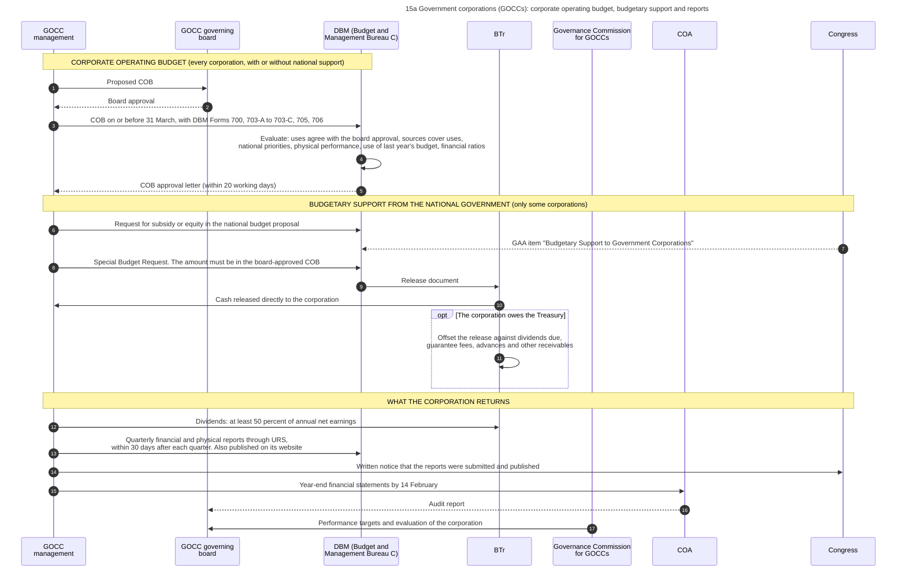
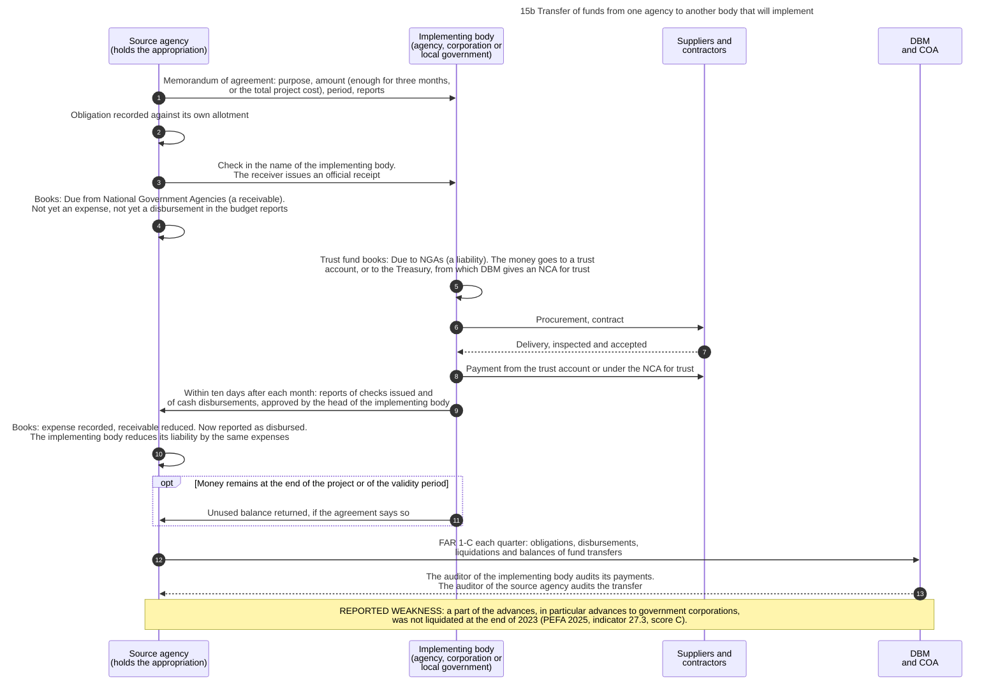
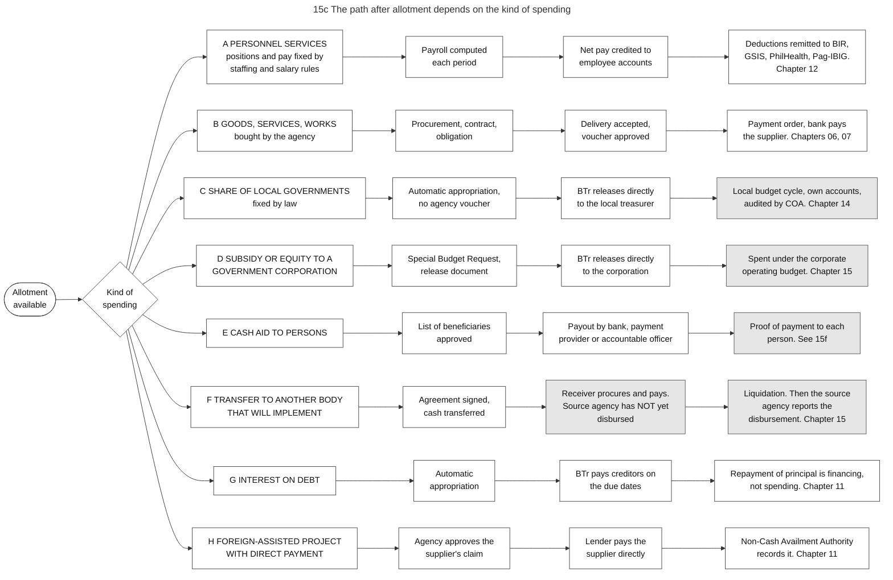
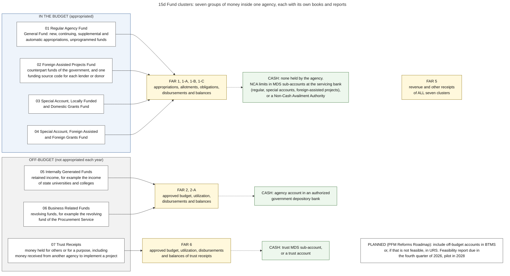
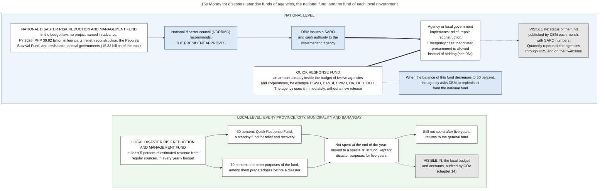
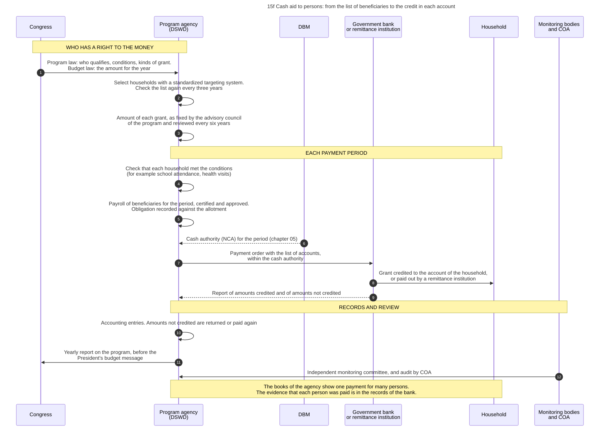

# 15. Government corporations, fund transfers, other spending paths, and fund clusters

*Part of the Philippine PFM Atlas. Facts as of 8 October 2026. The codes in the column "Basis" are explained in [Reference F](../reference/F_sources_and_verification.md). "GK" means general knowledge that I did not open in a source during this work.*

## 1. The question this process answers

Chapters 05 to 07 follow one purchase by one national agency. Which other routes does public money take, who approves the budget of a government corporation, when does a transfer to another body count as spent, and how does one agency separate different kinds of money?

## 2. The idea in plain words

The main route is: an agency receives an allotment, procures, accepts a delivery and pays. Four things do not fit this route, and each has its own rule.

1. **A government corporation is not an agency in the budget law.** It is a separate legal person with its own income. Its yearly budget is the **Corporate Operating Budget**, which its governing board approves and DBM reviews [COB]. The Administrative Code has the rule: the internal operating budgets of these corporations "shall be approved by their respective governing boards", and they pass through the budget process of the national government "in cases where national government budgetary support is needed" [EO292-B6 s.19]. Only the money that the national government gives to it (a subsidy, or equity, which is a capital investment) passes through the budget law and the Treasury [BSGC2026].
2. **A fund transfer moves cash, but it does not move the responsibility.** When an agency gives money to another agency, a corporation or a local government to implement a project, the source agency may not treat the money as disbursed until the receiver has used it for works, goods or services that were completed, inspected and accepted [NBC599 s.3.4].
3. **Several kinds of spending omit steps of the main route.** Salaries have no procurement. The share of local governments has no voucher of an agency. Interest on debt has no yearly vote on the amount. Diagram 15c shows eight such paths.
4. **One agency holds several kinds of money.** Money from the budget law, money from loans, income that the agency may keep, and money held for others must be recorded and reported separately. Each group is a **fund cluster** with its own books [JC2017-1][JC2019-1]. The accounting manual requires "fund cluster accounting" as one of its basic principles, and each agency keeps a complete set of books for each cluster [GAM-V1 Ch.2 s.6, s.8].

A case where the transfer rule works: in March an agency transfers 100 to a second agency for a project. The second agency procures, accepts the work in October, pays 90, reports this and returns 10. The first agency then reports a disbursement of 90.

A case where it fails: the second agency does not report. The books of the first agency show a receivable for years. The cash left the Treasury in March, and no record of the first agency shows what was bought. The 2025 PEFA assessment found that a part of the advances, in particular those given to government corporations, was not liquidated at the end of 2023 [PEFA2025].

Terms. A **GOCC** is a government-owned or controlled corporation. A **subsidy** is money for the operations or programs of the corporation (GK for this short definition). **Equity** is a capital investment of the national government in the corporation, and may not be used for salaries [BSGC2026]. **Liquidation** means that the receiver of an advance or transfer reports, with documents, how the money was used. **Off-budget** means not appropriated each year in the budget law.

## 3. Government corporations

### 3.1 Authorities and their roles

| Authority | Role | Basis |
|---|---|---|
| Governing board of the corporation | Approves the Corporate Operating Budget | BSGC2026, COB |
| Management of the corporation | Prepares the budget and submits it to DBM on or before 31 March of the fiscal year. Requests budgetary support. Reports | COB, BSGC2026 |
| DBM, Budget and Management Bureau C | Evaluates the budget within 20 working days. An Undersecretary approves and DBM issues an approval letter | COB |
| DBM | Administers the item "Budgetary Support to Government Corporations". Acts on the Special Budget Request | BSGC2026 |
| BTr | Releases the support directly to the corporation. May offset the release against dividends due, guarantee fees, advances and other receivables of the national government. Receives the dividends | BSGC2026 |
| Congress | Appropriates the budgetary support. Receives notice of the reports | BSGC2026 |
| Governance Commission for GOCCs | Has a defined group of corporations under its coverage. What it does in the budget of a corporation is not stated in the source I read | COB. Its work on performance: GK |
| COA | Receives the year-end statements by 14 February. Audits the corporation and its subsidiaries | COA2015-004, CONST IX-D.2, PD1445 s.26 |

### 3.2 Steps

The steps are those of diagram 15a.

| No. | Who acts | Towards whom | What is done or passed | Basis |
|---|---|---|---|---|
| 1 | GOCC management | GOCC governing board | Proposed COB | COB |
| 2 | GOCC governing board | GOCC management | Board approval | COB |
| 3 | GOCC management | DBM (Budget and Management Bureau C) | COB on or before 31 March, with DBM Forms 700, 703-A to 703-C, 705, 706 | COB |
| 4 | DBM (Budget and Management Bureau C) | (own action) | Evaluate: uses agree with the board approval, sources cover uses, national priorities, physical performance, use of last year's budget, financial ratios | COB |
| 5 | DBM (Budget and Management Bureau C) | GOCC management | COB approval letter (within 20 working days) | COB |
| 6 | GOCC management | DBM (Budget and Management Bureau C) | Request for subsidy or equity in the national budget proposal | GK |
| 7 | Congress | DBM (Budget and Management Bureau C) | GAA item "Budgetary Support to Government Corporations" | BSGC2026 |
| 8 | GOCC management | DBM (Budget and Management Bureau C) | Special Budget Request. The amount must be in the board-approved COB | BSGC2026 |
| 9 | DBM (Budget and Management Bureau C) | BTr | Release document | BSGC2026 |
| 10 | BTr | GOCC management | Cash released directly to the corporation | BSGC2026 |
| 11 | BTr | (own action) | Offset the release against dividends due, guarantee fees, advances and other receivables | BSGC2026 |
| 12 | GOCC management | BTr | Dividends: at least 50 percent of annual net earnings | BSGC2026 |
| 13 | GOCC management | DBM (Budget and Management Bureau C) | Quarterly financial and physical reports through URS, within 30 days after each quarter. Also published on its website | BSGC2026 |
| 14 | GOCC management | Congress | Written notice that the reports were submitted and published | BSGC2026 |
| 15 | GOCC management | COA | Year-end financial statements by 14 February | COA2015-004 |
| 16 | COA | GOCC governing board | Audit report | GK |
| 17 | Governance Commission for GOCCs | GOCC governing board | Performance targets and evaluation of the corporation | GK |

### 3.3 The Corporate Operating Budget

| Subject | Content | Basis |
|---|---|---|
| Who must submit | Corporations and government financial institutions under the coverage of the Governance Commission or under the jurisdiction of DBM, with or without budgetary support | COB |
| Legal bases named by DBM | Executive Order No. 518 of 1979, Republic Act No. 10149, Corporate Budget Circular No. 24 | COB |
| Forms | DBM Form 700 on corporate strategic measures. Forms 703-A, 703-B and 703-C on personnel services, operating expenses and capital outlays. Form 705 on sources of funds. Form 706 on uses of funds by expense class | COB |
| What DBM checks | That the uses agree with the board approval, that sources cover uses, agreement with national priorities, physical performance, the use of the budget of the previous year, the ratio of revenue to expense, and capital adequacy for banks | COB |
| Late submission | The budget is limited to the lower of two amounts: the level approved for the previous year, or the level approved by the board | COB |

### 3.4 Budgetary support and what the corporation returns

| Subject | Rule in the FY 2026 budget law | Basis |
|---|---|---|
| Kinds of support | Subsidy, and equity. Equity is a capital investment and is not for salaries | BSGC2026 |
| Condition | The corporation files a Special Budget Request. The amount must be in the budget approved by its board | BSGC2026 |
| Route of the money | DBM issues the release. BTr releases directly to the corporation | BSGC2026, NBC599 |
| Offsetting | BTr may deduct what the corporation owes: cash dividends, guarantee fees, advances, other receivables | BSGC2026 |
| Dividends | At least 50 percent of yearly net earnings go to the National Treasury | BSGC2026 |
| Reports | Quarterly financial and physical reports within 30 days after each quarter, through URS or other electronic means until migration to BTMS. Written notice to DBM, to both chambers and to their committees on appropriations and finance | BSGC2026 |
| Year-end statements | To the COA Government Accountancy Sector and to the auditor of the corporation on or before 14 February. No revision after 31 March | COA2015-004 |
| Codes | Corporations with budgetary support are users of UACS. The list of funding sources has codes for budgetary support to government corporations (equity, subsidies, loans, advances) and for net lending | UACS-FAQ, GAM-V1 Annex P |

## 4. Transfers of funds to another body that will implement

### 4.1 Steps

The steps are those of diagram 15b. They follow the accounting manual, which describes a transfer between two national agencies: a source agency and an implementing agency.

| No. | Who acts | Towards whom | What is done or passed | Basis |
|---|---|---|---|---|
| 1 | Source agency (holds the appropriation) | Implementing body (agency, corporation or local government) | Memorandum of agreement: purpose, amount (enough for three months, or the total project cost), period, reports | GAM-V1 Ch.6 s.63 |
| 2 | Source agency (holds the appropriation) | (own action) | Obligation recorded against its own allotment | GAM-V1 Annex M |
| 3 | Source agency (holds the appropriation) | Implementing body (agency, corporation or local government) | Check in the name of the implementing body. The receiver issues an official receipt | GAM-V1 Ch.6 s.63 |
| 4 | Source agency (holds the appropriation) | (own action) | Books: Due from National Government Agencies (a receivable). Not yet an expense, not yet a disbursement in the budget reports | GAM-V1 Annex M. Budget reports: NBC599 s.3.4 |
| 5 | Implementing body (agency, corporation or local government) | (own action) | Trust fund books: Due to NGAs (a liability). The money goes to a trust account, or to the Treasury, from which DBM gives an NCA for trust | GAM-V1 Ch.6 s.63, Annex M |
| 6 | Implementing body (agency, corporation or local government) | Suppliers and contractors | Procurement, contract | GAM-V1 Annex M |
| 7 | Suppliers and contractors | Implementing body (agency, corporation or local government) | Delivery, inspected and accepted | GAM-V1 Annex M |
| 8 | Implementing body (agency, corporation or local government) | Suppliers and contractors | Payment from the trust account or under the NCA for trust | GAM-V1 Annex M |
| 9 | Implementing body (agency, corporation or local government) | Source agency (holds the appropriation) | Within ten days after each month: reports of checks issued and of cash disbursements, approved by the head of the implementing body | GAM-V1 Ch.6 s.63 |
| 10 | Source agency (holds the appropriation) | (own action) | Books: expense recorded, receivable reduced. Now reported as disbursed. The implementing body reduces its liability by the same expenses | GAM-V1 Ch.6 s.63, Annex M, NBC599 s.3.4 |
| 11 | Implementing body (agency, corporation or local government) | Source agency (holds the appropriation) | Unused balance returned, if the agreement says so | GAM-V1 Ch.6 s.63 |
| 12 | Source agency (holds the appropriation) | DBM and COA | FAR 1-C each quarter: obligations, disbursements, liquidations and balances of fund transfers | JC2019-1 |
| 13 | DBM and COA | Source agency (holds the appropriation) | The auditor of the implementing body audits its payments. The auditor of the source agency audits the transfer | GAM-V1 Ch.6 s.63 |

### 4.2 The rules of the Manual

| Subject | Rule | Basis |
|---|---|---|
| Document | A memorandum of agreement between the source agency and the implementing agency | GAM-V1 Ch.6 s.63 |
| Amount | Enough "for three months operation subject to replenishment", or the total project cost | GAM-V1 Ch.6 s.63 |
| Where the money goes | A check in the name of the implementing agency "for deposit to its trust account in its authorized government depository bank". The implementing agency issues its official receipt. The worked example shows a second way: the implementing agency remits the money to the Treasury as a trust deposit and receives from DBM an NCA for trust, under which it pays | GAM-V1 Ch.6 s.63, Annex M |
| Reports | Within ten days after the end of each month, or of the agreed period, the implementing agency submits its report of checks issued and its report of cash disbursements. "Only actual project expenses shall be reported." The head of the implementing agency approves the reports | GAM-V1 Ch.6 s.63 |
| Unused money | Returned to the source agency after the project, when the agreement says so | GAM-V1 Ch.6 s.63 |
| Audit | The auditor of the implementing agency audits the payments from the trust account | GAM-V1 Ch.6 s.63 |

### 4.3 What the two sets of books show

The worked example of the Manual places the books of the two agencies side by side [GAM-V1 Annex M].

| Moment | Books of the source agency (regular agency fund) | Books of the implementing agency (trust fund) | Budget reports of the source agency | Basis |
|---|---|---|---|---|
| Transfer of cash | Debit Due from National Government Agencies. Credit Cash-MDS, Regular | Debit Cash-Collecting Officers. Credit Due to NGAs | Obligation recorded. No disbursement yet | GAM-V1 Annex M. Budget reports: NBC599 s.3.4 |
| The implementing agency deposits the money and receives its cash authority | No entry | Debit Cash-Treasury/Agency Deposit, Trust. Then, on the NCA for trust: debit Cash-MDS, Trust, credit Cash-Treasury/Agency Deposit, Trust | | GAM-V1 Annex M |
| The implementing agency accepts a delivery and pays | No entry | Debit the asset or inventory, credit Accounts Payable. Then debit Accounts Payable, credit Cash-MDS, Trust and Due to BIR | | GAM-V1 Annex M |
| The implementing agency reports | Debit the expense accounts. Credit Due from National Government Agencies | Debit Due to NGAs. Credit the expense accounts | Disbursement reported | GAM-V1 Annex M, Ch.6 s.63. Budget reports: NBC599 s.3.4 |
| End of the year, a part is not yet reported | Due from National Government Agencies stays as a receivable | Due to NGAs stays as a liability | The balance is shown in report FAR 1-C | GAM-V1 Annex M, JC2019-1 |

Three things follow from the example.

- The cash that the source agency transfers can return to the Treasury, and the implementing agency then spends under a new cash authority of DBM. One appropriation is in that case the basis of two cash authorities in sequence, one for each agency.
- In the books of the implementing agency the spending does not stay as its own expense. It reduces the liability to the source agency. The expense appears in the books of the source agency, and only when the implementing agency has reported.
- The receivable in the books of the source agency is the measure of what has not been reported. The assessment of 2025 found that a part of such advances was not liquidated at the end of 2023 [PEFA2025].

The Manual makes one condition. The receivable and the liability are recorded when the agreement requires that unused money is returned. When the agreement has no such condition, the source agency records an expense and the implementing agency records revenue at the moment of the transfer [GAM-V1 Ch.6 s.63].

A difference between two sources, to state and not to resolve: the Manual of 2015 credits the cash account of the source agency when the check is issued, like any other payment. The release guidelines of FY 2026 say that the source agency does not treat the transfer as disbursed until the receiver has used it for deliveries that were inspected and accepted [NBC599 s.3.4]. I did not read how the registry of the source agency shows the transfer between these two moments. Report FAR 1-C lists, for each quarter, the obligations, disbursements, liquidations and balances of inter-agency fund transfers [JC2019-1].

For a transfer to a government corporation or to a local government I read only the rule of the circular.

## 5. Paths after the allotment

Diagram 15c shows eight paths. The table gives the same content, and names the steps of the main route that each path omits.

| Path | Kind of spending | What is different from a purchase | Where the records of the national agency end | Basis |
|---|---|---|---|---|
| A | Personnel services | No procurement. The amount follows from positions and pay rules | At the remittances | GMIS, NBC599. See chapter 12 |
| B | Goods, services and works bought by the agency | The main route | At the payment and the audit | RA12009, CL2013-16A. See chapters 06 and 07 |
| C | Share of local governments | Automatic appropriation. No voucher of an agency. BTr releases to the local government | At the release. The local cycle continues in local records | LGC s.286, MANDANAS, ALGU2026. See chapter 14 |
| D | Subsidy or equity to a government corporation | Special Budget Request. BTr releases to the corporation | At the release. Spending continues under the corporate budget | BSGC2026 |
| E | Cash aid to persons | A list of beneficiaries replaces the contract. Payout by a bank, a remittance institution or an accountable officer | At the payment order for all persons. The proof of payment to each person is in the records of the payer | RA11310 s.9 for one program (section 5.2). Other programs: GK |
| F | Transfer to another body that will implement | The receiver procures and pays. The source agency has not disbursed until then | At the reports of the implementing body | NBC599 s.3.4, GAM-V1 Ch.6 s.63 |
| G | Interest on debt | Automatic appropriation. BTr pays creditors on the due dates | At the payment, in the books of BTr only. Repayment of principal reduces the liability and is not an expense | NBC599, EO292-B6 s.26, GAM-V1 Annex I. See chapter 11 |
| H | Foreign-assisted project with direct payment | The lender pays the supplier. No cash passes through the Treasury. BTr records the loan, and a Non-Cash Availment Authority lets the agency close its payable | At the recording | NBC599 s.4.2.2.1, GAM-V1 Ch.6 ss.66-68. See chapter 11 |

Why this matters for a model of the process: directly after the allotment there is a choice among these paths, and only path B contains procurement by the spending agency.

### 5.1 Money for disasters

After a disaster, money is needed within days, and the main route takes months. Diagram 15e answers the question: which money is already available, who must approve the rest, and which records show the use?

The idea: speed is obtained in three ways, and none of them removes the normal controls of appropriation, obligation, voucher and audit.

| Way | Content | Who decides | Basis |
|---|---|---|---|
| Quick Response Fund of an agency | An amount kept ready inside the budget of twelve agencies and corporations (the rules call it a standby fund), among them the social welfare, education, public works, agriculture and health departments and the Office of Civil Defense. PHP 10.69 billion in FY 2026. The agency uses it immediately | The agency. When the balance decreases to 50 percent, it asks DBM to replenish the fund | GAA2026-NDRRMF, DBM-QRF |
| National Disaster Risk Reduction and Management Fund | PHP 39.82 billion in the FY 2026 budget law, with no project named in advance. Four purposes: relief and rehabilitation services (11.03 billion), repair and reconstruction (12.47 billion), the People's Survival Fund (1.00 billion), and assistance to local governments for rehabilitation and reconstruction (15.33 billion). It covers events of the current year and of the two years before | The President approves each use, with the recommendation of the national disaster council. DBM then issues a SARO | GAA2026-NDRRMF |
| Fund of each local government | Not less than 5 percent of estimated revenue from regular sources, in every yearly budget. 30 percent of it is a Quick Response Fund. Amounts not spent go to a special trust fund for five years and then return to the general fund | The local government. The condition for the use of the 30 percent, and who approves, are not verified | RA10121 (read in two documents that quote the law and its rules) |

What the records show. DBM publishes the status of the national fund each month, with the number, date and amount of each SARO. By 31 May 2026 it had released PHP 5.92 billion, all in three SAROs to the social welfare department to replenish its Quick Response Fund. One of them is SARO-BMB-B-26-0000189 of 12 February 2026 for PHP 1,979,556,861 [NDRRMF-STATUS]. Implementing agencies report each quarter through URS and publish the reports on their websites [GAA2026-NDRRMF].

Procurement in an emergency: the Implementing Rules allow negotiated procurement when there is imminent danger to life or property during a calamity, or when vital services must be restored. Some documents of the supplier may then be submitted after the award, before payment [IRR12009 s.35.2].

On 14 August 2026 the GPPB approved guidelines for procurement in four stages: preparedness, action before an expected disaster, response and recovery. Emergency negotiated procurement applies "When time is of the essence arising from natural or man-made calamities", and also for action before a disaster once a state of imminent disaster is declared. The guidelines encourage framework agreements for goods that will be needed (chapter 06, section 5), and they allow the steps of a procurement before the award to be done early. The entity must confirm that "there is a budget for the purpose", and the contract form has a line "Certified Funds Available" for the chief accountant. Payment stays "subject to existing budgeting, accounting and auditing rules and regulations". A performance security is at the option of the entity. The guidelines do not speak of the Quick Response Fund or of advance payment [GPPB2026-17]. I read them as a summary. They shorten the choice of the supplier. They do not change the controls of funds: the certificate of the accountant, the obligation and the voucher remain.

A case where the design works: a typhoon damages schools. The education department repairs classrooms immediately from its Quick Response Fund, and asks for replenishment when half of it is used.

A case where it fails: the damage is larger than these ready amounts, and the release from the national fund needs a recommendation and an approval. The time between the disaster and the SARO is then the time of these two steps. The sources that I read do not state how long they take.

### 5.2 Cash aid to persons

In a purchase, one supplier delivers and one voucher is paid. In a cash aid program, one payment order pays many thousands of persons, and nothing is delivered to the government. Diagram 15f answers the question: what replaces the contract, the delivery and the acceptance?

The idea: the law of the program replaces the contract, because it says who has a right to the money. The list of persons who qualify replaces the delivery. The control is that each person on the list exists, qualifies and has met the conditions. The proof of payment is the record of the bank for each person.

The steps are those of diagram 15f. The example is the conditional cash transfer program.

| No. | Who acts | Towards whom | What is done or passed | Basis |
|---|---|---|---|---|
| 1 | Congress | Program agency (DSWD) | Program law: who qualifies, conditions, kinds of grant. Budget law: the amount for the year | RA11310 s.22 |
| 2 | Program agency (DSWD) | (own action) | Select households with a standardized targeting system. Check the list again every three years | RA11310 s.5 |
| 3 | Program agency (DSWD) | (own action) | Amount of each grant, as fixed by the advisory council of the program and reviewed every six years | RA11310 s.7, s.10 |
| 4 | Program agency (DSWD) | (own action) | Check that each household met the conditions (for example school attendance, health visits) | GK |
| 5 | Program agency (DSWD) | (own action) | Payroll of beneficiaries for the period, certified and approved. Obligation recorded against the allotment | GK |
| 6 | DBM | Program agency (DSWD) | Cash authority (NCA) for the period (chapter 05) | GK |
| 7 | Program agency (DSWD) | Government bank or remittance institution | Payment order with the list of accounts, within the cash authority | GK |
| 8 | Government bank or remittance institution | Household | Grant credited to the account of the household, or paid out by a remittance institution | RA11310 s.9 |
| 9 | Government bank or remittance institution | Program agency (DSWD) | Report of amounts credited and of amounts not credited | GK |
| 10 | Program agency (DSWD) | (own action) | Accounting entries. Amounts not credited are returned or paid again | GK |
| 11 | Program agency (DSWD) | Congress | Yearly report on the program, before the President's budget message | RA11310 s.18 |
| 12 | Monitoring bodies and COA | Program agency (DSWD) | Independent monitoring committee, and audit by COA | RA11310 s.16. Audit: CONST IX-D.2 |

The law of that program requires "direct and secured access to cash grants" through authorized government depository banks. Where no such bank serves an area, the department may use institutions for money remittance that the central bank has accredited [RA11310 s.9].

A consequence for the records: the books of the agency show one payment for many persons. The evidence that each person was paid is in the records of the bank or of the remittance institution, outside the systems of the government (Inference). Other aid programs follow their own rules, and some pay in cash through accountable officers (diagram 07f).

## 6. Fund clusters

Diagram 15d shows the seven fund clusters, the report that covers each one, and the form in which its cash is held. The names are those of the accounting manual [GAM-V1 Ch.2 s.13], and the content of each cluster is from its list of funding sources [GAM-V1 Annex P].

| Code | Name | What belongs to it | Budget report | Cash is held as | Basis |
|---|---|---|---|---|---|
| 01 | Regular Agency Fund | The General Fund: new general appropriations, continuing and supplemental appropriations, automatic appropriations, unprogrammed funds | FAR 1, 1-A, 1-B, 1-C | A limit (NCA) in an MDS sub-account, or a Non-Cash Availment Authority | GAM-V1 Ch.2 s.13, Annex P. Reports: JC2019-1. Cash: NBC599 |
| 02 | Foreign Assisted Projects Fund | The counterpart funds of the government, and one funding source code for each lender or donor | FAR 1 and its parts | As above | Same |
| 03 | Special Account-Locally Funded/Domestic Grants Fund | Special accounts in the General Fund that a law created, and domestic grants | FAR 1 and its parts | As above | Same |
| 04 | Special Account-Foreign Assisted/Foreign Grants Fund | Special accounts for foreign-assisted projects and foreign grants | FAR 1 and its parts | As above | Same |
| 05 | Internally Generated Funds | Retained income, for example the income of state universities and colleges. The Manual calls the group "Off-Budgetary Funds - Retained Income Funds" | FAR 2, 2-A | An account of the agency in an authorized government depository bank | GAM-V1 Ch.2 s.13, Annex P, JC2019-1, GAA2026-GP |
| 06 | Business Related Funds | Revolving funds, for example the revolving fund of the Procurement Service. The Manual calls the group "Off-Budgetary Funds-Revolving Funds" | FAR 2, 2-A | As for 05 | Same |
| 07 | Trust Receipts | Money held for others or for a purpose. It includes money that an agency receives from another agency to implement a project (section 4) | FAR 6 | A trust MDS sub-account, or a trust account in a depository bank | GAM-V1 Ch.2 s.13, Annex M, Annex N, JC2019-1, NBC599, GAA2026-GP |

Notes on this table.

- The clusters 01 to 04 are spent through an appropriation, in the yearly budget law or as an automatic appropriation under another law, and are reported in FAR 1. The Manual and the reporting circular call the clusters 05 and 06 off-budgetary funds [GAM-V1 Annex P][JC2019-1]. For these, the budget unit keeps other registries and the form is the budget utilization request, not the obligation request [GAM-V1 Ch.3 ss.18-24].
- The fund cluster is the first two digits of the funding source segment of UACS [JC2017-1]. Chapter 17 explains the segments.
- Report FAR 5 covers the revenue and other receipts of all seven clusters [JC2019-1].
- There are four kinds of MDS sub-account: regular, special accounts in the General Fund, trust, and foreign-assisted projects [NBC599]. The books have three cash accounts for the NCA: Cash-MDS, Regular, Cash-MDS, Special Account and Cash-MDS, Trust [GAM-V1 Ch.5 s.38]. The table does not pair each cluster with one sub-account.
- The law gives one committee the watch over all funds other than the General Fund: the Secretary of Finance as chair, the Secretary of Budget and Management and the Chairman of COA. It may recommend to the President that amounts return to the General Fund when they are no longer needed for their purpose, when the General Fund needs them in an emergency, or when rules were violated [GAM-V1 Ch.5 s.4][EO292-B6 s.45].
- The Roadmap plans to include off-budget accounts in BTMS, or in URS if that is not feasible. A feasibility report is due in the fourth quarter of 2026 and a pilot in 2028 [SFA6].

## 7. Documents and identifiers

| Document | Issued by | Identified by | Basis |
|---|---|---|---|
| Corporate Operating Budget and its forms | Corporation | Corporation and year | COB |
| Approval letter | DBM | Date | COB |
| Special Budget Request for support | Corporation | Request | BSGC2026 |
| Release document for support | DBM | Document number | BSGC2026 |
| Memorandum of agreement for a transfer | Source agency and receiver | Agreement | GAM-V1 Ch.6 s.63 |
| Official receipt for the transferred money | Implementing agency | Receipt number | GAM-V1 Ch.6 s.63 |
| Report of checks issued and report of cash disbursements, as the proof of use | Implementing agency | Month | GAM-V1 Ch.6 s.63 |
| FAR 1-C | Source agency | Agency and quarter | JC2019-1 |
| FAR 2, FAR 5, FAR 6 | Agency | Agency, fund cluster and quarter | JC2019-1 |

## 8. Information systems

| System | Use in this chapter | Basis |
|---|---|---|
| URS | Quarterly reports of corporations that receive support. Report FAR 1-C on transfers. Reports FAR 2, 5 and 6 on off-budget funds and receipts | BSGC2026, JC2019-1 |
| ADRS | Release documents | ADRS, NBC599 |
| AFR System of COA | Year-end statements | COA-GAS |
| BTMS | National agencies in the rollout. Off-budget accounts are planned for a later step | CL2025-8, SFA6 |
| Own systems of each corporation | Its budget, accounting and payments | GK |

## 9. Controls: what each one checks, and what it does not check

| Control | What it checks | What it does not check |
|---|---|---|
| Board approval and DBM review of the corporate budget | That planned uses are covered by sources and agree with the board decision and with national priorities | Each payment of the corporation |
| Special Budget Request for support, linked to the board-approved budget | That national money goes only to what the board has budgeted | How the corporation spends it afterwards |
| Offsetting by BTr | That a corporation that owes the Treasury does not receive the full support | |
| Rule on dividends | That at least half of the net earnings return to the Treasury | |
| Rule that a transfer is not a disbursement | That a source agency cannot show spending by moving cash to another body | That the receiver reports in time |
| Receivable in the books of the source agency, and liability in the trust fund books of the receiver | That the amount not yet reported stays visible in two sets of books | That the two balances are compared with each other. I read no rule that requires this comparison |
| FAR 1-C | That balances of transfers stay visible each quarter | That anyone acts on old balances |
| Separate books and reports for each fund cluster | That money of one kind is not used for another | Accounts that are outside the main systems |
| Audit of the source and of the receiver | Both parties of a transfer | |

## 10. Timing

| Date | Event | Basis |
|---|---|---|
| 14 February | Year-end statements of corporations to COA | COA2015-004 |
| 31 March | Corporate Operating Budget due at DBM. Last day for revisions of the year-end statements | COB, COA2015-004 |
| 20 working days | Processing time that DBM states for its action on the corporate budget | COB |
| 30 days after each quarter | Quarterly reports of supported corporations. FAR 1-C, FAR 2, FAR 5, FAR 6 | BSGC2026, JC2019-1 |

## 11. What the 2025 assessment and the Roadmap report

| Finding | Basis |
|---|---|
| A part of the advances, in particular advances to government corporations, was not liquidated at the end of 2023 (PEFA indicator 27.3, score C) | PEFA2025 |
| Accounts of foreign-funded projects and trust accounts with a legal basis are outside the Treasury Single Account (PEFA indicator 21.1, score C) | PEFA2025 |
| Off-budget accounts are not in the main systems. A plan exists to include them in BTMS or URS | SFA6 |
| The page that I read gives no finding on the monitoring of public corporations (PEFA indicator 10.1) | PEFA2025 |

## 12. Diagrams

### Diagram 15a  Government corporations (GOCCs): corporate operating budget, budgetary support and reports

Code file: `../diagrams/mermaid/15a_gocc_budget_sequence.mmd`. Rendered image: [`../rendered/15a_gocc_budget_sequence.png`](../rendered/15a_gocc_budget_sequence.png).

- **Question:** a government corporation is not an agency in the GAA. Who approves its budget, how does national money reach it, and what does it return?
- **Idea:** a corporation spends its own income under a Corporate Operating Budget (COB) approved by its board and reviewed by DBM. Only the part that comes from the national budget (subsidy, equity) passes through the GAA and the Treasury.
- **Sources:** review and approval of the COB by DBM, legal bases (EO 518 of 1979, RA 10149, Corporate Budget Circular No. 24), forms, deadline of 31 March, 20 working days, rule for late submission [COB]. Special provisions of the FY 2026 GAA on budgetary support: release through BTr, Special Budget Request, request must be in the board-approved COB, offsetting, dividends of at least 50 percent of net earnings (RA 7656), quarterly reports through URS within 30 days, notice to DBM and Congress [BSGC2026]. Year-end statements to COA by 14 February [COA2015-004]. Releases by BTr to subsidized corporations [NBC599].
- **General knowledge, not opened in a source here:** step 6 (the corporation's request during national budget preparation), what the Governance Commission for GOCCs does in step 17 (the source only states which corporations it covers), step 16 (audit report to the board), guarantees and lending by DOF.

### Diagram 15b  Transfer of funds from one agency to another body that will implement

Code file: `../diagrams/mermaid/15b_inter_agency_transfers.mmd`. Rendered image: [`../rendered/15b_inter_agency_transfers.png`](../rendered/15b_inter_agency_transfers.png).

- **Question:** an agency gives its money to another agency, a corporation or a local government to implement a project. When is the money "spent", and who is responsible for it?
- **Idea:** a transfer moves cash but not accountability. Under the FY 2026 rules the source agency may not treat the transfer as a disbursement until the receiver has used it for works, goods or services that were delivered, inspected and accepted. Until then the source agency holds a receivable and the receiver holds a liability.
- **Sources:** transfers to other agencies, corporations and local governments are not treated as disbursed by the source until used by the receiver for accepted deliveries within the validity period [NBC599 s.3.4]. Report FAR 1-C on obligations, disbursements, liquidations and balances of inter-agency fund transfers [JC2019-1]. A part of the advances, in particular advances to government corporations, was not liquidated at the end of 2023 (indicator 27.3, score C) [PEFA2025]. Schedule of fund transfers required from corporations [COA2015-004].
- **From the accounting manual of 2015:** the memorandum of agreement, the amount (enough for three months, or the total project cost), the check in the name of the implementing agency for its trust account, its official receipt, the monthly reports within ten days, the return of an unused balance when the agreement says so, the audit by the auditor of the implementing agency [GAM-V1 Ch.6 s.63]. The entries of both agencies side by side: Due from National Government Agencies in the books of the source, Due to NGAs in the trust fund books of the implementer [GAM-V1 Annex M].
- **A condition in the manual:** the receivable and the liability are recorded when the agreement requires that unused money is returned. When the agreement has no such condition, the source agency records an expense and the receiver records revenue at the transfer [GAM-V1 Ch.6 s.63]. The diagram shows the first case.
- **Limit:** the Manual describes a transfer between two national agencies. For a transfer to a corporation or to a local government I read only the rule of the FY 2026 circular [NBC599 s.3.4].

### Diagram 15c  The path after allotment depends on the kind of spending

Code file: `../diagrams/mermaid/15c_spending_paths.mmd`. Rendered image: [`../rendered/15c_spending_paths.png`](../rendered/15c_spending_paths.png).

- **Question:** chapters 06 and 07 follow one purchase by one agency. Which other paths does public money take, and which steps does each path omit?
- **How to read it:** each row is one kind of spending. A grey box marks the point where the records of the national agency stop showing what happens next. The last column names the chapter that continues the path.
- **Why it matters for a process model:** this is a choice among eight branches directly after the allotment. Only branch B contains procurement by the spending agency itself.
- **Sources:** A personnel [GMIS][NBC599]. B procurement and payment [RA12009][CL2013-16A]. C share of local governments, automatic appropriation and direct release by BTr [LGC s.286][MANDANAS][GAA2026-GP]. D budgetary support to corporations through BTr [BSGC2026]. F transfers not disbursed until used by the receiver [NBC599 s.3.4]. G interest as automatic appropriation [NBC599]. H direct payment by a lender and Non-Cash Availment Authority [NBC599].
- **Row e:** payment of cash grants through authorized government depository banks or accredited remittance institutions is verified for one program [RA11310 s.9]. Diagram 15f shows that program.
- **More sources:** the reports by which an implementing agency proves the use of transferred money (row F) [GAM-V1 Ch.6 s.63]. Debt service is recorded only in the books of BTr (row G) [GAM-V1 Annex I].
- **General knowledge, not opened in a source here:** the other steps of row E. Each program has its own guidelines.

### Diagram 15d  Fund clusters: seven groups of money inside one agency, each with its own books and reports

Code file: `../diagrams/mermaid/15d_fund_clusters.mmd`. Rendered image: [`../rendered/15d_fund_clusters.png`](../rendered/15d_fund_clusters.png).

- **Question:** an agency handles money from the GAA, from loans, from its own income and from other parties. How are these separated, and which report covers each group?
- **Idea:** a fund cluster is a group of funds that must be recorded and reported separately. The fund cluster is the first two digits of the funding source segment of UACS. Each cluster has its own set of books.
- **How to read it:** left = fund cluster. Solid arrow = the budget report that covers it. Dotted arrow = the form in which its cash is held.
- **Sources:** fund cluster as the first element of the funding source code [JC2017-1]. FAR 2 and 2-A for off-budgetary funds in clusters 05 and 06, FAR 6 for trust receipts in cluster 07, FAR 5 for revenue of clusters 01 to 07, FAR 1 for appropriations [JC2019-1]. Four MDS sub-accounts: regular, special accounts, trust, foreign-assisted projects [NBC599]. Revolving funds in authorized government depository banks, trust receipts, special accounts [GAA2026-GP]. Plan to include off-budget accounts in BTMS or URS [SFA6].
- **Names and content of the seven clusters:** from the Government Accounting Manual. The names [GAM-V1 Ch.2 s.13]. The funding sources that belong to each cluster [GAM-V1 Annex P]. The Manual calls cluster 05 "Off-Budgetary Funds - Retained Income Funds" and cluster 06 "Off-Budgetary Funds-Revolving Funds".
- **The cash accounts:** the books have three accounts for the NCA: Cash-MDS, Regular, Cash-MDS, Special Account and Cash-MDS, Trust [GAM-V1 Ch.5 s.38]. The FY 2026 circular lists four kinds of sub-account [NBC599]. The diagram does not pair each cluster with one sub-account.
- **A fact from the manual:** money that one agency receives from another agency to implement a project is recorded in the trust fund books of the receiver, in cluster 07 [GAM-V1 Ch.2 s.13, Annex M].

### Diagram 15e  Money for disasters: standby funds of agencies, the national fund, and the fund of each local government

Code file: `../diagrams/mermaid/15e_disaster_funds.mmd`. Rendered image: [`../rendered/15e_disaster_funds.png`](../rendered/15e_disaster_funds.png).

- **Question:** after a disaster, money is needed within days, and the normal path (release request, procurement, payment) takes months. Which money is already available, who must approve the rest, and which records show the use?
- **Idea:** speed is obtained in three ways. First, an amount is placed in advance in the budgets of the agencies that respond first (Quick Response Fund), so that no release is needed at the moment of the disaster. Second, a national fund without a named project is kept in the budget law and released case by case. Third, every local government must set aside its own fund each year. The normal controls remain: appropriation, obligation, voucher, audit.
- **How to read it:** upper frame = national level. Lower frame = local level. Blue = decision of an authority. Thick arrows = money. The grey boxes show where the use becomes visible.
- **Sources, national:** amount of PHP 39.82 billion in FY 2026 and its four purposes, approval by the President with the recommendation of the national disaster council, the agencies with a Quick Response Fund, replenishment when the balance reaches 50 percent subject to approval by DBM, the People's Survival Fund, the assistance program for local governments, and the reporting rule [GAA2026-NDRRMF]. The Quick Response Fund as a standby fund that is built into the budgets of the agencies and that they use immediately, and the request for replenishment [DBM-QRF]. The table of the amounts by agency (PHP 10.69 billion in total) is printed in the chapter of the national fund [GAA2026-NDRRMF]. Releases by SARO with their numbers, published by DBM each month; by 31 May 2026 three releases to DSWD of PHP 5.92 billion in total, all to replenish its Quick Response Fund [NDRRMF-STATUS]. Emergency cases as a ground for negotiated procurement [IRR12009 s.35.2].
- **Sources, local:** not less than 5 percent of estimated revenue from regular sources, 30 percent of it as a Quick Response Fund, and the special trust fund for unexpended amounts for five years, after which they revert to the general fund [RA10121]. I read these rules only in two documents that quote the law and its implementing rules, not in the law itself.
- **Not verified:** the condition (a declared state of calamity) for the use of the local Quick Response Fund, and who approves the use of the local fund. The uses of the remaining 70 percent are from a page that summarizes the joint circular of 2013: preparedness and training, rescue equipment, supplies and medicines, activities after a disaster, and insurance premiums [RA10121].

### Diagram 15f  Cash aid to persons: from the list of beneficiaries to the credit in each account

Code file: `../diagrams/mermaid/15f_cash_aid_to_persons_sequence.mmd`. Rendered image: [`../rendered/15f_cash_aid_to_persons_sequence.png`](../rendered/15f_cash_aid_to_persons_sequence.png).

- **Question:** in a purchase, one supplier delivers and one voucher is paid. In a cash aid program, one payment order pays many thousands of persons and nothing is delivered to the government. What replaces the contract, the delivery and the acceptance?
- **Idea:** the law of the program replaces the contract: it says who has a right to the money and under which conditions. The list of persons who qualify replaces the delivery: the control is that each person on the list exists, qualifies and has met the conditions. The proof of payment is the record of the bank for each person.
- **Sources:** the example is the Pantawid Pamilyang Pilipino Program. Selection of households with a standardized targeting system and revalidation every three years (section 5); amounts fixed by an advisory council and reviewed every six years (sections 7 and 10); "direct and secured access to cash grants" through authorized government depository banks, and through remittance institutions accredited by the central bank where no such bank serves the area (section 9); cost charged to the yearly budget law (section 22); independent monitoring committee and yearly report to Congress before the President's budget message (sections 16 and 18) [RA11310].
- **General knowledge, not opened in a source here:** steps 4, 5, 6, 7, 9 and 10 (checking of conditions, the payroll of beneficiaries, the obligation, the cash authority, the payment order, the report of the bank, the accounting). Other aid programs have their own rules, and some pay in cash through accountable officers (see 07f).
- **Inference:** the note at the end.

## 13. Verification status

- **Verified in a source:** the rules and the entries for a transfer between two national agencies [GAM-V1 Ch.6 s.63, Annex M]. The names and the content of the fund clusters [GAM-V1 Ch.2 s.13, Annex P]. The rule of the Administrative Code on the budgets of government corporations, read through a summary with quotations [EO292-B6 s.19]. The review of the Corporate Operating Budget, its forms, deadline and criteria [COB]. The special provisions on budgetary support in FY 2026 [BSGC2026]. Year-end statements of corporations [COA2015-004]. The rule that a transfer is not disbursed until the receiver uses it [NBC599 s.3.4]. Report FAR 1-C and the reports by fund cluster [JC2019-1]. The fund cluster as part of the funding source code [JC2017-1]. The PEFA scores [PEFA2025]. The national disaster fund, its purposes, the approval of its use and the standby funds of agencies in FY 2026 [GAA2026-NDRRMF][DBM-QRF]. The releases from the fund with their SARO numbers [NDRRMF-STATUS]. The guidelines of the GPPB of August 2026 on procurement for disasters, read as a summary [GPPB2026-17]. The payment of cash grants through banks, the selection of households and the reports of one program [RA11310].
- **Secondary source:** the rules of the local disaster fund, from two documents that quote the disaster law and its implementing rules [RA10121].
- **A difference between two sources:** when the source agency treats a transfer as disbursed (section 4.3).
- **General knowledge, to check:** the request of a corporation during national budget preparation, the work of the Governance Commission for GOCCs, the accounts used for a transfer to a corporation or to a local government, in the path of cash aid to persons: the checking of conditions, the payroll of beneficiaries, the payment order, the report of the bank and the accounting. Guarantees and lending by the national government to corporations (chapter 19).
- **Not opened:** Corporate Budget Circular No. 24, Republic Act No. 10149, Republic Act No. 7656 on dividends, later COA rules on fund transfers.
- **Not verified:** the condition for the use of the local Quick Response Fund, and the validity period of the national disaster fund.
- **Not covered:** government financial institutions as banks, social security institutions, water districts, the internal budget process of a corporation, aid programs other than the one in diagram 15f.
