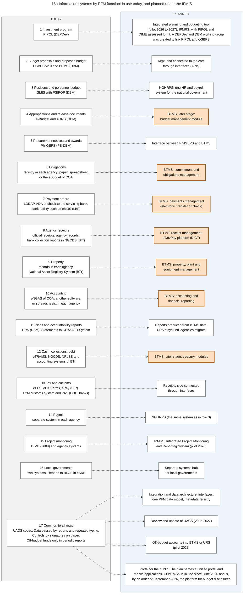
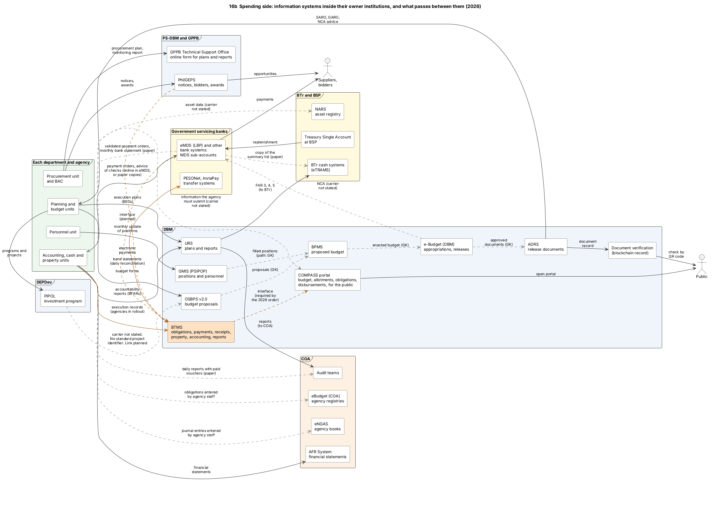
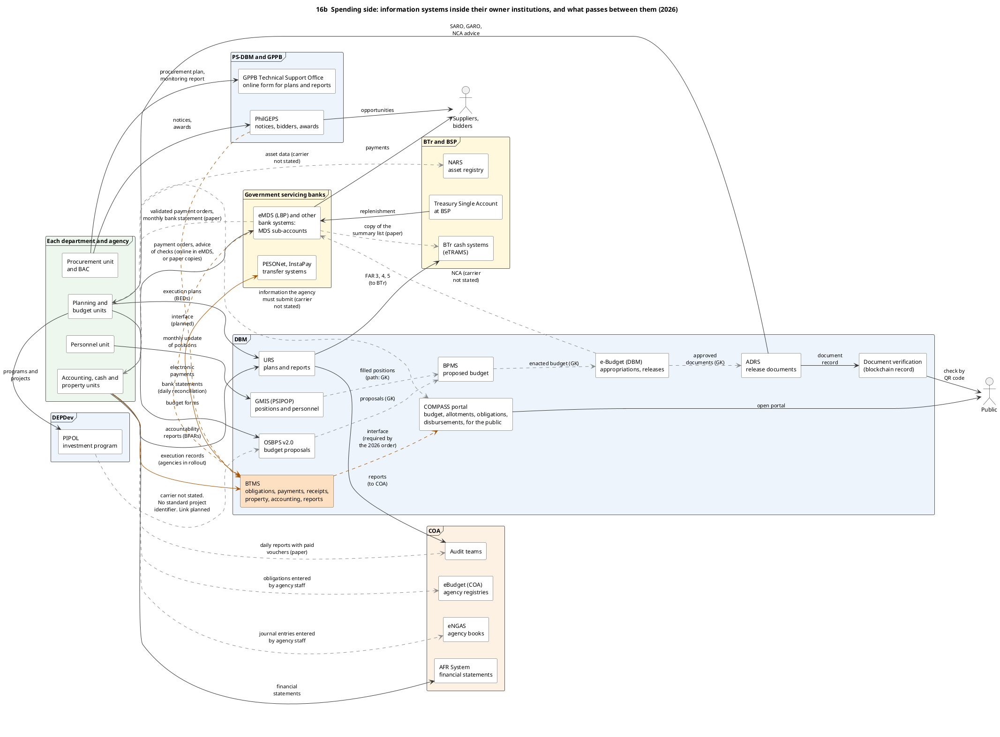
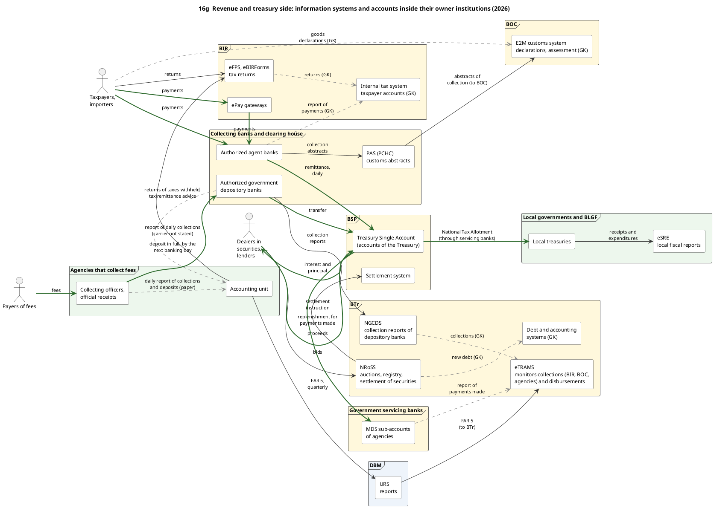
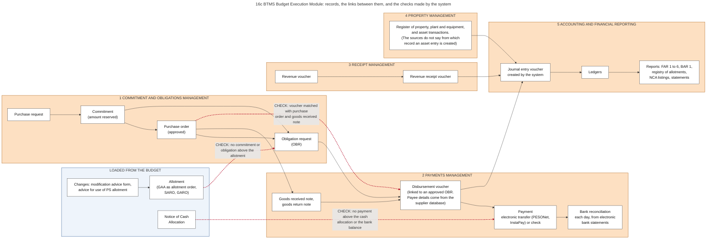
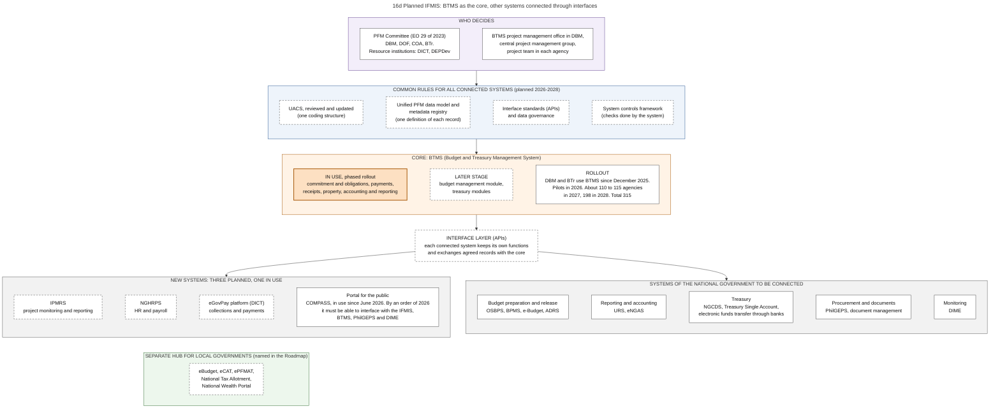
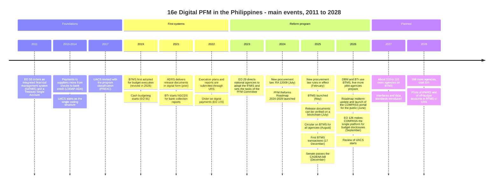
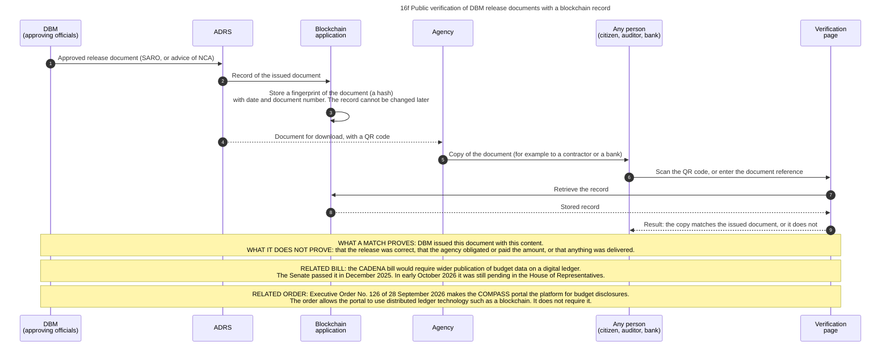

# 16. Information systems and the IFMIS

*Part of the Philippine PFM Atlas. Facts as of 8 October 2026. The statements on PhilGEPS and row 41 of the register are based on documents of the GPPB that I read on 12 October 2026. The codes in the column "Basis" are explained in [Reference F](../reference/F_sources_and_verification.md). "GK" means general knowledge that I did not open in a source during this work.*

## 1. The question this chapter answers

Which information system holds which record today, which institution owns it, by which carrier does each record pass from one system or body to the next, and what is the planned Integrated Financial Management Information System (IFMIS) meant to change?

The inventory of all systems, with owner, user and recipient of each one, is in [Reference B](../reference/B_information_systems_inventory.md). Reference B also contains a register of every flow between two systems or bodies. For each flow the register says what passes, by which carrier, whether it is in use, which control compares both sides, and where I read it. This chapter explains how the systems relate to each other.

## 2. The idea in plain words

Each institution built a system for its own part of the process. DBM has systems for budget proposals, positions, releases and reports. COA gives agencies systems for registries and books. BTr has systems for collections, cash and securities. BIR, BOC, the banks and DEPDev have their own. Each system serves the part of the process for which it was built. The difficulty lies between the systems. For most flows the sources describe a person who enters or uploads the content in the next system, or a paper copy. For few flows they describe a program that sends to another program, and for many they do not say how the content passes (section 6, and Reference B, section 4.4). The Roadmap names three gaps of this arrangement: the same report is prepared more than once, processing is manual, and the systems are not integrated [ROADMAP2024].

There are two ways to integrate. In the first, one large system replaces all the others. In the second, each institution keeps its system, one system holds the central records of budget execution, and the other systems exchange agreed records with it through interfaces. An **interface** (in the documents: API, application programming interface) is a defined way in which one program sends data to another and receives data from it.

The Philippine plan is the second way. The Roadmap describes interfaces that connect the existing separate systems to a central core, and says that agencies keep their existing systems [ROADMAP2024]. Its action plan calls BTMS the "interoperable core" of the IFMIS [SFA6].

A case where this design works: system A and system B use the same code for the same budget line and the same number for the same document. A record made in A can then be found in B without the help of a person.

A case where it fails: A and B use different codes, or give the same word different meanings. The interface then passes records that cannot be matched with each other. The action plan names this gap ("inconsistent classification codes across PFM systems") and plans three remedies: a review of UACS, one PFM data model, and a metadata registry, which is a list of the agreed definition of every data field [SFA6].

Terms. **IFMIS**: the Integrated Financial Management Information System that Executive Order No. 29 of 2023 tells all national government entities to adopt. **BTMS**: the Budget and Treasury Management System of DBM. **Core**: the system that holds the central records and to which the others connect. **Rollout**: the introduction of a system in one group of agencies after another.

## 3. What is known about the IFMIS

This section collects what the sources say, because the IFMIS is described in several documents and none of them gives the full picture.

| Subject | What the source says | Basis |
|---|---|---|
| First order | Executive Order No. 55 of 6 September 2011 ordered a Government Integrated Financial Management Information System (GIFMIS) for online accounting and monitoring of obligations and disbursements linked to cash management, a Treasury Single Account, and the PFM Committee, which was formed from an earlier committee on the GIFMIS | EO55 |
| Present order | Executive Order No. 29 of 1 June 2023. Its title begins "Strengthening the Integration of Public Financial Management Information Systems" and also names the amendment of Executive Order No. 55. All national government departments, agencies and instrumentalities, including government corporations, are directed to adopt and implement the IFMIS for government financial transactions. Local governments are encouraged to do so | EO29 |
| Scope in the order | Full digitalization of PFM processes through the IFMIS: budget management, budget execution, cash management, accounting and reporting | EO29 |
| What the order does not say | It gives no definition of the IFMIS. It does not name BTMS, the Treasury Single Account or UACS | EO29 |
| Who steers | The PFM Committee: representatives of DBM, DOF, COA and BTr. It must make a five-year development plan for the IFMIS, harmonize processes and systems, oversee the PFM Reforms Roadmap and review it at mid-term, and report each year to the Office of the President. DICT gives technical and policy support | EO29 |
| Money | First from the appropriations of the agencies and the corporate budgets, later from their budget proposals | EO29 |
| Design | Interfaces connect the existing systems to a central core. Agencies keep their systems | ROADMAP2024 |
| Core | BTMS | SFA6 |
| Present module of the core | The Budget Execution Module, with five functions. Modules for budget management and for treasury may follow | CL2025-8 |
| Status of the core | DBM and BTr use BTMS. Five more pilot agencies prepare in 2026. Plan: about 110 to 115 agencies in 2027 and 198 in 2028, 315 in total. A speech of the Secretary of Budget and Management of January 2026 gives other dates and numbers (section 7.3) | INQ-BTMS, SFA6, DBM-SPEECH26 |
| The IFMIS in the procurement rules | The rules of the procurement law say that the electronic and uniform payment system for procuring entities and suppliers "shall be defined in the context of the Integrated Financial Management Information System to be developed by the DBM, COA, and Department of Finance". This sentence names three developers. It does not name BTr, which is a member of the PFM Committee | IRR12009 s.21, EO29 |
| Common rules still to be made | Review and update of UACS in 2026 and 2027, with changes to the systems in 2027 and 2028. One PFM data model, a metadata registry, data governance, a framework of system controls | SFA6 |
| New systems planned | A project monitoring and reporting system (IPMRS), a human resources and payroll system (NGHRPS), a payment platform (eGovPay), a unified portal | SFA6 |
| Portal for the public | The COMPASS portal of DBM is in use since 26 June 2026. It combines the proposed budget, the budget law, allotments, obligations and disbursements. Executive Order No. 126 of 28 September 2026 makes it the platform of the government for budget and expenditure disclosures. According to the press release of DBM, the order says that the portal must be able to interface with existing systems, and it names the IFMIS, BTMS, PhilGEPS and DIME (section 11) | COMPASS-LAUNCH, EO126 |

## 4. Authorities and governance of the systems

| Body | Role | Basis |
|---|---|---|
| PFM Committee | Steers PFM reform and the IFMIS. Members: DBM, DOF, COA, BTr. The Roadmap names the DBM Secretary, the Secretary of Finance and the COA Chairperson as principals, and DICT and NEDA (now DEPDev) as resource institutions | EO29, ROADMAP2024 |
| DBM | Owns BTMS, OSBPS, GMIS, ADRS, URS, the COMPASS portal and the document verification record. Operates the BTMS project management office. Issues the rollout schedule | CL2025-8, NBM156, GMIS, ADRS, NBC599, COMPASS-LAUNCH, DBM-BLOCKCHAIN |
| COMPASS Council | Created by Executive Order No. 126 of 2026 for the public portal. Chair: DBM. Co-chair: DICT. Members: DOF and DILG. It approves the policies and the data standards of the portal and monitors compliance | EO126 |
| Central Project Management Group | Part of the governance of the BTMS project, together with the PFM Committee and the DBM project management office. I did not record its tasks | CL2025-8 |
| Each agency in the rollout | Forms a project implementation team, prepares a matrix of who may do what in the system, and migrates its data | CL2025-8 |
| COA | Owns eNGAS, the eBudget for agencies, and the AFR System | COA-GAS |
| BTr | Owns eTRAMS, NGCDS, NRoSS and the National Asset Registry System | BTR-SYS |
| DEPDev | Owns PIPOL | PIP-MEMO |
| PS-DBM | Operates PhilGEPS, with a Virtual Store and an eMarketplace for common-use supplies and equipment. Since October 2025 it publishes the registry of the beneficial owners of bidders through PhilGEPS, on an interim authority of the GPPB | RA12009 s.20, PS-FAQ, GPPB2025-11 |
| Technical Support Office of the GPPB | Receives the procurement plans and the procurement monitoring reports of all procuring entities, since 2026 through an online form | GPPB-TSO2026-2 |
| BIR, BOC | Own the filing, payment and customs systems. The customs system in use is named E2M | BIR-PAY, BOC-MOD |
| Servicing banks | Own the payment facilities, for example the eMDS of LBP | eMDS |
| BLGF | Owns eSRE | eSRE |
| DICT | Gives technical and policy support to the IFMIS. Leads the planned eGovPay platform with the working group on digital payments. Co-chairs the COMPASS Council and sets the standards of the portal for interoperability, cybersecurity and data management. Operates the national public key infrastructure (PNPKI). Built TradeNet | EO29, SFA6, EO126, PNPKI, TRADENET |
| DOF | Its Secretary chairs the steering committee of the National Single Window, whose platform is TradeNet. Member of the COMPASS Council | TRADENET, EO126 |

## 5. Systems by PFM function, today and planned

Diagram 16a shows this table as a picture. The right column is a plan, not a fact.

| No. | Function | System in use and its owner | Plan | Basis |
|---|---|---|---|---|
| 1 | Investment program | PIPOL (DEPDev) | An integrated planning and budgeting tool for the investment program, with a pilot in 2026 and 2027. A new project monitoring and reporting system (IPMRS). PIPOL and DIME will be assessed for fit. A working group of the planning department and DBM was created to link PIPOL and OSBPS | PIP-MEMO, SFA1, SFA6, ROADMAP2024 |
| 2 | Budget proposals and the proposed budget | OSBPS version 2.0 and BPMS (DBM) | Kept, and connected to the core through interfaces. This is my reading of the general statement in the Roadmap | NBM156, ROADMAP2024 |
| 3 | Positions and the personnel budget | GMIS with PSIPOP (DBM) | One human resources and payroll system (NGHRPS) | GMIS, SFA6 |
| 4 | Appropriations and release documents | e-Budget of DBM, and ADRS | Budget management module of BTMS at a later stage. This is my reading | ROADMAP2024, ADRS, CL2025-8 |
| 5 | Procurement notices and awards | PhilGEPS (PS-DBM), with a Virtual Store and an eMarketplace for common-use items. In September 2025 two versions of the portal existed, and 69 agencies used at least four modules of the electronic bidding facility of the modernized one. The earlier version takes no new posting from 1 March 2026 | Interface between PhilGEPS and BTMS. The rules also require a payment feature of PhilGEPS that can interface with the bank of the procuring entity | RA12009 s.20, IRR12009 s.20, PS-FAQ, CL2025-8, GPPB2025-09 |
| 6 | Obligations | A registry in each agency: paper, spreadsheet, or the eBudget of COA | BTMS: commitment and obligations management | COA-GAS, CL2025-8 |
| 7 | Payment orders | LDDAP-ADA or check to the servicing bank, on paper copies or through the facility of the bank, such as eMDS | BTMS: payments management, by electronic transfer or check | CL2013-16A, GAM-V1 Ch.6 s.56, s.58, eMDS, CL2025-8 |
| 8 | Receipts of agencies | Official receipts and agency records. Collection reports of depository banks in NGCDS (BTr) | BTMS: receipt management. A common payment platform (eGovPay) | BTR-SYS, CL2025-8, SFA6 |
| 9 | Property | Records in each agency. National Asset Registry System (BTr) | BTMS: property, plant and equipment management | BTR-SYS, CL2025-8 |
| 10 | Accounting | eNGAS of COA, other software or spreadsheets, in each agency | BTMS: accounting and financial reporting | COA-GAS, CL2025-8 |
| 11 | Plans and accountability reports | URS (DBM). Statements to COA through the AFR System | Reports produced from BTMS data. URS stays until agencies migrate | NBC599, JC2019-1, COA-GAS, GAA2026-GP |
| 12 | Cash, collections, debt | eTRAMS, NGCDS, NRoSS and the accounting systems of BTr | Treasury modules of BTMS at a later stage | BTR-SYS, CL2025-8 |
| 13 | Tax and customs | eFPS, eBIRForms and payment gateways (BIR). The E2M customs system (BOC) and Payment Application Secure | The receipts side is connected through interfaces. This is my reading. BOC plans a Customs Processing System that is based on E2M | BIR-PAY, PAS, BOC-MOD |
| 14 | Payroll | A separate system in each agency | NGHRPS | GK, SFA6 |
| 15 | Project monitoring | DIME (DBM) and agency systems | IPMRS, with a pilot in 2028 | ROADMAP-MID, SFA6 |
| 16 | Local governments | Own systems. Reports to BLGF in eSRE | A separate systems hub for local governments | eSRE, ROADMAP2024 |
| 17 | Common to all rows | UACS codes. Content passed by reports, by paper copies and by a second entry. Controls by signatures on the forms of the Manual. Off-budget funds only in periodic reports | Integration and data architecture, review of UACS, off-budget accounts into BTMS or URS, a unified portal. A portal for the public, COMPASS, is in use since June 2026 (section 11) | JC2017-1, GAM-V2, ROADMAP2024, SFA6, COMPASS-LAUNCH |

### 5.1 Two services of the whole government that are related to the PFM systems

Two systems hold no budget, payment or accounting record, and for that reason they have no row in the table. One of them concerns the permits that an importer needs before a customs declaration. The other concerns electronic signatures.

| System | Owner | What it does | Relation to PFM | Basis |
|---|---|---|---|---|
| TradeNet | DOF coordinates the agencies that join. DICT built the platform | It is the platform of the National Single Window. An importer or exporter applies there for the permits of the regulating agencies. The steering committee adopted it in 2017. The aim at that time was 66 agencies and 10 economic zones, and a connection to the single window of the ASEAN countries | The permits come before the goods declaration at BOC (chapter 10). A link between TradeNet and the customs system, and the present state of TradeNet, are not verified | TRADENET. Order of the steps: GK |
| PNPKI, Philippine National Public Key Infrastructure | DICT | It issues digital certificates. With a certificate a person or an office proves its identity and signs a file electronically | An electronic signature can replace a signature on paper on a PFM document. Whether the documents of DBM, of BTMS or of the banks are signed with these certificates is not verified | PNPKI. Use for PFM documents: not found |

## 6. What passes between systems and bodies today, and by which carrier

Diagrams 16b (spending side) and 16g (revenue and treasury side) show the systems inside their owner institutions, with what passes between them. Diagram 08a shows what passes between the units of one agency. The tables below list the same flows. They are produced from the register in Reference B, section 4, which has two more columns for each flow: the control that compares both sides, and the basis.

One word for each flow, such as "Electronic", would mix three different questions. The tables answer them one by one.

- **Kind**: what passes. Data, a document, an authority (a document that gives a right or sets a limit), or money.
- **Carrier**: how it passes. "System to system" means that one program sends to another and no person copies the content. "Entry by the sender" means that a person of the sending body enters or uploads the content in a system of the receiver. "Entry in own system" means that staff enter it in a record or system of their own body. "Paper" means signed paper copies. "Electronic, kind not stated" means that a source describes an electronic channel and does not say of which kind.
- **Stage of use**: whether a source describes the flow as existing today, as existing for a part of the agencies, as required or described without a confirmation of use, or as planned.

"Not stated" never means "absent". It means that the sources that I read do not say.

A case where the difference matters: an agency sends its budget forms to DBM through OSBPS. A source describes this as an online submission [NBM156]. That is an electronic flow, and it is also a second entry by a person: the staff of the agency type or upload the figures that they hold in their own files. The carrier "Entry by the sender" says both things. The one word "Electronic" hid the second.

### 6.1 Spending side

| No. | From | To | What passes | Kind | Carrier | Stage of use |
|---|---|---|---|---|---|---|
| 1 | Planning and budget units of an agency | PIPOL | Programs and projects | Data | Entry by the sender | In use |
| 2 | PIPOL | OSBPS | Programs and projects that enter the budget proposal | Data | Not stated | Not stated |
| 3 | Planning and budget units of an agency | OSBPS | Budget forms | Data | Entry by the sender | In use |
| 4 | Personnel unit of an agency | GMIS | Monthly update of positions | Data | Entry by the sender | In use |
| 5 | OSBPS and GMIS | BPMS | Proposals and filled positions | Data | Not stated | Not stated |
| 6 | BPMS | e-Budget of DBM | The enacted budget | Data | Not stated | Not stated |
| 7 | e-Budget of DBM | ADRS | Approved release documents | Document | Not stated | Not stated |
| 8 | ADRS | Agency | SARO, GARO, advice of NCA issued | Authority | Download by the receiver | In use |
| 9 | ADRS | Document verification record | A record of each issued document | Data | Electronic, kind not stated | In use |
| 10 | Document verification record | Public | Result of a check by QR code | Data | Public website | In use |
| 11 | DBM | Servicing bank | Notice of Cash Allocation | Authority | Not stated | In use |
| 12 | Agency | URS | Execution plans, then accountability reports | Data | Entry by the sender | In use |
| 13 | Procurement unit of an agency | PhilGEPS | Notices and awards | Data | Entry by the sender | In use |
| 14 | PhilGEPS | Suppliers and bidders | Opportunities | Data | Public website | In use |
| 15 | Budget unit of an agency | eBudget of COA, or own registry | Obligations | Data | Entry in own system | In use |
| 16 | Accounting unit of an agency | eNGAS or other software | Journal entries | Data | Entry in own system | In use |
| 17 | Cash unit of an agency | eMDS, the facility of the Land Bank | Payment orders, advice of checks issued and cancelled, and other MDS transactions | Document | Entry by the sender | In use for part |
| 18 | Servicing bank | Payees | Payments | Money | Bank transfer | In use |
| 19 | Servicing bank | BTr | One copy of the summary list and of the payment order, on the day of receipt | Document | Paper | In use |
| 20 | Treasury Single Account | Servicing bank | Replenishment for the payments made | Money | Bank transfer | In use |
| 21 | URS | DBM, COA, BTr | The reports. FAR 3, 4 and 5 also go to BTr | Data | Electronic, kind not stated | In use |
| 22 | Agency | AFR System of COA | Financial statements | Data | Entry by the sender | In use |
| 23 | Accounting unit of an agency | COA audit team | Daily reports of checks and of payment orders issued, with the paid vouchers, their documents and the journal entry vouchers | Document | Paper | In use |
| 24 | Agency | National Asset Registry System | Data on important assets | Data | Not stated | In use for part |
| 25 | Agency in the rollout | BTMS | Execution records: obligations, vouchers, receipts, assets | Data | Entry by the sender | In use for part |
| 26 | PhilGEPS | BTMS | Procurement data | Data | System to system | Planned |
| 27 | BTMS | PESONet and InstaPay, through the banks | Instructions for electronic payments | Data | System to system | In use for part |
| 28 | Servicing bank | BTMS | Electronic bank statements for the daily reconciliation | Data | Electronic, kind not stated | Described or required, use not verified |
| 29 | Agency | COMPASS portal | Financial and program performance, status of projects, procurement information | Data | Not stated | Described or required, use not verified |
| 30 | BTMS | COMPASS portal | Not stated | Data | System to system | Described or required, use not verified |
| 31 | COMPASS portal | Public | Budget, allotments, obligations and disbursements | Data | Public website | In use |
| 32 | Cash unit of an agency | Servicing bank | Payment order (LDDAP-ADA) with its summary list, and the advice of checks issued and cancelled | Document | Paper | In use |
| 33 | Servicing bank | Cash unit of an agency | Validated copy of the payment order | Document | Paper | In use |
| 34 | Servicing bank | Accounting unit of an agency | Monthly bank statement, with the paid checks and the debit and credit memoranda | Document | Paper | In use |
| 35 | Accounting unit of an agency | BIR | Returns of taxes withheld, and the electronic Tax Remittance Advice | Data | Entry by the sender | In use |
| 36 | BTr | Agency with a foreign-assisted project | Journal entry voucher for a payment that the lender made directly to the supplier | Document | Not stated | In use |
| 37 | Agency with a foreign-assisted project | DBM | Copy of that journal entry voucher, and the list of suppliers paid | Document | Not stated | In use |
| 38 | Agency that implements with transferred funds | Agency that gave the funds | Reports of checks issued and of cash disbursements, within ten days after each month | Document | Not stated | In use |
| 39 | PhilGEPS | Bank of the procuring entity, and merchants | Requests for payment after delivery | Data | System to system | Described or required, use not verified |
| 40 | Cash unit of an agency | Website of the agency | Daily report of payment orders issued | Data | Public website | Described or required, use not verified |
| 41 | Procurement unit of an agency, as BAC Secretariat | GPPB, through its Technical Support Office | The approved Annual Procurement Plan, its update after each semester, and the Procurement Monitoring Report of each semester | Document | Entry by the sender | In use |

Rows 17 and 32 are two carriers of the same documents. The Manual of 2015 describes five paper copies of each payment order and four of its summary list, and it describes the electronic facility of the Land Bank as a mode for the agencies with sub-accounts at that bank [GAM-V1 Ch.6 s.56, s.58]. I read no figure on how many agencies use each carrier today.

For row 2 the sources do not say that no interface exists. They state that no standard project identifier exists, that the two platforms lack interoperability, that many proposals are still submitted on paper or in spreadsheet files, that a working group of the planning department and DBM was created to link the two systems, and that an integrated tool is planned [SFA1][ROADMAP2024]. They do not state how the content of an entry in PIPOL reaches a budget form today.

Row 41: since 2026 a procuring entity sends its procurement plan and its monitoring report to the GPPB through an online form, and no longer by email [GPPB-TSO2026-2]. The form of the plan names the source of funds in words and has no budget code (chapter 17, section 6). The body that receives the plans of all entities therefore cannot match their lines with budget lines by a number (Inference).

On row 13: a resolution of the GPPB gives the state of PhilGEPS in September 2025. Two versions existed, the earlier one was to close in steps until the first semester of 2026, and 69 agencies used the electronic bidding facility of the modernized one [GPPB2025-09]. On row 39: in the Electronic Marketplace of PhilGEPS an entity pays through an eWallet, a Government Purchase Card or another electronic mode, and the Procurement Service pays the merchant after the entity accepts the goods [GPPB2025-10]. Chapter 06, section 9, gives both in detail.

### 6.2 Revenue and treasury side

| No. | From | To | What passes | Kind | Carrier | Stage of use |
|---|---|---|---|---|---|---|
| 42 | Taxpayer | eFPS, eBIRForms | Tax returns | Data | Entry by the sender | In use |
| 43 | Taxpayer | Authorized agent bank, payment gateway or revenue collection officer | Tax payments | Money | Bank transfer | In use |
| 44 | eFPS, eBIRForms | Internal tax system of BIR | Returns | Data | Not stated | Not stated |
| 45 | Authorized agent bank | BIR | Report of payments received | Data | Not stated | Not stated |
| 46 | Importer | E2M customs system | Goods declaration | Data | Not stated | Not stated |
| 47 | Authorized agent bank | BOC, through Payment Application Secure | Abstracts of customs collections, encrypted and authenticated | Data | Electronic, kind not stated | In use |
| 48 | Authorized agent banks | Treasury Single Account | Collections of BIR and BOC, daily | Money | Bank transfer | In use |
| 49 | Collecting officer of an agency | Authorized government depository bank | Collections, in full, not later than the following banking day | Money | Cash or check | In use |
| 50 | Collecting officer of an agency | Accounting unit of the agency | Report of collections and deposits, at the close of each business day | Document | Paper | In use |
| 51 | Authorized government depository bank | NGCDS of BTr | Daily and monthly collection reports | Data | Entry by the sender | In use |
| 52 | Authorized government depository bank | Treasury Single Account | Transfer of the balances | Money | Bank transfer | In use |
| 53 | NGCDS | eTRAMS | Collections | Data | Not stated | Not stated |
| 54 | BTr | Agency | Certificate of deposited national collections | Document | Not stated | In use |
| 55 | Agency, through URS | BTr | Quarterly report of revenue and other receipts (FAR 5) | Data | Entry by the sender | In use |
| 56 | Dealers in government securities | NRoSS of BTr | Bids | Data | Entry by the sender | In use |
| 57 | NRoSS | Settlement system of BSP | Settlement instruction | Data | System to system | In use |
| 58 | Dealers and lenders | Treasury Single Account | Proceeds of securities and loans | Money | Bank transfer | In use |
| 59 | NRoSS | Debt and accounting systems of BTr | New debt | Data | Not stated | Not stated |
| 60 | Treasury Single Account | Dealers and lenders | Interest and principal | Money | Bank transfer | In use |
| 61 | Servicing banks | eTRAMS of BTr | Report of payments made | Data | Not stated | In use |
| 62 | Treasury Single Account | Local governments, through servicing banks | National Tax Allotment and other shares | Money | Bank transfer | In use |
| 63 | Local treasurer | eSRE of BLGF | Statements of receipts and expenditures | Data | Entry by the sender | In use |
| 64 | Payers of fees | Collecting officer of an agency | Fees, against an official receipt | Money | Cash or check | In use |
| 65 | Authorized agent bank or depository bank | Accounting unit of the collecting agency | Consolidated report of daily collections, and the credit memo or abstract of deposits | Document | Not stated | In use |

The sources say that eTRAMS monitors the revenue collections and the disbursements of the national government [BTR-SYS]. They do not say who sends the data on tax and customs collections to it, and they do not say into which BTr system the reports FAR 3, 4 and 5 go. They also do not say which system supplies the figures of the COMPASS portal, and how often these figures are updated [COMPASS-LAUNCH].

### 6.3 Inside one agency

| No. | From | To | What passes | Kind | Carrier | Stage of use |
|---|---|---|---|---|---|---|
| 66 | Budget unit | Accounting unit | The obligation request with the claim documents, and a copy of each allotment release document | Document | Paper | In use |
| 67 | Property unit | Accounting unit | Copy of the inspection and acceptance report, with the purchase order and the delivery receipt | Document | Paper | In use |
| 68 | Cash unit | Accounting unit | Daily reports of checks issued and of payment orders issued, with the paid vouchers and the validated payment orders | Document | Paper | In use |
| 69 | Accounting unit | Budget unit | Copy of the daily reports, of the Tax Remittance Advice and of journal entry vouchers, for posting the payable and the payment | Document | Paper | In use |

These flows pass between the budget unit, the accounting unit, the cash unit and the property unit of the same agency. The Manual prescribes them as paper copies of forms. Where the units keep their records in different systems, each flow is a point where the same figure is written a second time. In an agency that uses BTMS these records are entries in one system (section 7).

### 6.4 What the register shows

The counts are in Reference B, section 4.4. Four observations follow from them, and each is a statement about the sources, not a measurement of the systems.

1. For few flows a source describes a program that sends to another program. Most of these are planned, required or limited to the agencies on BTMS.
2. The most frequent carrier that the sources describe is an entry or upload by a person of the sending body in a system of the receiver. For the receiver the flow is electronic. For the sender it is a second entry.
3. Around the payment itself, the Manual of 2015 prescribes paper: the payment order and its summary list to the bank, a copy from the bank to BTr, the validated copy back to the agency, the monthly bank statement, and the paid vouchers to the auditor.
4. For about one flow in four, the sources that I read do not state the carrier. Among them are the Notice of Cash Allocation from DBM to the bank and the reports of the banks to BTr.

## 7. BTMS, the core

Diagram 16c shows the records of the Budget Execution Module and the links between them.

### 7.1 Scope and functions

BTMS starts where the agency receives its allotment and its NCA, and ends at the disbursement [BTMS-SITE]. The circular of 2025 makes it the primary system for the expenditure transactions of all national agencies that have appropriations in the budget law, in a phased rollout, and says that all payments are recorded in it: personnel services, operating expenses, capital outlays and financial expenses [CL2025-8].

| Function | Records | Basis |
|---|---|---|
| 1. Commitment and obligations management | Purchase request, commitment, purchase order, obligation request. An obligation request is made manually, from a commitment, or from an approved purchase order | CL2025-8, BTMS-SITE |
| 2. Payments management | Goods received note, goods return note, disbursement voucher, payment by electronic funds transfer (PESONet, InstaPay) or by check, payment extract, bank reconciliation | CL2025-8, BTMS-SITE |
| 3. Receipt management | Revenue voucher, revenue receipt voucher | CL2025-8, BTMS-SITE |
| 4. Property, plant and equipment management | Register of assets and asset transactions | CL2025-8, BTMS-SITE |
| 5. Accounting and financial reporting | Journal entry voucher, ledgers, and the reports FAR 1 to 6, BAR 1, the registry of allotments and the NCA listings | CL2025-8, BTMS-SITE |
| Changes to allotments | Modification Advice Form, Advice for use of PS Allotment | CL2025-8 |

### 7.2 Rules that the system enforces

| Rule | How it is enforced outside BTMS | How BTMS enforces it | Basis |
|---|---|---|---|
| No obligation above the allotment | The budget unit checks the allotment in its registry, and its head signs Box B of the obligation request | The system blocks commitments and obligations above the allotment | GAM-V1 Ch.3 s.15, GAM-V2 App.11, BTMS-SITE |
| No payment above the cash authority | The head of accounting reads the registry of the NCA and certifies "Cash available" in Box C of the voucher. The bank checks the NCA balance | The system enforces the limits of the cash allocation and of the bank balance | GAM-V1 Ch.6 s.12, GAM-V2 App.32, BTMS-SITE. Bank check: GK |
| A voucher belongs to an obligation | The number of the obligation request is written on the voucher and on each line of the payment order | The voucher is linked to an approved obligation request | GAM-V2 App.32, App.42, BTMS-SITE |
| Payment only for what was ordered and received | The original acceptance report is attached to the voucher on paper | The voucher is matched with the purchase order and the goods received note | GAM-V1 Ch.8 s.15, BTMS-SITE |
| The books agree with the bank | Bank reconciliation statement each month, by the chief accountant. The 2025 assessment rates the practice partial | Automatic reconciliation each day from electronic bank statements | GAM-V1 Ch.21 s.4, PEFA2025, BTMS-SITE |
| Every transaction reaches the books | Accounting staff prepare a journal entry voucher and enter it in eNGAS or other software | The system creates the journal entry from the voucher, the revenue vouchers and the asset transactions. Entries at the end of a period are made manually | GAM-V2 App.36, COA-GAS, BTMS-SITE |
| DBM, COA and BTr receive the same reports | Agencies enter data in URS. Only reports generated by URS are accepted | Reports are produced from the records of BTMS | JC2019-1, CL2025-8 |

What the system cannot check: whether the goods received note is true. That fact is still stated by a person (chapter 07).

### 7.3 Status in October 2026

| Fact | Basis |
|---|---|
| BTMS was first adopted for budget execution by DBM Circular Letter No. 2019-4, and was later revived | CL2025-8 |
| The present system was launched in May 2025. From its first transactions on 17 December 2025 to the end of that year it processed about PHP 4.25 billion | INQ-BTMS |
| Seven pilot agencies were identified for 2026. Two of them, DBM and BTr, already use the system. Five prepare | INQ-BTMS |
| Plan: 110 agencies in 2027 and 198 in 2028, 315 in total. The action plan counts 2, then 115, then 198 | INQ-BTMS, SFA6 |
| A third source disagrees with the two rows above. In a speech of 22 January 2026 the Secretary of Budget and Management said: "We launched its interoperable core, the Budget and Treasury Management System (BTMS), in 2024 and even piloted it with seven agencies in 2025." The speech also says that the system is expanded to 155 national agencies in 2026. The atlas states the three sources and does not decide between them. Where a diagram or the register must show one state, it shows the account of the two rows above, because two sources agree on it and it is the more detailed one | DBM-SPEECH26 |
| Target share of the budget executed through BTMS: 50 percent, then 80 percent | SFA6 |
| A third-party audit and certification of BTMS is planned for 2026 and 2027 | SFA6 |
| Until an agency migrates, its reports are submitted through URS or other electronic means | GAA2026-GP |
| Interfaces are foreseen with procurement, document management, electronic funds transfer and financial systems. Which of them are in use: not verified | CL2025-8 |
| The order on the COMPASS portal of September 2026 names BTMS among the systems with which the portal must be able to interface | EO126 |

## 8. The planned IFMIS

Diagram 16d shows the plan in layers.

| Layer | Content | State | Basis |
|---|---|---|---|
| Who decides | PFM Committee. BTMS project management office in DBM, central project management group, a team in each agency | Exists | EO29, CL2025-8 |
| Common rules for all connected systems | UACS, reviewed and updated. One PFM data model and a metadata registry. Interface standards and data governance. A framework of system controls | Planned for 2026 to 2028 | SFA6 |
| Core | BTMS, Budget Execution Module | In use, in phased rollout | CL2025-8, INQ-BTMS |
| Core, later | Budget management module and treasury modules | Planned | CL2025-8 |
| Interface layer | Each connected system keeps its functions and exchanges agreed records with the core | Planned | ROADMAP2024, SFA6 |
| National systems to be connected | The Roadmap figure names ADRS, BPMS, BTMS, DIME, eBudget, eNGAS, NGCDS, OSBPS, the Treasury Single Account and URS. The circular adds procurement, document management and electronic funds transfer | Named | ROADMAP2024, CL2025-8 |
| New systems | IPMRS: concept in 2026, procurement in 2026 and 2027, development in 2027 and 2028, pilot in 2028. NGHRPS. eGovPay platform: assessment in 2026, phased rollout to 2028. Unified portal and mobile applications | Planned | SFA6 |
| Portal for the public | COMPASS. The action plan names a unified portal and mobile applications. The sources that I read do not say that COMPASS is that planned portal. Diagrams 16a and 16d place it there, and this is my reading | In use since June 2026 | COMPASS-LAUNCH, EO126, SFA6 |
| Hub for local governments | The Roadmap figure names eBudget, eCAT, ePFMAT, National Tax Allotment and the National Wealth Portal | Named. Functions of eCAT and ePFMAT are not explained | ROADMAP2024 |
| Off-budget accounts | Into BTMS, or into URS if that is not feasible. Feasibility report in the fourth quarter of 2026, pilot in 2028 | Planned | SFA6 |

The sources do not give a plan that replaces each present system by a named successor. The statement is general: agencies keep their systems and connect them.

## 9. Main events, 2011 to 2028

Diagram 16e shows these events on a time line.

| Year | Event | Basis |
|---|---|---|
| 2011 | Executive Order No. 55: GIFMIS and the Treasury Single Account | EO55 |
| 2013 to 2014 | Payment of suppliers by bank credit through the LDDAP-ADA, in full use from 1 March 2014. UACS starts as the single coding structure | CL2013-16A. Start year of UACS: GK |
| 2015 | A joint order of DBM and DOF adopts eMDS as one of the modes of disbursement. COA prescribes the Government Accounting Manual, in force from 1 January 2016 | GAM-V1 Ch.6 s.58, COA2015-007 |
| 2017 | UACS revised with the program classification | JC2017-1 |
| 2019 | BTMS first adopted for budget execution. Cash budgeting starts | CL2025-8, EO91 |
| 2021 | ADRS in pilot from 1 October. NGCDS of BTr in use from May | ADRS, BTR-SYS |
| 2022 | Execution plans and reports through URS. Order on digital payments | NBC599 (which cites the circular letters), BTR-SITE |
| 2023 | Executive Order No. 29 on the IFMIS | EO29 |
| 2024 | New procurement law. PFM Reforms Roadmap 2024 to 2028 | RA12009, ROADMAP2024 |
| 2025 | Rules of the procurement law in effect on 25 February. BTMS launched in May. Release documents can be verified against a blockchain record from 30 July. Circular on BTMS on 28 August. First BTMS transactions on 17 December. The Senate passes the CADENA bill on 15 December | GPPB-ADV, INQ-BTMS, DBM-BLOCKCHAIN, CL2025-8, CADENA-NEWS |
| 2026 | DBM and BTr use BTMS, five more pilot agencies prepare. Midterm update of the Roadmap, launched on 25 June. COMPASS portal for the public, launched on 26 June. Executive Order No. 126 on the portal, signed on 28 September. Review of UACS starts | INQ-BTMS, ROADMAP-MID, COMPASS-LAUNCH, EO126, SFA6 |
| 2027 (plan) | About 110 to 115 more agencies on BTMS. Interfaces and data standards introduced | INQ-BTMS, SFA6 |
| 2028 (plan) | 198 more agencies, 315 in total. Pilots of IPMRS and of off-budget accounts | INQ-BTMS, SFA6 |

## 10. Public verification of release documents

DBM has one application that uses a blockchain. Its purpose is narrow, and it is often described too broadly.

The steps are those of diagram 16f.

| No. | Who acts | Towards whom | What is done or passed | Basis |
|---|---|---|---|---|
| 1 | DBM (approving officials) | ADRS | Approved release document (SARO, or advice of NCA) | DBM-BLOCKCHAIN, ADRS |
| 2 | ADRS | Blockchain application | Record of the issued document | DBM-BLOCKCHAIN, ADRS |
| 3 | Blockchain application | (own action) | Store a fingerprint of the document (a hash) with date and document number. The record cannot be changed later | GK |
| 4 | ADRS | Agency | Document for download, with a QR code | ADRS, DBM-BLOCKCHAIN |
| 5 | Agency | Any person (citizen, auditor, bank) | Copy of the document (for example to a contractor or a bank) | GK |
| 6 | Any person (citizen, auditor, bank) | Verification page | Scan the QR code, or enter the document reference | DBM-BLOCKCHAIN |
| 7 | Verification page | Blockchain application | Retrieve the record | GK |
| 8 | Blockchain application | Verification page | Stored record | DBM-BLOCKCHAIN. Method: GK |
| 9 | Verification page | Any person (citizen, auditor, bank) | Result: the copy matches the issued document, or it does not | DBM-BLOCKCHAIN. Method: GK |

| Question | Answer | Basis |
|---|---|---|
| What is it? | A blockchain application for the Action Document Releasing System, built with a private company. It is in operation since 30 July 2025 | DBM-BLOCKCHAIN |
| What does it record? | Release documents of DBM that pass through ADRS, such as a SARO or an advice of NCA | DBM-BLOCKCHAIN, ADRS |
| Who can check? | Any person, by the QR code on the document | DBM-BLOCKCHAIN |
| What does a successful check prove? | That DBM issued this document with this content | Follows from the design |
| What does it not prove? | That the release was correct, that the agency obligated or paid the amount, or that anything was delivered. Allotments, obligations and payments are recorded in the systems of sections 5 to 7, not in this record | Follows from the design |
| Which network and which form of record? | Not stated by DBM. Press reports that quote the company name a public network and one token for each document | DBM-BLOCKCHAIN (press reports) |

A related bill is in Congress, and a related order was signed in September 2026 (section 11). The Senate approved Senate Bill No. 1506, known as the CADENA Act, on third reading on 15 December 2025 with 17 votes in favour and none against. According to a press report of 5 October 2026, the House of Representatives has not passed it: the House version was referred to the Committee on Appropriations on 9 May 2026, and that committee has published no timetable [CADENA-NEWS]. I did not open the text of the bill. Press reports say that it would require budget documents and records to be published on a blockchain.

## 11. The COMPASS portal and Executive Order No. 126

The systems of sections 5 to 8 serve the institutions that run the budget. A portal for the public answers a different question: what can a person outside the government see, and who is responsible for the figure that is shown?

DBM launched the COMPASS portal on 26 June 2026. The name is short for Centralized Open Monitoring Platform for Appropriations and Spending Statistics. On 28 September 2026, Executive Order No. 126 made the portal the platform of the government for budget and expenditure disclosures. I could not find the text of the order. The table uses six documents: four releases of DBM and of the Philippine Information Agency, and two press reports. Reference F lists them under the codes COMPASS-LAUNCH and EO126. The quotations are from these documents, and they are not checked against the order.

| Subject | What the sources say | Basis |
|---|---|---|
| Content at the launch | The proposed budget (NEP), the budget law (GAA), allotments, obligations and disbursements in one portal with a search function. A user can follow spending "by department, agency, funding purpose, and fiscal year" | COMPASS-LAUNCH |
| Content that the order requires | Financial and program performance, the implementation and completion status of projects, procurement information, and other transparency information of the budget cycle. Projects with private partners and projects with foreign assistance are included as far as they use public funds | EO126 |
| Who must submit | All national government agencies and instrumentalities, including government corporations and government financial institutions. They must "submit, regularly update, disclose and publish relevant information through COMPASS". Local governments are encouraged to participate. They are not required | EO126 |
| Who is responsible for the figures | Each covered agency is responsible "for the accuracy, completeness, and timeliness of the information it submits" | EO126 |
| Links to other systems | The portal must be "capable of interfacing with existing government systems". The press release of DBM names the IFMIS, BTMS, PhilGEPS, DIME and the eGovPH application. The council must ensure that the portal is integrated with the financial systems of DBM, COA, DOF and other oversight bodies | EO126 |
| Technology | The portal "may utilize distributed ledger technology, including blockchain or other emerging technologies". This is a permission. It is not a duty | EO126 |
| Who decides | The COMPASS Council: DBM as chair, DICT as co-chair, DOF and DILG as members. It approves policies and data standards, monitors compliance and meets at least once in each quarter. DBM operates the portal and has custody of the data. DICT sets the standards for interoperability, cybersecurity and data management | EO126 |
| Exceptions | Information that a law forbids to publish, information on national defense and security, and personal data that the Data Privacy Act protects. For each item that an agency withholds or redacts, it publishes a log with the legal basis, the approving authority and the date | EO126 |
| Sanctions and money | Non-compliance may be a ground for administrative and disciplinary sanctions. The first costs are charged to the current appropriations of DBM, DICT and other agencies | EO126 |
| Not stated in the documents that I read | The date on which the order takes effect, deadlines for the agencies, the system that supplies the figures of the portal today, how often the figures are updated, and the section numbers of the order | Not found in COMPASS-LAUNCH and EO126 |

A case where the portal answers a question. A person wants to know how much of the budget of one department was released and how much was obligated. Before June 2026 the person had to open several reports of DBM and of the agency. The portal shows these amounts in one place.

A case where the portal does not answer the question. A person wants to know whether a road that is shown as completed exists. The portal shows what the agency submitted. The order makes the agency responsible for the accuracy of that information, and the documents that I read describe no check by another body before publication [EO126]. The check of a delivery remains what chapter 07 describes: inspection and acceptance by the agency, and later the audit by COA.

Three things are similar to the portal and are not the same thing.

| Thing | What it is | Difference from the COMPASS portal | Basis |
|---|---|---|---|
| The blockchain record of section 10 | A record of each release document that DBM issued | It lets a person check that one copy of a document is authentic. It publishes no totals. The portal publishes amounts and gives no proof for a single document | DBM-BLOCKCHAIN, COMPASS-LAUNCH |
| The CADENA bill | A bill that, according to press reports, would require the publication of budget records on a blockchain | The bill would make a distributed ledger a duty by law. The order permits this technology and does not require it. The bill is not law | CADENA-NEWS, EO126 |
| The unified portal of the action plan | A planned portal with mobile applications | The sources that I read do not say that COMPASS is this planned portal | SFA6 |

The permission to use a distributed ledger does not change what a published figure proves. A ledger of this kind can show that a record was not changed after it was written. It cannot show that the record was true when it was written.

## 12. What the assessments report

| Finding | Basis |
|---|---|
| Three gaps of the present systems: the same report is prepared more than once, processing is manual, and the systems are not integrated | ROADMAP2024 |
| No single system follows a proposal from the investment program to the budget. A working group was created to link PIPOL and OSBPS | ROADMAP2024 |
| No standard project identifier exists. The planning and the budgeting platforms lack interoperability. Many proposals and reports are still submitted on paper or in spreadsheet files | SFA1 |
| Classification codes are not consistent across PFM systems | SFA6 |
| The accuracy of quarterly reports is rated C because manual processes remain (PEFA indicator 28.3). Coverage of reports through URS is rated B (indicator 28.1) | PEFA2025 |
| Bank reconciliation is partial (PEFA indicator 27.1, score C) | PEFA2025 |
| The national asset registry is not yet in full use (PEFA indicator 12.2, score C) | PEFA2025 |
| DBM operates a central personnel information system and payroll is reconciled monthly (PEFA indicator 23.1, score B) | PEFA2025 |

## 13. Diagrams

### Diagram 16a  Information systems by PFM function: in use today, and planned under the IFMIS

Code file: `../diagrams/mermaid/16a_systems_by_function.mmd`. Rendered image: [`../rendered/16a_systems_by_function.png`](../rendered/16a_systems_by_function.png).

- **Question:** for each PFM function, which system holds the record today, who owns it, and what does the PFM Reforms Roadmap plan for that function?
- **How to read it:** one row = one function. Left = the system in use today and its owner. Right = the plan. Orange = a function of BTMS, the planned core. A dotted arrow means "planned change", not a finished one. Today the systems on the left are separate: data passes between them by reports, by files and by typing the same data again.
- **Sources:** systems by function, gaps (duplicate reports, manual processing, no integration), design with interfaces (APIs) and a central core, list of systems in the national hub [ROADMAP2024]. The five functions of the BTMS Budget Execution Module, later modules for budget management and treasury, interfaces to procurement, document, payment and financial systems [CL2025-8]. BTMS status [INQ-BTMS]. Reports through URS until agencies migrate to BTMS [GAA2026-GP]. Planned systems, UACS review, data architecture, off-budget accounts, portal [SFA6]. OSBPS [NBM156]. ADRS [ADRS][NBC599]. GMIS [GMIS]. PhilGEPS [RA12009 s.20]. eMDS [eMDS]. COA systems [COA-GAS]. BTr systems [BTR-SYS]. BIR channels [BIR-PAY]. PAS [PAS]. eSRE [eSRE]. PIPOL [PIP-MEMO].
- **Not stated in the sources I read:** a one-to-one replacement plan for each system. The Roadmap says that agencies keep their systems and connect them to the core. Rows 2, 4 and 14 on the right are my reading of that statement.
- **More sources:** the COMPASS portal and Executive Order No. 126 [COMPASS-LAUNCH][EO126]; the name of the customs system [BOC-MOD].
- **Inference:** the action plan of the Roadmap names "a unified portal and mobile applications" [SFA6]. The sources I read do not say that COMPASS is this planned portal. I place COMPASS in the same box because both are portals for the public.
- **More sources on plans:** the planned integrated planning and budgeting tool for the investment program [SFA1]. The payment feature that the procurement rules require of PhilGEPS, and the place of the IFMIS in those rules [IRR12009 s.20.2.8, s.21].
- **General knowledge, not opened in a source here:** what BPMS and the DBM e-Budget do in detail, the debt recording system.

### Diagram 16b  Spending side: information systems inside their owner institutions, and what passes between them (2026) (PlantUML)

Code file: `../diagrams/plantuml/16b_systems_components_spending.puml`. Rendered image: [`../rendered/16b_systems_components_spending.png`](../rendered/16b_systems_components_spending.png).

- **Question:** on the SPENDING side (plan, budget, release, procurement, payment, reports, audit), which information system belongs to which institution, what passes from one system or body to another today, and by which carrier?
- **How to read it:** one frame = one institution. One box inside = one information system (or, for an agency, a unit that enters data). Arrow = data that passes, with a short label.
- Solid black arrow = a source describes an electronic channel. In most cases a person of the sending body enters or uploads the content in a system of the receiver. The register in Reference B, section 4, gives the carrier of each arrow.
- Dashed grey arrow = paper copies, an entry by staff in a record or system of their own body, or a carrier that the sources do not state. The label says which. "(GK)" marks a flow that I know only from general knowledge.
- Orange arrow = part of BTMS, which is in phased rollout, or an interface that is required or planned.
- **"not stated" never means "absent":** it means that the sources that I read do not say how the content passes.
- **Position of the labels:** the drawing program places each label near the middle of its arrow, often a little above the line. Where two labels are close together, the table in chapter 16, section 6.1, lists every flow in words.
- **What the sources state on pipol and osbps:** no standard project identifier exists, and the sources do not state how the content passes today [SFA1][ROADMAP2024]. The arrows between the agency, the bank, BTr and the auditor follow the Manual, which prescribes paper copies [GAM-V1 Ch.6 s.56, Ch.21 s.5].
- THE REVENUE AND TREASURY SIDE is in diagram 16g.
- **Why PlantUML:** Mermaid cannot place boxes inside labelled frames and also route many labelled arrows between them in a readable way.
- **Sources:** [NBM156] OSBPS. [GMIS] GMIS. [PIP-MEMO] PIPOL. [ADRS] [NBC599] ADRS, URS, NCA to banks. [JC2019-1] reports through URS to DBM, COA, BTr. [RA12009 s.20] PhilGEPS. [GPPB-TSO2026-2] the procurement plan and the procurement monitoring report are submitted to the GPPB through an online form since 2026. [eMDS] LBP eMDS. [CL2013-16A] bank reports to BTr and replenishment. [COA-GAS] eNGAS, eBudget, AFR System. [BTR-SYS] eTRAMS, NARS. [CL2025-8] [BTMS-SITE] BTMS functions, interfaces, electronic payments, bank reconciliation. [DBM-BLOCKCHAIN] document verification. [ROADMAP2024] a working group was created to link PIPOL and OSBPS; duplicate encoding, manual processing. [SFA1] no standard project identifier, an integrated planning and budgeting tool is planned. [GAM-V1 Ch.6 s.56, s.58] paper copies of the payment order and its summary list to the bank, one copy from the bank to BTr, the validated copy back to the agency, the paid vouchers to the auditor, and eMDS as a mode for agencies with sub-accounts at the Land Bank. [GAM-V1 Ch.21 s.5] monthly bank statement. [GAM-V1 Ch.3 s.15][GAM-V2 App.36] obligations and journal entries recorded by agency staff. [COMPASS-LAUNCH] [EO126] COMPASS portal: open to the public since June 2026; agencies must submit and update information; the portal must be able to interface with the IFMIS, BTMS, PhilGEPS and DIME (read in press releases, not in the text of the order).
- **General knowledge (GK), not opened in a source here:** the flow from OSBPS to BPMS and from BPMS to the DBM e-Budget, the path of position data from GMIS to the budget system, which DBM system passes approved documents to ADRS, how asset data reaches NARS.
- **Not stated in the sources I read:** the carrier by which an NCA reaches the bank, and how the content of PIPOL reaches the budget forms.
- **Not described in the sources I read:** by which channel the information of an agency reaches the COMPASS portal, and which system supplies the figures of the portal today. The arrow from the agency to the portal is dashed for that reason.
- **Not drawn as an arrow:** the returns of taxes withheld that an agency files in the electronic system of BIR (diagram 16g). The payment feature that the procurement rules require of PhilGEPS, with an interface to the bank of the procuring entity [IRR12009 s.20.2.8]. Agencies send their reports through URS until they migrate to BTMS [GAA2026-GP]. After migration the reports listed in [CL2025-8] (FAR 1 to 6, BAR 1) are produced from BTMS. FAR 3, 4 and 5 go to BTr [JC2019-1]. The sources do not say into which BTr system.

PlantUML code

### Diagram 16g  Revenue and treasury side: information systems and accounts inside their owner institutions (2026) (PlantUML)

Code file: `../diagrams/plantuml/16g_systems_components_revenue_treasury.puml`. Rendered image: [`../rendered/16g_systems_components_revenue_treasury.png`](../rendered/16g_systems_components_revenue_treasury.png).

- **Question:** on the REVENUE AND TREASURY side (taxes, customs, agency collections, cash, borrowing), which information system belongs to which institution, and what passes from one system to another today?
- **How to read it:** one frame = one institution. One box inside = one information system or account. Arrow = what passes, with a short label.
- Thick green arrow = money.
- Solid black arrow = a source describes an electronic channel. The register in Reference B, section 4, gives the carrier of each arrow.
- Dashed grey arrow = paper copies, a flow from general knowledge (GK), or a carrier that the sources do not state. The label says which.
- **"not stated" never means "absent":** it means that the sources that I read do not say how the content passes.
- **Position of the labels:** the drawing program places each label near the middle of its arrow, often a little above the line. Where two labels are close together, the table in chapter 16, section 6.2, lists every flow in words.
- THE SPENDING SIDE is in diagram 16b.
- **Sources:** [BIR-PAY] eFPS, eBIRForms, ePay gateways, authorized agent banks, revenue collection officers. [PAS] abstracts of customs collections sent by banks to BOC through the clearing house. [BTR-SYS] NGCDS (authorized government depository banks upload daily and monthly collection reports, BTr issues certificates of deposited national collections to agencies), eTRAMS (monitors revenue collections and disbursements), NRoSS. [BTR-SITE] Treasury Single Account, collections of BIR, BOC and agencies reported to BTr. [PEFA2025] daily transfer of collections. [NRoSS] bids by dealers, settlement through the BSP payment system. [EO449] debt records. [PD1445 s.65, s.68, s.69] official receipt for every payment, deposit of the full amount not later than the following banking day. [GAM-V1 Ch.5 s.39, s.40, s.41] daily report of collections and deposits on paper, deposit through a depository bank for the account of the National Treasurer, consolidated report of daily collections from the bank to the accounting unit. [GAM-V1 Ch.6 ss.60-62] returns of taxes withheld and the electronic Tax Remittance Advice, filed by each agency in the electronic system of BIR. [JC2019-1] FAR 5. [CL2013-16A] replenishment of servicing banks. [GAA2026-GP] release of local shares by BTr through servicing banks. [eSRE] local reports to BLGF. [BOC-MOD] the name of the customs system in use (E2M) and the plan of a new Customs Processing System.
- **General knowledge (GK), not opened in a source here:** what the customs system does, the internal tax system, bank reports to BIR, the debt recording system, the names of accounts at BSP, the passing of NGCDS data to eTRAMS.
- **Not described in the sources I read:** who sends the data on BIR and BOC collections to eTRAMS, and into which BTr system the report FAR 5 goes. No arrow is drawn from the tax-collecting banks to a BTr system for that reason.

PlantUML code

### Diagram 16c  BTMS Budget Execution Module: records, the links between them, and the checks made by the system

Code file: `../diagrams/mermaid/16c_btms_execution_flow.mmd`. Rendered image: [`../rendered/16c_btms_execution_flow.png`](../rendered/16c_btms_execution_flow.png).

- **Question:** when an agency works in the Budget and Treasury Management System (BTMS), which records does it create, how is each record linked to the one before, and which rules does the system enforce by itself?
- **Idea:** in the paper process each document is separate and a person writes the number of the earlier document on the next one. In BTMS each record is created FROM the earlier record, so the link is stored by the system, and the system refuses a record that breaks a limit.
- **How to read it:** frames = the five functions named in DBM Circular Letter No. 2025-8. Box = a record. Solid arrow = "is created from". Red dotted arrow = a limit that the system checks.
- **Sources:** the five functions, the list of transactions (purchase request, obligation request, purchase order, goods received note, goods return note, disbursement voucher, journal entry voucher, revenue voucher, revenue receipt voucher, advice for use of PS allotment, modification advice form), forms and reports, payment by check or electronic transfer, interfaces [CL2025-8]. Scope from receipt of allotment and NCA to disbursement, blocking of commitments and obligations above allotments, obligation request made manually or from a commitment or from an approved purchase order, voucher linked to an approved obligation request, supplier database, limits of cash allocation and bank balance, matching of expenditures with purchase orders and goods received notes, payment extracts, daily bank reconciliation, automatic journal entries from vouchers, revenue vouchers and asset transactions [BTMS-SITE].
- **Not verified:** the internal design of BTMS beyond these two public sources. The arrows show the links that the sources describe, not the full data model.

### Diagram 16d  Planned IFMIS: BTMS as the core, other systems connected through interfaces

Code file: `../diagrams/mermaid/16d_ifmis_target_architecture.mmd`. Rendered image: [`../rendered/16d_ifmis_target_architecture.png`](../rendered/16d_ifmis_target_architecture.png).

- **Question:** what is the Integrated Financial Management Information System (IFMIS) meant to be, and what is the place of BTMS in it?
- **Idea:** the IFMIS is not one large program that replaces everything. The PFM Reforms Roadmap describes it as a central core (BTMS) plus interfaces (APIs) that connect the systems each institution already has. For this to work, all connected systems must use the same codes and the same definitions of each record.
- **How to read it:** top = who decides. Second row = the common rules that every connected system must follow. Middle = the core. Below = systems to be connected. Dashed border = planned, not yet in use. This diagram shows a PLAN.
- **Sources:** BTMS as the "interoperable core", interfaces (APIs) that connect the existing systems to a central core, agencies keep existing systems, national hub (ADRS, BPMS, BTMS, DIME, eBudget, eNGAS, NGCDS, OSBPS, TSA, URS), local hub (eBudget, eCAT, ePFMAT, NTA, NWP) [ROADMAP2024]. Five functions now, budget management and treasury modules later, interfaces to procurement, document management, electronic funds transfer and financial systems, governance by the PFM Committee, a central project group and the DBM project office [CL2025-8]. Integration and data architecture, unified PFM data model, metadata registry, data governance, UACS review, system controls, IPMRS, NGHRPS, eGovPay, unified portal, off-budget accounts, third-party audit and certification of BTMS, targets of 2, 115 and 198 agencies [SFA6]. PFM Committee members, support of DICT [EO29][ROADMAP2024]. Status in 2026 [INQ-BTMS].
- **More sources:** the COMPASS portal exists since June 2026. Executive Order No. 126 of 28 September 2026 makes it the platform for budget disclosures. According to the press release of DBM, the order says that the portal must be able to interface with existing systems, and it names the IFMIS, BTMS, PhilGEPS and DIME [COMPASS-LAUNCH][EO126].
- **Inference:** the action plan names "a unified portal and mobile applications" [SFA6]. The sources I read do not say that COMPASS is this planned portal. I place COMPASS in that box. Which system supplies the figures of the portal today is not stated in the sources I read.
- **Not explained in the sources I read:** what eCAT, ePFMAT and NWP in the local hub do. The Roadmap names them in a figure. NWP is expanded there as National Wealth Portal.

### Diagram 16e  Digital PFM in the Philippines - main events, 2011 to 2028

Code file: `../diagrams/mermaid/16e_digital_pfm_timeline.mmd`. Rendered image: [`../rendered/16e_digital_pfm_timeline.png`](../rendered/16e_digital_pfm_timeline.png).

- **Question:** in which order did the rules and systems of digital PFM appear, and what is planned up to 2028?
- **How to read it:** left to right by year. Entries for 2027 and 2028 are plans, not facts.
- **Sources:** 2011 [EO55]. 2013 and 2014 payment by LDDAP-ADA [CL2013-16A]. 2017 [JC2017-1]. 2019 first adoption of BTMS by Circular Letter No. 2019-4 [CL2025-8], cash budgeting [EO91]. 2021 pilot of ADRS [ADRS], BTr systems [BTR-SYS]. 2022 URS and ADRS circular letters cited in [NBC599], digital payments order cited in [BTR-SITE]. 2023 [EO29]. 2024 new procurement law [RA12009], Roadmap [ROADMAP2024]. 2025 procurement rules in effect [GPPB-ADV], BTMS launch and first transactions [INQ-BTMS], document verification on a blockchain [DBM-BLOCKCHAIN], circular letter on BTMS [CL2025-8], Senate vote on the CADENA bill [CADENA-NEWS]. 2026 pilots [INQ-BTMS], midterm update and UACS review [ROADMAP-MID][SFA6], COMPASS portal [COMPASS-LAUNCH], Executive Order No. 126 of 28 September 2026 [EO126]. 2027 and 2028 targets [INQ-BTMS][SFA6].
- **General knowledge, not opened in a source here:** the year 2014 as the first budget year that used UACS.

### Diagram 16f  Public verification of DBM release documents with a blockchain record

Code file: `../diagrams/mermaid/16f_document_verification_blockchain.mmd`. Rendered image: [`../rendered/16f_document_verification_blockchain.png`](../rendered/16f_document_verification_blockchain.png).

- **Question:** what does the blockchain application of DBM record, who can check it, and what does a successful check prove?
- **Idea:** the application answers one question only: "is this copy of a SARO or NCA document the same as the one DBM issued?" It does not record the budget process itself. Allotments, obligations and payments are still recorded in the systems shown in 16a and 16b.
- **Sources:** DBM page of 29 August 2025 on the launch of 30 July 2025: a blockchain application for the Action Document Releasing System, built with BayaniChain, with verification by QR code [DBM-BLOCKCHAIN]. ADRS delivers approved documents to authorized agency users [ADRS]. Senate vote on the CADENA bill in December 2025, bill still in the House in early October 2026 [CADENA-NEWS]. Executive Order No. 126 and the COMPASS portal, read in two official releases and one press report, not in the text of the order [EO126].
- **From press reports that quote the vendor, not from DBM:** the public network (Polygon), the form of the record (a token for each document), the product names. They are not drawn as facts.
- **General knowledge, not opened in a source here:** steps 3 and 7 describe the usual method (a hash is a short number computed from a file. Any change in the file changes the hash). The exact method of the DBM application is not described in the sources I read.

## 14. Verification status

- **Verified in a source:** Executive Orders No. 55 and No. 29 [EO55][EO29]. The functions, transactions, reports, governance and interfaces of BTMS [CL2025-8]. The scope and the system checks of BTMS [BTMS-SITE]. The status and the targets [INQ-BTMS][SFA6]. The systems by function, the gaps and the design of the IFMIS [ROADMAP2024]. The planned systems and standards [SFA6][SFA1]. The flows of section 6, each from the source named in its row of the register in Reference B. The paper flows between the agency, the bank, BTr and the auditor, and the flows between the units of one agency [GAM-V1 Ch.3, Ch.5, Ch.6, Ch.21]. The place of the IFMIS and of PhilGEPS in the procurement rules [IRR12009 ss.20-23]. The document verification application [DBM-BLOCKCHAIN]. The state of the CADENA bill [CADENA-NEWS]. The COMPASS portal and Executive Order No. 126, read in four official releases and two press reports and not in the text of the order [COMPASS-LAUNCH][EO126]. The name of the customs system in use and the plan of a new one [BOC-MOD]. The facilities of the modernized PhilGEPS for common-use items [PS-FAQ]. The state of PhilGEPS in September 2025, the modes of payment in its Electronic Marketplace, the registry of beneficial owners and the submission of procurement plans to the GPPB, each read as a summary on 12 October 2026 [GPPB2025-09][GPPB2025-10][GPPB2025-11][GPPB-TSO2026-2]. TradeNet as adopted in 2017 [TRADENET]. The public key infrastructure of DICT [PNPKI].
- **Sources that disagree:** the dates and numbers of the BTMS rollout [INQ-BTMS][SFA6][DBM-SPEECH26].
- **My reading, not stated in a source:** the plans in rows 2, 4 and 13 of section 5. The four observations of section 6.4. The statements on what a blockchain record proves and does not prove. The place of the COMPASS portal in the box of the planned unified portal in diagrams 16a and 16d. The statement that the portal publishes what agencies submit without a check by another body: the documents that I read describe no such check, and the order itself may contain one.
- **General knowledge, to check:** what BPMS and the e-Budget of DBM do, the flows between OSBPS, BPMS, the e-Budget and ADRS, what the customs system does, the order of permits and customs declaration, bank reports to BIR, payroll systems of agencies, the usual method of a blockchain record (a hash of the document).
- **Not found in the sources I read:** how the content of PIPOL reaches the budget proposal today, how many agencies send payment orders on paper and how many through a bank facility, the channel by which an NCA reaches the bank, the sender of collection data to eTRAMS, the BTr system that receives FAR 3, 4 and 5, the functions of PMIS, "BTr NGAS", the "Online Cash Planning Reporting System", eCAT and ePFMAT, the internal data model of BTMS, the interfaces of BTMS that are already in use, the network and record format of the document verification application, the text of Executive Order No. 126 and its date of effect, the system that supplies the figures of the COMPASS portal and the frequency of its updates, the present state of TradeNet and of the planned Customs Processing System, the use of PNPKI certificates on PFM documents, the features of PhilGEPS that are in use in October 2026, and how an entity deposits money in the eWallet of the Electronic Marketplace.
