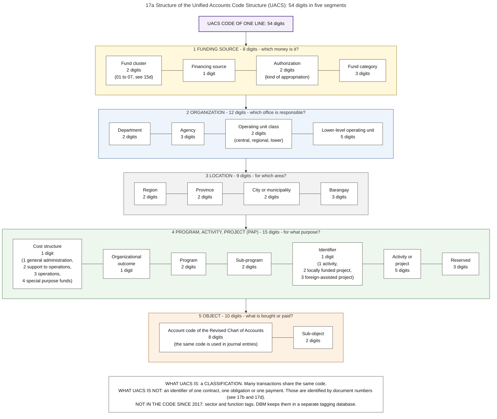
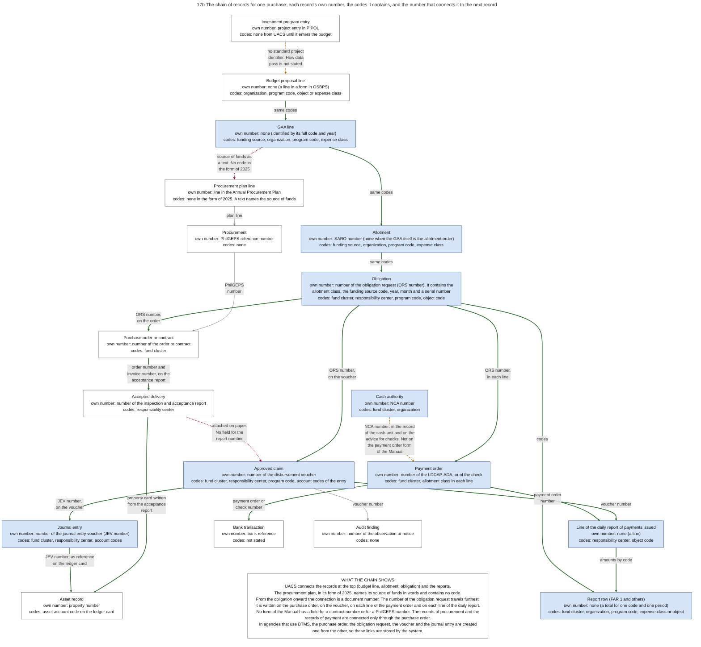
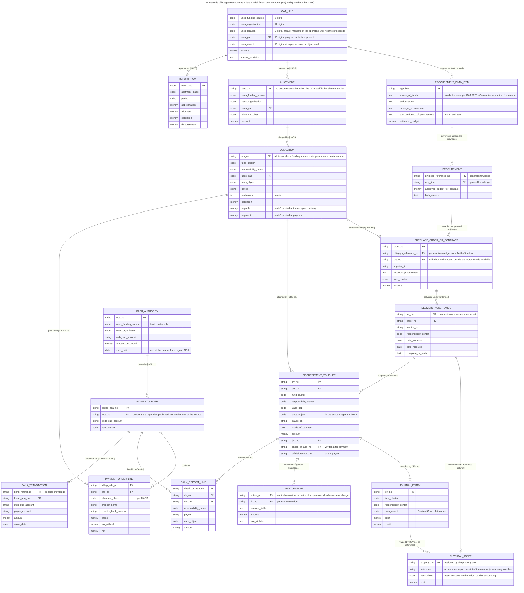
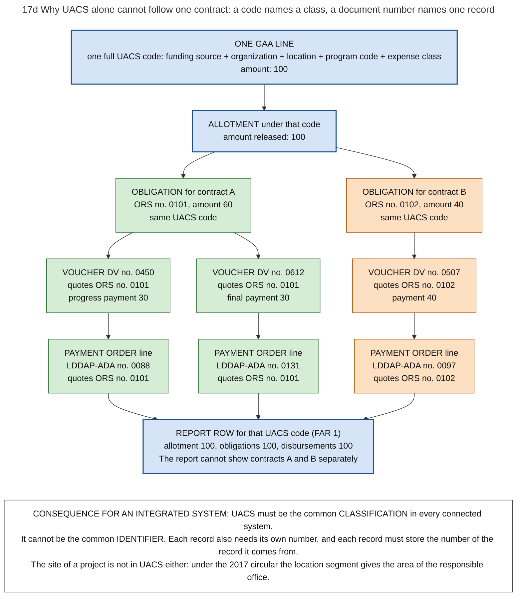

# 17. UACS and the identifiers of records

*Part of the Philippine PFM Atlas. Facts as of 8 October 2026. The codes in the column "Basis" are explained in [Reference F](../reference/F_sources_and_verification.md). "GK" means general knowledge that I did not open in a source during this work.*

## 1. The question this chapter answers

Is the Unified Accounts Code Structure (UACS) the key that connects all PFM records? What does a UACS code say about an amount, on which records does it appear, and which other numbers are needed to follow one transaction from the budget to the audit?

## 2. The idea in plain words

Two different questions can be asked about a record of public money.

The first question is: **to which group does this amount belong?** Which fund, which office, which program, which kind of expense? A **classification** answers it. A classification is a set of codes, and many records have the same code.

The second question is: **which single record is this, and from which earlier record does it come?** An **identifier** answers it. An identifier is a number that only one record has, for example the number of one obligation request.

UACS is a classification. It is the common classification of the budget, of the accounting books and of the reports of the national government [JC2017-1]. It is not an identifier.

A case where UACS is enough: "How much was allotted, obligated and paid under this program of this agency for capital outlays in 2026?" All records with the same code are summed. Report FAR 1 does this [JC2019-1].

A case where UACS is not enough: one budget line funds two contracts, A and B. Every record of A and every record of B has the same UACS code. The question which payments belong to contract B, and whether the work of B was accepted before each payment, cannot be answered from the code. The answer needs the chain of document numbers: the number of the obligation request, of the voucher and of the payment order [GAM-V2 App.11, App.32, App.42]. Diagram 17d shows this case with invented numbers.

The answer to the hypothesis "UACS is the key" therefore has two parts.

- **A common classification is one of two ways to make totals comparable.** The totals of two systems can be compared when both use the same classification, or when a documented table translates the codes of one into the codes of the other. The law chose the first way: "A common terminology and classification shall be used consistently throughout the budget, the accounts and the financial reports" [PD1445 s.115]. UACS is the classification that the present rules prescribe for this purpose [JC2017-1]. The second way exists in the rules too: when COA replaced the chart of accounts, it issued rules for the conversion from the old chart to the new one [GAM-V3 Ch.1].
- **A classification is not sufficient.** To follow one transaction, each record must also contain its own number and the number of the record from which it comes.

Terms. A **segment** is one of the five parts of a UACS code. An **element** is a part of a segment. **PAP** means program, activity or project. The **object code** says what is bought or paid. A **responsibility center** is a part of an agency whose head is responsible for a set of activities. In a database, a **key** is a field by which two records are joined: the **primary key** is the record's own number, and a **foreign key** is the number of another record that it quotes.

## 3. Authorities and their roles

| Authority | Role | Basis |
|---|---|---|
| The law | Requires one terminology and classification for the budget, the accounts and the reports. Requires that expenditures are recorded by agency, by program, project and activity, by object, by region or locality, by economic or functional class, and by obligational authority and cash transaction | PD1445 s.115, EO292-B6 s.53 |
| COA, DBM and DOF | Issued together the circular of 11 August 2017 that sets the present structure of UACS and the program classification | JC2017-1 |
| DBM | Decides which data are needed. Keeps the tags for sector and function in a separate tagging database since 2017. Will review and update UACS with the UACS technical working group in 2026 and 2027 | EO292-B6 s.53, JC2017-1, SFA6 |
| COA | Prescribes the chart of accounts. Issues the Revised Chart of Accounts, which is Volume III of the Government Accounting Manual and gives the first eight digits of the object code | PD1445 s.113, GAM-V3 Ch.1, Ch.2, COA2015-007 |
| Congress | Requires UACS account codes in the general provisions of the budget law | GAA2026-GP |
| National agencies, and corporations that receive budgetary support | Users of UACS | UACS-FAQ |
| Local governments | Not users of UACS | UACS-FAQ |
| Servicing banks | Were asked in 2013 to adjust their systems to UACS | CL2013-16A |

## 4. Structure of the code

Diagram 17a shows the structure. A full code has 54 digits in five segments.

| Segment | Digits | Elements, with the digits of each | Question that it answers | Basis |
|---|---|---|---|---|
| 1. Funding source | 8 | Fund cluster 2, financing source 1, authorization 2, fund category 3 | Which money is it? | JC2017-1 |
| 2. Organization | 12 | Department 2, agency 3, operating unit class 2, lower-level operating unit 5 | Which office is responsible? | JC2017-1 |
| 3. Location | 9 | Region 2, province 2, city or municipality 2, barangay 3 | For which area? | JC2017-1 |
| 4. Program, activity, project | 15 | Cost structure 1, organizational outcome 1, program 2, sub-program 2, identifier 1, activity or project 5, reserved 3 | For what purpose? | JC2017-1 |
| 5. Object | 10 | Account code of the Revised Chart of Accounts 8, sub-object 2 | What is bought or paid? | JC2017-1, GAM-V3 Ch.2 |

Details.

- **Fund cluster** (first two digits of segment 1): the seven groups 01 to 07 of chapter 15 [JC2017-1].
- **Cost structure** (first digit of segment 4): 1 general administration and support, 2 support to operations, 3 operations, 4 special purpose funds [JC2017-1].
- **Identifier** in segment 4: 1 activity, 2 locally funded project, 3 foreign-assisted project [JC2017-1].
- **Object code**: the chart of accounts lists each account with a code of eight digits, a sub-object code of two digits, and the object code, which is the first followed by the second. Example of the chart: the account Cash-Collecting Officers has the account code 10101010 and the object code 1010101000. The first digit of an account code says what the account is: 1 an asset, 2 a liability, 3 equity, 4 revenue, 5 an expense [GAM-V3 Ch.2]. The object code of the budget and the account code of the books are therefore one code by construction. This is the point where the budget classification and the accounting books meet.
- **Responsibility center code**: the Manual defines it as the organization code of UACS, 12 digits, followed by 3 digits for the major office inside the agency [GAM-V1 Ch.4 s.7]. Several forms carry it (section 5).
- **Not all digits on every document.** The website of UACS says that not all 54 digits are used on each document [UACS-FAQ].
- **Removed in 2017.** Codes for sector and for function are no longer part of the code. DBM keeps them as tags in a separate database [JC2017-1].

### A contradiction between two sources on the location segment

The circular of 2017 says in its section 5.2 that the location code is the area of mandate of the operating unit, whatever the expense class [JC2017-1]. The questions and answers on the UACS website give another rule: the location of the office for personnel and operating expenses, and the physical location of the item for capital outlays [UACS-FAQ]. The atlas follows the circular, because it is the later and the formal text. Under the rule of the circular, the location segment does not give the site of a project. Which rule agencies apply in practice should be asked of DBM.

## 5. On which records the codes appear

"App." is the number of the form in Volume II of the Manual.

| Record | UACS segments or codes that it contains | Basis |
|---|---|---|
| Budget proposal (forms in OSBPS) | Organization, the 15-digit program code, expense class or object | NBM156 |
| Line of the budget law | Funding source, organization, program code, expense class | GAA2026-GP |
| Allotment (SARO, or the law itself) | The codes of the budget line | NBC599. Layout of the SARO: GK |
| Procurement plan | None in the form that is mandatory since 21 September 2025. Its column "Source of Funds" holds words, for example "GAA 2026 - Current Appropriation". The form of 2015 began with a column "Code (PAP)", and its circular does not explain which code is meant | APP-FORM2025, APP-FORM |
| Purchase request, inspection and acceptance report | Responsibility center code | GAM-V2 App.60, App.62 |
| Obligation request | Fund cluster, responsibility center, program code (the field "MFO/PAP"), object code. Its serial number begins with the allotment class and the funding source code | GAM-V2 App.11 |
| Disbursement voucher | Fund cluster, responsibility center, program code, and the account codes of the accounting entry in Box B | GAM-V2 App.32 |
| Journal entry voucher | Fund cluster, responsibility center, object code of each line | GAM-V2 App.36 |
| Notice of Cash Allocation | Fund cluster and organization. It is issued for one MDS sub-account | GK. Sub-accounts: NBC599 |
| Payment order (LDDAP-ADA) | In the header: fund cluster, bank branch and MDS sub-account. In each line: allotment class per UACS. Not in a line: the object code | GAM-V2 App.42 |
| Advice to the bank for checks issued | Organization code, fund cluster, area code, NCA number. For each check: the object code | GAM-V2 App.39 |
| Daily report of checks issued or of payment orders issued, each line | Responsibility center code, object code | GAM-V2 App.13, App.35 |
| Daily report of collections and deposits, each line | Responsibility center code, program code, account code | GAM-V2 App.26 |
| Report FAR 1 and its parts | Fund cluster, organization, program code, expense class or object | JC2019-1 |
| Ledger card of an asset, kept by accounting | Object account code | GAM-V2 App.70 |
| Bank statement | Not stated in the sources that I read | Open question |
| Audit notice | None. It quotes document numbers | GK |

One difference between two sources: payment orders that agencies published show an NCA number in the header [LDDAP-FORM]. The form of the Manual has no such field [GAM-V2 App.42].

A consequence for the bank: for a payment order, the bank receives for each payee the name, the bank account, the number of the obligation request, the allotment class and the amounts. It does not receive the program code or the object code. A payment that is seen only in the records of the bank can therefore be assigned to an allotment class, and not to a program or an object, unless the records of the agency are used.

## 6. The chain of identifiers for one purchase

Diagram 17b shows the records and the link between each pair. The table lists the links in the same order. The column "Field?" says whether the later record has a field that holds a number or code of the earlier record. "Yes" means that I read the field on a form or in a rule.

| No. | From | To | What links them | Field? | Basis |
|---|---|---|---|---|---|
| 1 | Entry in the investment program (PIPOL) | Budget proposal line | No standard project identifier exists. How data pass between the two systems today is not stated in the sources that I read | Not stated | SFA1, ROADMAP2024 |
| 2 | Budget proposal line | Line of the budget law | The same codes | Yes | NBM156, GAA2026-GP |
| 3 | Line of the budget law | Allotment | The same codes | Yes | NBC599 |
| 4 | Line of the budget law | Line of the procurement plan | Words and an amount. The form of 2025 has a column for the source of funds, with entries such as "GAA 2026 - Current Appropriation", and a column for the estimated budget. It has no column for a budget code. The form of 2015 began with a column "Code (PAP)" | No field for a code in the form of 2025 | APP-FORM2025, APP-FORM |
| 5 | Line of the procurement plan | Procurement | The plan line. The rules allow no procurement that is not in accordance with the approved plan | Not read on a form | IRR12009 s.7.8. The reference itself: GK |
| 6 | Procurement | Purchase order or contract | PhilGEPS reference number. No form of the Manual has a field for it | Not on a form of the Manual | The number as a link: GK. The search of the forms: GAM-V2 |
| 7 | Allotment | Obligation | The same codes. The serial number of the obligation request begins with the allotment class and the funding source code | Yes | GAM-V2 App.11 |
| 8 | Obligation | Purchase order | The purchase order has fields for the number, the date and the amount of the obligation request, beside the certificate "Funds Available". The obligation request has no field for the number of the order or of a contract. It names them in the text field "Particulars" | Yes, in one direction | GAM-V2 App.61, App.11 |
| 9 | Purchase order | Accepted delivery | The acceptance report has fields for the number of the purchase order and for the number of the invoice | Yes | GAM-V2 App.62 |
| 10 | Obligation | Voucher | The voucher has a field for the number of the obligation request | Yes | GAM-V2 App.32 |
| 11 | Voucher | Audit finding | Voucher number | Not read on a form | GK |
| 12 | Accepted delivery | Voucher | The original acceptance report is attached to the voucher on paper. The voucher has no field for its number | No | GAM-V1 Ch.8 s.15, GAM-V2 App.32 |
| 13 | Voucher | Journal entry | The voucher has a field for the number of the journal entry voucher | Yes | GAM-V2 App.32 |
| 14 | Voucher | Payment order | After payment, the number of the check or payment order is written in Box E of the voucher. A line of the payment order has the number of the obligation request and not the number of the voucher. A line of the daily report has both numbers | Yes | GAM-V2 App.32, App.42, App.13 |
| 15 | Cash authority | Payment order | The record of the cash unit has a column for the number of the NCA, of the voucher or of the payroll. The advice to the bank for checks has a field for the NCA number. The form of the payment order in the Manual has none. Forms that agencies published have one | In part | GAM-V2 App.34, App.39, App.42, LDDAP-FORM |
| 16 | Payment order | Bank transaction | Number of the payment order or of the check. The bank returns a validated copy of the payment order | Yes for the order. GK for the reference of the bank | CL2013-16A, GAM-V1 Ch.6 s.56 |
| 17 | Accepted delivery | Asset record | The property unit writes the property card "based on the IAR", with a column for a reference. The ledger card of accounting names the journal entry voucher as its reference. The receipt that the user signs carries the property number | In part: a reference column, filled by a person | GAM-V2 App.69, App.70, App.71 |
| 18 | Obligation | Report row | Codes | Yes | JC2019-1 |
| 19 | Payment order | Report row | Amount paid, by code, through the line of the daily report | Yes | JC2019-1, GAM-V1 Ch.3 ss.16-17 |

Three records of the Manual are sorted in another way than by transaction, and they help to search.

| Record | Sorted by | What one sheet shows | Basis |
|---|---|---|---|
| Part C of the obligation request | Obligation | Obligation, payable and payment of one obligation, with a reference column for the number of the journal entry voucher, check, payment order or Tax Remittance Advice | GAM-V2 App.11 |
| Index of payments | Payee | Every payment to one payee, with the numbers of the voucher and of the check or payment order | GAM-V2 App.38 |
| Construction in progress ledger card | Project | For one project: its name, the contract period, the contractor with tax number, the project cost, and each entry with its voucher or journal entry voucher. This is the one form of Volume II that is kept for each project | GAM-V2 App.77 |

What the chain shows.

- UACS connects the records at the start (budget line, allotment, obligation) and the reports. From the obligation onward the connection is a document number.
- The procurement plan is outside this chain of codes. Its form of 2025 names the source of funds in words. A line of the plan can therefore be matched with a line of the budget law only by words and amounts. In a purchase, the first record that carries the program code and the object code is the obligation request (link 7).
- The number of the obligation request travels furthest. It is written on the purchase order, on the voucher, on each line of the payment order and on each line of the daily report.
- No form of the Manual has a field for a contract number or for a PhilGEPS number on the obligation request, on the voucher or on the payment order. The records of procurement and the records of payment are connected through the purchase order: it carries the number of the obligation request, and the acceptance report carries its number.
- Link 12 has no field at all. A person must read the attached paper to connect a payment with the acceptance of the delivery.
- For link 1 the sources state a gap and a plan, and not the present mechanism. The Roadmap of 2024 reports a working group of the planning department and DBM "on Linking the PIPOL System with the OSBPS" [ROADMAP2024]. The action plan of 2026 names as gaps "No standardized project ID system mechanism" and a lack of interoperability between the planning and the budgeting platforms [SFA1].

## 7. What BTMS changes in this chain

In BTMS, a record is created from the record before it. An obligation request can be created from an approved purchase order. A voucher is linked to an approved obligation request and is matched with the purchase order and the goods received note. The journal entry is created by the system from the voucher [BTMS-SITE]. In an agency that uses BTMS, links 8, 10, 12 and 13 are therefore stored by the system, and are no longer numbers copied by a person.

Two links stay outside. Link 1, between the investment program and the budget proposal, is between systems of two different departments. For link 17, the two public sources on BTMS do not say from which record an asset entry is created.

## 8. What UACS does not contain

| Not in the code | Where it is found instead | Basis |
|---|---|---|
| The single contract, obligation or payment | Document numbers | Sections 2 and 6 |
| The supplier or payee | Obligation request, voucher, payment order, index of payments | GAM-V2 App.11, App.32, App.42, App.38 |
| The site of a project | Text of the contract, or the own location records of the agency. The location segment gives the area of the responsible office | JC2017-1 s.5.2 |
| Sector and function | Tagging database of DBM | JC2017-1 |
| Local governments | They do not use UACS | UACS-FAQ |

## 9. The records as a data model

Diagram 17c draws the same records as tables with fields, with the record's own number (PK) and the quoted numbers (FK). It is a reading aid for the design of an integrated system. It is not the data model of BTMS or of any existing system. The fields of the obligation request, the purchase order, the acceptance report, the voucher, the journal entry voucher, the payment order, the daily report and the property records are read on the forms of the Manual [GAM-V2]. The fields of the line of the procurement plan follow its form of 2025 [APP-FORM2025]. The fields for the procurement in PhilGEPS, for the bank transaction and for the audit notice come from general knowledge and are marked so in the diagram.

## 10. Plans

| Plan | Time | Basis |
|---|---|---|
| Review and update of UACS by the UACS technical working group and DBM | 2026 to 2027 | SFA6 |
| Changes to the information systems that follow from the review | 2027 to 2028 | SFA6 |
| One PFM data model, a metadata registry and data governance | 2026 to 2028 | SFA6 |
| Measures "for the unique identification of project proposals to improve their traceability across planning and budgeting stages" | Roadmap period 2024 to 2028 | ROADMAP2024 |
| An integrated planning and budgeting tool for the Public Investment Program: design in 2026, pilot in 2026 and 2027, wider use from 2027 | 2026 to 2028 and later | SFA1 |

The gap that the first three plans address is stated in the action plan: classification codes are not consistent across PFM systems [SFA6].

## 11. What each mechanism makes possible, and what it cannot do

| Mechanism | What it makes possible | What it cannot do |
|---|---|---|
| The same UACS code in the budget, the books and the reports | Totals from different records can be compared | Separate two transactions that share a code |
| A documented table that translates the codes of one system into the codes of another | Totals can be compared although the two systems keep their own codes | Work when one code of the first system must be divided among several codes of the second, and no rule for the division exists |
| The same account code in the object segment and in the journal entry | Budget figures and accounting figures can be compared by object | Remove the differences in timing between an obligation and an expense (chapter 08) |
| A document number quoted on the next document | One transaction can be followed step by step | Work where the next document has no field for the number, or where a person copies the number wrongly |
| A record created from the earlier record inside one system | The link is stored by the system | Reach records in other systems without an interface and a common identifier |
| Tags kept outside the code | Totals by sector or function without a longer code | |

## 12. Diagrams

### Diagram 17a  Structure of the Unified Accounts Code Structure (UACS): 54 digits in five segments

Code file: `../diagrams/mermaid/17a_uacs_structure.mmd`. Rendered image: [`../rendered/17a_uacs_structure.png`](../rendered/17a_uacs_structure.png).

- **Question:** what does a full UACS code say about one line of money, and which part of the code answers which question?
- **Idea:** each segment answers one question about an amount. Which money is it (funding source)? Which office is responsible (organization)? For which area (location)? For what purpose (program, activity or project)? What is bought or paid (object)? The same code structure is used in the budget, in the accounting books and in the reports, so that amounts can be compared.
- **How to read it:** one frame = one segment, with its elements from left to right and the number of digits of each. 8 + 12 + 9 + 15 + 10 = 54 digits.
- **Sources:** segments, elements and digits, the cost structure codes, the identifier of activity or project, removal of sector and function codes to a separate tagging database, the location rule in section 5.2 [JC2017-1] (COA-DBM-DOF Joint Circular No. 1 of 11 August 2017). Not all 54 digits are used on every document, users are national agencies and corporations with budgetary support, local governments are not users, the older location rule [UACS-FAQ]. Object code = account code of the Revised Chart of Accounts [JC2017-1][COA2015-007]. UACS codes required by the GAA [GAA2026-GP]. Review of UACS in 2026 and 2027 [SFA6].
- **Conflict between sources on location:** the 2017 Joint Circular says the location code is the area of mandate of the operating unit, whatever the expense class. The FAQ on the UACS website gives an older rule: office location for personnel and operating expenses, physical location of the item for capital outlays. The diagram shows the 2017 rule.
- **General knowledge, not opened in a source here:** which body maintains each segment, and the standard geographic code used for the location segment.

### Diagram 17b  The chain of records for one purchase: each record's own number, the codes it contains, and the number that connects it to the next record

Code file: `../diagrams/mermaid/17b_identifier_chain.mmd`. Rendered image: [`../rendered/17b_identifier_chain.png`](../rendered/17b_identifier_chain.png).

- **Question:** to follow one purchase from the budget line to the payment, the asset and the audit, which number connects each record to the next one, on which form is that number written, and where is there no such number?
- **How to read it:** each box is one record. Line 1 = its name. Line 2 = its own number (this identifies ONE record). Line 3 = the codes it contains (these identify a GROUP of records). The text on each arrow is the number or code that connects two records.
- **Four kinds of arrow:** thick green = a field of a form or of a system holds the number, and I read this in a source. Thin grey = general knowledge, not read in a source here. Red dotted = no field for the number: the link exists only as an attached paper or as text. Orange dashed = the sources do not state how the two records are connected.
- **Fields:** the fields are read on the forms of the Manual [GAM-V2]. On the form of the purchase order the number of the obligation request is a field [GAM-V2 App.61]. Between the investment program and the budget proposal the sources state that there is no standard project identifier [SFA1].
- **Procurement plan:** the form of the plan that is mandatory since 21 September 2025 has no column for a budget code. Its column for the source of funds holds a text, for example the budget law of the year. I read the column labels and the guide through a tool, in two copies [APP-FORM2025][GPPB2025-05]. The form of 2015 had a column "Code (PAP)", which its circular does not explain [APP-FORM]. The arrow from the budget line to the plan line is therefore red dotted.
- **Sources:** UACS segments [JC2017-1]. Obligation request: serial number, fund cluster, responsibility center, particulars, MFO/PAP, object code [GAM-V2 App.11]. Purchase order with the number of the obligation request [GAM-V2 App.61]. Acceptance report with the numbers of the purchase order and of the invoice [GAM-V2 App.62]. Voucher with the numbers of the obligation request, of the check or payment order, of the official receipt and of the journal entry voucher [GAM-V2 App.32]. Journal entry voucher [GAM-V2 App.36]. Payment order: each line has the number of the obligation request and the allotment class [GAM-V2 App.42]. Daily report line: number of the check or payment order, of the voucher and of the obligation request, payee, object code [GAM-V2 App.13, App.35]. Record of the cash unit with the NCA [GAM-V2 App.34]. Advice of checks to the bank with the NCA number [GAM-V2 App.39]. NCA number on payment orders that agencies published [LDDAP-FORM]. Property card, recorded "based on the IAR", the ledger card of accounting with the journal entry voucher as reference, and the receipt of the user with the property number [GAM-V2 App.69, App.70, App.71]. Working group for the two planning systems and planned identification of project proposals [ROADMAP2024][SFA1]. Records created one from the other in BTMS [BTMS-SITE].
- **Searched and not found on the forms of the manual:** a field for a contract number on the obligation request, on the voucher or on the payment order. A field for a PhilGEPS number on any form. A field for the property number on the voucher or on the journal entry voucher [GAM-V2].
- **General knowledge, not opened in a source here:** the PhilGEPS reference number as the link from the procurement to the contract, the reference of the bank, and the numbers that an audit notice quotes.

### Diagram 17c  Records of budget execution as a data model: fields, own numbers (PK) and quoted numbers (FK)

Code file: `../diagrams/mermaid/17c_record_lineage_er.mmd`. Rendered image: [`../rendered/17c_record_lineage_er.png`](../rendered/17c_record_lineage_er.png).

- **Question:** if the records of 17b were tables in one database, which fields would each table have, and by which field would two tables be joined?
- **How to read it:** one box = one kind of record. PK = the record's own number. FK = the number of another record that it quotes. Fields that start with uacs_ are UACS segments. The text in square brackets on each line names the key that makes the link. "[attachment]" means that no coded key exists. "[general knowledge]" means that I did not read the field on a form.
- **Use:** this is a reading aid for designing an integrated system. It is NOT the data model of BTMS or of any existing system.
- LEFT COLUMN = the purchase and the physical work. MIDDLE = legal authority and accounting. RIGHT = cash.
- **Simplification:** a budget line is identified by its full code (all five segments) and the fiscal year. The diagram marks only the program code (uacs_pap) as its key, because the other records quote the program code.
- **Not drawn:** sub-allotment to operating units (same codes as the allotment), tax remittance, retention money, the index of payments (one sheet for each payee, with the numbers of the voucher and of the payment order [GAM-V2 App.38]).
- **Sources:** UACS segments and digits, location rule [JC2017-1]. The fields of the obligation request, of the purchase order, of the acceptance report, of the voucher, of the journal entry voucher, of the payment order, of the daily reports, of the property card and of the property ledger card are read on the forms of the Manual and in their instructions [GAM-V2 App.11, App.61, App.62, App.32, App.36, App.42, App.13, App.35, App.69, App.70]. The NCA number on payment orders that agencies published [LDDAP-FORM]. NCA validity [NBC599].
- **Procurement plan:** the fields follow the form that is mandatory since 21 September 2025: end-user unit, mode of procurement, start and end of the procurement activity, source of funds as a text, estimated budget. It has no column for a budget code [APP-FORM2025]. The form of 2015 had a column "Code (PAP)", which its circular does not explain [APP-FORM].
- **Searched and not found on the forms of the manual:** a field for a contract number on the obligation request, on the voucher or on the payment order. A field for a PhilGEPS number on any form. A field for the property number on the voucher or on the journal entry voucher [GAM-V2].
- **General knowledge, not opened in a source here:** the fields of PROCUREMENT, of BANK_TRANSACTION and of AUDIT_FINDING, and the layout of the NCA.

### Diagram 17d  Why UACS alone cannot follow one contract: a code names a class, a document number names one record

Code file: `../diagrams/mermaid/17d_uacs_class_not_instance.mmd`. Rendered image: [`../rendered/17d_uacs_class_not_instance.png`](../rendered/17d_uacs_class_not_instance.png).

- **Question:** is UACS the key that connects all PFM records? For which questions is it enough, and for which is it not?
- **Idea:** a UACS code names a group of records: all records with the same funding source, office, area, purpose and object. It does not name one record inside the group. Two contracts paid from the same budget line have exactly the same UACS code on every record. To separate them you need the numbers of the documents.
- **Example (invented, for illustration only):** one budget line funds two contracts. Every box in the same colour has the same UACS code. The records of contract A and of contract B differ only in their document numbers.
- **A question that UACS answers:** how much was allotted, obligated and paid under this program, by this office, for this expense class, in this year? All records with the same code are summed. This is what report FAR 1 does.
- **A question that UACS does not answer:** which payments belong to contract B, and was the work of contract B accepted before each payment? The code is the same for A and B. The answer needs the chain ORS number, voucher number, payment order number, and the contract number, which is not a coded field on the obligation request.
- **Sources:** UACS is a classification with segments for funding source, organization, location, program and object [JC2017-1]. The location code is the area of mandate of the operating unit, not the site of a project [JC2017-1 s.5.2]. Fields of the obligation request and of the payment order [GAM-V2 App.11, App.42]. NCA number on payment orders that agencies published [LDDAP-FORM]. FAR 1 by program and by object [JC2019-1]. Record links stored by the system in BTMS [BTMS-SITE].

## 13. Verification status

- **Verified in a source:** the five segments, their elements and digits, the cost structure codes, the identifier, the removal of sector and function codes, the location rule of section 5.2 [JC2017-1]. The legal requirement of one classification and the list of dimensions [PD1445 s.115][EO292-B6 s.53]. The object code as account code plus two digits, and the meaning of the first digit [GAM-V3 Ch.2]. The responsibility center code [GAM-V1 Ch.4 s.7]. The fields of the obligation request, purchase order, acceptance report, voucher, journal entry voucher, payment order, advice of checks, daily reports, index of payments and property records, read on the forms of the Manual and in their instructions [GAM-V2]. The statements of the UACS website on users, on the use of the digits and on location [UACS-FAQ]. The columns of the form of the procurement plan of 2025, read through a tool in a text that was garbled in parts, and the first column of the form of 2015 [APP-FORM2025][APP-FORM]. The reports by code [JC2019-1]. The links stored by BTMS [BTMS-SITE]. The plans [SFA6][SFA1][ROADMAP2024].
- **Limit:** the forms are those of the Manual of 2015. An agency may use a later or an own version of a form. The NCA number on the payment order is an example.
- **General knowledge, to check:** the PhilGEPS reference number as the link from the procurement to the contract, the numbers that an audit notice quotes, the layout of the SARO and of the NCA, the reference of the bank.
- **Open:** which location rule agencies apply. How data pass today from the investment program to the budget proposal. Whether the printed form of the procurement plan of 2025 agrees with the columns that the tool returned, and what agencies write in its column for the source of funds.
- **Invented for illustration:** all numbers and amounts in diagram 17d.
