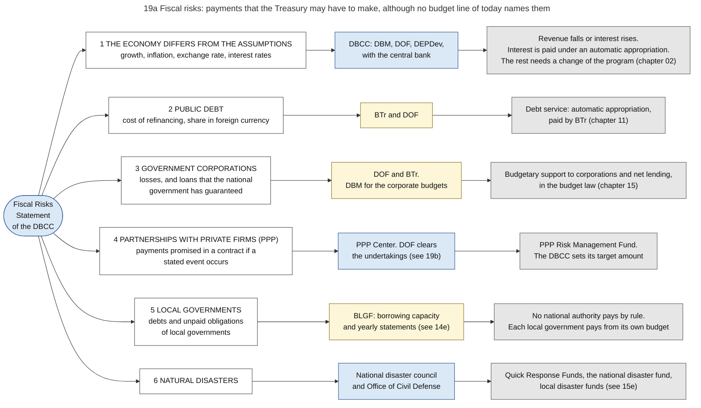
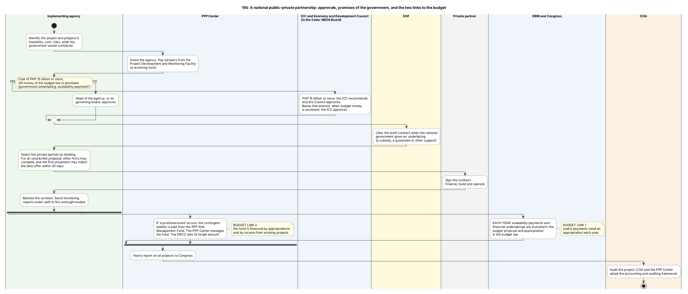
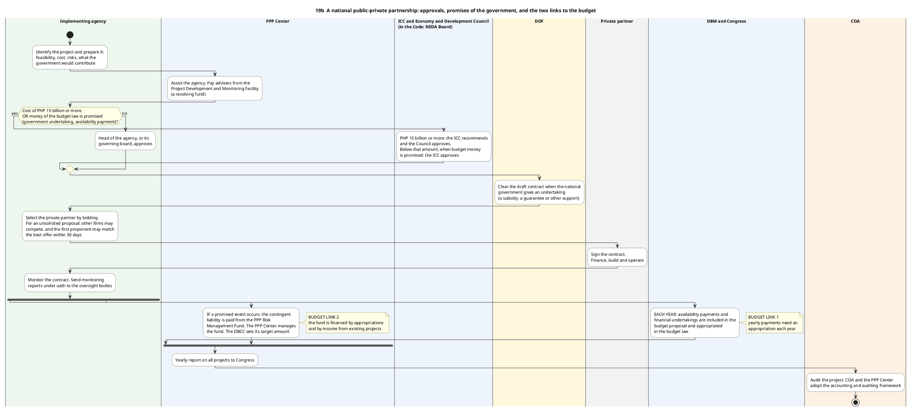

# 19. Fiscal risks, public-private partnerships and contingent liabilities

*Part of the Philippine PFM Atlas. Facts as of 8 October 2026. The codes in the column "Basis" are explained in [Reference F](../reference/F_sources_and_verification.md). "GK" means general knowledge that I did not open in a source during this work.*

## 1. The question this process answers

The budget law lists the spending that is decided for one year. Which payments may become necessary although no budget line of today names them, who monitors each source of such payments, and from which authority would they be paid?

## 2. The idea in plain words

A **fiscal risk** is an event that would make revenue, spending or debt differ from the plan. Some risks are general, for example slower growth of the economy. Others come from promises that the government has already made.

A **contingent liability** is such a promise: the government will pay IF a stated event occurs. Example: the national government guarantees a loan of a government corporation. If the corporation repays the loan, the government pays nothing. If the corporation cannot repay, the government must pay the lender.

The difficulty for the budget process is the date. On the day of the promise no money leaves the Treasury, so no appropriation, no obligation and no payment is recorded. The promise does not appear in any record of chapters 05 to 08. It appears only in two places: in a statement of risks, and later, if the event occurs, as a payment for which an authority must then exist.

The accounting rules say the same for the books. The Manual defines a contingent liability as "A possible obligation that arises from past events, and whose existence will be confirmed only by the occurrence or non-occurrence of one or more uncertain future events not wholly within the control of the entity", or a present obligation for which a payment is not probable or cannot be measured [GAM-V1 Ch.18 s.2]. Its rule is: "An entity shall not recognize a contingent liability. However, it is disclosed unless the possibility of an outflow of resources" is remote [GAM-V1 Ch.18 s.3]. A guarantee that is not yet called is therefore named in the notes to the financial statements and is not a liability in the statement of financial position. It becomes a recorded liability, called a provision, when a payment is probable and the amount can be estimated [GAM-V1 Ch.18 s.3].

The law has one authority ready for the day on which a guarantee is called: "national government guarantees of obligations which are drawn upon" are among the automatic appropriations [EO292-B6 s.26].

A **public-private partnership** (PPP) produces both kinds of future payment. A private firm pays for the construction of a road or a hospital and operates it. The government pays later in instalments, or promises support under stated conditions. The decision is made once, at the signing of the contract, and it binds the budgets of many later years.

For such a contract the Manual has a rule that differs from the rule for a guarantee. The government body that grants the concession records the asset that the private operator builds, when it "controls or regulates what services the operator must provide with the asset, to whom it must provide them, and at what price" and controls the remaining interest in the asset at the end of the term [GAM-V1 Ch.14 s.3]. With the asset it records a liability of the same amount: a financial liability when the government must pay the operator, or the grant of a right when the operator earns from the users [GAM-V1 Ch.14 s.5]. A partnership of this kind is therefore in the books from the start, and a guarantee is not.

A case where the control works: before a partnership contract is signed, a body above the agency approves the project, and the Department of Finance clears each promise of the national government. The yearly payments are then included in each budget proposal, and a fund exists for the promises that become due.

A case where it fails: a promise is given outside these procedures, for example a guarantee in the charter of a corporation or a letter of support, and nobody records it. It appears for the first time when the creditor asks for payment. The budget of that year has no line for it.

Terms. An **availability payment** is a regular payment by the government to the private partner for keeping the facility available, whether or not the public uses it. A **government undertaking** is any contribution or support that the government gives to the private partner, for example a subsidy or a guarantee. **Viability gap funding** is a subsidy that makes a project financially possible for the private partner when the income from users is too low. **Net lending** is the amount that the national government lends to government corporations, less repayments.

## 3. Authorities and their roles

| Authority | Role in this process | Basis |
|---|---|---|
| DBCC | Issues the Fiscal Risks Statement. Sets the target amount of the PPP Risk Management Fund | FRS2023, RA11966 s.27 |
| DOF | Clears the draft contract of a partnership when the national government gives an undertaking. Vice-chair of the PPP Governing Board. Source of the table of the consolidated public sector position | RA11966 s.8, s.25, BESF2026-A3 |
| BTr | Manages the debt of the national government and pays its debt service. Releases budgetary support to corporations. Leads the financial instruments against disaster risk | EO449, NBC599, ROADMAP2024. Decisions on guarantees: GK |
| Agencies and government corporations | State their contingent liabilities, including guarantees, in their budget estimates. Corporations report periodically to the Secretary of Finance and the Secretary of Budget and Management on the obligations that the government has guaranteed | EO292-B6 s.14, s.30 |
| DBM | Member of the DBCC, of the PPP Governing Board and of the committee of the project development facility. Puts yearly payments for partnerships into the proposed budget | DBCC-PAGE, RA11966 s.25, s.26. Budget step: Inference from RA11966 s.7 |
| Investment Coordination Committee and the Economy and Development Council (in the Code: NEDA Board) | Approve national partnership projects of PHP 15 billion or more. The committee also approves smaller projects that need money of the budget law | RA11966 s.7. Present name of the board: AO37 |
| Implementing agency | Prepares, procures and monitors the partnership. Its head approves projects below the threshold that need no money of the budget law | RA11966 s.7, s.16 |
| PPP Center | Assists agencies, reviews contracts, monitors projects, keeps all project documents. Manages the Project Development and Monitoring Facility and the PPP Risk Management Fund. Reports each year to Congress | RA11966 ss.16, 24, 26, 27 |
| PPP Governing Board | "the overall policy-making body for all PPP-related matters". Chair: head of the planning department. Vice-chair: Secretary of Finance | RA11966 s.25 |
| Sanggunian and local development council | Approve and confirm local partnership projects | RA11966 s.7 |
| COA | Audits partnership projects. Adopts the accounting and auditing framework together with the PPP Center. On the direction of the President it may examine a body outside the government whose loans the government guarantees, and then only for the contingent liability of the government | RA11966 s.31, PD1445 s.29 |
| BLGF | Certifies the borrowing capacity of local governments (chapter 14) | DOF-LGULOAN |
| National disaster council and Office of Civil Defense | Recommend the use of the national disaster fund (chapter 15) | GAA2026-NDRRMF |

## 4. Sources of fiscal risk and the authority that would pay

The rows follow the chapters of the Fiscal Risks Statement [FRS2023]. Diagram 19a shows the same content.

| No. | Source of risk | Who monitors it | If the event occurs, the payment comes from | Basis |
|---|---|---|---|---|
| 1 | The economy differs from the assumptions: growth, inflation, exchange rate, interest rates | DBCC | No separate authority. Revenue falls or interest rises. The fiscal program must be changed (chapter 02) | FRS2023, DBCC-PAGE. Consequence: Inference |
| 2 | Public debt: cost of refinancing, share in foreign currency | BTr and DOF | Debt service, an automatic appropriation paid by BTr (chapter 11) | FRS2023, NBC599 |
| 3 | Government corporations: losses, and loans guaranteed by the national government | DOF and BTr. DBM for the corporate budgets. The corporations report on guaranteed obligations to DOF and DBM | Budgetary support to corporations and net lending, in the budget law (chapter 15). A guarantee that is called: an automatic appropriation | FRS2023, NBC599, BESF2026-A3, EO292-B6 s.26, s.30. Who decides on guarantees: GK |
| 4 | Partnerships with private firms: payments promised under conditions | PPP Center. DOF clears the undertakings | PPP Risk Management Fund | FRS2023, RA11966 s.8, s.27 |
| 5 | Local governments: their debts and unpaid obligations | BLGF | Each local government, from its own budget. No national authority pays by rule | FRS2023, DOF-LGULOAN. Last statement: GK |
| 6 | Natural disasters | National disaster council and Office of Civil Defense | Quick Response Funds, the national disaster fund, local disaster funds (chapter 15, diagram 15e) | FRS2023, GAA2026-NDRRMF |

The statement of 2023 also discusses the pensions of military and uniformed personnel [FRS2023]. My copy of the statement ended before the detailed sections on corporations, partnerships and local governments, so this atlas gives no amounts for them.

## 5. Steps of a national partnership project

The steps follow diagram 19b. All are from the Public-Private Partnership Code of 2023 [RA11966].

| No. | Step | Who acts | Document or record | Section |
|---|---|---|---|---|
| 1 | Identify and prepare the project: feasibility, cost, risks, contribution of the government | Implementing agency | Project documents | s.7 |
| 2 | Assist the agency and pay advisers | PPP Center, from the Project Development and Monitoring Facility (a revolving fund) | Application to the facility | ss.24, 26 |
| 3 | Approve the project. PHP 15 billion or more: the Council, on the recommendation of the Investment Coordination Committee. Below that amount: the head of the agency or its governing board. Below that amount, when a government undertaking or an availability payment is paid from the budget law: the Investment Coordination Committee | As stated | Approval | s.7 |
| 4 | Clear the draft contract when the national government gives an undertaking | DOF | Clearance | s.8 |
| 5 | Select the private partner. For an unsolicited proposal, other firms may compete and the first proponent may match the best offer within 30 days | Implementing agency | Bids, award | s.10 |
| 6 | Sign the contract. Finance, build, operate | Private partner | Partnership contract | |
| 7 | Monitor the contract and report under oath | Implementing agency | Monitoring reports. Contract management plan sent to the PPP Center | ss.15, 16 |
| 8 | Each year: put the availability payments and the financial undertakings into the budget. They must be "sourced and funded under the General Appropriations Act" | Agency, DBM, Congress | Budget proposal, budget law | s.7 |
| 9 | If a promised event occurs: pay the contingent liability from the PPP Risk Management Fund | PPP Center | Payment from the fund | s.27 |
| 10 | Report on all projects each year to Congress | PPP Center | Yearly report | ss.16, 33 |
| 11 | Audit | COA | Audit report | s.31 |

Local projects follow a shorter path: the sanggunian approves after the local development council confirms. A project that uses national funds needs the endorsement of the Regional Development Council, and the Investment Coordination Committee decides on government undertakings for local projects within 60 days [RA11966 s.7].

A press report of October 2025 says that the review threshold of the Investment Coordination Committee for projects paid from the national budget was raised to PHP 5 billion and that its review now covers partnerships [ICC-NEWS]. I did not check how this decision relates to the amount of PHP 15 billion in the Code.

## 6. The two links between a partnership and the budget

| Link | What it is | Where it appears in the records of the earlier chapters |
|---|---|---|
| Yearly payments | Availability payments and financial undertakings that the contract fixes for each year | In the budget proposal and the budget law of each year, as an appropriation of the agency. Then as allotment, obligation and payment like any other spending (chapters 03 to 07) |
| Promises under conditions | Guarantees and other contingent liabilities | In no record of the budget until the event occurs. Then as a payment from the PPP Risk Management Fund, which is financed by appropriations, by income from existing partnership projects and by other sources that the DBCC names |

Basis: RA11966 s.7 and s.27. The second column of the first row is my reading of the Code together with chapters 03 to 07 (Inference).

A partnership contract lasts many years, like the contracts of diagram 06f. The Code does not state rules for multi-year commitments. The Multi-Year Contractual Authority of chapter 06 applies to procurement under the procurement law. Whether a similar authority is required for the yearly payments of a partnership is not stated in the sources I read.

## 7. Documents and identifiers

| Document | Made by | Identified by | Basis |
|---|---|---|---|
| Fiscal Risks Statement | DBCC | Year | FRS2023 |
| Consolidated Public Sector Financial Position (a table in the budget documents) | DOF | Years covered | BESF2026-A3 |
| Partnership contract | Implementing agency and private partner | Not described | RA11966 |
| Clearance of an undertaking | DOF | Not described | RA11966 s.8 |
| Monitoring report under oath | Implementing agency | Not described | RA11966 s.16 |
| Yearly report on partnerships | PPP Center | Year | RA11966 s.16 |

No source that I read names a register of all guarantees and other contingent liabilities with one identifier for each. The PPP Center is the central repository for partnership documents [RA11966 s.24]. For the other sources of risk the records are with the office named in section 4.

## 8. Information systems

No source that I read names an information system for contingent liabilities or for fiscal risks. In the accounts, a contingent liability exists only as text in the notes to the financial statements of the body that gave the promise [GAM-V1 Ch.18 s.3]. The debt systems of BTr are named in chapter 11 without detail. The PPP Center keeps the project documents [RA11966 s.24]. Executive Order No. 126 of 2026 extends the public COMPASS portal to programs that are funded or implemented through partnerships, as far as they use public funds [EO126].

## 9. Controls: what each one checks, and what it does not check

| Control | What it checks | What it does not check |
|---|---|---|
| Approval above the agency for large projects and for projects that need budget money | That one agency alone cannot bind future budgets for a large amount | Projects below the threshold that need no budget money |
| Clearance by DOF | Each undertaking of the national government in the draft contract | Promises given outside a partnership contract |
| Yearly appropriation of availability payments and undertakings | That the payment of each year has legal authority | That Congress will appropriate the amount in a later year |
| PPP Risk Management Fund | That money exists when a promised event occurs | Whether the fund is large enough. The DBCC sets a target amount |
| Disclosure in the notes to the financial statements | That each body names its contingent liabilities, unless a payment is remote | That anyone adds the notes of all bodies into one total |
| Fiscal Risks Statement | That the risks are named and published | That the statement is complete and current. The latest statement that I found is that of 2023 |
| Audit by COA | The transactions of each project | |

Basis of the rows: RA11966 ss.7, 8, 27, 31, FRS2023, GAM-V1 Ch.18 s.3. The third column is my reading.

## 10. Timing

| Time | Event | Basis |
|---|---|---|
| Before the contract | Approval, clearance by DOF | RA11966 ss.7, 8 |
| 30 days | Period in which the first proponent of an unsolicited proposal may match the best offer | RA11966 s.10 |
| 60 days | Decision of the Investment Coordination Committee on undertakings for a local project | RA11966 s.7 |
| Each year of the contract | Appropriation of the payments of that year | RA11966 s.7 |
| End of each year | Report of the PPP Center to Congress | RA11966 s.16 |
| Published statements on the DBM site | Fiscal Risks Statements of 2015-2016, 2018, 2019, 2020, 2021 and 2023 | FRS2023 |

## 11. Where the totals appear

The table of the Department of Finance in the budget documents adds the national government, the monitored non-financial government corporations, the social security institutions, the central bank, the government financial institutions and the local governments into one balance of the public sector. For 2024 the consolidated public sector deficit was PHP 820.6 billion, or 3.1 percent of gross domestic product (the yearly output of the economy), against a deficit of the national government alone of PHP 1,506.4 billion [BESF2026-A3]. The table shows balances of one year. It does not show promises that may become due later. Diagram 08d shows who produces this table and the other national totals.

## 12. Diagrams

### Diagram 19a  Fiscal risks: payments that the Treasury may have to make, although no budget line of today names them

Code file: `../diagrams/mermaid/19a_fiscal_risks_map.mmd`. Rendered image: [`../rendered/19a_fiscal_risks_map.png`](../rendered/19a_fiscal_risks_map.png).

- **Question:** the budget law lists the spending that is decided. Which possible payments are not decided, where could they come from, who monitors each source, and from which authority would a payment be made if the event occurs?
- **Idea:** a fiscal risk is an event that would change revenue, spending or debt compared with the plan. One group of risks are contingent liabilities: the government has promised to pay IF a stated event occurs (for example, if a corporation cannot repay a guaranteed loan). Such a promise costs nothing on the day it is made, so it does not appear as spending. It appears only in a risk statement, until the event occurs.
- **How to read it:** each row is one source of risk, in the order of the chapters of the Fiscal Risks Statement. Column 2 = the office that monitors it. Column 3 (grey) = the authority from which a payment would be made if the event occurs.
- **Sources:** the Fiscal Risks Statement is issued by the DBCC. Its chapters cover macroeconomic assumptions, fiscal performance, public debt, the financial sector, and "Other Contingent Central Government Obligations": government corporations, public-private partnerships and other contingent liabilities, local governments, natural disasters [FRS2023]. Members of the DBCC [DBCC-PAGE][AO37]. Interest and net lending as automatic appropriations, budgetary support to corporations, the Contingent Fund and the disaster fund as items released by SARO [NBC599]. The PPP Risk Management Fund pays contingent liabilities from partnerships; the PPP Center manages it and the DBCC sets its target amount [RA11966 s.27]. Disaster funds, see 15e [GAA2026-NDRRMF]. BLGF certifies the borrowing capacity of local governments [DOF-LGULOAN]. Rows of the consolidated public sector position [BESF2026-A3].
- **In the accounts and in the law:** a contingent liability is disclosed in the notes and is not recorded as a liability [GAM-V1 Ch.18 s.3]. A guarantee of the national government that is called is paid from an automatic appropriation, and corporations report their guaranteed obligations to DOF and DBM [EO292-B6 s.26, s.30]. An asset built by a private operator under a concession is recorded by the government body that granted it, with a liability of the same amount [GAM-V1 Ch.14 s.3, s.5].
- **General knowledge, not opened in a source here:** that DOF and BTr decide on guarantees for the loans of corporations; that the Governance Commission for GOCCs monitors the performance of corporations; unprogrammed appropriations as a source of payment; the statement in row 5 that no national authority pays the debts of a local government by rule. The latest Fiscal Risks Statement that I could open is that of 2023, and its last chapter was cut in my copy.
- **Not covered by the assessment pages I read:** indicator 10 (fiscal risk reporting) of the 2025 assessment [PEFA2025].

### Diagram 19b  A national public-private partnership: approvals, promises of the government, and the two links to the budget (PlantUML)

Code file: `../diagrams/plantuml/19b_ppp_project_swimlane.puml`. Rendered image: [`../rendered/19b_ppp_project_swimlane.png`](../rendered/19b_ppp_project_swimlane.png).

- **Question:** in a public-private partnership a private firm pays for the construction and the government pays later, or promises to pay if a stated event occurs. Which bodies approve such a project, and at which points does it enter the budget?
- **Idea:** a partnership moves payments into later years and adds promises that depend on events. The controls are therefore placed before the contract is signed: approval by a body above the agency when the cost is high or when money of the budget is promised, and clearance of each promise by the Department of Finance. After signing, two budget links remain: yearly payments that need an appropriation each year, and a fund for the promises that become due.
- **How to read it:** one column (lane) = one actor. A diamond = a decision. The notes on the right name the two points where the project enters the budget.
- **Why PlantUML:** the path crosses seven actors, and lanes show which actor decides at each step.
- **Sources:** all steps are from the Public-Private Partnership Code of 2023 [RA11966]: approval thresholds and exceptions (section 7), clearance by DOF of the draft contract when the national government gives an undertaking (section 8), unsolicited proposals and the right to match within 30 days (section 10), monitoring reports under oath and the yearly report of the PPP Center to Congress (section 16), PPP Center and PPP Governing Board (sections 24 and 25), Project Development and Monitoring Facility (section 26), PPP Risk Management Fund (section 27), audit and the accounting framework (section 31).
- **Names:** the Code names the "NEDA Board" and its Investment Coordination Committee (ICC). A law of 2025 replaced the NEDA Board by the Economy and Development Council [AO37]. The diagram uses the present name and adds the name of the Code.
- **Not opened:** the implementing rules of the Code. A press report of October 2025 says that the ICC review threshold for projects paid from the national budget was raised to PHP 5 billion and that the review now covers partnerships [ICC-NEWS]. I did not check how that threshold relates to the PHP 15 billion of the Code.

PlantUML code

## 13. Verification status

- **Verified in a source:** the accounting rules on contingent liabilities, provisions and service concession arrangements [GAM-V1 Ch.14, Ch.18]. The automatic appropriation for guarantees that are called, and the duties to report contingent liabilities, read through summaries with quotations [EO292-B6 s.14, s.26, s.30]. The authority of COA over bodies with guaranteed loans [PD1445 s.29]. The steps, thresholds, bodies and funds of the Public-Private Partnership Code [RA11966], read through a tool that returns a summary with short quotations. The issuer and the chapters of the Fiscal Risks Statement [FRS2023]. The rows and the 2024 figures of the consolidated public sector position [BESF2026-A3]. Automatic appropriations and items released by special order [NBC599].
- **General knowledge, to check:** who decides on guarantees for the loans of corporations, and the statement that no national authority pays the debts of a local government by rule.
- **Inference:** the budget treatment of the yearly payments of a partnership, and the third column of the table of controls.
- **Not opened:** the implementing rules of the Code, the laws on government guarantees and on foreign borrowing, the detailed sections of the Fiscal Risks Statement on corporations, partnerships and local governments, any Fiscal Risks Statement later than 2023, and the pages of the 2025 assessment on fiscal risk reporting (indicator 10).
- **Covered only briefly or not at all:** amounts of guarantees and of contingent liabilities, the pension obligations of the government, the risks of the financial sector, insurance of public assets, and joint ventures of government corporations.
